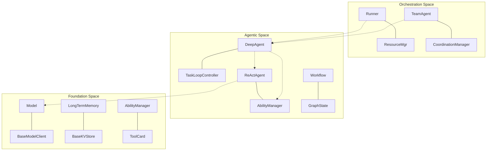
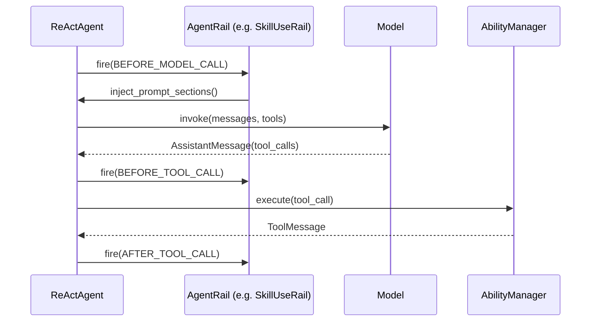

<!-- source: DeepWiki mcp.deepwiki.com · repo openJiuwen-ai/agent-core · page 1.2 Architecture Overview · fetched 2026-11-02 -->

# Architecture Overview

Relevant source files

The following files were used as context for generating this wiki page:

- [.gitignore](.gitignore)
- [Makefile](Makefile)
- [openjiuwen/core/common/exception/codes.py](openjiuwen/core/common/exception/codes.py)
- [openjiuwen/core/foundation/tool/mcp/client/openapi_client.py](openjiuwen/core/foundation/tool/mcp/client/openapi_client.py)
- [openjiuwen/core/memory/common/base.py](openjiuwen/core/memory/common/base.py)
- [openjiuwen/core/retrieval/__init__.py](openjiuwen/core/retrieval/__init__.py)
- [openjiuwen/core/runner/resources_manager/resource_manager.py](openjiuwen/core/runner/resources_manager/resource_manager.py)
- [openjiuwen/core/runner/resources_manager/tool_manager.py](openjiuwen/core/runner/resources_manager/tool_manager.py)
- [openjiuwen/core/single_agent/__init__.py](openjiuwen/core/single_agent/__init__.py)
- [openjiuwen/core/single_agent/ability_manager.py](openjiuwen/core/single_agent/ability_manager.py)
- [openjiuwen/core/single_agent/agent_callback_manager.py](openjiuwen/core/single_agent/agent_callback_manager.py)
- [openjiuwen/core/single_agent/agents/react_agent.py](openjiuwen/core/single_agent/agents/react_agent.py)
- [openjiuwen/core/single_agent/base.py](openjiuwen/core/single_agent/base.py)
- [openjiuwen/core/single_agent/rail/__init__.py](openjiuwen/core/single_agent/rail/__init__.py)
- [openjiuwen/core/single_agent/rail/base.py](openjiuwen/core/single_agent/rail/base.py)
- [openjiuwen/harness/deep_agent.py](openjiuwen/harness/deep_agent.py)
- [openjiuwen/harness/factory.py](openjiuwen/harness/factory.py)
- [openjiuwen/harness/prompts/sections/skills.py](openjiuwen/harness/prompts/sections/skills.py)
- [openjiuwen/harness/rails/skills/skill_use_rail.py](openjiuwen/harness/rails/skills/skill_use_rail.py)
- [openjiuwen/harness/rails/subagent/verification_rail.py](openjiuwen/harness/rails/subagent/verification_rail.py)
- [openjiuwen/harness/rails/sys_operation_rail.py](openjiuwen/harness/rails/sys_operation_rail.py)
- [openjiuwen/harness/schema/config.py](openjiuwen/harness/schema/config.py)
- [openjiuwen/harness/tools/worktree/rails.py](openjiuwen/harness/tools/worktree/rails.py)
- [openjiuwen/symphony/README.md](openjiuwen/symphony/README.md)
- [openjiuwen/symphony/__init__.py](openjiuwen/symphony/__init__.py)
- [openjiuwen/symphony/interfaces/__init__.py](openjiuwen/symphony/interfaces/__init__.py)
- [openjiuwen/symphony/orchestration/__init__.py](openjiuwen/symphony/orchestration/__init__.py)
- [openjiuwen/symphony/orchestration/artifacts.py](openjiuwen/symphony/orchestration/artifacts.py)
- [openjiuwen/symphony/orchestration/graph/__init__.py](openjiuwen/symphony/orchestration/graph/__init__.py)
- [openjiuwen/symphony/orchestration/graph/matcher/__init__.py](openjiuwen/symphony/orchestration/graph/matcher/__init__.py)
- [openjiuwen/symphony/orchestration/graph/matcher/cache.py](openjiuwen/symphony/orchestration/graph/matcher/cache.py)
- [openjiuwen/symphony/orchestration/service.py](openjiuwen/symphony/orchestration/service.py)
- [openjiuwen/symphony/runtime.py](openjiuwen/symphony/runtime.py)
- [pyproject.toml](pyproject.toml)
- [tests/system_tests/rail/test_force_finish_rail.py](tests/system_tests/rail/test_force_finish_rail.py)
- [tests/system_tests/runner/test_runner.py](tests/system_tests/runner/test_runner.py)
- [tests/system_tests/tune/test_prompt_tune.py](tests/system_tests/tune/test_prompt_tune.py)
- [tests/system_tests/workflow/test_real_workflow.py](tests/system_tests/workflow/test_real_workflow.py)
- [tests/test_logger.py](tests/test_logger.py)
- [tests/unit_tests/agent/react_agent/test_new_react_agent_mock.py](tests/unit_tests/agent/react_agent/test_new_react_agent_mock.py)
- [tests/unit_tests/agent_teams/observability/test_team_observability_mock_llm.py](tests/unit_tests/agent_teams/observability/test_team_observability_mock_llm.py)
- [tests/unit_tests/core/context_engine/conftest.py](tests/unit_tests/core/context_engine/conftest.py)
- [tests/unit_tests/core/single_agent/rail/test_rail.py](tests/unit_tests/core/single_agent/rail/test_rail.py)
- [tests/unit_tests/core/single_agent/rail/test_rail_init_timing.py](tests/unit_tests/core/single_agent/rail/test_rail_init_timing.py)
- [tests/unit_tests/harness/test_deep_agent.py](tests/unit_tests/harness/test_deep_agent.py)
- [tests/unit_tests/harness/test_filesystem_rail.py](tests/unit_tests/harness/test_filesystem_rail.py)
- [tests/unit_tests/harness/test_skill_rail.py](tests/unit_tests/harness/test_skill_rail.py)
- [tests/unit_tests/symphony/test_models.py](tests/unit_tests/symphony/test_models.py)
- [uv.lock](uv.lock)

The openjiuwen `agent-core` SDK is a modular framework for building, orchestrating, and evolving LLM-powered agents. It bridges the gap between high-level natural language reasoning and low-level code execution through a layered architecture that supports single-agent workflows, complex multi-agent teams, and autonomous self-evolution.

## System Architecture

The architecture is divided into three primary layers: the **Foundation Layer** (LLM, Tools, Memory, Storage), the **Agentic Layer** (ReAct, DeepAgent, Workflow Engine), and the **Orchestration Layer** (Agent Teams, Evolving, Runner).

### High-Level Component Map

The following diagram illustrates the interconnection between major subsystems and their corresponding code entities.

**Diagram: System Entity Mapping**

Sources: [openjiuwen/core/runner/resources_manager/resource_manager.py:68-80](), [openjiuwen/harness/deep_agent.py:208-220](), [openjiuwen/core/single_agent/ability_manager.py:87-101]().

---

## Major Subsystems

### 1. Runner and Resource Management
The `Runner` acts as the entry point for the SDK, managing the lifecycle of agents and workflows. It relies on the `ResourceMgr` to handle the registration and retrieval of models, tools, prompts, and agents.
*   **ResourceMgr**: Central registry for all system entities. It supports tag-based isolation, allowing different sessions to access specific subsets of tools or agents [openjiuwen/core/runner/resources_manager/resource_manager.py:68-104]().
*   **Resource Dispatch**: Uses `_dispatch_add` and `_dispatch_get` to route registration requests to specialized registries like `ResourceRegistry` [openjiuwen/core/runner/resources_manager/resource_manager.py:82-104]().
*   **Tag Management**: `TagMgr` enables resource filtering and scoping, ensuring security and organizational boundaries [openjiuwen/core/runner/resources_manager/resource_manager.py:75-75]().

### 2. Agents (ReAct & DeepAgent)
Agents are the core reasoning units.
*   **ReActAgent**: Implements the "Reason + Act" pattern, managing an iterative loop of thought and tool invocation via `AbilityManager` [openjiuwen/core/single_agent/agents/react_agent.py:193-205]().
*   **DeepAgent**: A high-level wrapper around `ReActAgent` that introduces a "Harness" for advanced features like task loops, rails, and workspace management [openjiuwen/harness/deep_agent.py:208-220]().
*   **Harness Rails**: Interceptors (e.g., `DeepAgentRail`, `TaskCompletionRail`, `SkillUseRail`) that hook into the agent's lifecycle via the `AgentCallbackEvent` system to enforce security or manage context [openjiuwen/harness/deep_agent.py:66-76](), [openjiuwen/harness/rails/skills/skill_use_rail.py:36-45]().

### 3. Agent Teams
The `agent_teams` package enables multi-agent collaboration through a leader-teammate hierarchy.
*   **TeamAgent**: A unified implementation that handles team lifecycle, teammate spawning, and session recovery.
*   **Symphony Integration**: Capabilities are orchestrated through `SymphonyRuntime` and `OrchestrationService` for asset discovery and fingerprinting [openjiuwen/symphony/runtime.py:1-20]().

### 4. Workflow Engine
Workflows provide a structured, graph-based execution model.
*   **DSL**: Workflows are defined using `BaseWorkflow` and compiled into a graph of nodes.
*   **Execution**: The engine handles conditional branching and loops, using `GraphState` to maintain execution context.

### 5. LLM Integration
A unified `Model` facade abstracts different providers.
*   **Model**: Wraps `ModelClientConfig` and `ModelRequestConfig` to provide a consistent interface for text and tool generation [openjiuwen/core/single_agent/agents/react_agent.py:32-47]().
*   **ContextEngine**: Manages the `ModelContext`, handling message buffers and window management for LLM requests [openjiuwen/core/single_agent/agents/react_agent.py:36-40]().

### 6. Memory and Retrieval
*   **Long-Term Memory**: A storage system for conversation history and user profiles.
*   **Knowledge Retrieval**: Supports vector search (Milvus, Chroma) and hybrid strategies via `KnowledgeBase` and `BaseRetriever`.

### 7. Tools and Ability Management
*   **AbilityManager**: Manages local function tools, workflows, and remote `McpServerConfig` connections for an agent [openjiuwen/core/single_agent/ability_manager.py:87-111]().
*   **Tool Execution**: Handles ordered execution for specific tools (e.g., filesystem tools) to prevent race conditions during multi-tool LLM turns [openjiuwen/core/single_agent/ability_manager.py:97-100]().

### 8. System Operations
The `SysOperation` layer provides a secure abstraction for interacting with the host system or a sandbox.
*   **Operations**: Includes `ShellOperation`, `CodeOperation`, and `FsOperation` cards [openjiuwen/core/runner/resources_manager/resource_manager.py:32-34]().
*   **Security**: Operations can run in `LOCAL` or `SANDBOX` mode via `OperationMode` [openjiuwen/harness/factory.py:19-19]().

### 9. Rail and Callback Framework
The system uses a sophisticated callback system to intercept agent actions.
*   **AgentCallbackEvent**: Defines lifecycle hooks such as `BEFORE_MODEL_CALL`, `AFTER_TOOL_CALL`, and `AFTER_REACT_ITERATION` [openjiuwen/core/single_agent/rail/base.py:6-12]().
*   **AgentRail**: A base class for implementing logic that reacts to these events, such as `SkillUseRail` or `SysOperationRail` [openjiuwen/core/single_agent/rail/base.py:8-9]().

**Diagram: Agent Lifecycle and Rail Interception**

Sources: [openjiuwen/core/single_agent/rail/base.py:152-200](), [openjiuwen/core/single_agent/agents/react_agent.py:66-73](), [openjiuwen/harness/rails/skills/skill_use_rail.py:36-50]().

---

## Subsystem Interconnection Summary

| Subsystem | Key Class | Primary Responsibility |
| :--- | :--- | :--- |
| **Runner** | `Runner` | Entry point, lifecycle management |
| **Agents** | `DeepAgent` | Task-oriented reasoning loop with Harness |
| **Abilities** | `AbilityManager` | Tool discovery and execution logic |
| **Rails** | `AgentRail` | Lifecycle interception and guardrails |
| **LLM** | `Model` | Unified interface for LLM providers |
| **Ops** | `SysOperation` | Secure filesystem and shell execution |
| **Resource** | `ResourceMgr` | Global registry and tag isolation |

Sources: [openjiuwen/core/runner/resources_manager/resource_manager.py:68-104](), [openjiuwen/harness/deep_agent.py:208-220](), [openjiuwen/core/single_agent/ability_manager.py:87-111](), [openjiuwen/core/single_agent/rail/base.py:8-12]().

---

