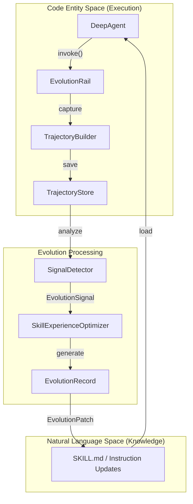
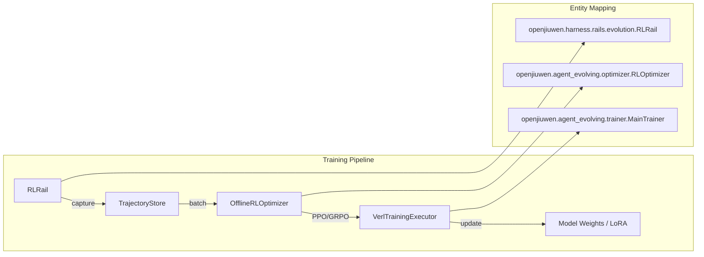

<!-- source: DeepWiki mcp.deepwiki.com · repo openJiuwen-ai/agent-core · page 10 Agent Evolving · fetched 2026-11-02 -->

# Agent Evolving

Relevant source files

The following files were used as context for generating this wiki page:

- [docs/en/2.Development Guide/API Docs/openjiuwen.harness/rails/evolution/skill_evolution_rail.md](docs/en/2.Development Guide/API Docs/openjiuwen.harness/rails/evolution/skill_evolution_rail.md)
- [docs/en/2.Development Guide/API Docs/openjiuwen.harness/rails/evolution/team_skill_evolution_rail.md](docs/en/2.Development Guide/API Docs/openjiuwen.harness/rails/evolution/team_skill_evolution_rail.md)
- [docs/en/2.Development Guide/Agent Teams/Team Skill Evolution.md](docs/en/2.Development Guide/Agent Teams/Team Skill Evolution.md)
- [openjiuwen/agent_evolving/checkpointing/__init__.py](openjiuwen/agent_evolving/checkpointing/__init__.py)
- [openjiuwen/agent_evolving/checkpointing/evolution_store.py](openjiuwen/agent_evolving/checkpointing/evolution_store.py)
- [openjiuwen/agent_evolving/checkpointing/manager.py](openjiuwen/agent_evolving/checkpointing/manager.py)
- [openjiuwen/agent_evolving/checkpointing/store_file.py](openjiuwen/agent_evolving/checkpointing/store_file.py)
- [openjiuwen/agent_evolving/checkpointing/store_records.py](openjiuwen/agent_evolving/checkpointing/store_records.py)
- [openjiuwen/agent_evolving/checkpointing/types.py](openjiuwen/agent_evolving/checkpointing/types.py)
- [openjiuwen/agent_evolving/experience/online_orchestrator.py](openjiuwen/agent_evolving/experience/online_orchestrator.py)
- [openjiuwen/agent_evolving/experience/scorer.py](openjiuwen/agent_evolving/experience/scorer.py)
- [openjiuwen/agent_evolving/experience/tracker.py](openjiuwen/agent_evolving/experience/tracker.py)
- [openjiuwen/agent_evolving/experience/types.py](openjiuwen/agent_evolving/experience/types.py)
- [openjiuwen/agent_evolving/optimizer/skill_call/__init__.py](openjiuwen/agent_evolving/optimizer/skill_call/__init__.py)
- [openjiuwen/agent_evolving/optimizer/skill_call/experience_optimizer.py](openjiuwen/agent_evolving/optimizer/skill_call/experience_optimizer.py)
- [openjiuwen/agent_evolving/optimizer/skill_call/templates.py](openjiuwen/agent_evolving/optimizer/skill_call/templates.py)
- [openjiuwen/agent_evolving/optimizer/skill_call/tool_call_chain.py](openjiuwen/agent_evolving/optimizer/skill_call/tool_call_chain.py)
- [openjiuwen/harness/rails/evolution/evolution_rail.py](openjiuwen/harness/rails/evolution/evolution_rail.py)
- [openjiuwen/harness/rails/evolution/skill_evolution_rail.py](openjiuwen/harness/rails/evolution/skill_evolution_rail.py)
- [openjiuwen/harness/rails/evolution/team_skill_evolution_rail.py](openjiuwen/harness/rails/evolution/team_skill_evolution_rail.py)
- [tests/system_tests/agent_evolving/test_online_evolution_e2e.py](tests/system_tests/agent_evolving/test_online_evolution_e2e.py)
- [tests/unit_tests/agent_evolving/checkpointing/test_evolution_store.py](tests/unit_tests/agent_evolving/checkpointing/test_evolution_store.py)
- [tests/unit_tests/agent_evolving/experience/test_pending_commit.py](tests/unit_tests/agent_evolving/experience/test_pending_commit.py)
- [tests/unit_tests/agent_evolving/optimizer/skill_call/test_experience_optimizer.py](tests/unit_tests/agent_evolving/optimizer/skill_call/test_experience_optimizer.py)
- [tests/unit_tests/agent_evolving/optimizer/test_team_skill_optimizer.py](tests/unit_tests/agent_evolving/optimizer/test_team_skill_optimizer.py)
- [tests/unit_tests/agent_evolving/sharing/test_sharing_module.py](tests/unit_tests/agent_evolving/sharing/test_sharing_module.py)
- [tests/unit_tests/harness/rails/evolution/test_skill_evolution_rail.py](tests/unit_tests/harness/rails/evolution/test_skill_evolution_rail.py)
- [tests/unit_tests/harness/rails/evolution/test_team_skill_rail.py](tests/unit_tests/harness/rails/evolution/test_team_skill_rail.py)

The `agent_evolving` package provides a comprehensive framework for self-improving agents. It bridges the gap between raw execution logs and optimized agent behavior through two primary mechanisms: **Skill Evolution** (discrete knowledge/instruction updates) and **Reinforcement Learning** (continuous policy optimization).

## Overview

The evolution system is built around the concept of a **Trajectory**—a structured trace of an agent's execution including LLM calls, tool invocations, and environment feedback [openjiuwen/harness/rails/evolution/evolution_rail.py:26-35](). These trajectories are processed by the `EvolutionRail` system to detect signals for improvement, such as execution failures, user corrections, or inefficient patterns [openjiuwen/agent_evolving/optimizer/skill_call/experience_optimizer.py:43-49]().

### Core Components
*   **EvolutionRail**: The base class for intercepting agent lifecycle events to collect trajectories and trigger evolution logic [openjiuwen/harness/rails/evolution/evolution_rail.py:171-184]().
*   **Trajectory Store**: Persistence layer for execution traces, supporting both `InMemoryTrajectoryStore` and persistent backends [openjiuwen/harness/rails/evolution/evolution_rail.py:27-35]().
*   **Optimizers**: LLM-driven components like `SkillExperienceOptimizer` that analyze trajectories to generate "patches" (updates) for agent skills [openjiuwen/agent_evolving/optimizer/skill_call/experience_optimizer.py:27-33]().
*   **EvolutionStore**: Manages the persistence, versioning, and projection of evolution records and skill markdown files [openjiuwen/agent_evolving/checkpointing/evolution_store.py:41-52]().

## System Architecture: From Execution to Evolution

The following diagram illustrates how execution data in the "Code Entity Space" (Rails, Trajectories) is transformed into "Natural Language Space" (Skill updates, Experience).

### Evolution Data Flow

**Sources:** [openjiuwen/harness/rails/evolution/evolution_rail.py:171-184](), [openjiuwen/agent_evolving/optimizer/skill_call/experience_optimizer.py:11-15](), [openjiuwen/agent_evolving/checkpointing/evolution_store.py:130-148]()

## Skill Evolution

Skill evolution is the process of refining an agent's "skills" (markdown-based instruction sets) based on real-world performance. This is primarily managed by the `SkillEvolutionRail` and `TeamSkillRail`.

*   **Signal Detection**: The system identifies `execution_failure`, `user_intent`, and `conversation_review` as triggers for evolution [openjiuwen/agent_evolving/optimizer/skill_call/experience_optimizer.py:43-49]().
*   **Evolution Orchestration**: The `OnlineEvolutionOrchestrator` coordinates between the `ExperienceManager` and `SkillExperienceOptimizer` to stage updates [openjiuwen/harness/rails/evolution/skill_evolution_rail.py:113-119]().
*   **Team Evolution**: `TeamSkillEvolutionRail` specializes in multi-agent collaboration patterns, tracking `spawn_member` calls and coordination gaps [openjiuwen/harness/rails/evolution/team_skill_evolution_rail.py:138-145]().
*   **Human-in-the-Loop**: Evolution typically requires manual approval via `EvolutionApprovalRuntime`, which generates approval events for the user [openjiuwen/harness/rails/evolution/skill_evolution_rail.py:109-112]().

For details, see [Skill Evolution](#10.1).

**Sources:** [openjiuwen/harness/rails/evolution/skill_evolution_rail.py:142-165](), [openjiuwen/harness/rails/evolution/team_skill_evolution_rail.py:138-152](), [openjiuwen/agent_evolving/optimizer/skill_call/experience_optimizer.py:43-49]()

## RL Training Loops

Beyond discrete skill updates, the framework supports Reinforcement Learning (RL) to optimize the underlying model policy via the JiuwenClaw system.

### RL Evolution Pipeline

### Offline RL Training
The `OfflineRLOptimizer` handles the batch processing of trajectories to perform policy updates using algorithms like PPO or GRPO. It uses `RLConfig` to manage training, rollout, and runtime parameters.

For details, see [Offline RL Training](#10.2).

### Online RL Loop (JiuwenClaw)
The JiuwenClaw system provides a real-time feedback loop. This includes high-performance trajectory capture in Redis and hot-loading LoRA weights into inference servers like vLLM.

For details, see [Online RL Loop (JiuwenClaw)](#10.3).

## Checkpointing and Evolution Store

The `EvolutionStore` ensures that the evolution process is robust and persistent.
*   **EvolutionRecord**: A structured object containing the `EvolutionPatch` (the change), its source, and its current score [openjiuwen/agent_evolving/checkpointing/types.py:115-127]().
*   **EvolutionPatch**: Defines specific actions like `append` or `replace` targeting specific sections of a skill's documentation [openjiuwen/agent_evolving/checkpointing/types.py:54-67]().
*   **Persistence**: `EvolutionStore` manages `evolutions.json` files within skill directories to track the history of improvements [openjiuwen/agent_evolving/checkpointing/evolution_store.py:32-42]().

For details, see [Skill Evolution](#10.1).

**Sources:** [openjiuwen/agent_evolving/checkpointing/types.py:54-67](), [openjiuwen/agent_evolving/checkpointing/evolution_store.py:41-52](), [openjiuwen/agent_evolving/checkpointing/evolution_store.py:130-148]()

---

