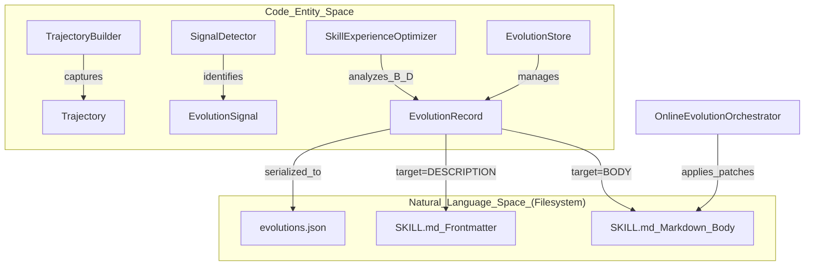
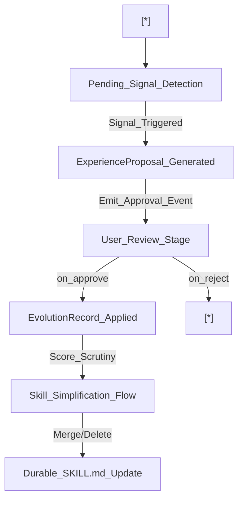

<!-- source: DeepWiki mcp.deepwiki.com · repo openJiuwen-ai/agent-core · page 10.1 Skill Evolution · fetched 2026-11-02 -->

# Skill Evolution

Relevant source files

The following files were used as context for generating this wiki page:

- [docs/en/2.Development Guide/API Docs/openjiuwen.harness/rails/evolution/skill_evolution_rail.md](docs/en/2.Development Guide/API Docs/openjiuwen.harness/rails/evolution/skill_evolution_rail.md)
- [docs/en/2.Development Guide/API Docs/openjiuwen.harness/rails/evolution/team_skill_evolution_rail.md](docs/en/2.Development Guide/API Docs/openjiuwen.harness/rails/evolution/team_skill_evolution_rail.md)
- [docs/en/2.Development Guide/Agent Teams/Team Skill Evolution.md](docs/en/2.Development Guide/Agent Teams/Team Skill Evolution.md)
- [openjiuwen/agent_evolving/checkpointing/__init__.py](openjiuwen/agent_evolving/checkpointing/__init__.py)
- [openjiuwen/agent_evolving/checkpointing/evolution_store.py](openjiuwen/agent_evolving/checkpointing/evolution_store.py)
- [openjiuwen/agent_evolving/checkpointing/manager.py](openjiuwen/agent_evolving/checkpointing/manager.py)
- [openjiuwen/agent_evolving/checkpointing/store_file.py](openjiuwen/agent_evolving/checkpointing/store_file.py)
- [openjiuwen/agent_evolving/checkpointing/store_records.py](openjiuwen/agent_evolving/checkpointing/store_records.py)
- [openjiuwen/agent_evolving/checkpointing/types.py](openjiuwen/agent_evolving/checkpointing/types.py)
- [openjiuwen/agent_evolving/experience/online_orchestrator.py](openjiuwen/agent_evolving/experience/online_orchestrator.py)
- [openjiuwen/agent_evolving/experience/scorer.py](openjiuwen/agent_evolving/experience/scorer.py)
- [openjiuwen/agent_evolving/experience/tracker.py](openjiuwen/agent_evolving/experience/tracker.py)
- [openjiuwen/agent_evolving/experience/types.py](openjiuwen/agent_evolving/experience/types.py)
- [openjiuwen/agent_evolving/optimizer/skill_call/__init__.py](openjiuwen/agent_evolving/optimizer/skill_call/__init__.py)
- [openjiuwen/agent_evolving/optimizer/skill_call/experience_optimizer.py](openjiuwen/agent_evolving/optimizer/skill_call/experience_optimizer.py)
- [openjiuwen/agent_evolving/optimizer/skill_call/templates.py](openjiuwen/agent_evolving/optimizer/skill_call/templates.py)
- [openjiuwen/agent_evolving/optimizer/skill_call/tool_call_chain.py](openjiuwen/agent_evolving/optimizer/skill_call/tool_call_chain.py)
- [openjiuwen/harness/rails/evolution/evolution_rail.py](openjiuwen/harness/rails/evolution/evolution_rail.py)
- [openjiuwen/harness/rails/evolution/skill_evolution_rail.py](openjiuwen/harness/rails/evolution/skill_evolution_rail.py)
- [openjiuwen/harness/rails/evolution/team_skill_evolution_rail.py](openjiuwen/harness/rails/evolution/team_skill_evolution_rail.py)
- [tests/system_tests/agent_evolving/test_online_evolution_e2e.py](tests/system_tests/agent_evolving/test_online_evolution_e2e.py)
- [tests/unit_tests/agent_evolving/checkpointing/test_evolution_store.py](tests/unit_tests/agent_evolving/checkpointing/test_evolution_store.py)
- [tests/unit_tests/agent_evolving/experience/test_pending_commit.py](tests/unit_tests/agent_evolving/experience/test_pending_commit.py)
- [tests/unit_tests/agent_evolving/optimizer/skill_call/test_experience_optimizer.py](tests/unit_tests/agent_evolving/optimizer/skill_call/test_experience_optimizer.py)
- [tests/unit_tests/agent_evolving/optimizer/test_team_skill_optimizer.py](tests/unit_tests/agent_evolving/optimizer/test_team_skill_optimizer.py)
- [tests/unit_tests/agent_evolving/sharing/test_sharing_module.py](tests/unit_tests/agent_evolving/sharing/test_sharing_module.py)
- [tests/unit_tests/harness/rails/evolution/test_skill_evolution_rail.py](tests/unit_tests/harness/rails/evolution/test_skill_evolution_rail.py)
- [tests/unit_tests/harness/rails/evolution/test_team_skill_rail.py](tests/unit_tests/harness/rails/evolution/test_team_skill_rail.py)

The Skill Evolution framework provides a self-optimization loop for agents, enabling them to refine their capabilities based on real-world execution. It encompasses trajectory collection, signal detection, experience optimization, and a structured approval flow to update agent skills and team collaboration patterns.

## Evolution Architecture

The framework is built around the `EvolutionRail` base class, which intercepts agent execution to collect data and trigger evolution logic.

### Core Evolution Rails
*   **`EvolutionRail`**: The base class providing automatic trajectory collection and lifecycle hooks `[_on_before_invoke, _on_after_model_call, _on_after_tool_call, _on_after_invoke, _on_after_task_iteration]` [openjiuwen/harness/rails/evolution/evolution_rail.py:171-184]().
*   **`SkillEvolutionRail`**: Specialized for individual agent skills. It monitors for failures or user corrections and manages the `ExperienceManager` to stage improvements [openjiuwen/harness/rails/evolution/skill_evolution_rail.py:142-152]().
*   **`TeamSkillEvolutionRail`** (aliased as `TeamSkillRail`): Focused on multi-agent collaboration. It analyzes coordination patterns and `spawn_member` calls to propose updates to team skills [openjiuwen/harness/rails/evolution/team_skill_evolution_rail.py:138-145]().

### Trajectory Collection
Trajectories represent the "execution history" of an agent. The `EvolutionRail` automatically records `TrajectoryStep` objects for every LLM and tool call [openjiuwen/harness/rails/evolution/evolution_rail.py:174-180]().

| Step Component | Description | Code Entity |
| :--- | :--- | :--- |
| **LLM Call** | Captures messages, responses, and token usage | `LLMCallDetail` [openjiuwen/agent_evolving/trajectory/types.py:28-32]() |
| **Tool Call** | Captures tool name, arguments, and results | `ToolCallDetail` [openjiuwen/agent_evolving/trajectory/types.py:33-37]() |
| **Metadata** | Timestamps, execution IDs, and session context | `Trajectory` [openjiuwen/agent_evolving/trajectory/types.py:41-47]() |

**Sources:** [openjiuwen/harness/rails/evolution/evolution_rail.py:171-200](), [openjiuwen/harness/rails/evolution/evolution_rail.py:26-40]().

---

## Signal Detection

Evolution is triggered by specific signals detected during or after an agent's execution by the `SignalDetector`.

### Detection Mechanisms
1.  **`execution_failure`**: Detected when a tool call returns an error or an LLM call fails to meet expectations. Initial score: `0.65` [openjiuwen/agent_evolving/optimizer/skill_call/experience_optimizer.py:45-45]().
2.  **`user_intent`**: High-priority signals detected when a user provides explicit feedback or requests optimization. Initial score: `0.70` [openjiuwen/agent_evolving/optimizer/skill_call/experience_optimizer.py:46-46]().
3.  **`conversation_review`**: A passive analysis of the dialogue history to find inefficiencies. Initial score: `0.50` [openjiuwen/agent_evolving/optimizer/skill_call/experience_optimizer.py:48-48]().
4.  **`script_artifact`**: Detection of reusable code snippets that can be promoted to skill tools. Initial score: `0.60` [openjiuwen/agent_evolving/optimizer/skill_call/experience_optimizer.py:47-47]().

**Sources:** [openjiuwen/agent_evolving/optimizer/skill_call/experience_optimizer.py:43-49](), [openjiuwen/agent_evolving/signal/base.py:26-30]().

---

## Experience Optimization

The optimization layer converts raw trajectories and signals into structured `EvolutionRecord` objects.

### SkillExperienceOptimizer
This component uses LLM policies (e.g., `GENERATE_RECORDS_LLM_POLICY`) to analyze conversation snippets and propose patches to the `SKILL.md` file [openjiuwen/agent_evolving/optimizer/skill_call/experience_optimizer.py:51-55]().

*   **Targets**: Patches can target the `BODY` (instructions) or `DESCRIPTION` (metadata) [openjiuwen/agent_evolving/checkpointing/types.py:60-60]().
*   **Actions**: Valid actions include `append`, `replace`, `merge`, `delete`, or `skip` [openjiuwen/agent_evolving/checkpointing/types.py:58-58]().

### ExperienceScorer (E/U/F)
The `ExperienceScorer` maintains the quality of the evolution store by scoring records using three metrics [openjiuwen/agent_evolving/experience/scorer.py:22-26]():

1.  **Effectiveness (E)**: Bayesian-smoothed ratio of positive vs. negative outcomes when the experience was used [openjiuwen/agent_evolving/checkpointing/types.py:17-26]().
2.  **Utilization (U)**: How often the agent actually adopts the experience when it is presented in the context [openjiuwen/agent_evolving/checkpointing/types.py:21-22]().
3.  **Freshness (F)**: Exponential time decay combined with version staleness penalties [openjiuwen/agent_evolving/checkpointing/types.py:25-26]().

**Sources:** [openjiuwen/agent_evolving/experience/scorer.py:21-26](), [openjiuwen/agent_evolving/checkpointing/types.py:17-50]().

---

## Data Flow and Persistence

The `EvolutionStore` manages the lifecycle of evolution data on the filesystem, typically targeting a `skills/` directory containing `SKILL.md` files and `evolutions.json` logs [openjiuwen/agent_evolving/checkpointing/evolution_store.py:41-52]().

### Code Space to Natural Language Space
The following diagram illustrates how code entities like `EvolutionRecord` translate into updates within the human-readable `SKILL.md` files.

Title: Skill Evolution Data Flow

**Sources:** [openjiuwen/agent_evolving/checkpointing/evolution_store.py:41-52](), [openjiuwen/agent_evolving/checkpointing/types.py:115-127](), [openjiuwen/harness/rails/evolution/skill_evolution_rail.py:143-152]().

### EvolutionStore Operations
*   **`read_skill_content`**: Reads the `SKILL.md` for a specific skill [openjiuwen/agent_evolving/checkpointing/evolution_store.py:130-148]().
*   **`append_record`**: Persists a new `EvolutionRecord` to the `evolutions.json` log [openjiuwen/agent_evolving/checkpointing/evolution_store.py:162-164]().
*   **`merge_records`**: Simplifies the evolution log by merging multiple records into a single consolidated entry [openjiuwen/agent_evolving/checkpointing/evolution_store.py:178-186]().

---

## Evolution Lifecycle

The evolution process follows a strict flow from detection to user approval.

### Approval/Rejection Flow
By default, evolution proposals are held in a pending state for human-in-the-loop (HITL) verification unless `auto_save` is enabled [openjiuwen/harness/rails/evolution/skill_evolution_rail.py:165-165]().

1.  **Generation**: `run_evolution` creates an `ExperienceProposal` [openjiuwen/agent_evolving/experience/types.py:31-31]().
2.  **Notification**: The rail emits an approval event (e.g., `build_skill_approval_event`) [openjiuwen/harness/rails/evolution/approval_events.py:60-60]().
3.  **Approval**: If approved, the `ExperienceManager` transitions the record to `applied=True` [openjiuwen/agent_evolving/checkpointing/types.py:123-123]().
4.  **Simplification**: Periodic maintenance using `SIMPLIFY_LLM_POLICY` merges similar experiences to reduce context overhead [openjiuwen/agent_evolving/experience/scorer.py:24-24]().

Title: Evolution Approval State Machine

**Sources:** [openjiuwen/harness/rails/evolution/skill_evolution_rail.py:143-152](), [openjiuwen/harness/rails/evolution/approval_events.py:57-62](), [openjiuwen/agent_evolving/checkpointing/types.py:188-190]().

---

