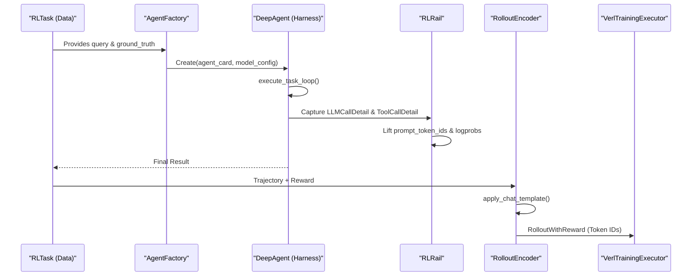

<!-- source: DeepWiki mcp.deepwiki.com · repo openJiuwen-ai/agent-core · page 10.2 Offline RL Training · fetched 2026-11-02 -->

# Offline RL Training

<details>
<summary>Relevant source files</summary>

The following files were used as context for generating this wiki page:

- [openjiuwen/agent_evolving/agent_rl/offline/coordinator/encoding.py](openjiuwen/agent_evolving/agent_rl/offline/coordinator/encoding.py)
- [openjiuwen/agent_evolving/agent_rl/offline/runtime/agent_factory.py](openjiuwen/agent_evolving/agent_rl/offline/runtime/agent_factory.py)
- [openjiuwen/agent_evolving/agent_rl/online/gateway/trajectory/judge_dispatcher.py](openjiuwen/agent_evolving/agent_rl/online/gateway/trajectory/judge_dispatcher.py)
- [openjiuwen/agent_evolving/agent_rl/online/rail/converter.py](openjiuwen/agent_evolving/agent_rl/online/rail/converter.py)
- [openjiuwen/agent_evolving/agent_rl/online/rail/online_rail.py](openjiuwen/agent_evolving/agent_rl/online/rail/online_rail.py)
- [openjiuwen/agent_evolving/agent_rl/schemas.py](openjiuwen/agent_evolving/agent_rl/schemas.py)
- [openjiuwen/agent_evolving/checkpointing/__init__.py](openjiuwen/agent_evolving/checkpointing/__init__.py)
- [openjiuwen/agent_evolving/checkpointing/evolution_store.py](openjiuwen/agent_evolving/checkpointing/evolution_store.py)
- [openjiuwen/agent_evolving/checkpointing/manager.py](openjiuwen/agent_evolving/checkpointing/manager.py)
- [openjiuwen/agent_evolving/checkpointing/store_file.py](openjiuwen/agent_evolving/checkpointing/store_file.py)
- [openjiuwen/agent_evolving/checkpointing/store_records.py](openjiuwen/agent_evolving/checkpointing/store_records.py)
- [openjiuwen/agent_evolving/checkpointing/types.py](openjiuwen/agent_evolving/checkpointing/types.py)
- [openjiuwen/agent_evolving/optimizer/skill_call/experience_optimizer.py](openjiuwen/agent_evolving/optimizer/skill_call/experience_optimizer.py)
- [openjiuwen/agent_evolving/trajectory/__init__.py](openjiuwen/agent_evolving/trajectory/__init__.py)
- [openjiuwen/agent_evolving/trajectory/builder.py](openjiuwen/agent_evolving/trajectory/builder.py)
- [openjiuwen/agent_evolving/trajectory/extractor.py](openjiuwen/agent_evolving/trajectory/extractor.py)
- [openjiuwen/agent_evolving/trajectory/operation.py](openjiuwen/agent_evolving/trajectory/operation.py)
- [openjiuwen/agent_evolving/trajectory/store.py](openjiuwen/agent_evolving/trajectory/store.py)
- [openjiuwen/agent_evolving/trajectory/types.py](openjiuwen/agent_evolving/trajectory/types.py)
- [openjiuwen/core/foundation/llm/schema/message_chunk.py](openjiuwen/core/foundation/llm/schema/message_chunk.py)
- [tests/unit_tests/agent_evolving/agent_rl/online/test_rl_online_rail.py](tests/unit_tests/agent_evolving/agent_rl/online/test_rl_online_rail.py)
- [tests/unit_tests/agent_evolving/checkpointing/test_evolution_store.py](tests/unit_tests/agent_evolving/checkpointing/test_evolution_store.py)
- [tests/unit_tests/agent_evolving/experience/test_pending_commit.py](tests/unit_tests/agent_evolving/experience/test_pending_commit.py)
- [tests/unit_tests/agent_evolving/optimizer/skill_call/test_experience_optimizer.py](tests/unit_tests/agent_evolving/optimizer/skill_call/test_experience_optimizer.py)
- [tests/unit_tests/agent_evolving/optimizer/test_team_skill_optimizer.py](tests/unit_tests/agent_evolving/optimizer/test_team_skill_optimizer.py)
- [tests/unit_tests/agent_evolving/sharing/test_sharing_module.py](tests/unit_tests/agent_evolving/sharing/test_sharing_module.py)
- [tests/unit_tests/agent_evolving/trajectory/__init__.py](tests/unit_tests/agent_evolving/trajectory/__init__.py)
- [tests/unit_tests/agent_evolving/trajectory/test_builder.py](tests/unit_tests/agent_evolving/trajectory/test_builder.py)
- [tests/unit_tests/agent_evolving/trajectory/test_extractor.py](tests/unit_tests/agent_evolving/trajectory/test_extractor.py)
- [tests/unit_tests/agent_evolving/trajectory/test_store.py](tests/unit_tests/agent_evolving/trajectory/test_store.py)
- [tests/unit_tests/agent_evolving/trajectory/test_types.py](tests/unit_tests/agent_evolving/trajectory/test_types.py)
- [tests/unit_tests/core/foundation/llm/test_message_chunk.py](tests/unit_tests/core/foundation/llm/test_message_chunk.py)

</details>


The Offline RL Training pipeline in the `agent-core` SDK provides a structured framework for optimizing `DeepAgent` performance using Reinforcement Learning (RL) algorithms like PPO and GRPO. It automates the cycle of task rollout, trajectory collection, reward scoring, and policy updates using the **verl** and **vLLM** backends.

## Architecture Overview

The offline RL system is centered around the `OfflineRLOptimizer`, which orchestrates the training loop across distributed compute resources (typically managed via the **OpenYuanrong** or **Ray** frameworks).

### Core Training Flow
1.  **Data Loading**: Tasks are loaded from Parquet datasets and converted into `RLTask` objects.
2.  **Rollout**: The `MainTrainer` uses an `AgentFactory` to spawn `DeepAgent` instances that execute tasks.
3.  **Trajectory Capture**: The `RLRail` (integrated via `DeepAgent`) captures every LLM call and tool interaction into a `Trajectory` [openjiuwen/agent_evolving/trajectory/types.py:40-57]().
4.  **Reward Scoring**: A user-defined `reward_fn` evaluates the final outcome of the trajectory.
5.  **Encoding**: The `RolloutEncoder` transforms raw trajectories into token-level samples (per-turn or whole-trajectory) [openjiuwen/agent_evolving/agent_rl/offline/coordinator/encoding.py:21-32]().
6.  **Optimization**: The `VerlTrainingExecutor` triggers the actual model update using the collected samples.

### System Components Diagram

```mermaid
graph TD
    subgraph "Training Coordination"
        ["OfflineRLOptimizer"] -- "manages" --> ["MainTrainer"]
        ["MainTrainer"] -- "uses" --> ["AgentFactory"]
        ["MainTrainer"] -- "triggers" --> ["VerlTrainingExecutor"]
    end

    subgraph "Execution Runtime"
        ["AgentFactory"] -- "creates" --> ["DeepAgent"]
        ["DeepAgent"] -- "contains" --> ["RLRail"]
        ["RLRail"] -- "captures" --> ["Trajectory"]
    end

    subgraph "Data & Storage"
        ["Trajectory"] -- "stored in" --> ["FileRolloutStore"]
        ["FileRolloutStore"] -- "provides samples to" --> ["RolloutEncoder"]
        ["RolloutEncoder"] -- "tokenized data" --> ["VerlTrainingExecutor"]
    end

    ["BackendProxy"] -- "proxies LLM calls" --> ["vLLM/Inference"]
    ["DeepAgent"] -- "calls" --> ["BackendProxy"]
```
Sources: `[openjiuwen/agent_evolving/agent_rl/offline/runtime/agent_factory.py:20-45]()`, `[openjiuwen/agent_evolving/agent_rl/offline/coordinator/encoding.py:21-32]()`

---

## Configuration (`RLConfig`)

The training process is governed by a hierarchical configuration structure.

| Config Class | Responsibility | Key Fields |
| :--- | :--- | :--- |
| `TrainingConfig` | High-level training parameters | `model_path`, `save_path`, `algorithm` (PPO/GRPO) |
| `RolloutConfig` | Controls how trajectories are generated | `n_rollouts_per_task`, `max_parallel_tasks`, `temperature` |
| `AgentRuntimeConfig` | Environment for the agent | `system_prompt`, `tools`, `max_new_tokens`, `max_iterations` |

Sources: `[openjiuwen/agent_evolving/agent_rl/schemas.py:10-50]()`

---

## Trajectory Collection and Encoding

### Trajectory Data Model
Trajectories represent the ground truth of an agent's execution. Each `Trajectory` consists of multiple `TrajectoryStep` objects [openjiuwen/agent_evolving/trajectory/types.py:41-42]().

*   **Step Kinds**: `llm` (LLM generation) or `tool` (external tool execution) [openjiuwen/agent_evolving/trajectory/types.py:55-55]().
*   **Token Lifting**: For RL training, `RLRail` extracts `prompt_token_ids`, `completion_token_ids`, and `logprobs` directly from the model response to avoid redundant tokenization during training [openjiuwen/agent_evolving/agent_rl/online/rail/converter.py:170-172]().

Sources: `[openjiuwen/agent_evolving/trajectory/types.py:40-57]()`, `[openjiuwen/agent_evolving/agent_rl/online/rail/converter.py:162-175]()`

### Rollout Encoding Modes
The `RolloutEncoder` prepares data for the training executor in two distinct modes:

1.  **Per-Turn Mode**: Each dialogue turn (User -> Assistant) is treated as an independent training sample. This is the default for standard PPO [openjiuwen/agent_evolving/agent_rl/offline/coordinator/encoding.py:21-29]().
2.  **Whole-Trajectory Mode**: The entire multi-turn conversation is treated as a single sample. A `loss_mask` is applied to ensure the model only learns from `assistant` tokens while treating `tool` outputs and `user` prompts as environment context [openjiuwen/agent_evolving/agent_rl/offline/coordinator/encoding.py:162-171]().

Sources: `[openjiuwen/agent_evolving/agent_rl/offline/coordinator/encoding.py:21-29]()`, `[openjiuwen/agent_evolving/agent_rl/offline/coordinator/encoding.py:162-171]()`

---

## Agent Factory and Runtime

The `AgentFactory` is responsible for materializing `DeepAgent` instances in the training environment [openjiuwen/agent_evolving/agent_rl/offline/runtime/agent_factory.py:20-25](). It ensures that agents are correctly hooked into the `BackendProxy`.

### Key Initialization Steps:
1.  **Model Configuration**: Configures a `Model` object pointing to the local `BackendProxy` (usually `localhost:port/v1`) using the OpenAI-compatible client [openjiuwen/agent_evolving/agent_rl/offline/runtime/agent_factory.py:47-60]().
2.  **Tool Registration**: Reconstructs `LocalFunction` instances for tools. This is critical because serialization can break tool closures; `AgentFactory` ensures tools are freshly bound in the worker process [openjiuwen/agent_evolving/agent_rl/offline/runtime/agent_factory.py:116-130]().
3.  **RL Hooks**: Sets `llm_return_token_ids = True` on the underlying `ReActAgent` to enable the capture of token-level data required for policy gradients [openjiuwen/agent_evolving/agent_rl/offline/runtime/agent_factory.py:80-90]().

Sources: `[openjiuwen/agent_evolving/agent_rl/offline/runtime/agent_factory.py:47-114]()`, `[openjiuwen/agent_evolving/agent_rl/offline/runtime/agent_factory.py:116-157]()`

---

## Implementation Diagram: Task to Token Space

This diagram illustrates how a high-level `RLTask` is transformed through the agent runtime into the token-level samples used by the `VerlTrainingExecutor`.


Sources: `[openjiuwen/agent_evolving/agent_rl/offline/runtime/agent_factory.py:47-114]()`, `[openjiuwen/agent_evolving/agent_rl/offline/coordinator/encoding.py:118-137]()`, `[openjiuwen/agent_evolving/trajectory/types.py:40-57]()`

---

## Reward Functions

The reward function is a critical component that defines the "objective" for the RL agent. It typically compares the agent's final output or intermediate steps against a `ground_truth` provided in the dataset.

In an NL2SQL scenario, the reward function typically:
1.  Extracts the SQL query from the agent's response.
2.  Executes both the `pred_sql` and the `gold_sql` against a database.
3.  Returns `1.0` if the result sets match, and `0.0` otherwise.

---

## Infrastructure and Distributed Execution

Offline training requires a distributed backend to handle the high VRAM requirements of LLM training and parallel rollouts.

*   **BackendProxy**: Acts as a gateway between the `DeepAgent` (acting as a client) and the `vLLM` inference engine used during rollouts [openjiuwen/agent_evolving/agent_rl/offline/runtime/agent_factory.py:58-63]().
*   **FileRolloutStore**: A persistent storage layer (often on shared FS like NFS) where trajectories are saved before being batched for the trainer [openjiuwen/agent_evolving/trajectory/store.py:65-80]().
*   **Distributed Environment**: Uses environment variables like `VLLM_DP_MASTER_IP` to coordinate multi-node GPU training.

Sources: `[openjiuwen/agent_evolving/agent_rl/offline/runtime/agent_factory.py:58-63]()`, `[openjiuwen/agent_evolving/trajectory/store.py:65-80]()`

---

