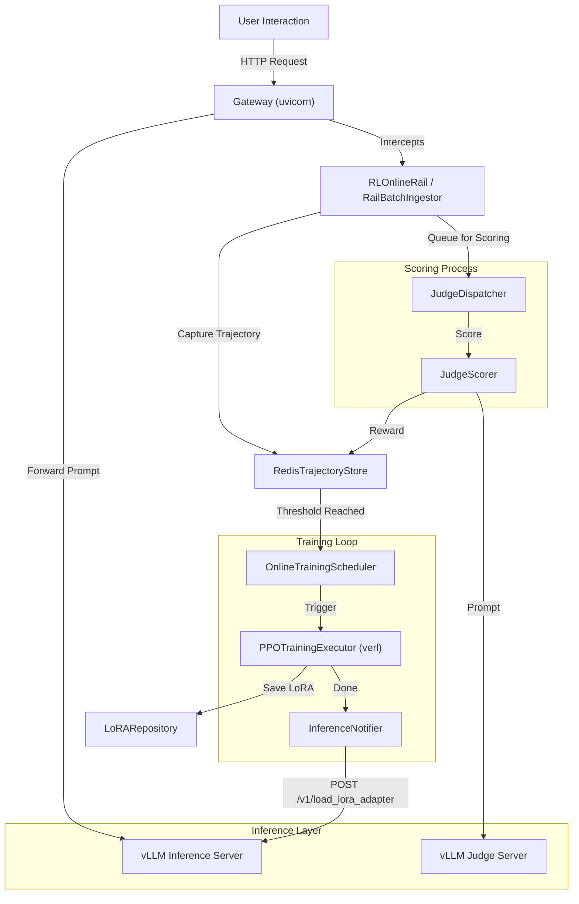
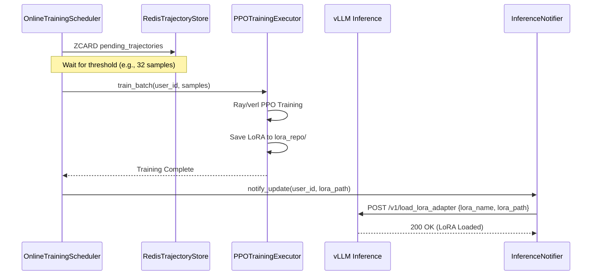

<!-- source: DeepWiki mcp.deepwiki.com · repo openJiuwen-ai/agent-core · page 10.3 Online RL Loop (JiuwenClaw) · fetched 2026-11-02 -->

# Online RL Loop (JiuwenClaw)

Relevant source files

The following files were used as context for generating this wiki page:

- [docs/en/2.Development Guide/API Docs/openjiuwen.agent_evolving/agent_rl/agent_rl.README.md](docs/en/2.Development Guide/API Docs/openjiuwen.agent_evolving/agent_rl/agent_rl.README.md)
- [docs/en/2.Development Guide/API Docs/openjiuwen.agent_evolving/agent_rl/online/gateway.md](docs/en/2.Development Guide/API Docs/openjiuwen.agent_evolving/agent_rl/online/gateway.md)
- [docs/en/2.Development Guide/API Docs/openjiuwen.agent_evolving/agent_rl/online/inference.md](docs/en/2.Development Guide/API Docs/openjiuwen.agent_evolving/agent_rl/online/inference.md)
- [docs/en/2.Development Guide/API Docs/openjiuwen.agent_evolving/agent_rl/online/judge.md](docs/en/2.Development Guide/API Docs/openjiuwen.agent_evolving/agent_rl/online/judge.md)
- [docs/en/2.Development Guide/API Docs/openjiuwen.agent_evolving/agent_rl/online/launcher.md](docs/en/2.Development Guide/API Docs/openjiuwen.agent_evolving/agent_rl/online/launcher.md)
- [docs/en/2.Development Guide/API Docs/openjiuwen.agent_evolving/agent_rl/online/rail.md](docs/en/2.Development Guide/API Docs/openjiuwen.agent_evolving/agent_rl/online/rail.md)
- [docs/en/2.Development Guide/API Docs/openjiuwen.agent_evolving/agent_rl/online/scheduler.md](docs/en/2.Development Guide/API Docs/openjiuwen.agent_evolving/agent_rl/online/scheduler.md)
- [openjiuwen/agent_evolving/agent_rl/config/online_config.py](openjiuwen/agent_evolving/agent_rl/config/online_config.py)
- [openjiuwen/agent_evolving/agent_rl/online/gateway/app/bootstrap.py](openjiuwen/agent_evolving/agent_rl/online/gateway/app/bootstrap.py)
- [openjiuwen/agent_evolving/agent_rl/online/gateway/app/server.py](openjiuwen/agent_evolving/agent_rl/online/gateway/app/server.py)
- [openjiuwen/agent_evolving/agent_rl/online/gateway/config.py](openjiuwen/agent_evolving/agent_rl/online/gateway/config.py)
- [openjiuwen/agent_evolving/agent_rl/online/gateway/trajectory/persistence.py](openjiuwen/agent_evolving/agent_rl/online/gateway/trajectory/persistence.py)
- [openjiuwen/agent_evolving/agent_rl/online/launcher/cli.py](openjiuwen/agent_evolving/agent_rl/online/launcher/cli.py)
- [openjiuwen/agent_evolving/agent_rl/online/launcher/runner.py](openjiuwen/agent_evolving/agent_rl/online/launcher/runner.py)
- [openjiuwen/agent_evolving/agent_rl/online/launcher/services.py](openjiuwen/agent_evolving/agent_rl/online/launcher/services.py)
- [openjiuwen/agent_evolving/agent_rl/online/rail/factory.py](openjiuwen/agent_evolving/agent_rl/online/rail/factory.py)
- [openjiuwen/agent_evolving/agent_rl/online/scheduler/online_training_scheduler.py](openjiuwen/agent_evolving/agent_rl/online/scheduler/online_training_scheduler.py)
- [tests/unit_tests/agent_evolving/agent_rl/online/gateway/test_processor_components.py](tests/unit_tests/agent_evolving/agent_rl/online/gateway/test_processor_components.py)
- [tests/unit_tests/agent_evolving/agent_rl/online/test_gateway_support.py](tests/unit_tests/agent_evolving/agent_rl/online/test_gateway_support.py)

The JiuwenClaw Online RL system provides a complete, automated loop for improving LLM-powered agents through interaction. It orchestrates real-time trajectory collection, automated reward scoring via a "Judge" model, PPO training using the `verl` framework, and hot-loading of trained LoRA adapters back into the inference engine.

## System Architecture

The online RL loop is managed by a centralized launcher that coordinates multiple distributed services. The data flow follows a "Sense-Think-Act-Learn" pattern where agent interactions are captured as trajectories, stored in Redis, and periodically consumed by a training scheduler.

### Orchestration and Services

The system orchestration is handled by the `run_online_rl_loop` function [openjiuwen/agent_evolving/agent_rl/online/launcher/runner.py:111-116](), which manages the lifecycle of the following components:

1.  **vLLM Inference**: Hosts the base model with LoRA support enabled via `VLLM_ALLOW_RUNTIME_LORA_UPDATING` [openjiuwen/agent_evolving/agent_rl/online/launcher/services.py:128-132]().
2.  **vLLM Judge**: A separate (or shared) instance hosting a model dedicated to scoring trajectories [openjiuwen/agent_evolving/agent_rl/online/launcher/services.py:171-178]().
3.  **Gateway**: Acts as an OpenAI-compatible proxy that intercepts requests to inject trajectory capture logic [openjiuwen/agent_evolving/agent_rl/online/launcher/services.py:163-174]().
4.  **OnlineTrainingScheduler**: A background service that monitors trajectory counts in Redis and triggers PPO training jobs [openjiuwen/agent_evolving/agent_rl/online/launcher/services.py:204-209]().
5.  **JiuwenClaw App/Web**: The frontend and agent server where user interactions occur [openjiuwen/agent_evolving/agent_rl/online/launcher/runner.py:221-233]().

### Service Orchestration Flow

The diagram below illustrates the service dependencies and the "Natural Language Space" (User/Judge) to "Code Entity Space" mapping.

**Service Orchestration and Data Flow**

Sources: [openjiuwen/agent_evolving/agent_rl/online/launcher/runner.py:111-233](), [openjiuwen/agent_evolving/agent_rl/online/launcher/services.py:163-211](), [openjiuwen/agent_evolving/agent_rl/online/gateway/trajectory/persistence.py:55-65](), [openjiuwen/agent_evolving/agent_rl/online/gateway/app/bootstrap.py:121-130]()

---

## Trajectory Capture and Storage

### RedisTrajectoryStore
Trajectories are stored in Redis to allow for distributed collection and decoupled training. The system uses Redis hashes and sorted sets to manage the state of trajectories (e.g., `pending`, `training`).

*   **Trajectory Storage**: Trajectories are ingested via `RailBatchIngestor` and persisted using `GatewayTrajectoryRuntime` which wraps the underlying store [openjiuwen/agent_evolving/agent_rl/online/gateway/trajectory/persistence.py:67-73]().
*   **State Management**: The `_FakeRedis` implementation in tests reveals the underlying Lua-like logic used to move samples from `pending_key` to `training_key` once a threshold is met [tests/unit_tests/agent_evolving/agent_rl/online/test_gateway_support.py:61-74]().

### RLOnlineRail and Ingestion
The `RLOnlineRail` (part of the `gateway` package) intercepts OpenAI-compatible API calls. 
*   **Ingestion**: `RailBatchIngestor` handles the conversion of incoming rail-v1 protocol data into stored samples [openjiuwen/agent_evolving/agent_rl/online/gateway/trajectory/persistence.py:78-86]().
*   **Payload Construction**: `build_sample` creates the standardized dictionary containing prompt text, prompt IDs, response text, response IDs, and logprobs [tests/unit_tests/agent_evolving/agent_rl/online/gateway/test_processor_components.py:190-211]().

---

## Reward Scoring (Judge vLLM)

The `JudgeScorer` is responsible for evaluating the quality of captured trajectories. It sends the trajectory details to a dedicated Judge LLM.

*   **Parsing Logic**: The `JudgeScorer._parse_scores` method extracts scores from JSON blocks or specific tags in the LLM's response [tests/unit_tests/agent_evolving/agent_rl/online/test_gateway_support.py:163-179]().
*   **Scoring Metrics**: It typically looks for keys like `task_completion_score`, `tool_usage_score`, and `response_quality` to calculate an `overall` reward [tests/unit_tests/agent_evolving/agent_rl/online/test_gateway_support.py:172-178]().
*   **Retries**: If the Judge model hits a length limit or provides malformed output, the system supports retries with sanitized prompts [tests/unit_tests/agent_evolving/agent_rl/online/test_gateway_support.py:208-222]().

---

## Training and Hot-Loading

### PPO Training via verl
When the `OnlineTrainingScheduler` detects that the number of scored trajectories for a user exceeds the `threshold` [openjiuwen/agent_evolving/agent_rl/online/launcher/cli.py:110](), it invokes a PPO training job.

*   **Config Composition**: The training configuration is built using `compose_online_ppo_config`, which merges the base `verl` PPO trainer config with the `ONLINE_PPO_VERL_HYDRA_OVERLAY` [openjiuwen/agent_evolving/agent_rl/online/scheduler/ppo_config.py:86-102]().
*   **Executor Lifecycle**: `PPOTrainingExecutor` manages the Ray runner, triggering `train_batch` to perform the actual PPO steps [docs/en/2.Development Guide/API Docs/openjiuwen.agent_evolving/agent_rl/online/scheduler.md:104-140]().
*   **Resource Allocation**: Training is constrained to specific GPUs defined in `training.gpu_ids` [openjiuwen/agent_evolving/agent_rl/online/launcher/cli.py:112]().

### LoRA Hot-loading
Once training completes, the new LoRA weights are saved to the `lora_repo` [openjiuwen/agent_evolving/agent_rl/online/launcher/services.py:44](). The `InferenceNotifier` then sends a request to the vLLM server to load the new adapter without restarting the service.

*   **Notifier Implementation**: `InferenceNotifier.notify_update` calls the `/v1/load_lora_adapter` endpoint with `load_inplace=True` [tests/unit_tests/agent_evolving/agent_rl/online/test_gateway_support.py:183-202]().

**Training and Hot-Loading Sequence**

Sources: [openjiuwen/agent_evolving/agent_rl/online/launcher/runner.py:204-209](), [tests/unit_tests/agent_evolving/agent_rl/online/test_gateway_support.py:183-202](), [docs/en/2.Development Guide/API Docs/openjiuwen.agent_evolving/agent_rl/online/scheduler.md:140-150]()

---

## CLI Launcher

The system is launched via a unified CLI defined in `openjiuwen.agent_evolving.agent_rl.online.launcher.cli`.

### Key Arguments
| Argument | Config Path | Description |
| :--- | :--- | :--- |
| `--model-path` | `inference.model_path` | Path to the base model for inference. |
| `--vllm-gpu` | `inference.gpu_ids` | GPUs dedicated to vLLM inference. |
| `--judge-gpu` | `judge.gpu_ids` | GPUs dedicated to the Judge model. |
| `--threshold` | `training.threshold` | Samples needed to trigger training. |
| `--redis-url` | `gateway.redis_url` | Connection string for Redis storage. |
| `--lora-repo` | `training.lora_repo` | Directory for LoRA storage. |
| `--skip-jiuwen` | `jiuwen.enabled=False` | Skip launching the web frontend. |

Sources: [openjiuwen/agent_evolving/agent_rl/online/launcher/cli.py:71-151](), [openjiuwen/agent_evolving/agent_rl/online/launcher/cli.py:22-57]()

### Implementation Detail: `resolve_launch_runtime`
The `resolve_launch_runtime` function [openjiuwen/agent_evolving/agent_rl/online/launcher/services.py:42]() determines if the Judge should reuse the inference vLLM instance (if `reuse_inference_if_same_model` is true) or launch a dedicated process. It also validates that all required ports are free before starting [openjiuwen/agent_evolving/agent_rl/online/launcher/runner.py:82-87]().

---

