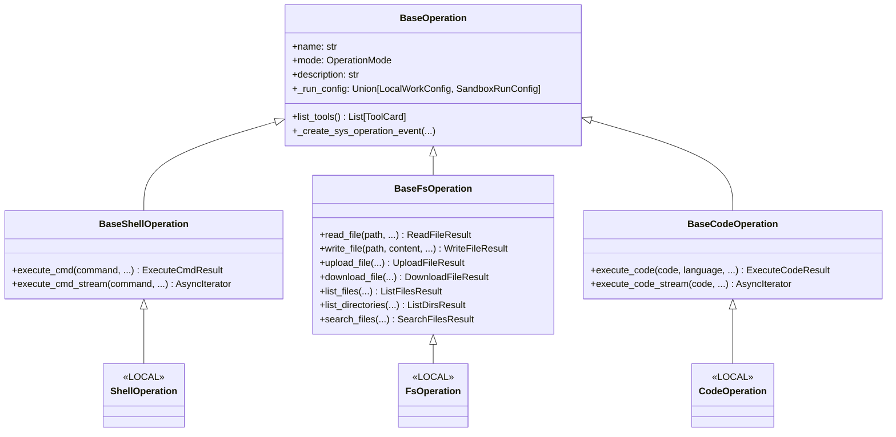
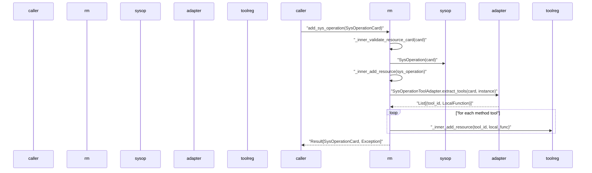
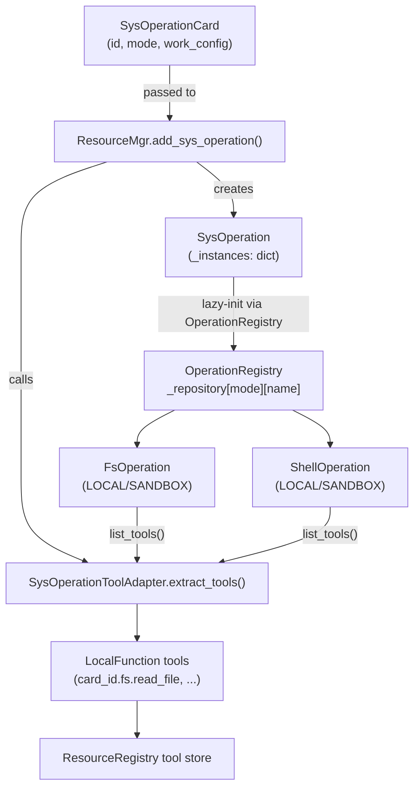

<!-- source: DeepWiki mcp.deepwiki.com · repo openJiuwen-ai/agent-core · page 11 System Operations · fetched 2026-11-02 -->

# System Operations

<details>
<summary>Relevant source files</summary>

The following files were used as context for generating this wiki page:

- [docs/en/2.Development Guide/API Docs/openjiuwen.core/sys_operation/sys_operation.md](docs/en/2.Development Guide/API Docs/openjiuwen.core/sys_operation/sys_operation.md)
- [docs/en/2.Development Guide/Advanced Usage/System Operation.md](docs/en/2.Development Guide/Advanced Usage/System Operation.md)
- [openjiuwen/core/session/stream/base.py](openjiuwen/core/session/stream/base.py)
- [openjiuwen/core/sys_operation/__init__.py](openjiuwen/core/sys_operation/__init__.py)
- [openjiuwen/core/sys_operation/base.py](openjiuwen/core/sys_operation/base.py)
- [openjiuwen/core/sys_operation/code.py](openjiuwen/core/sys_operation/code.py)
- [openjiuwen/core/sys_operation/config.py](openjiuwen/core/sys_operation/config.py)
- [openjiuwen/core/sys_operation/fs.py](openjiuwen/core/sys_operation/fs.py)
- [openjiuwen/core/sys_operation/local/CLAUDE.md](openjiuwen/core/sys_operation/local/CLAUDE.md)
- [openjiuwen/core/sys_operation/local/_async_read_write_lock.py](openjiuwen/core/sys_operation/local/_async_read_write_lock.py)
- [openjiuwen/core/sys_operation/local/_rw_lock_manager.py](openjiuwen/core/sys_operation/local/_rw_lock_manager.py)
- [openjiuwen/core/sys_operation/local/code_operation.py](openjiuwen/core/sys_operation/local/code_operation.py)
- [openjiuwen/core/sys_operation/local/fs_operation.py](openjiuwen/core/sys_operation/local/fs_operation.py)
- [openjiuwen/core/sys_operation/local/shell_operation.py](openjiuwen/core/sys_operation/local/shell_operation.py)
- [openjiuwen/core/sys_operation/local/utils.py](openjiuwen/core/sys_operation/local/utils.py)
- [openjiuwen/core/sys_operation/registry.py](openjiuwen/core/sys_operation/registry.py)
- [openjiuwen/core/sys_operation/result/__init__.py](openjiuwen/core/sys_operation/result/__init__.py)
- [openjiuwen/core/sys_operation/result/base_result.py](openjiuwen/core/sys_operation/result/base_result.py)
- [openjiuwen/core/sys_operation/result/code_operation_result.py](openjiuwen/core/sys_operation/result/code_operation_result.py)
- [openjiuwen/core/sys_operation/result/fs_operation_result.py](openjiuwen/core/sys_operation/result/fs_operation_result.py)
- [openjiuwen/core/sys_operation/result/shell_operation_result.py](openjiuwen/core/sys_operation/result/shell_operation_result.py)
- [openjiuwen/core/sys_operation/sandbox/code_operation.py](openjiuwen/core/sys_operation/sandbox/code_operation.py)
- [openjiuwen/core/sys_operation/sandbox/fs_operation.py](openjiuwen/core/sys_operation/sandbox/fs_operation.py)
- [openjiuwen/core/sys_operation/shell.py](openjiuwen/core/sys_operation/shell.py)
- [openjiuwen/core/sys_operation/sys_operation.py](openjiuwen/core/sys_operation/sys_operation.py)
- [tests/unit_tests/agent_teams/CLAUDE.md](tests/unit_tests/agent_teams/CLAUDE.md)
- [tests/unit_tests/agent_teams/docs/test_design.md](tests/unit_tests/agent_teams/docs/test_design.md)
- [tests/unit_tests/core/sys_operation/local/test_code_operation.py](tests/unit_tests/core/sys_operation/local/test_code_operation.py)
- [tests/unit_tests/core/sys_operation/local/test_custom_operation_extension.py](tests/unit_tests/core/sys_operation/local/test_custom_operation_extension.py)
- [tests/unit_tests/core/sys_operation/local/test_fs_operation.py](tests/unit_tests/core/sys_operation/local/test_fs_operation.py)
- [tests/unit_tests/core/sys_operation/local/test_operation_as_tool.py](tests/unit_tests/core/sys_operation/local/test_operation_as_tool.py)
- [tests/unit_tests/core/sys_operation/local/test_shell_operation.py](tests/unit_tests/core/sys_operation/local/test_shell_operation.py)

</details>


The System Operations module provides a unified, mode-switchable abstraction layer for three categories of OS-level capabilities: file system access (`fs`), shell command execution (`shell`), and code execution (`code`). It is configured through `SysOperationCard`, managed by `ResourceMgr`, and exposes each operation method as a callable `LocalFunction` tool that agents can use directly.

This page covers the abstractions, configuration, registration, and tool-exposure mechanism. For detailed documentation of individual sub-operations, see [Shell and Code Execution](#11.1) and [File System Operations](#11.2). For sandbox-specific providers and gateway details, see [Sandbox Providers](#11.3).

---

## Core Abstractions

**Class hierarchy:**



Sources: [openjiuwen/core/sys_operation/local/shell_operation.py:20-22](), [openjiuwen/core/sys_operation/local/fs_operation.py:132-133](), [openjiuwen/core/sys_operation/local/code_operation.py:24-26](), [openjiuwen/core/sys_operation/sys_operation.py:167-168]()

---

### `SysOperationCard`

`SysOperationCard` ([openjiuwen/core/sys_operation/sys_operation.py:83-110]()) is a Pydantic `BaseCard` subclass that defines the configuration for a single SysOperation instance.

| Field | Type | Default | Description |
|---|---|---|---|
| `id` | `str` | required | Unique identifier for this instance |
| `mode` | `OperationMode` | `LOCAL` | Execution mode: `LOCAL` or `SANDBOX` |
| `work_config` | `LocalWorkConfig` | `None` | Required when `mode=LOCAL` |
| `gateway_config` | `SandboxGatewayConfig` | `None` | Required when `mode=SANDBOX` |

**`OperationMode`** is a `str` enum defined in [openjiuwen/core/sys_operation/base.py:1-10]() (referenced in [openjiuwen/core/sys_operation/__init__.py:4]()):

| Value | Meaning |
|---|---|
| `LOCAL` | Operations run in the current process environment |
| `SANDBOX` | Operations run in an isolated remote container/sandbox |

**`LocalWorkConfig`** fields ([openjiuwen/core/sys_operation/config.py:10-40]()):

| Field | Default | Description |
|---|---|---|
| `shell_allowlist` | Built-in list | Permitted shell command prefixes; `None` allows all (insecure) |
| `sandbox_root` | `None` | Security boundary for FS operations; fallback to workspace/project root |
| `restrict_to_sandbox` | `False` | When `True`, rejects paths outside `sandbox_root` |
| `dangerous_patterns` | `None` | Regex patterns for dangerous commands to block (e.g., `rm -rf`) |

The default `shell_allowlist` includes common utilities like `echo`, `ls`, `python`, `git`, `curl`, etc. [openjiuwen/core/sys_operation/config.py:17-21]().

---

### `SysOperation`

`SysOperation` ([openjiuwen/core/sys_operation/sys_operation.py:167-195]()) is the runtime entry point. It is constructed from a `SysOperationCard` and instantiates sub-operations lazily.

```python
# Access sub-operations
sys_op.fs()     # -> BaseFsOperation
sys_op.shell()  # -> BaseShellOperation
sys_op.code()   # -> BaseCodeOperation
```

If `mode=SANDBOX`, the `SysOperation` initializes a `SandboxRunConfig` and uses a `generate_isolation_key_template` helper to manage container lifecycle and routing [openjiuwen/core/sys_operation/sys_operation.py:177-184]().

---

### `ToolIdProxy`

`ToolIdProxy` ([openjiuwen/core/sys_operation/sys_operation.py:67-80]()) generates tool IDs via attribute access. `SysOperationCard` properties (`fs`, `shell`, `code`) and `__getattr__` return `ToolIdProxy` instances.

**Tool ID format:** `{card_id}.{op_type}.{method_name}`

```python
card = SysOperationCard(id="my_sys_op")
card.fs.read_file           # -> "my_sys_op.fs.read_file"
card.shell.execute_cmd      # -> "my_sys_op.shell.execute_cmd"
```

Sources: [openjiuwen/core/sys_operation/sys_operation.py:159-164]()

---

## Operation Registry

`OperationRegistry` ([openjiuwen/core/sys_operation/registry.py:1-150]()) maps `(OperationMode, name)` pairs to concrete `BaseOperation` subclasses. Built-in operations (`fs`, `shell`, `code`) are auto-discovered using the `@operation` decorator.

**Registration via `@operation` decorator:**

```python
@operation(name="shell", mode=OperationMode.LOCAL, description="local shell operation")
class ShellOperation(BaseShellOperation):
    ...
```

Sources: [openjiuwen/core/sys_operation/local/shell_operation.py:22](), [openjiuwen/core/sys_operation/local/fs_operation.py:131](), [openjiuwen/core/sys_operation/local/code_operation.py:24]()

---

## Registration with `ResourceMgr`

**Registration and tool-exposure flow:**



Sources: [openjiuwen/core/sys_operation/sys_operation.py:99-109](), [tests/unit_tests/core/sys_operation/local/test_shell_operation.py:42-45]()

---

## Component and Data Flow

**How a SysOperationCard connects to callable tools:**



Sources: [openjiuwen/core/sys_operation/sys_operation.py:167-195](), [openjiuwen/core/sys_operation/registry.py:1-50](), [tests/unit_tests/core/sys_operation/local/test_operation_as_tool.py:47-63]()

---

## Result Types

All operation methods return subclasses of `BaseResult[T]` ([openjiuwen/core/sys_operation/result/base_result.py:1-40]()):

| Field | Type | Description |
|---|---|---|
| `code` | `int` | `0` = success; non-zero = failure |
| `message` | `str` | Status or error message |
| `data` | `Optional[T]` | Payload on success |

**Result type map:**

| Operation | Non-streaming | Streaming |
|---|---|---|
| `shell.execute_cmd` | `ExecuteCmdResult` | `ExecuteCmdStreamResult` |
| `code.execute_code` | `ExecuteCodeResult` | `ExecuteCodeStreamResult` |
| `fs.read_file` | `ReadFileResult` | `ReadFileStreamResult` |

Sources: [openjiuwen/core/sys_operation/result/shell_operation_result.py:1-56](), [openjiuwen/core/sys_operation/result/code_operation_result.py:1-30](), [openjiuwen/core/sys_operation/result/fs_operation_result.py:1-100]()

---

## Async Process Handling

The `AsyncProcessHandler` class ([openjiuwen/core/sys_operation/local/utils.py:77-112]()) underpins local shell and code execution. It wraps an `asyncio.subprocess.Process` and provides:

- **`invoke()`**: Collects all stdout/stderr by draining streams and waiting for the process. It handles timeouts and cancellations safely by killing the process tree [openjiuwen/core/sys_operation/local/utils.py:113-200]().
- **`stream()`**: An async generator yielding `StreamEvent` (STDOUT, STDERR, EXIT, ERROR) chunks for real-time output monitoring [openjiuwen/core/sys_operation/local/utils.py:202-270]().

It enforces an `overall_timeout` (default 300s) and uses `_kill_process_tree()` to clean up subprocesses on expiry or cancellation [openjiuwen/core/sys_operation/local/utils.py:92-111]().

Sources: [openjiuwen/core/sys_operation/local/utils.py:1-270]()

---

## Usage Summary

**Register a `SysOperation`:**

```python
from openjiuwen.core.runner import Runner
from openjiuwen.core.sys_operation import SysOperationCard, OperationMode, LocalWorkConfig

card = SysOperationCard(
    id="my_sys_op",
    mode=OperationMode.LOCAL,
    work_config=LocalWorkConfig(shell_allowlist=["echo", "ls"])
)
Runner.resource_mgr.add_sys_operation(card)
```

**Via tool ID (agent usage):**

```python
# Retrieve registered tool
tool_id = SysOperationCard.generate_tool_id("my_sys_op", "fs", "read_file")
read_tool = Runner.resource_mgr.get_tool(tool_id)
result = await read_tool.invoke({"path": "config.json"})
```

Sources: [openjiuwen/core/sys_operation/sys_operation.py:102-110](), [tests/unit_tests/core/sys_operation/local/test_operation_as_tool.py:99-105]()

---

