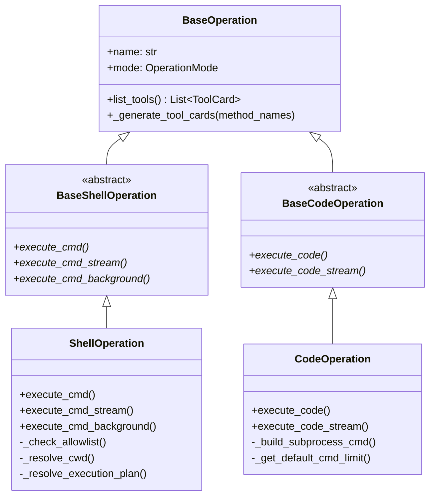
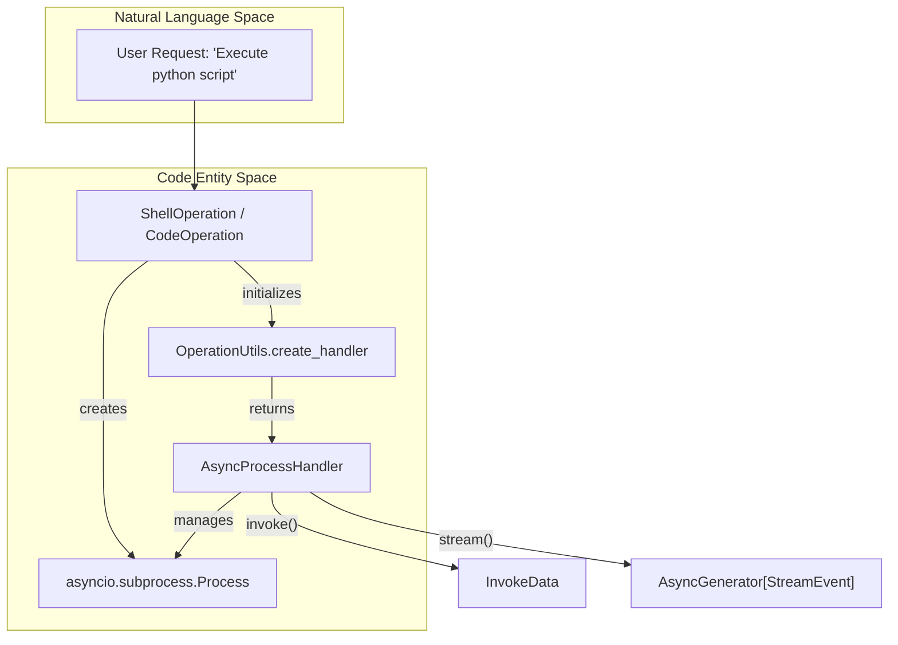

<!-- source: DeepWiki mcp.deepwiki.com · repo openJiuwen-ai/agent-core · page 11.1 Shell and Code Execution · fetched 2026-11-02 -->

# Shell and Code Execution

Relevant source files

The following files were used as context for generating this wiki page:

- [docs/en/2.Development Guide/API Docs/openjiuwen.core/sys_operation/sys_operation.md](docs/en/2.Development Guide/API Docs/openjiuwen.core/sys_operation/sys_operation.md)
- [docs/en/2.Development Guide/Advanced Usage/System Operation.md](docs/en/2.Development Guide/Advanced Usage/System Operation.md)
- [openjiuwen/core/session/stream/base.py](openjiuwen/core/session/stream/base.py)
- [openjiuwen/core/sys_operation/__init__.py](openjiuwen/core/sys_operation/__init__.py)
- [openjiuwen/core/sys_operation/config.py](openjiuwen/core/sys_operation/config.py)
- [openjiuwen/core/sys_operation/local/shell_operation.py](openjiuwen/core/sys_operation/local/shell_operation.py)
- [openjiuwen/core/sys_operation/local/utils.py](openjiuwen/core/sys_operation/local/utils.py)
- [openjiuwen/core/sys_operation/result/__init__.py](openjiuwen/core/sys_operation/result/__init__.py)
- [openjiuwen/core/sys_operation/result/base_result.py](openjiuwen/core/sys_operation/result/base_result.py)
- [openjiuwen/core/sys_operation/result/code_operation_result.py](openjiuwen/core/sys_operation/result/code_operation_result.py)
- [openjiuwen/core/sys_operation/result/fs_operation_result.py](openjiuwen/core/sys_operation/result/fs_operation_result.py)
- [openjiuwen/core/sys_operation/result/shell_operation_result.py](openjiuwen/core/sys_operation/result/shell_operation_result.py)
- [openjiuwen/core/sys_operation/shell.py](openjiuwen/core/sys_operation/shell.py)
- [openjiuwen/core/sys_operation/sys_operation.py](openjiuwen/core/sys_operation/sys_operation.py)
- [tests/unit_tests/core/sys_operation/local/test_operation_as_tool.py](tests/unit_tests/core/sys_operation/local/test_operation_as_tool.py)
- [tests/unit_tests/core/sys_operation/local/test_shell_operation.py](tests/unit_tests/core/sys_operation/local/test_shell_operation.py)

This page documents the `ShellOperation` and `CodeOperation` subsystems: their interfaces, result types, internal subprocess management, and configuration options. Both are accessed via a `SysOperation` instance and operate under the `OperationMode.LOCAL` mode. For the parent abstraction that registers and exposes these operations, see [System Operations](#11). For file system operations, see [File System Operations](#11.2).

---

## Conceptual Model

Both operations share a common execution model:

1. A caller invokes a method on a sub-operation object (e.g., `sys_op.shell().execute_cmd(...)`).
2. The method creates an `asyncio` subprocess.
3. An `AsyncProcessHandler` wraps the subprocess and either collects all output at once (`invoke`) or streams it chunk by chunk (`stream`).
4. Results are returned as typed Pydantic models — either a single result or an `AsyncIterator` of chunk results.

**Class Hierarchy**

Sources: [openjiuwen/core/sys_operation/shell.py:29-117](), [openjiuwen/core/sys_operation/local/shell_operation.py:168-303](), [openjiuwen/core/sys_operation/local/code_operation.py:79-380](), [openjiuwen/core/sys_operation/sys_operation.py:167-185]()

---

## ShellOperation

`ShellOperation` is registered under the key `"shell"` in `OperationMode.LOCAL` via the `@operation` decorator. It is accessed through `sys_op.shell()`.

[openjiuwen/core/sys_operation/local/shell_operation.py:22-22](), [openjiuwen/core/sys_operation/sys_operation.py:143-144]()

### Methods

| Method | Return Type | Description |
|---|---|---|
| `execute_cmd(...)` | `ExecuteCmdResult` | Runs a shell command, waits for completion, returns full stdout/stderr. |
| `execute_cmd_stream(...)` | `AsyncIterator[ExecuteCmdStreamResult]` | Runs a shell command and streams stdout/stderr in real time. |
| `execute_cmd_background(...)` | `ExecuteCmdBackgroundResult` | Launches a command in the background and returns the PID. |

Sources: [openjiuwen/core/sys_operation/shell.py:41-116](), [openjiuwen/core/sys_operation/local/shell_operation.py:168-303]()

### Working Directory Resolution

`_resolve_cwd` determines the effective working directory. If a `cwd` is provided in the method call, it is used. If not, it defaults to the `work_dir` configured in the `LocalWorkConfig`. If neither is available, it falls back to the current process directory.

[openjiuwen/core/sys_operation/local/shell_operation.py:315-332]()

### Shell Selection and Execution Plan

The system uses `_resolve_execution_plan` to decide whether to use `create_subprocess_shell` or `create_subprocess_exec` based on the requested `ShellType` (AUTO, CMD, POWERSHELL, BASH, SH).

- **Windows**: Detects PowerShell syntax (e.g., `$env:`, `Get-ChildItem`) to automatically switch from CMD to PowerShell. It also handles unwrapping nested PowerShell commands to avoid profile-loading overhead. [openjiuwen/core/sys_operation/local/shell_operation.py:34-80](), [openjiuwen/core/sys_operation/local/shell_operation.py:165-181]()
- **Unix**: Defaults to `sh` or `bash` depending on configuration.

Sources: [openjiuwen/core/sys_operation/local/shell_operation.py:83-157](), [tests/unit_tests/core/sys_operation/local/test_shell_operation.py:54-130]()

### Shell Allowlist

If `LocalWorkConfig.shell_allowlist` is set, only commands whose first token matches an entry in the list are permitted. The default allowlist includes common tools like `echo`, `ls`, `python`, `git`, and `pip`.

[openjiuwen/core/sys_operation/config.py:17-21](), [openjiuwen/core/sys_operation/local/shell_operation.py:306-313]()

---

## CodeOperation

`CodeOperation` is registered under the key `"code"` in `OperationMode.LOCAL`. It is accessed through `sys_op.code()`.

[openjiuwen/core/sys_operation/local/code_operation.py:24-25](), [openjiuwen/core/sys_operation/sys_operation.py:147-148]()

### Supported Languages

The SDK currently supports `"python"` and `"javascript"` (Node.js).

- **Python**: Uses `sys.executable` with `-u` for unbuffered output. [openjiuwen/core/sys_operation/local/code_operation.py:29-34]()
- **JavaScript**: Uses `node` or `node.exe`. [openjiuwen/core/sys_operation/local/code_operation.py:36-40]()

### CLI vs. File Execution

For short code snippets, the command is executed directly via CLI flags (e.g., `python -c`). If the code length exceeds platform limits (8,000 chars on Windows, 100,000 on Unix), it is written to a temporary file for execution.

[openjiuwen/core/sys_operation/local/code_operation.py:27-77]()

---

## Subprocess Execution Engine

Subprocess management is delegated to `AsyncProcessHandler`.

**AsyncProcessHandler Data Flow**

Sources: [openjiuwen/core/sys_operation/local/utils.py:77-111](), [openjiuwen/core/sys_operation/local/shell_operation.py:195-215]()

### AsyncProcessHandler Internals

- **invoke()**: Drains `stdout` and `stderr` into buffers. It uses `asyncio.wait_for` to enforce timeouts. If a timeout occurs, it kills the process tree and returns partial output. [openjiuwen/core/sys_operation/local/utils.py:113-193]()
- **stream()**: Uses an `asyncio.Queue` to yield `StreamEvent` objects (STDOUT, STDERR, EXIT, ERROR) in real-time. [openjiuwen/core/sys_operation/local/utils.py:195-288]()
- **Process Cleanup**: `_kill_process_tree` handles cross-platform process termination, using `os.killpg` on Unix and `process.kill()` on Windows. [openjiuwen/core/sys_operation/local/utils.py:92-111]()

### Result Types

| Result Class | Data Model | Key Fields |
|---|---|---|
| `ExecuteCmdResult` | `ExecuteCmdData` | `command`, `stdout`, `stderr`, `exit_code` |
| `ExecuteCmdStreamResult` | `ExecuteCmdChunkData` | `text`, `type` (stdout/stderr), `chunk_index` |
| `ExecuteCodeResult` | `ExecuteCodeData` | `code_content`, `language`, `stdout`, `exit_code` |

Sources: [openjiuwen/core/sys_operation/result/shell_operation_result.py:10-56](), [openjiuwen/core/sys_operation/result/code_operation_result.py:10-40]()

---

## Configuration and Security

### LocalWorkConfig

`LocalWorkConfig` controls the security boundary:
- `shell_allowlist`: List of allowed command prefixes. [openjiuwen/core/sys_operation/config.py:17-21]()
- `dangerous_patterns`: Regex patterns used to block malicious commands (e.g., `rm -rf`). [openjiuwen/core/sys_operation/config.py:36-39]()

### Environment and Encoding

- **Environment**: Custom variables are merged with the system environment via `OperationUtils.prepare_environment`. [openjiuwen/core/sys_operation/local/utils.py:328-341]()
- **Encoding**: Default is `utf-8`. Python execution specifically sets `PYTHONIOENCODING=utf-8` and `PYTHONUTF8=1` to prevent encoding issues in different locales. [openjiuwen/core/sys_operation/local/code_operation.py:151-152]()

Sources: [openjiuwen/core/sys_operation/config.py:10-40](), [openjiuwen/core/sys_operation/local/shell_operation.py:334-338]()

---

