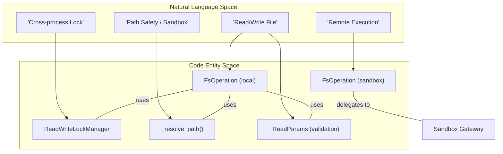

<!-- source: DeepWiki mcp.deepwiki.com · repo openJiuwen-ai/agent-core · page 11.2 File System Operations · fetched 2026-11-02 -->

# File System Operations

<details>
<summary>Relevant source files</summary>

The following files were used as context for generating this wiki page:

- [openjiuwen/core/sys_operation/base.py](openjiuwen/core/sys_operation/base.py)
- [openjiuwen/core/sys_operation/code.py](openjiuwen/core/sys_operation/code.py)
- [openjiuwen/core/sys_operation/fs.py](openjiuwen/core/sys_operation/fs.py)
- [openjiuwen/core/sys_operation/local/CLAUDE.md](openjiuwen/core/sys_operation/local/CLAUDE.md)
- [openjiuwen/core/sys_operation/local/_async_read_write_lock.py](openjiuwen/core/sys_operation/local/_async_read_write_lock.py)
- [openjiuwen/core/sys_operation/local/_rw_lock_manager.py](openjiuwen/core/sys_operation/local/_rw_lock_manager.py)
- [openjiuwen/core/sys_operation/local/code_operation.py](openjiuwen/core/sys_operation/local/code_operation.py)
- [openjiuwen/core/sys_operation/local/fs_operation.py](openjiuwen/core/sys_operation/local/fs_operation.py)
- [openjiuwen/core/sys_operation/registry.py](openjiuwen/core/sys_operation/registry.py)
- [openjiuwen/core/sys_operation/sandbox/code_operation.py](openjiuwen/core/sys_operation/sandbox/code_operation.py)
- [openjiuwen/core/sys_operation/sandbox/fs_operation.py](openjiuwen/core/sys_operation/sandbox/fs_operation.py)
- [tests/unit_tests/agent_teams/CLAUDE.md](tests/unit_tests/agent_teams/CLAUDE.md)
- [tests/unit_tests/agent_teams/docs/test_design.md](tests/unit_tests/agent_teams/docs/test_design.md)
- [tests/unit_tests/core/sys_operation/local/test_code_operation.py](tests/unit_tests/core/sys_operation/local/test_code_operation.py)
- [tests/unit_tests/core/sys_operation/local/test_custom_operation_extension.py](tests/unit_tests/core/sys_operation/local/test_custom_operation_extension.py)
- [tests/unit_tests/core/sys_operation/local/test_fs_operation.py](tests/unit_tests/core/sys_operation/local/test_fs_operation.py)

</details>


This page documents `FsOperation` — the file system component of the `SysOperation` abstraction layer. It covers the methods provided by `BaseFsOperation` and their local implementation in `FsOperation`, result and data types, streaming behavior, path resolution, and the differences between `LOCAL` and `SANDBOX` modes.

For the broader `SysOperation` framework (registration, modes, tool-ID format), see [openjiuwen/core/sys_operation/base.py](). For shell and code execution operations, see **11.1. Shell and Code Execution**.

---

## Overview

`FsOperation` is the file system sub-operation accessible via `SysOperation.fs()`. It is registered under the name `"fs"` and provides async methods for reading, writing, uploading, downloading, listing, and searching files within a configured working directory.

**Class hierarchy:**

```mermaid
classDiagram
    direction TB
    class "BaseOperation"["BaseOperation (openjiuwen/core/sys_operation/base.py)"] {
        +name: str
        +mode: OperationMode
        +description: str
        +_run_config: LocalWorkConfig | SandboxGatewayConfig
        +list_tools() List~ToolCard~
    }
    class "BaseFsOperation"["BaseFsOperation (openjiuwen/core/sys_operation/fs.py)"] {
        <<abstract>>
        +read_file()
        +read_file_stream()
        +write_file()
        +upload_file()
        +list_files()
        +list_directories()
        +search_files()
    }
    class "FsOperation_LOCAL"["FsOperation (openjiuwen/core/sys_operation/local/fs_operation.py)"] {
        +_file_lock()
        +_resolve_path() 
        +_transfer_file()
        +_apply_permissions()
    }
    class "FsOperation_SANDBOX"["FsOperation (openjiuwen/core/sys_operation/sandbox/fs_operation.py)"] {
        +invoke()
        +invoke_stream()
    }
    BaseOperation <|-- BaseFsOperation
    BaseFsOperation <|-- FsOperation_LOCAL
    BaseFsOperation <|-- FsOperation_SANDBOX
```

Sources: [openjiuwen/core/sys_operation/fs.py:25-41](), [openjiuwen/core/sys_operation/local/fs_operation.py:131-133](), [openjiuwen/core/sys_operation/sandbox/fs_operation.py:21-22](), [openjiuwen/core/sys_operation/base.py:78-91]()

The local implementation lives in [openjiuwen/core/sys_operation/local/fs_operation.py](). The class is decorated with `@operation(name="fs", mode=OperationMode.LOCAL, ...)`, which registers it automatically in `OperationRegistry`.

Sources: [openjiuwen/core/sys_operation/local/fs_operation.py:131-132]()

---

## Concurrency and Locking

The local `FsOperation` implementation provides cross-process file synchronization using a hybrid async read-write lock system. This ensures data integrity when multiple agent instances or external processes access same files.

### `ReadWriteLockManager`
The `ReadWriteLockManager` handles the lifecycle of cross-process locks using SQLite-based lock databases stored in a machine-local temporary directory (`openjiuwen-fs-rwlocks`). 

- **Readers/Writer Rules**: Multiple concurrent readers are allowed, but a writer requires exclusive access. [openjiuwen/core/sys_operation/local/CLAUDE.md:48-51]()
- **Deterministic Locking**: Lock database paths are a stable SHA-256 hash of the normalized target file path. [openjiuwen/core/sys_operation/local/_rw_lock_manager.py:56-60]()
- **Idle Cleanup**: Lock singletons are evicted after 2 minutes of inactivity. [openjiuwen/core/sys_operation/local/_rw_lock_manager.py:38-39]()
- **Deadlock Prevention**: For operations touching multiple files (e.g., `upload_file` reading source and writing destination), `_ordered_file_locks` acquires locks in sorted path order. [openjiuwen/core/sys_operation/local/fs_operation.py:172-180]()

Sources: [openjiuwen/core/sys_operation/local/_rw_lock_manager.py:29-68](), [openjiuwen/core/sys_operation/local/CLAUDE.md:44-56]()

---

## Method Reference

### Method-to-Result Type Map

**Non-streaming methods:**

| Method | Returns | Data type on `.data` |
|---|---|---|
| `read_file` | `ReadFileResult` | `ReadFileData` |
| `write_file` | `WriteFileResult` | `WriteFileData` |
| `upload_file` | `UploadFileResult` | `UploadFileData` |
| `download_file` | `DownloadFileResult` | `DownloadFileData` |
| `list_files` | `ListFilesResult` | `FileSystemData` |
| `list_directories` | `ListDirsResult` | `FileSystemData` |
| `search_files` | `SearchFilesResult` | `SearchFilesData` |

**Streaming methods:**

| Method | Yields | Chunk data type |
|---|---|---|
| `read_file_stream` | `ReadFileStreamResult` | `ReadFileChunkData` |
| `upload_file_stream` | `UploadFileStreamResult` | `UploadFileChunkData` |
| `download_file_stream` | `DownloadFileStreamResult` | `DownloadFileChunkData` |

Sources: [openjiuwen/core/sys_operation/result/__init__.py]()

---

### `read_file` and `read_file_stream`

Reads a file with support for line-based subsetting (`head`, `tail`, `line_range`) and binary/text modes.

**Signature Highlights:**
- `mode`: `'text'` (default) or `'bytes'`.
- `head`/`tail`/`line_range`: Mutually exclusive; only available in `text` mode. [openjiuwen/core/sys_operation/local/fs_operation.py:113-119]()
- `chunk_size`: Defaults to `0` (unlimited) for standard reads, and `8192` (8KB) for streaming. [openjiuwen/core/sys_operation/fs.py:16-21]()

**Streaming Behavior**: In text mode, `read_file_stream` yields line-by-line. In binary mode, it yields chunks of `chunk_size`. It uses a peek-ahead pattern to correctly set the `is_last_chunk` flag. [openjiuwen/core/sys_operation/local/CLAUDE.md:79-81]()

Sources: [openjiuwen/core/sys_operation/local/fs_operation.py:190-223](), [openjiuwen/core/sys_operation/local/fs_operation.py:225-308]()

---

### `write_file`

Writes content to a path. Supports prepending/appending newlines for text content.

- **Atomic Locking**: Acquires an exclusive write lock via `_file_lock`. [openjiuwen/core/sys_operation/local/fs_operation.py:381-382]()
- **Permissions**: Best-effort permission application on Unix via `os.chmod`; ignored on Windows. [openjiuwen/core/sys_operation/local/fs_operation.py:365-369]()

Sources: [openjiuwen/core/sys_operation/local/fs_operation.py:310-391]()

---

### `upload_file` and `download_file`

Handles file movement between the local host and the agent workspace.

- **Path Safety**: Source and destination are resolved and validated for sandbox escape if `restrict_to_sandbox` is enabled. [openjiuwen/core/sys_operation/local/CLAUDE.md:65-71]()
- **Progress Tracking**: Both operations provide streaming versions that yield progress chunks with `chunk_index` and `is_last_chunk`. [openjiuwen/core/sys_operation/local/CLAUDE.md:79-81]()

Sources: [openjiuwen/core/sys_operation/local/fs_operation.py:393-539](), [openjiuwen/core/sys_operation/local/fs_operation.py:541-640]()

---

## LOCAL vs SANDBOX Modes

The operation behavior differs significantly based on the `OperationMode`:

### LOCAL Mode
- **Implementation**: `openjiuwen.core.sys_operation.local.fs_operation.FsOperation`.
- **Direct I/O**: Uses `aiofiles` and `pathlib` for direct system access.
- **Locking**: Uses the local SQLite lock databases for cross-process synchronization. [openjiuwen/core/sys_operation/local/CLAUDE.md:46-47]()
- **Sandbox**: Enforced via path prefix checks against `sandbox_root`. [openjiuwen/core/sys_operation/local/CLAUDE.md:68-71]()

### SANDBOX Mode
- **Implementation**: `openjiuwen.core.sys_operation.sandbox.fs_operation.FsOperation`.
- **Gateway Routing**: Delegates all calls to a `BaseSandboxMixin`-provided `invoke` or `invoke_stream` method, which routes requests to a remote sandbox gateway. [openjiuwen/core/sys_operation/sandbox/fs_operation.py:43-46]()
- **Concurrency**: Relies on the sandbox gateway to manage its own file access controls; parameters like `only_read` (lock-waiving) are accepted for parity but usually ignored. [openjiuwen/core/sys_operation/sandbox/fs_operation.py:39-42]()

Sources: [openjiuwen/core/sys_operation/local/fs_operation.py:131-132](), [openjiuwen/core/sys_operation/sandbox/fs_operation.py:21-22](), [openjiuwen/core/sys_operation/sandbox/sandbox_mixin.py]()

---

## Entity Mapping: Natural Language to Code

The following diagram maps high-level file system concepts to the specific code modules and classes.



Sources: [openjiuwen/core/sys_operation/local/fs_operation.py](), [openjiuwen/core/sys_operation/local/_rw_lock_manager.py](), [openjiuwen/core/sys_operation/sandbox/fs_operation.py]()

---

