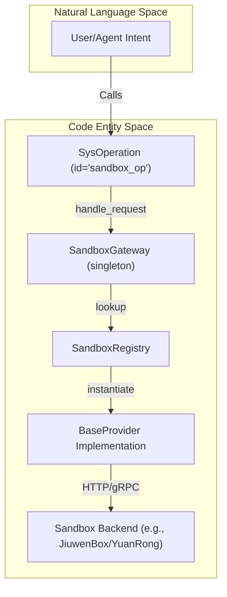
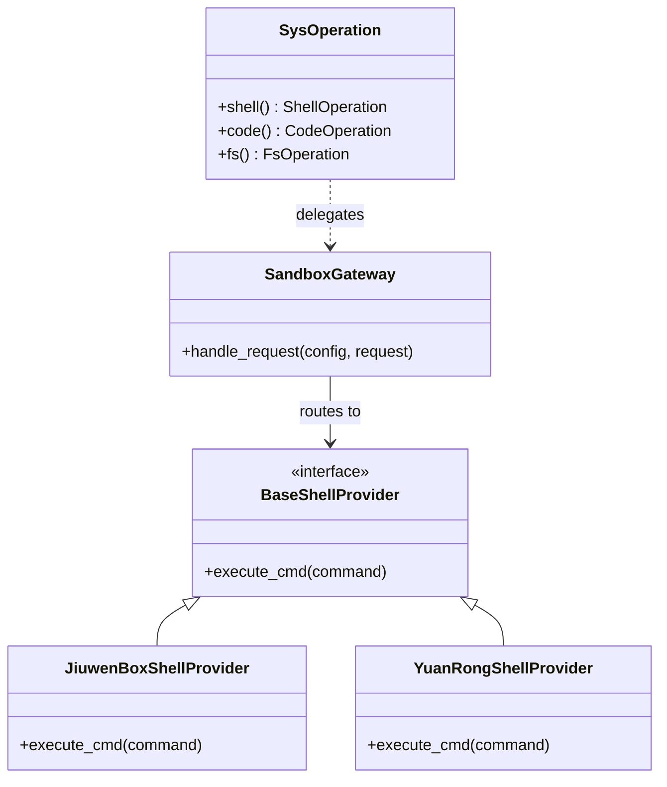

<!-- source: DeepWiki mcp.deepwiki.com · repo openJiuwen-ai/agent-core · page 11.3 Sandbox Providers · fetched 2026-11-02 -->

# Sandbox Providers

Relevant source files

The following files were used as context for generating this wiki page:

- [openjiuwen/core/sys_operation/sandbox/gateway/gateway.py](openjiuwen/core/sys_operation/sandbox/gateway/gateway.py)
- [openjiuwen/core/sys_operation/sandbox/launchers/base.py](openjiuwen/core/sys_operation/sandbox/launchers/base.py)
- [openjiuwen/core/sys_operation/sandbox/launchers/pre_deployment_launcher.py](openjiuwen/core/sys_operation/sandbox/launchers/pre_deployment_launcher.py)
- [openjiuwen/extensions/sys_operation/sandbox/providers/__init__.py](openjiuwen/extensions/sys_operation/sandbox/providers/__init__.py)
- [openjiuwen/extensions/sys_operation/sandbox/providers/jiuwenbox.py](openjiuwen/extensions/sys_operation/sandbox/providers/jiuwenbox.py)
- [openjiuwen/extensions/sys_operation/sandbox/providers/yuanrong.py](openjiuwen/extensions/sys_operation/sandbox/providers/yuanrong.py)
- [tests/unit_tests/extensions/sys_operation/sandbox/__init__.py](tests/unit_tests/extensions/sys_operation/sandbox/__init__.py)
- [tests/unit_tests/extensions/sys_operation/sandbox/test_jiuwenbox.py](tests/unit_tests/extensions/sys_operation/sandbox/test_jiuwenbox.py)
- [tests/unit_tests/extensions/sys_operation/sandbox/test_jiuwenbox_code_operation.py](tests/unit_tests/extensions/sys_operation/sandbox/test_jiuwenbox_code_operation.py)
- [tests/unit_tests/extensions/sys_operation/sandbox/test_jiuwenbox_exec_delivered.py](tests/unit_tests/extensions/sys_operation/sandbox/test_jiuwenbox_exec_delivered.py)
- [tests/unit_tests/extensions/sys_operation/sandbox/test_jiuwenbox_fs_operation.py](tests/unit_tests/extensions/sys_operation/sandbox/test_jiuwenbox_fs_operation.py)
- [tests/unit_tests/extensions/sys_operation/sandbox/test_jiuwenbox_shell_operation.py](tests/unit_tests/extensions/sys_operation/sandbox/test_jiuwenbox_shell_operation.py)
- [tests/unit_tests/extensions/sys_operation/sandbox/test_yuanrong.py](tests/unit_tests/extensions/sys_operation/sandbox/test_yuanrong.py)
- [tests/unit_tests/extensions/sys_operation/sandbox/test_yuanrong_code_operation.py](tests/unit_tests/extensions/sys_operation/sandbox/test_yuanrong_code_operation.py)
- [tests/unit_tests/extensions/sys_operation/sandbox/test_yuanrong_fs_operation.py](tests/unit_tests/extensions/sys_operation/sandbox/test_yuanrong_fs_operation.py)
- [tests/unit_tests/extensions/sys_operation/sandbox/test_yuanrong_shell_operation.py](tests/unit_tests/extensions/sys_operation/sandbox/test_yuanrong_shell_operation.py)

Sandbox Providers implement the execution logic for shell commands, code snippets, and filesystem operations within isolated environments. They abstract the communication with various sandbox backends (e.g., Docker containers, remote execution services) from the high-level `SysOperation` interface.

## Sandbox Architecture and Data Flow

The sandbox system follows a gateway-provider pattern. The `SandboxGateway` acts as a central router, resolving sandbox endpoints and instantiating the appropriate providers based on the configuration provided in a `SysOperationCard`.

### Sandbox Execution Flow
The following diagram illustrates how a request from a `SysOperation` instance is routed through the `SandboxGateway` to a specific provider implementation.

**Sandbox Routing and Execution**

Sources: `[openjiuwen/core/sys_operation/sandbox/gateway/gateway.py:84-101]()`, `[openjiuwen/core/sys_operation/sandbox/sandbox_registry.py:13-55]()`.

## Sandbox Gateway

The `SandboxGateway` is a singleton class responsible for managing the lifecycle of sandbox providers and routing requests.

### Key Functions
- `handle_request`: Resolves the `SandboxEndpoint`, selects the provider, and executes the requested method (e.g., `read_file`, `execute_cmd`) `[openjiuwen/core/sys_operation/sandbox/gateway/gateway.py:84-101]()`.
- `handle_stream_request`: Similar to `handle_request` but returns an `AsyncIterator` for streaming operations like command output `[openjiuwen/core/sys_operation/sandbox/gateway/gateway.py:103-115]()`.
- `_get_or_create_provider`: Manages a `_provider_cache` to reuse provider instances for the same isolation key and operation type `[openjiuwen/core/sys_operation/sandbox/gateway/gateway.py:117-136]()`.
- `release_sandbox`: Evicts cached providers and triggers the launcher to delete or pause the sandbox `[openjiuwen/core/sys_operation/sandbox/gateway/gateway.py:158-172]()`.

Sources: `[openjiuwen/core/sys_operation/sandbox/gateway/gateway.py:53-172]()`.

## Sandbox Providers

Providers are categorized by their capability: `BaseFSProvider`, `BaseShellProvider`, and `BaseCodeProvider`. Concrete implementations are registered in the `SandboxRegistry`.

### JiuwenBox Provider
The `JiuwenBoxProvider` implementation communicates with the Jiuwen sandbox service via HTTP.

- **Shell Operations**: Implements `execute_cmd` and `execute_cmd_stream` by sending requests to the sandbox endpoint `[openjiuwen/extensions/sys_operation/sandbox/providers/jiuwenbox.py:469-520]()`.
- **Code Operations**: Executes code snippets, supporting multiple languages and environment variables `[openjiuwen/extensions/sys_operation/sandbox/providers/jiuwenbox.py:540-580]()`.
- **FS Operations**: Handles file reads (including `head`, `tail`, and `line_range` parameters), writes, and directory listing `[openjiuwen/extensions/sys_operation/sandbox/providers/jiuwenbox.py:270-450]()`.
- **Error Handling**: Uses specialized builders like `_build_fs_error_result` to map HTTP errors to `StatusCode` values `[openjiuwen/extensions/sys_operation/sandbox/providers/jiuwenbox.py:81-105]()`.

### YuanRong Provider
The `YuanRongProvider` integrates with the `yr` actor SDK. It supports two execution modes: `default` (standard sandbox) and `docker` (custom container images) `[openjiuwen/extensions/sys_operation/sandbox/providers/yuanrong.py:5-15]()`.

- **Shared Instances**: Uses a `_shared_instances` dictionary to cache SDK client instances per endpoint/isolation key `[openjiuwen/extensions/sys_operation/sandbox/providers/yuanrong.py:254-270]()`.
- **FS Mapping**: Maps native SDK calls like `read_file` and `list_files` to the provider interface `[openjiuwen/extensions/sys_operation/sandbox/providers/yuanrong.py:270-430]()`.

### AIO Provider
The `AIOProvider` wraps the `agent_sandbox` SDK. It includes parameter validation to ensure that text-mode features like `line_range` are not applied to binary reads `[openjiuwen/extensions/sys_operation/sandbox/providers/aio.py:101-121]()`.

Sources: `[openjiuwen/extensions/sys_operation/sandbox/providers/jiuwenbox.py:56-580]()`, `[openjiuwen/extensions/sys_operation/sandbox/providers/yuanrong.py:16-430]()`, `[openjiuwen/extensions/sys_operation/sandbox/providers/aio.py:199-250]()`.

## Operations in Sandbox Mode

When a `SysOperation` is configured with `OperationMode.SANDBOX`, its sub-operations delegate all calls to the `SandboxGateway`.

| Operation Type | Implementation Class | Key Methods |
| :--- | :--- | :--- |
| **Shell** | `ShellOperation` | `execute_cmd`, `execute_cmd_stream` |
| **Code** | `CodeOperation` | `execute_code`, `execute_code_stream` |
| **File System** | `FsOperation` | `read_file`, `write_file`, `list_files`, `upload_file` |

**Code Entity Mapping: Operations to Providers**

Sources: `[openjiuwen/core/sys_operation/sandbox/gateway/gateway.py:84-115]()`, `[openjiuwen/core/sys_operation/sandbox/providers/base_provider.py:1-100]()`.

## Configuration and Extension

### Configuration
Sandbox behavior is controlled via `SandboxGatewayConfig`:
- `launcher_config`: Specifies the `sandbox_type` (e.g., "jiuwenbox", "yuanrong") and the `base_url` `[openjiuwen/core/sys_operation/config.py:72-80]()`.
- `isolation`: Defines the `container_scope` (SYSTEM, SESSION, or CUSTOM) and the `custom_id` `[openjiuwen/core/sys_operation/config.py:47-55]()`.

### Launchers
Launchers manage the physical creation and deletion of sandboxes. The `PreDeploymentLauncher` is a built-in launcher that handles sandboxes already deployed or managed by external services like JiuwenBox or YuanRong `[openjiuwen/core/sys_operation/sandbox/launchers/pre_deployment_launcher.py:7-12]()`.

### Extending Providers
To add a new sandbox provider:
1. Inherit from `BaseFSProvider`, `BaseShellProvider`, or `BaseCodeProvider`.
2. Implement the abstract methods.
3. Register the class using `SandboxRegistry.provider` `[openjiuwen/core/sys_operation/sandbox/sandbox_registry.py:57-65]()`.

Sources: `[openjiuwen/core/sys_operation/config.py:47-80]()`, `[openjiuwen/core/sys_operation/sandbox/launchers/pre_deployment_launcher.py:7-51]()`, `[openjiuwen/core/sys_operation/sandbox/sandbox_registry.py:57-82]()`.

---

