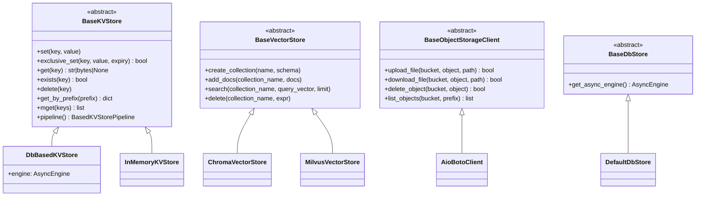

<!-- source: DeepWiki mcp.deepwiki.com · repo openJiuwen-ai/agent-core · page 12 Storage Backends · fetched 2026-11-02 -->

# Storage Backends

Relevant source files

The following files were used as context for generating this wiki page:

- [docs/en/2.Development Guide/API Docs/openjiuwen.core/foundation/store.README.md](docs/en/2.Development Guide/API Docs/openjiuwen.core/foundation/store.README.md)
- [docs/en/2.Development Guide/API Docs/openjiuwen.core/foundation/store/store.md](docs/en/2.Development Guide/API Docs/openjiuwen.core/foundation/store/store.md)
- [openjiuwen/core/foundation/store/__init__.py](openjiuwen/core/foundation/store/__init__.py)
- [openjiuwen/core/foundation/store/base_db_store.py](openjiuwen/core/foundation/store/base_db_store.py)
- [openjiuwen/core/foundation/store/base_kv_store.py](openjiuwen/core/foundation/store/base_kv_store.py)
- [openjiuwen/core/foundation/store/base_vector_store.py](openjiuwen/core/foundation/store/base_vector_store.py)
- [openjiuwen/core/foundation/store/vector/__init__.py](openjiuwen/core/foundation/store/vector/__init__.py)
- [openjiuwen/core/foundation/store/vector/chroma_vector_store.py](openjiuwen/core/foundation/store/vector/chroma_vector_store.py)
- [openjiuwen/core/foundation/store/vector/milvus_vector_store.py](openjiuwen/core/foundation/store/vector/milvus_vector_store.py)
- [openjiuwen/core/foundation/store/vector/utils.py](openjiuwen/core/foundation/store/vector/utils.py)
- [tests/unit_tests/core/foundation/store/test_chroma_vector_store.py](tests/unit_tests/core/foundation/store/test_chroma_vector_store.py)
- [tests/unit_tests/core/foundation/store/test_milvus_vector_store.py](tests/unit_tests/core/foundation/store/test_milvus_vector_store.py)
- [tests/unit_tests/core/memory/migration/migrator/test_chroma_vec_migrator.py](tests/unit_tests/core/memory/migration/migrator/test_chroma_vec_migrator.py)

This page describes the storage abstraction layer in `openjiuwen-agent-core`: the key-value store hierarchy, the vector store factory, and the object storage client hierarchy. These components are infrastructure-level building blocks used by memory, session management, and retrieval systems.

- For detailed documentation on `BaseKVStore` implementations (SQLite, MySQL, InMemory), see [Key-Value Stores](#12.1).
- For documentation on the S3-compatible `BaseObjectStorageClient`, see [Object Storage](#12.2).
- For documentation on specialized backends like GaussDB, Elasticsearch, and Redis, see [Extension Stores](#12.3).

---

## Architecture Overview

The storage layer provides a unified interface for three primary data patterns: unstructured blobs (Object Storage), structured key-value pairs (KV Store), and high-dimensional embeddings (Vector Store).

**Storage Backends — Class Hierarchy**

Sources: [openjiuwen/core/foundation/store/base_kv_store.py:16-161](), [openjiuwen/core/foundation/store/base_vector_store.py:228-348](), [openjiuwen/core/foundation/store/base_db_store.py:7-28](), [openjiuwen/core/foundation/store/object/base_storage_client.py:7-82]()

---

## Consumers of Storage Backends

Storage abstractions decouple the core framework logic from specific database implementations. The framework utilizes lazy-loading via `__getattr__` to avoid unnecessary imports of heavy dependencies like SQLAlchemy [openjiuwen/core/foundation/store/__init__.py:7-12]().

**How storage backends are consumed**

```mermaid
flowchart TD
    subgraph "KV Stores"
        KVBase["BaseKVStore\nopenjiuwen/core/foundation/store/base_kv_store.py"]
        DbKV["DbBasedKVStore\n(SQLAlchemy)"]
        MemKV["InMemoryKVStore"]
        KVBase --> DbKV
        KVBase --> MemKV
    end

    subgraph "Vector Stores"
        VecBase["BaseVectorStore\nopenjiuwen/core/foundation/store/base_vector_store.py"]
        Milvus["MilvusVectorStore\nopenjiuwen/core/foundation/store/vector/milvus_vector_store.py"]
        Chroma["ChromaVectorStore\nopenjiuwen/core/foundation/store/vector/chroma_vector_store.py"]
        VecBase --> Milvus
        VecBase --> Chroma
    end

    subgraph "Object Storage"
        ObjBase["BaseObjectStorageClient\nopenjiuwen/core/foundation/store/object/base_storage_client.py"]
        AioBot["AioBotoClient\n(S3/OBS)"]
        ObjBase --> AioBot
    end

    subgraph "System Pillars"
        Mem["LongTermMemory\n(MessageManager)"]
        Retrieval["KnowledgeBase\n(Retrievers)"]
        Check["Checkpointer\n(Session State)"]
        Ops["FsOperation\n(File Tools)"]
    end

    KVBase --> Mem
    KVBase --> Check
    VecBase --> Retrieval
    ObjBase --> Ops
```

Sources: [openjiuwen/core/foundation/store/__init__.py:117-134](), [docs/en/2.Development Guide/API Docs/openjiuwen.core/foundation/store/store.md:1-12]()

---

## Key-Value Stores

The `BaseKVStore` ([openjiuwen/core/foundation/store/base_kv_store.py:16-161]()) provides the foundation for session checkpointing and memory management. 

### Core Implementations
- **`DbBasedKVStore`**: Uses SQLAlchemy to support SQLite and MySQL. It automatically manages a `kv_store` table [docs/en/2.Development Guide/API Docs/openjiuwen.core/foundation/store/store.md:192-215]().
- **`InMemoryKVStore`**: A thread-safe dictionary-based store for testing or ephemeral state [openjiuwen/core/foundation/store/kv/in_memory_kv_store.py:25-26]().
- **`BasedKVStorePipeline`**: Provides a pipeline-like interface for batch operations to reduce network round-trips [openjiuwen/core/foundation/store/base_kv_store.py:164-215]().

For implementation details and distributed locking primitives, see [Key-Value Stores](#12.1).

---

## Vector Stores

The vector store layer handles high-dimensional search for RAG (Retrieval-Augmented Generation). It uses `VectorDataType` to define field types such as `VARCHAR`, `FLOAT_VECTOR`, and `JSON` [openjiuwen/core/foundation/store/base_vector_store.py:16-30]().

### Vector Store Factory
The `create_vector_store` function resolves backends in the following order:
1. **Built-in**: `chroma`, `milvus`, `gaussvector` [openjiuwen/core/foundation/store/__init__.py:35](), [openjiuwen/core/foundation/store/__init__.py:65-77]().
2. **Programmatic**: Via `register_vector_store()` [openjiuwen/core/foundation/store/__init__.py:42-63]().
3. **Plugins**: Via `openjiuwen.vector_stores` entry points [openjiuwen/core/foundation/store/__init__.py:81-115]().

### Implementations
- **`MilvusVectorStore`**: Supports complex schemas and lazy client initialization [openjiuwen/core/foundation/store/vector/milvus_vector_store.py:33-101]().
- **`ChromaVectorStore`**: Supports persistent or in-memory storage with HNSW indexing [openjiuwen/core/foundation/store/vector/chroma_vector_store.py:33-162]().

For detailed configuration of retrieval strategies, see [Vector Stores](#7.1).

---

## Object Storage

`BaseObjectStorageClient` ([openjiuwen/core/foundation/store/object/base_storage_client.py:7-82]()) defines the interface for file-based operations. 

- **`AioBotoClient`**: The primary implementation using `aioboto3`. It supports S3-compatible services like Huawei Cloud OBS and AWS S3.
- **Functionality**: Includes `upload_file`, `download_file`, `delete_object`, and `list_objects`.

For detailed client usage and bucket management, see [Object Storage](#12.2).

---

## Extension Stores

The framework supports advanced storage extensions:
- **Relational Access**: `BaseDbStore` provides raw access to an `AsyncEngine` for complex SQL operations [openjiuwen/core/foundation/store/base_db_store.py:7-28]().
- **Schema Migration**: `VectorMigrator` and associated operations (e.g., `AddScalarFieldOperation`) allow evolving vector store schemas without data loss [openjiuwen/core/memory/migration/migrator/vector_migrator.py:15-15]() (implied), [openjiuwen/core/foundation/store/vector/utils.py:139-172]().

For details on GaussDB, Redis checkpointers, and remote A2A clients, see [Extension Stores](#12.3).

---

