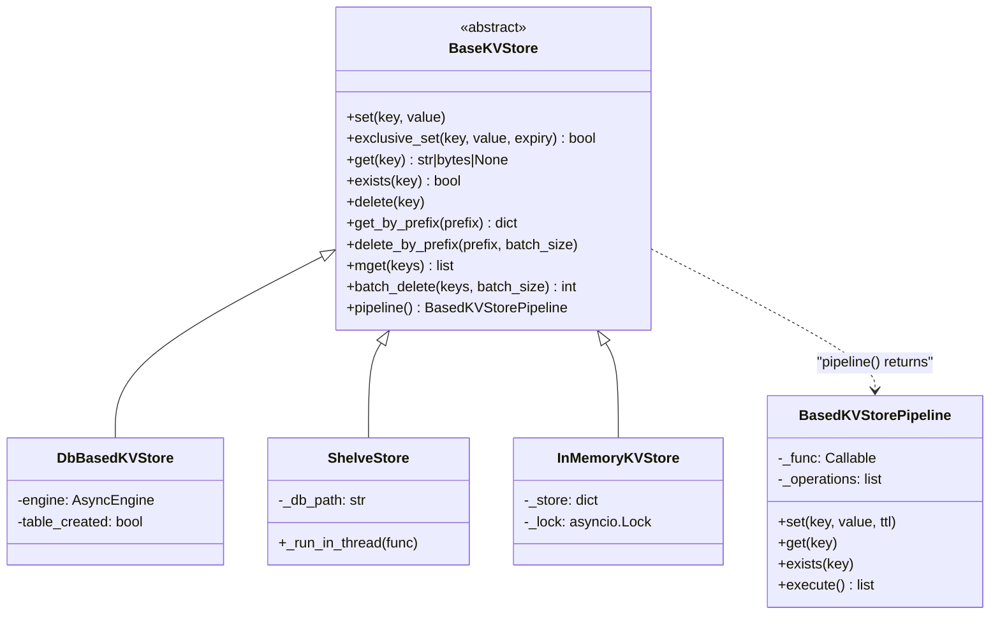
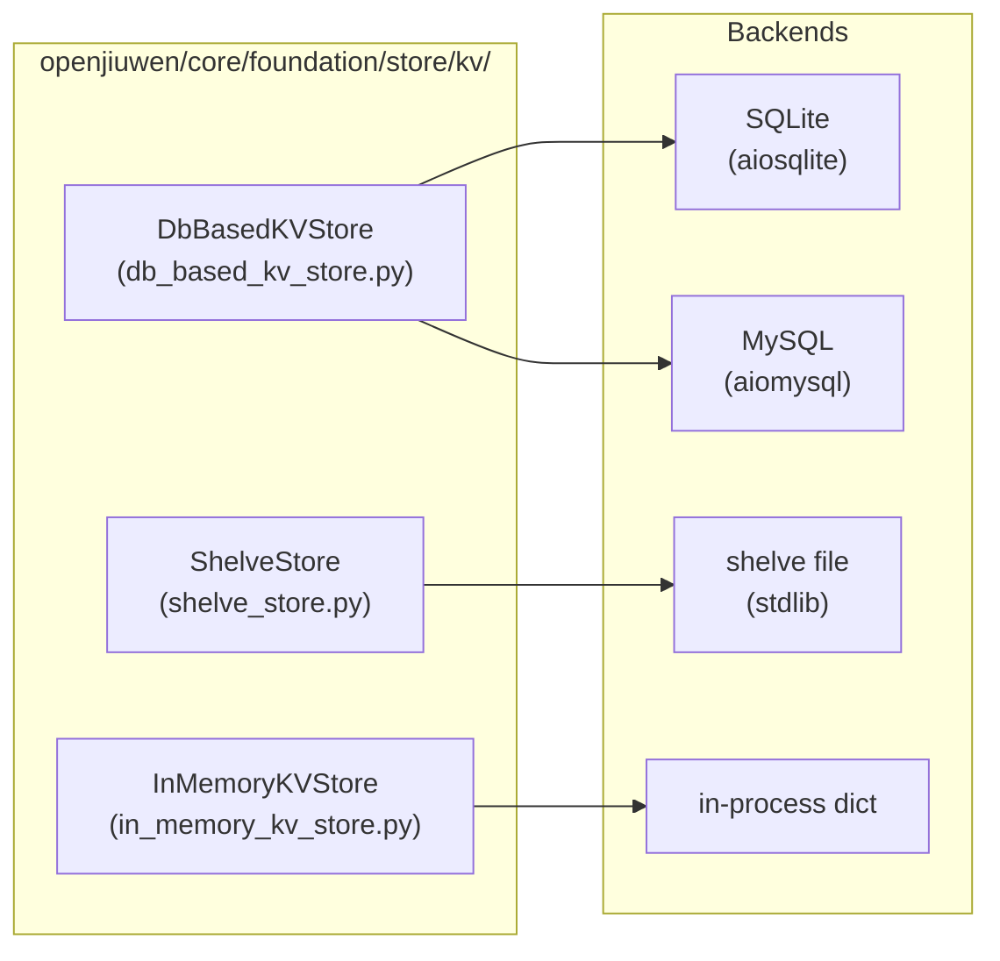
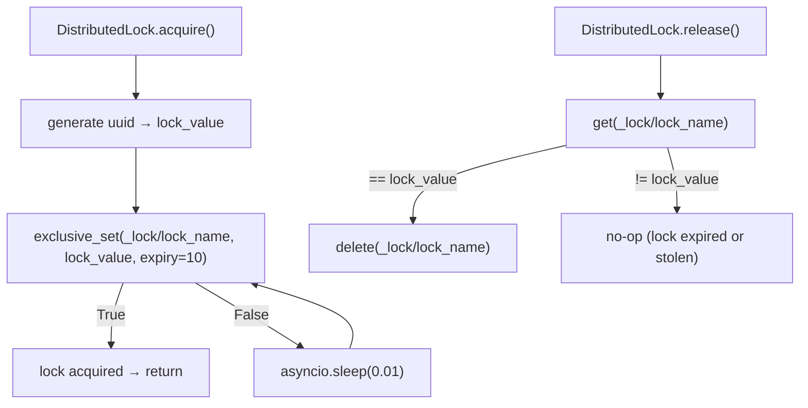
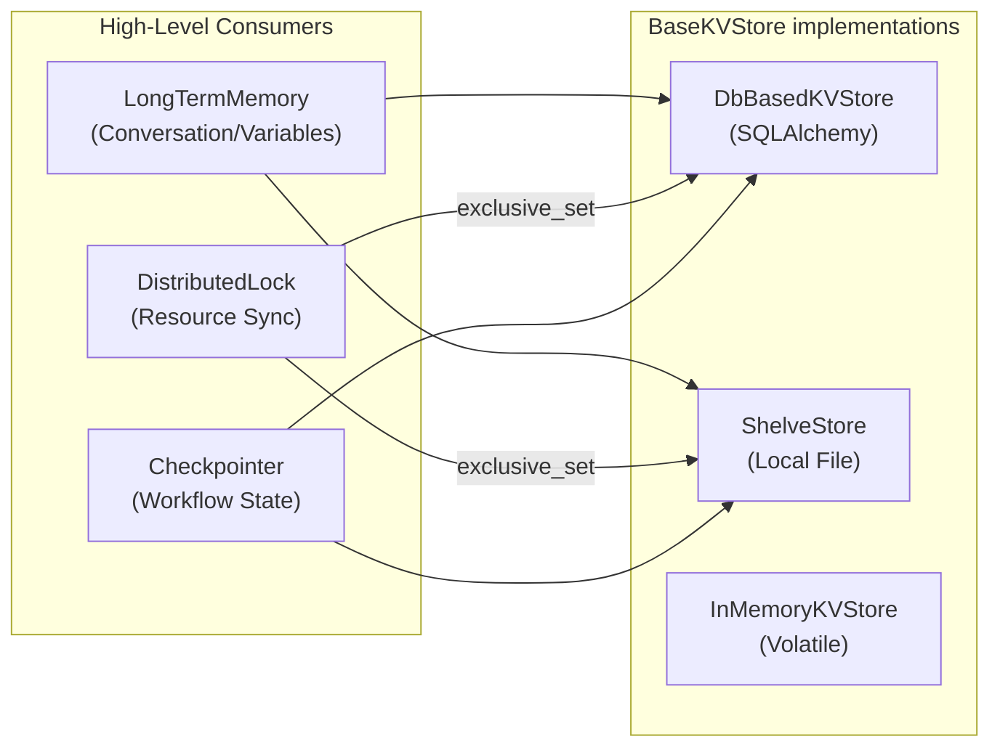

<!-- source: DeepWiki mcp.deepwiki.com · repo openJiuwen-ai/agent-core · page 12.1 Key-Value Stores · fetched 2026-11-02 -->

# Key-Value Stores

<details>
<summary>Relevant source files</summary>

The following files were used as context for generating this wiki page:

- [docs/en/2.Development Guide/API Docs/openjiuwen.core/foundation/store.README.md](docs/en/2.Development Guide/API Docs/openjiuwen.core/foundation/store.README.md)
- [docs/en/2.Development Guide/API Docs/openjiuwen.core/foundation/store/store.md](docs/en/2.Development Guide/API Docs/openjiuwen.core/foundation/store/store.md)
- [docs/en/2.Development Guide/Advanced Usage/Checkpointer Checkpoint Mechanism.md](docs/en/2.Development Guide/Advanced Usage/Checkpointer Checkpoint Mechanism.md)
- [openjiuwen/core/foundation/store/__init__.py](openjiuwen/core/foundation/store/__init__.py)
- [openjiuwen/core/foundation/store/base_db_store.py](openjiuwen/core/foundation/store/base_db_store.py)
- [openjiuwen/core/foundation/store/base_kv_store.py](openjiuwen/core/foundation/store/base_kv_store.py)
- [openjiuwen/core/foundation/store/base_vector_store.py](openjiuwen/core/foundation/store/base_vector_store.py)
- [openjiuwen/core/foundation/store/vector/__init__.py](openjiuwen/core/foundation/store/vector/__init__.py)
- [openjiuwen/core/foundation/store/vector/chroma_vector_store.py](openjiuwen/core/foundation/store/vector/chroma_vector_store.py)
- [openjiuwen/core/foundation/store/vector/milvus_vector_store.py](openjiuwen/core/foundation/store/vector/milvus_vector_store.py)
- [openjiuwen/core/foundation/store/vector/utils.py](openjiuwen/core/foundation/store/vector/utils.py)
- [openjiuwen/core/session/checkpointer/__init__.py](openjiuwen/core/session/checkpointer/__init__.py)
- [openjiuwen/core/session/checkpointer/base.py](openjiuwen/core/session/checkpointer/base.py)
- [openjiuwen/core/session/checkpointer/inmemory.py](openjiuwen/core/session/checkpointer/inmemory.py)
- [openjiuwen/core/session/checkpointer/persistence.py](openjiuwen/core/session/checkpointer/persistence.py)
- [openjiuwen/extensions/checkpointer/redis/checkpointer.py](openjiuwen/extensions/checkpointer/redis/checkpointer.py)
- [openjiuwen/extensions/checkpointer/redis/storage.py](openjiuwen/extensions/checkpointer/redis/storage.py)
- [tests/unit_tests/core/foundation/store/test_chroma_vector_store.py](tests/unit_tests/core/foundation/store/test_chroma_vector_store.py)
- [tests/unit_tests/core/foundation/store/test_milvus_vector_store.py](tests/unit_tests/core/foundation/store/test_milvus_vector_store.py)
- [tests/unit_tests/core/memory/migration/migrator/test_chroma_vec_migrator.py](tests/unit_tests/core/memory/migration/migrator/test_chroma_vec_migrator.py)
- [tests/unit_tests/core/runner/test_resource_manager.py](tests/unit_tests/core/runner/test_resource_manager.py)
- [tests/unit_tests/core/session/checkpointer/test_inmemory_storage.py](tests/unit_tests/core/session/checkpointer/test_inmemory_storage.py)
- [tests/unit_tests/core/session/checkpointer/test_persistence_storage.py](tests/unit_tests/core/session/checkpointer/test_persistence_storage.py)
- [tests/unit_tests/extensions/checkpointer/test_agent_storage.py](tests/unit_tests/extensions/checkpointer/test_agent_storage.py)

</details>


This page covers the `BaseKVStore` abstraction and all concrete implementations shipped with the SDK: `DbBasedKVStore` (SQLite and MySQL via SQLAlchemy), `ShelveStore`, and `InMemoryKVStore`. It also documents the `BasedKVStorePipeline` helper for batching operations, and the `DistributedLock` primitive that is built on top of the KV interface.

For how KV stores are wired into the memory system (registration, scope configuration, `UserMemStore`), see [Memory Configuration](#6.2). For session checkpointing that also consumes a KV backend, see [Sessions and Checkpointing](#2.6). For object (blob) storage, see [Object Storage](#12.2).

---

## `BaseKVStore` Interface

All KV implementations share the contract defined in `BaseKVStore` [openjiuwen/core/foundation/store/base_kv_store.py:16-162](). This interface provides a unified way to interact with different storage backends, ranging from in-memory dictionaries to relational databases.

**Class hierarchy diagram**



Sources: [openjiuwen/core/foundation/store/base_kv_store.py:16-162](), [openjiuwen/core/foundation/store/kv/in_memory_kv_store.py:1-189](), [openjiuwen/core/foundation/store/kv/db_based_kv_store.py:1-201]()

### Method reference

| Method | Signature | Description |
|---|---|---|
| `set` | `(key: str, value: str\|bytes)` | Unconditional upsert of a key-value pair [openjiuwen/core/foundation/store/base_kv_store.py:31-39](). |
| `exclusive_set` | `(key, value, expiry: int\|None) → bool` | Atomic set-if-absent with optional TTL. Returns `False` if key exists and has not expired [openjiuwen/core/foundation/store/base_kv_store.py:42-54](). |
| `get` | `(key: str) → str\|bytes\|None` | Single key lookup; returns `None` if the key is absent or expired [openjiuwen/core/foundation/store/base_kv_store.py:57-67](). |
| `exists` | `(key: str) → bool` | Presence check [openjiuwen/core/foundation/store/base_kv_store.py:70-80](). |
| `delete` | `(key: str)` | Delete one key; no-op if absent [openjiuwen/core/foundation/store/base_kv_store.py:83-90](). |
| `get_by_prefix` | `(prefix: str) → dict` | Returns all `{key: value}` pairs where the key starts with the prefix [openjiuwen/core/foundation/store/base_kv_store.py:93-103](). |
| `delete_by_prefix` | `(prefix, batch_size=None)` | Deletes all keys matching the prefix, optionally in batches [openjiuwen/core/foundation/store/base_kv_store.py:106-115](). |
| `mget` | `(keys: List[str]) → List` | Bulk read in input order; missing keys result in `None` [openjiuwen/core/foundation/store/base_kv_store.py:118-129](). |
| `batch_delete` | `(keys, batch_size=None) → int` | Bulk delete; returns count of deleted keys [openjiuwen/core/foundation/store/base_kv_store.py:132-144](). |
| `pipeline` | `() → BasedKVStorePipeline` | Returns a pipeline for batching operations [openjiuwen/core/foundation/store/base_kv_store.py:147-162](). |

Sources: [openjiuwen/core/foundation/store/base_kv_store.py:30-162]()

---

## Concrete Implementations

**Implementation comparison**



Sources: [openjiuwen/core/foundation/store/kv/in_memory_kv_store.py:25-189](), [tests/unit_tests/core/foundation/store/test_db_based_kv_store.py:14-57]()

| Implementation | Backend | Async model | TTL support via `exclusive_set` | Persistence |
|---|---|---|---|---|
| `DbBasedKVStore` | SQLite or MySQL (SQLAlchemy) | Native async (aiosqlite / aiomysql) | Yes (via JSON payload) | Yes |
| `ShelveStore` | Python `shelve` (file) | Thread pool (`run_in_executor`) | No (ignored) | Yes |
| `InMemoryKVStore` | In-process `dict` | Synchronous with `asyncio.Lock` | Yes (timestamp check) | No |

---

## `DbBasedKVStore`

`DbBasedKVStore` leverages SQLAlchemy's `AsyncEngine` to provide a persistent KV store using a relational database table named `kv_store` [openjiuwen/core/foundation/store/kv/db_based_kv_store.py:11-201]().

**SQLite engine construction** (from the test fixture):

```python
# uses aiosqlite for async SQLite access
engine = create_async_engine(
    f"sqlite+aiosqlite:///{kv_path}",
    pool_pre_ping=True,
    echo=False,
)
kv_store = DbBasedKVStore(engine)
```

**MySQL engine construction:**

```python
# uses aiomysql for async MySQL access
engine = create_async_engine(
    f"mysql+aiomysql://{user}:{password}@{host}:{port}/{db}?charset=utf8mb4",
    pool_size=20,
    max_overflow=20,
)
kv_store = DbBasedKVStore(engine)
```

Sources: [tests/unit_tests/core/foundation/store/test_db_based_kv_store.py:14-57]()

### `exclusive_set` and expiry

`exclusive_set` implements a compare-and-set logic. In `DbBasedKVStore`, expiration is managed by storing a JSON object containing both the value and an expiry timestamp within the database column [docs/en/2.Development Guide/API Docs/openjiuwen.core/foundation/store/store.md:214-215]().

```python
# Atomic check: only sets if key is missing or expired
success = await kv_store.exclusive_set("exclusive_key", "value", expiry=1)
# returns True

# Immediate call returns False
success = await kv_store.exclusive_set("exclusive_key", "new_value")
# returns False

# After 1s, the key can be claimed again
await asyncio.sleep(1)
success = await kv_store.exclusive_set("exclusive_key", "new_value")
# returns True
```

Sources: [tests/unit_tests/core/foundation/store/test_db_based_kv_store.py:83-90]()

---

## `ShelveStore`

`ShelveStore` wraps the Python standard library `shelve` module. Since `shelve` is synchronous, the class uses `run_in_executor` to prevent blocking the async event loop during I/O operations [openjiuwen/core/foundation/store/kv/shelve_store.py:25-52]().

Key implementation details:
- **Initialization**: Automatically creates parent directories for the database file [openjiuwen/core/foundation/store/kv/shelve_store.py:35-37]().
- **Concurrency**: Each operation opens the shelf file with `flag='c'` (create/open) and ensures `db.sync()` is called after writes [openjiuwen/core/foundation/store/kv/shelve_store.py:54-217]().
- **Limitations**: `exclusive_set` does not support `expiry` logic; the parameter is accepted for interface compatibility but ignored [openjiuwen/core/foundation/store/kv/shelve_store.py:75-80]().

Sources: [openjiuwen/core/foundation/store/kv/shelve_store.py:33-217]()

---

## `BasedKVStorePipeline`

`BasedKVStorePipeline` is a helper class that allows batching multiple `set`, `get`, and `exists` operations into a single execution round-trip to the backend [openjiuwen/core/foundation/store/base_kv_store.py:164-215]().

**Pipeline flow diagram**

```mermaid
sequenceDiagram
    participant C as "caller"
    participant P as "BasedKVStorePipeline"
    participant S as "BaseKVStore backend"
    C->>P: "await pipeline.set(k, v)"
    Note over P: "appends ('set', k, v) to _operations"
    C->>P: "await pipeline.get(k2)"
    Note over P: "appends ('get', k2) to _operations"
    C->>P: "await pipeline.execute()"
    P->>S: "_func(_operations) – batch execution"
    S-->>P: "results list"
    P-->>C: "results list; _operations cleared"
```

Sources: [openjiuwen/core/foundation/store/base_kv_store.py:164-215]()

---

## `DistributedLock`

`DistributedLock` provides a multiprocess-safe lock mechanism. It is implemented using the `exclusive_set` method of a `BaseKVStore`, ensuring that only one client can hold the lock at a time [openjiuwen/core/memory/common/distributed_lock.py:9-46]().

**Mechanism diagram**



### Parameters and Usage

| Attribute | Default | Description |
|---|---|---|
| `lock_key` | `"_lock/" + name` | The key used in the KV store to represent the lock [openjiuwen/core/memory/common/distributed_lock.py:15](). |
| `ttl` | `10` | Time-to-live in seconds to prevent permanent deadlocks [openjiuwen/core/memory/common/distributed_lock.py:16](). |
| `retry_delay` | `0.01` | Polling interval for acquisition retries [openjiuwen/core/memory/common/distributed_lock.py:17](). |

The lock supports the async context manager protocol:
```python
async with DistributedLock(store, "my_resource_lock"):
    # Critical section
    await do_work()
```

Sources: [openjiuwen/core/memory/common/distributed_lock.py:9-46]()

---

## System Integration

KV stores serve as the foundational storage layer for several high-level subsystems.



Sources: [openjiuwen/core/foundation/store/__init__.py:170-192](), [docs/en/2.Development Guide/API Docs/openjiuwen.core/foundation/store/store.md:3-9](), [openjiuwen/core/memory/common/distributed_lock.py:1-46]()

---

