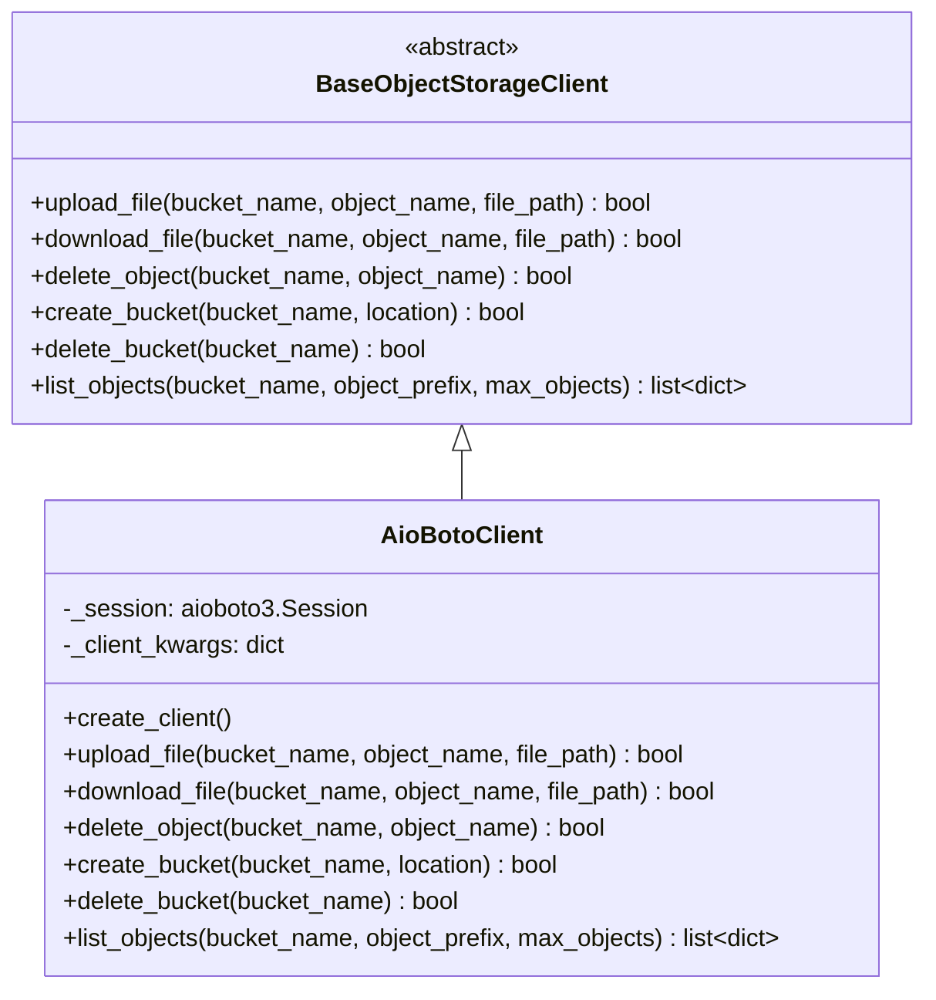
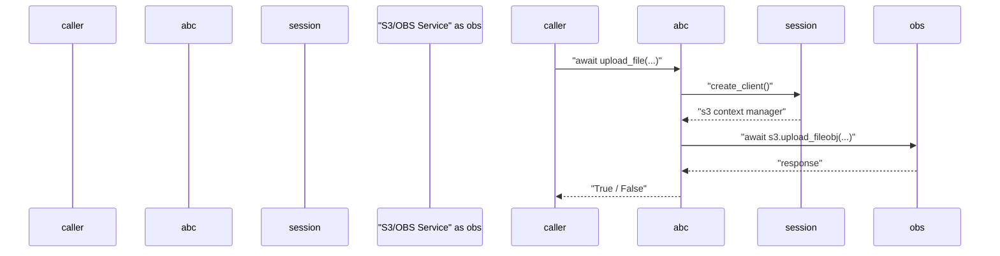
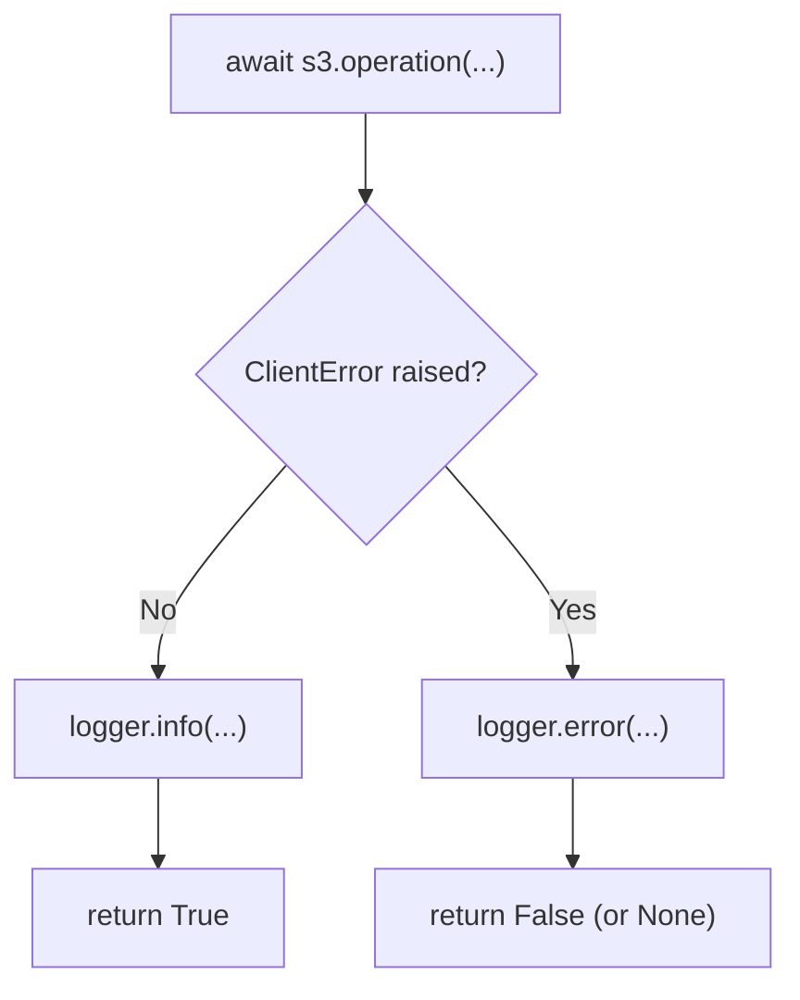
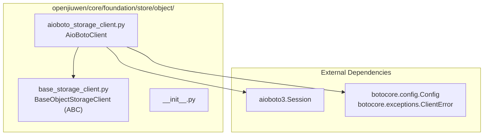
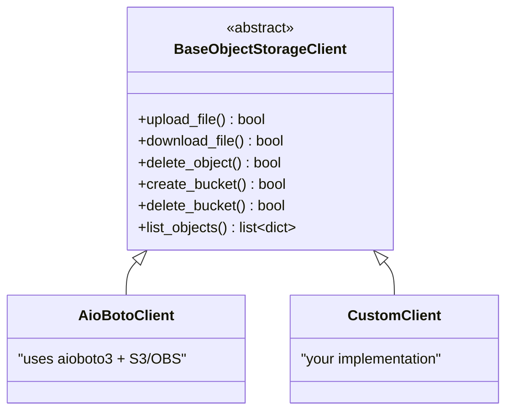

<!-- source: DeepWiki mcp.deepwiki.com · repo openJiuwen-ai/agent-core · page 12.2 Object Storage · fetched 2026-11-02 -->

# Object Storage

Relevant source files

The following files were used as context for generating this wiki page:

- [docs/en/2.Development Guide/API Docs/openjiuwen.core/foundation/store.README.md](docs/en/2.Development Guide/API Docs/openjiuwen.core/foundation/store.README.md)
- [docs/en/2.Development Guide/API Docs/openjiuwen.core/foundation/store/store.md](docs/en/2.Development Guide/API Docs/openjiuwen.core/foundation/store/store.md)
- [openjiuwen/core/foundation/store/__init__.py](openjiuwen/core/foundation/store/__init__.py)
- [openjiuwen/core/foundation/store/base_db_store.py](openjiuwen/core/foundation/store/base_db_store.py)
- [openjiuwen/core/foundation/store/base_kv_store.py](openjiuwen/core/foundation/store/base_kv_store.py)
- [openjiuwen/core/foundation/store/base_vector_store.py](openjiuwen/core/foundation/store/base_vector_store.py)
- [openjiuwen/core/foundation/store/vector/__init__.py](openjiuwen/core/foundation/store/vector/__init__.py)
- [openjiuwen/core/foundation/store/vector/chroma_vector_store.py](openjiuwen/core/foundation/store/vector/chroma_vector_store.py)
- [openjiuwen/core/foundation/store/vector/milvus_vector_store.py](openjiuwen/core/foundation/store/vector/milvus_vector_store.py)
- [openjiuwen/core/foundation/store/vector/utils.py](openjiuwen/core/foundation/store/vector/utils.py)
- [tests/unit_tests/core/foundation/store/test_chroma_vector_store.py](tests/unit_tests/core/foundation/store/test_chroma_vector_store.py)
- [tests/unit_tests/core/foundation/store/test_milvus_vector_store.py](tests/unit_tests/core/foundation/store/test_milvus_vector_store.py)
- [tests/unit_tests/core/memory/migration/migrator/test_chroma_vec_migrator.py](tests/unit_tests/core/memory/migration/migrator/test_chroma_vec_migrator.py)

This page covers the object storage abstraction layer in `openjiuwen/core/foundation/store/object/`. It documents the `BaseObjectStorageClient` interface and the `AioBotoClient` S3-compatible implementation. For key-value storage (used for memory, session state, and distributed locking), see [12.1 Key-Value Stores]().

---

## Overview

The object storage module provides an async interface for storing and retrieving binary blobs — files — against an S3-compatible bucket-based storage service such as Huawei Cloud OBS. It is used primarily by file system operations (see [11.2 File System Operations]()) when running in a mode that requires remote storage.

The design follows a two-layer pattern: an abstract base class that defines the interface, and a concrete implementation backed by `aioboto3`.

**Class hierarchy:**

Title: Object Storage Class Hierarchy

**Sources:** [docs/en/2.Development Guide/API Docs/openjiuwen.core/foundation/store.README.md:14-18](), [openjiuwen/core/foundation/store/__init__.py:155-155]()

---

## BaseObjectStorageClient

`BaseObjectStorageClient` is an abstract base class (`ABC`) that establishes the contract for all object storage backends. All six methods are `@abstractmethod` and are `async`.

| Method | Parameters | Returns | Description |
|---|---|---|---|
| `upload_file` | `bucket_name`, `object_name`, `file_path` | `bool` | Upload a local file to a bucket |
| `download_file` | `bucket_name`, `object_name`, `file_path: str\|Path` | `bool` | Download an object to a local path |
| `delete_object` | `bucket_name`, `object_name` | `bool` | Delete a single object from a bucket |
| `create_bucket` | `bucket_name`, `location` | `bool` | Create a bucket in a given region |
| `delete_bucket` | `bucket_name` | `bool` | Delete an existing bucket |
| `list_objects` | `bucket_name`, `object_prefix`, `max_objects=100` | `list[dict]\|None` | List objects under a prefix, up to `max_objects` |

All methods return `True` on success and `False` on failure. `list_objects` returns `None` on error instead of raising.

**Sources:** [docs/en/2.Development Guide/API Docs/openjiuwen.core/foundation/store.README.md:14-14]()

---

## AioBotoClient

`AioBotoClient` is the production implementation. It wraps `aioboto3` to make all S3 API calls fully async.

### Configuration

`AioBotoClient` accepts credentials either as constructor arguments or from environment variables. Environment variables take effect when the corresponding constructor argument is `None` (the default).

| Constructor Argument | Environment Variable | Description |
|---|---|---|
| `server` | `OBS_SERVER` | Endpoint URL (e.g., `https://obs.r.com`) |
| `access_key_id` | `OBS_ACCESS_KEY_ID` | AWS/OBS access key ID |
| `secret_access_key` | `OBS_SECRET_ACCESS_KEY` | AWS/OBS secret access key |
| `region_name` | `OBS_REGION` | Region name |

The client is configured with `signature_version` set to `s3v4`, `addressing_style` to `virtual`, and `payload_signing_enabled` to `False`.

**Sources:** [docs/en/2.Development Guide/API Docs/openjiuwen.core/foundation/store.README.md:18-18]()

### Client Lifecycle

Each operation method creates a fresh S3 client via `create_client()`, used as an async context manager. `create_client` calls `self._session.client(**self._client_kwargs)`, which returns a context manager from `aioboto3.Session`.

**Request flow per operation:**

Title: AioBotoClient Request Flow

**Sources:** [docs/en/2.Development Guide/API Docs/openjiuwen.core/foundation/store.README.md:18-18]()

### Method Details

*   **`upload_file`**: Opens the specified `file_path` in binary read mode and calls `s3.upload_fileobj`. The `object_name` is used as the S3 `Key`.
*   **`download_file`**: Opens the specified `file_path` in binary write mode and calls `s3.download_fileobj`. The file is created/overwritten at the given path.
*   **`delete_object`**: Calls `s3.delete_object(Bucket=..., Key=...)`. Returns `True` even if the object did not previously exist, as S3 treats that as a successful no-op.
*   **`create_bucket`**: Calls `s3.create_bucket` with a `CreateBucketConfiguration` specifying `LocationConstraint`. Requires appropriate IAM/OBS permissions.
*   **`delete_bucket`**: Calls `s3.delete_bucket`. The bucket must be empty before deletion; attempting to delete a non-empty bucket will result in a service error.
*   **`list_objects`**: Calls `s3.list_objects_v2` with `Prefix=object_prefix` and `MaxKeys=max_objects`. Returns the `Contents` list from the response, or `None` on error. Each item in the list is a `dict` with at least a `Key` field.

**Sources:** [docs/en/2.Development Guide/API Docs/openjiuwen.core/foundation/store.README.md:14-18]()

---

## Error Handling

All methods catch service-level client errors and handle them uniformly:

1.  Log an error message via the SDK logger (e.g., `'Upload "obj" failed: ...'`).
2.  Return `False` (or `None` for `list_objects`).
3.  Do **not** re-raise the exception.

This means callers must always check the return value. No exception propagates out of `AioBotoClient` for service-level errors.

Title: Object Storage Error Handling Flow

**Sources:** [docs/en/2.Development Guide/API Docs/openjiuwen.core/foundation/store.README.md:14-18]()

---

## Module Structure

Title: Object Storage Module Structure

**Sources:** [openjiuwen/core/foundation/store/__init__.py:155-155](), [docs/en/2.Development Guide/API Docs/openjiuwen.core/foundation/store.README.md:14-18]()

---

## Implementing a Custom Backend

To use a different storage backend (e.g., Azure Blob, GCS), subclass `BaseObjectStorageClient` and implement all six abstract methods. The return convention (`True`/`False` and `list[dict]|None`) must be preserved.

Title: Custom Object Storage Implementation

**Sources:** [docs/en/2.Development Guide/API Docs/openjiuwen.core/foundation/store.README.md:14-14]()

---

