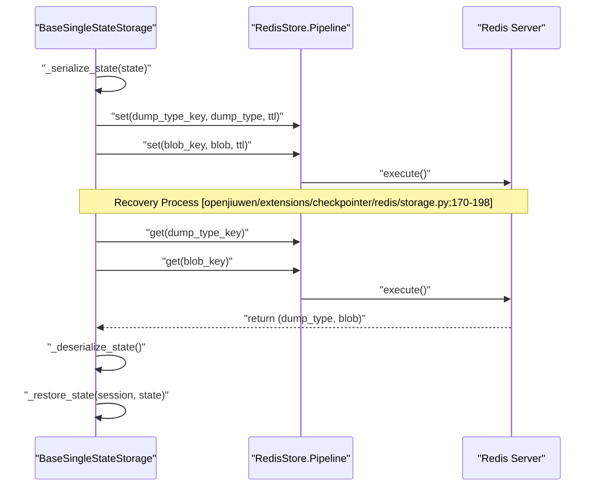
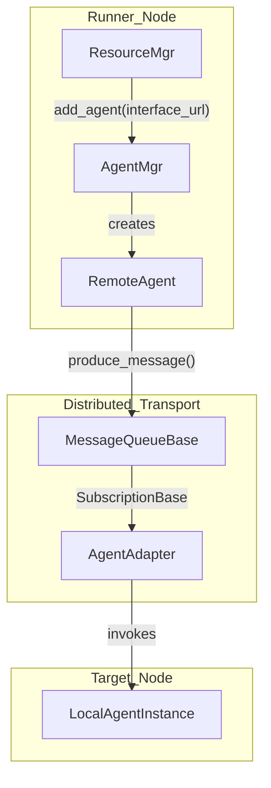

<!-- source: DeepWiki mcp.deepwiki.com · repo openJiuwen-ai/agent-core · page 12.3 Extension Stores · fetched 2026-11-02 -->

# Extension Stores

Relevant source files

The following files were used as context for generating this wiki page:

- [docs/en/2.Development Guide/Advanced Usage/Checkpointer Checkpoint Mechanism.md](docs/en/2.Development Guide/Advanced Usage/Checkpointer Checkpoint Mechanism.md)
- [openjiuwen/core/common/background_tasks.py](openjiuwen/core/common/background_tasks.py)
- [openjiuwen/core/runner/__init__.py](openjiuwen/core/runner/__init__.py)
- [openjiuwen/core/runner/callback/chain.py](openjiuwen/core/runner/callback/chain.py)
- [openjiuwen/core/runner/drunner/dmessage_queue/dsubscription/reply_topic_subscription.py](openjiuwen/core/runner/drunner/dmessage_queue/dsubscription/reply_topic_subscription.py)
- [openjiuwen/core/runner/drunner/dmessage_queue/dsubscription/response_collector.py](openjiuwen/core/runner/drunner/dmessage_queue/dsubscription/response_collector.py)
- [openjiuwen/core/runner/drunner/dmessage_queue/message_queue_fake.py](openjiuwen/core/runner/drunner/dmessage_queue/message_queue_fake.py)
- [openjiuwen/core/runner/drunner/dmessage_queue/message_serializer.py](openjiuwen/core/runner/drunner/dmessage_queue/message_serializer.py)
- [openjiuwen/core/runner/message_queue_base.py](openjiuwen/core/runner/message_queue_base.py)
- [openjiuwen/core/runner/message_queue_inmemory.py](openjiuwen/core/runner/message_queue_inmemory.py)
- [openjiuwen/core/runner/resources_manager/agent_manager.py](openjiuwen/core/runner/resources_manager/agent_manager.py)
- [openjiuwen/core/runner/spawn/process_manager.py](openjiuwen/core/runner/spawn/process_manager.py)
- [openjiuwen/core/session/checkpointer/__init__.py](openjiuwen/core/session/checkpointer/__init__.py)
- [openjiuwen/core/session/checkpointer/base.py](openjiuwen/core/session/checkpointer/base.py)
- [openjiuwen/core/session/checkpointer/inmemory.py](openjiuwen/core/session/checkpointer/inmemory.py)
- [openjiuwen/core/session/checkpointer/persistence.py](openjiuwen/core/session/checkpointer/persistence.py)
- [openjiuwen/extensions/checkpointer/redis/checkpointer.py](openjiuwen/extensions/checkpointer/redis/checkpointer.py)
- [openjiuwen/extensions/checkpointer/redis/storage.py](openjiuwen/extensions/checkpointer/redis/storage.py)
- [openjiuwen/extensions/message_queue/message_queue_pulsar.py](openjiuwen/extensions/message_queue/message_queue_pulsar.py)
- [tests/unit_tests/core/runner/test_message_queue.py](tests/unit_tests/core/runner/test_message_queue.py)
- [tests/unit_tests/core/runner/test_resource_manager.py](tests/unit_tests/core/runner/test_resource_manager.py)
- [tests/unit_tests/core/session/checkpointer/test_inmemory_storage.py](tests/unit_tests/core/session/checkpointer/test_inmemory_storage.py)
- [tests/unit_tests/core/session/checkpointer/test_persistence_storage.py](tests/unit_tests/core/session/checkpointer/test_persistence_storage.py)
- [tests/unit_tests/extensions/checkpointer/test_agent_storage.py](tests/unit_tests/extensions/checkpointer/test_agent_storage.py)
- [tests/unit_tests/extensions/message_queue/__init__.py](tests/unit_tests/extensions/message_queue/__init__.py)
- [tests/unit_tests/extensions/message_queue/test_drain.py](tests/unit_tests/extensions/message_queue/test_drain.py)
- [tests/unit_tests/extensions/message_queue/test_start_with_retry.py](tests/unit_tests/extensions/message_queue/test_start_with_retry.py)
- [tests/unit_tests/extensions/message_queue/test_unsubscribe_all.py](tests/unit_tests/extensions/message_queue/test_unsubscribe_all.py)

The `openjiuwen` SDK provides a suite of extension storage backends designed to support high-performance, distributed, and enterprise-grade agentic workflows. These extensions cover relational databases (GaussDB), vector search (Elasticsearch), session persistence (Redis), and distributed communication (A2A Remote Client).

## GaussDB Dialect for SQLAlchemy

The SDK extends SQLAlchemy to support **GaussDB** through a custom dialect implementation. This dialect allows `DbBasedKVStore` and other database-reliant components to operate seamlessly on GaussDB.

### Implementation Details
- **Async Driver**: Uses `async_gaussdb` to provide asynchronous database connectivity.
- **SQL Patching**: Includes a listener for the `before_cursor_execute` event to patch reflection SQL. Specifically, it replaces `pg_type.typcollation` subqueries with `NULL` to ensure compatibility with GaussDB's metadata schema.
- **Type Handling**: Implements `GaussString`, which ensures that non-string data types (like `datetime`) are explicitly cast to strings before being passed to the driver.
- **Compiler Overrides**: Provides `GaussCompiler` to handle specific clause syntax, such as `FOR UPDATE`.

### Registration
The dialect is registered under the names `gaussdb` and `gaussdb.async_gaussdb` within the SQLAlchemy registry.

**Sources:**
- `openjiuwen/core/foundation/store/kv/db.py` (referenced for `DbBasedKVStore` integration)
- `openjiuwen/core/session/checkpointer/persistence.py:20-33`

---

## Elasticsearch Vector Store

The `EsVectorStore` provides a scalable alternative to Milvus or Chroma by utilizing Elasticsearch's `dense_vector` field type and k-NN search capabilities.

### Features
- **Similarity Search**: Implements the `BaseVectorStore` interface using `AsyncElasticsearch` for CRUD operations and similarity queries.
- **Integration**: Designed for use within the `KnowledgeBase` and `LongTermMemory` systems for high-throughput retrieval tasks.

---

## Redis Checkpointer

The Redis Checkpointer provides a distributed state management solution for agents and workflows, allowing session data to persist across multiple service instances.

### Implementation: `BaseRedisStorage`
The storage layer interacts with a `RedisStore` instance [openjiuwen/extensions/checkpointer/redis/storage.py:34]() and uses a `Serializer` (defaulting to `pickle`) to handle complex Python objects [openjiuwen/extensions/checkpointer/redis/storage.py:57]().

| Feature | Description |
| :--- | :--- |
| **TTL Management** | Supports configurable `ttl_seconds` and `refresh_on_read` logic [openjiuwen/extensions/checkpointer/redis/storage.py:58-63](). |
| **Pipelining** | Uses Redis pipelines to ensure atomic updates of state blobs and metadata [openjiuwen/extensions/checkpointer/redis/storage.py:159-164](). |
| **Namespacing** | Organizes keys using namespaces for `AGENT`, `AGENT_TEAM`, and `WORKFLOW` [openjiuwen/extensions/checkpointer/redis/storage.py:25-33](). |

### Data Flow: Save and Recover
The `BaseSingleStateStorage` handles the serialization and persistence logic [openjiuwen/extensions/checkpointer/redis/storage.py:103-146]().

**Redis Checkpoint Data Flow**

**Sources:**
- [openjiuwen/extensions/checkpointer/redis/storage.py:41-200]()
- [openjiuwen/core/session/checkpointer/persistence.py:62-112]()

---

## A2A Remote Client

The **Agent-to-Agent (A2A)** remote client enables distributed communication between agents. It allows a `Runner` to execute an agent hosted on a remote server via `interface_url` [openjiuwen/core/runner/resources_manager/agent_manager.py:34-47]().

### Components
1. **`RemoteAgent`**: A class representing an agent located on a remote node [openjiuwen/core/runner/resources_manager/agent_manager.py:7]().
2. **`AgentAdapter`**: Adapts local agents to be accessible via the message queue in distributed mode [openjiuwen/core/runner/resources_manager/agent_manager.py:42-46]().
3. **`ResourceMgr` Integration**: The `ResourceMgr.add_agent` method accepts an `interface_url` which is passed to the underlying `AgentMgr` to establish remote connectivity [tests/unit_tests/core/runner/test_resource_manager.py:131-141]().

### Code Entity Mapping
The diagram below bridges the natural language concept of "Remote Execution" to specific code entities.

**Distributed Agent Communication Architecture**

### Protocol Handling
The `AgentMgr` checks if the `distributed_mode` is enabled in `RunnerConfig` [openjiuwen/core/runner/resources_manager/agent_manager.py:36](). If so, it wraps the agent provider in an `AgentAdapter` to facilitate remote invocation [openjiuwen/core/runner/resources_manager/agent_manager.py:42]().

**Sources:**
- [openjiuwen/core/runner/resources_manager/agent_manager.py:27-69]()
- [openjiuwen/core/runner/message_queue_base.py:71-91]()
- [tests/unit_tests/core/runner/test_resource_manager.py:119-142]()
- [openjiuwen/core/session/checkpointer/persistence.py:48-58]()

---

