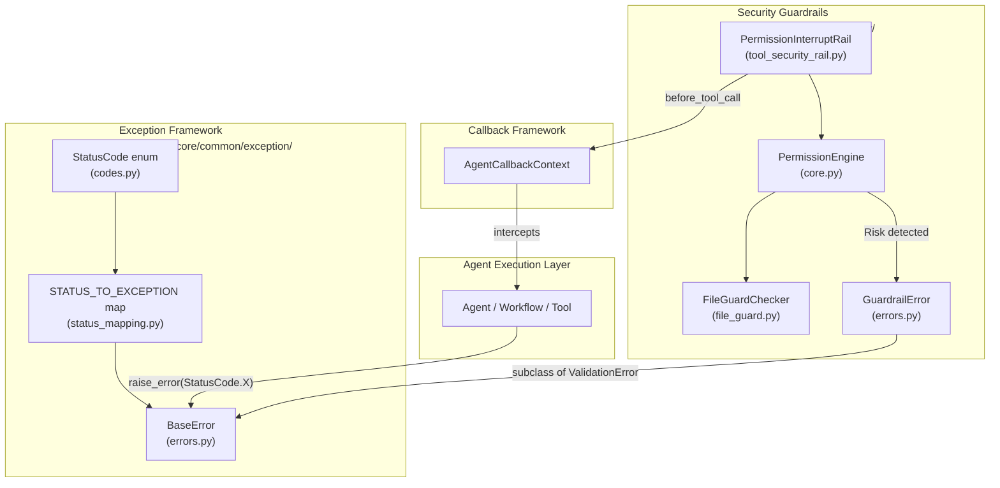
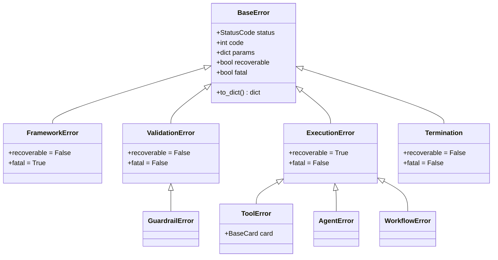
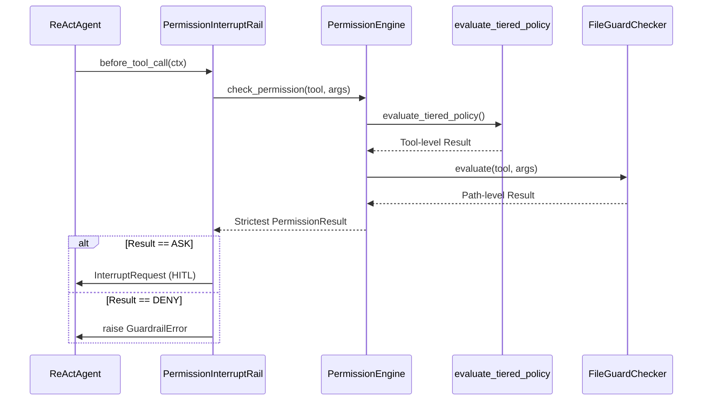

<!-- source: DeepWiki mcp.deepwiki.com · repo openJiuwen-ai/agent-core · page 13 Error Handling and Security · fetched 2026-11-02 -->

# Error Handling and Security

Relevant source files

The following files were used as context for generating this wiki page:

- [openjiuwen/core/common/exception/code_template.py](openjiuwen/core/common/exception/code_template.py)
- [openjiuwen/core/common/exception/errors.py](openjiuwen/core/common/exception/errors.py)
- [openjiuwen/core/common/exception/status_mapping.py](openjiuwen/core/common/exception/status_mapping.py)
- [openjiuwen/core/workflow/components/flow/loop/loop_comp.py](openjiuwen/core/workflow/components/flow/loop/loop_comp.py)
- [openjiuwen/harness/prompts/sections/safety.py](openjiuwen/harness/prompts/sections/safety.py)
- [openjiuwen/harness/rails/interrupt/confirm_rail.py](openjiuwen/harness/rails/interrupt/confirm_rail.py)
- [openjiuwen/harness/rails/security/tool_security_rail.py](openjiuwen/harness/rails/security/tool_security_rail.py)
- [openjiuwen/harness/security/__init__.py](openjiuwen/harness/security/__init__.py)
- [openjiuwen/harness/security/checker.py](openjiuwen/harness/security/checker.py)
- [openjiuwen/harness/security/core.py](openjiuwen/harness/security/core.py)
- [openjiuwen/harness/security/file_guard.py](openjiuwen/harness/security/file_guard.py)
- [openjiuwen/harness/security/files/__init__.py](openjiuwen/harness/security/files/__init__.py)
- [openjiuwen/harness/security/files/extract.py](openjiuwen/harness/security/files/extract.py)
- [openjiuwen/harness/security/files/registry.py](openjiuwen/harness/security/files/registry.py)
- [openjiuwen/harness/security/models.py](openjiuwen/harness/security/models.py)
- [openjiuwen/harness/security/patterns.py](openjiuwen/harness/security/patterns.py)
- [openjiuwen/harness/security/tiered_policy.py](openjiuwen/harness/security/tiered_policy.py)
- [openjiuwen/symphony/evaluation/__init__.py](openjiuwen/symphony/evaluation/__init__.py)
- [openjiuwen/symphony/evaluation/base.py](openjiuwen/symphony/evaluation/base.py)
- [openjiuwen/symphony/evaluation/evaluators.py](openjiuwen/symphony/evaluation/evaluators.py)
- [openjiuwen/symphony/evaluation/suite.py](openjiuwen/symphony/evaluation/suite.py)
- [openjiuwen/symphony/interfaces/capability.py](openjiuwen/symphony/interfaces/capability.py)
- [openjiuwen/symphony/interfaces/llm.py](openjiuwen/symphony/interfaces/llm.py)
- [tests/unit_tests/core/__init__.py](tests/unit_tests/core/__init__.py)
- [tests/unit_tests/core/common/test_errors.py](tests/unit_tests/core/common/test_errors.py)
- [tests/unit_tests/core/component/test_loop_comp.py](tests/unit_tests/core/component/test_loop_comp.py)
- [tests/unit_tests/core/workflow/__init__.py](tests/unit_tests/core/workflow/__init__.py)
- [tests/unit_tests/core/workflow/mock_nodes.py](tests/unit_tests/core/workflow/mock_nodes.py)
- [tests/unit_tests/core/workflow/test_workflow_with_interrupt.py](tests/unit_tests/core/workflow/test_workflow_with_interrupt.py)
- [tests/unit_tests/harness/security/test_permission_merge_after_auto_confirm.py](tests/unit_tests/harness/security/test_permission_merge_after_auto_confirm.py)

This page provides an overview of the two cross-cutting systems that deal with failure handling and content safety in agent-core: the **exception framework** and the **security guardrail system**. Both systems are used throughout every layer of the SDK — agents, workflows, tools, storage, and retrieval.

For detailed reference on the exception class hierarchy and utilities, see [Exception System](#13.1). For detailed reference on guardrail configuration and the detection callback flow, see [Security Guardrails](#13.2).

---

## Two Cooperating Systems

The exception framework and the guardrail system are independent but cooperate at one specific point: a guardrail that detects a security risk raises a `GuardrailError`, which is a subclass of `ValidationError` defined in the exception hierarchy [openjiuwen/core/common/exception/errors.py:263-270]().

**Exception framework** — defined in `openjiuwen/core/common/exception/` — provides:
- A single `StatusCode` enum that catalogs every named error condition across the entire SDK [openjiuwen/core/common/exception/codes.py:7-12]().
- A base exception class (`BaseError`) and a typed subclass hierarchy [openjiuwen/core/common/exception/errors.py:23-31]().
- Factory utilities (`build_error`, `raise_error`, `system_error`) that map a `StatusCode` to the correct exception type automatically [openjiuwen/core/common/exception/errors.py:276-325]().

**Security Guardrails** — defined in `openjiuwen/harness/security/` — provides:
- A multi-pipeline engine (`PermissionEngine`) for assessing tool calls and filesystem operations [openjiuwen/harness/security/core.py:42-65]().
- A rail-based interception layer (`PermissionInterruptRail`) that triggers Human-in-the-Loop (HITL) interrupts for high-risk actions [openjiuwen/harness/rails/security/tool_security_rail.py:51-63]().
- A policy evaluation framework supporting `allow`, `ask`, and `deny` levels [openjiuwen/harness/security/models.py:19-29]().

---

## High-Level Interaction

**Diagram: System Overview — How the Two Subsystems Relate**

Sources: [openjiuwen/core/common/exception/errors.py:263-270](), [openjiuwen/harness/security/core.py:11-16](), [openjiuwen/harness/rails/security/tool_security_rail.py:174-184]()

---

## Exception Framework Overview

Every named error condition in the SDK is identified by a member of the `StatusCode` enum. Each member is a `(int_code, message_template)` tuple, organized by subsystem numeric range [openjiuwen/core/common/exception/codes.py:22-132]().

| Code Range | Subsystem |
|---|---|
| 100000–119999 | Workflow validation and execution |
| 120000–129999 | Agent orchestration |
| 130000–139999 | Runner, distributed resources |
| 140000–149999 | Graph execution engine |
| 150000–159999 | Context, Memory, and Retrieval |
| 160000–179999 | Toolchain and optimization |
| 180000–189999 | Common utilities and Model providers |
| 190000–198999 | Session management |
| 199000–199999 | SysOperation (Shell/FS) |

The exception class for a given `StatusCode` is resolved automatically using rules defined in `status_mapping.py` [openjiuwen/core/common/exception/status_mapping.py:103-125]():

1. **Manual Overrides**: Explicit mappings for legacy or specific cases (e.g., `TOOL_EXECUTION_ERROR` → `ToolError`) [openjiuwen/core/common/exception/status_mapping.py:65-80]().
2. **Keyword Matching**: Matches names like `TIMEOUT` to `ExecutionError` or `CONFIG` to `ValidationError` [openjiuwen/core/common/exception/status_mapping.py:42-50]().
3. **Numeric Range**: Falls back to range-based mapping (e.g., `120000-129999` → `AgentError`) [openjiuwen/core/common/exception/status_mapping.py:52-62]().

**Diagram: Exception Class Hierarchy and Code Entities**

Sources: [openjiuwen/core/common/exception/errors.py:137-270](), [openjiuwen/core/common/exception/status_mapping.py:14-39]()

---

## Security Guardrail Overview

The security system centers on the `PermissionEngine`, which evaluates tool calls against configured `PermissionsSection` rules [openjiuwen/harness/security/core.py:42-52](). It employs a dual-pipeline check:

1. **Pipeline A (Tiered Policy)**: Evaluates tool-level and parameter-level rules (e.g., allow `read_file` but ask for `write_file`) [openjiuwen/harness/security/core.py:202-207]().
2. **Pipeline B (File Guard)**: Provides path-based protection for filesystem operations, preventing unauthorized access outside the workspace [openjiuwen/harness/security/core.py:214-222]().

### Interception and HITL
The `PermissionInterruptRail` intercepts tool calls before execution [openjiuwen/harness/rails/security/tool_security_rail.py:174-180](). If a risk level of `ASK` is returned, it triggers a `ConfirmInterruptRail` flow, allowing the user to approve the action once, for the session, or permanently [openjiuwen/harness/security/models.py:52-61]().

**Diagram: Tool Permission Assessment Flow**

Sources: [openjiuwen/harness/security/core.py:11-16](), [openjiuwen/harness/rails/security/tool_security_rail.py:51-63](), [openjiuwen/harness/security/tiered_policy.py:32-37]()

### The `StatusCodeTemplate` Utility
Consistency in error reporting is maintained via `StatusCodeTemplate`, which generates naming and message patterns for new status codes based on their scope (e.g., `WORKFLOW`, `AGENT`) and failure type (e.g., `TIMEOUT`, `INVALID`) [openjiuwen/core/common/exception/code_template.py:54-59, 89-95]().

---

## How the Two Systems Work Together

The `PermissionEngine` acts as the detector, while the `BaseError` hierarchy provides the enforcement mechanism. When the engine identifies a terminal risk (Level: `DENY`), it raises a `GuardrailError` [openjiuwen/core/common/exception/errors.py:263-270](). This error is caught by the `Runner` or `Workflow` engine, ensuring that security violations are treated as non-recoverable validation failures [openjiuwen/core/common/exception/status_mapping.py:27]().

Sources: [openjiuwen/core/common/exception/errors.py:263-270](), [openjiuwen/harness/security/core.py:161-165]()

---

