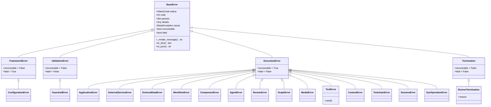
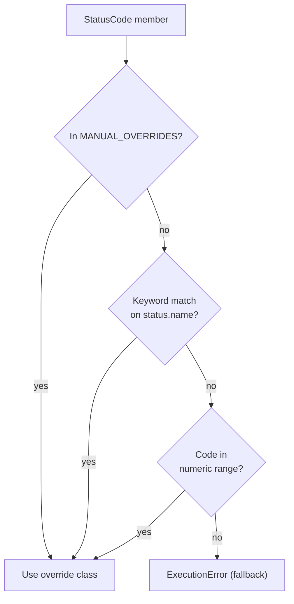
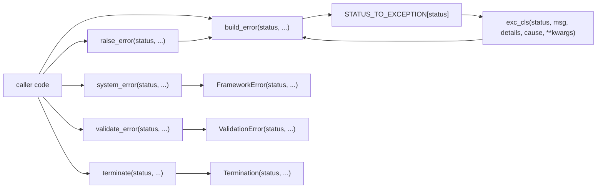
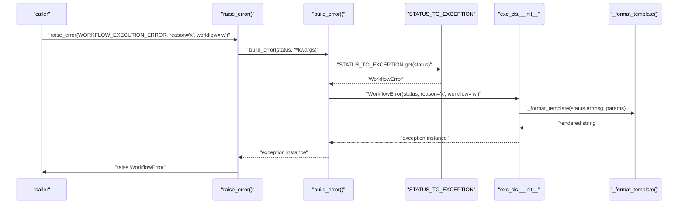

<!-- source: DeepWiki mcp.deepwiki.com · repo openJiuwen-ai/agent-core · page 13.1 Exception System · fetched 2026-11-02 -->

# Exception System

<details>
<summary>Relevant source files</summary>

The following files were used as context for generating this wiki page:

- [.gitignore](.gitignore)
- [Makefile](Makefile)
- [openjiuwen/core/common/exception/code_template.py](openjiuwen/core/common/exception/code_template.py)
- [openjiuwen/core/common/exception/codes.py](openjiuwen/core/common/exception/codes.py)
- [openjiuwen/core/common/exception/errors.py](openjiuwen/core/common/exception/errors.py)
- [openjiuwen/core/common/exception/status_mapping.py](openjiuwen/core/common/exception/status_mapping.py)
- [openjiuwen/core/foundation/tool/mcp/client/openapi_client.py](openjiuwen/core/foundation/tool/mcp/client/openapi_client.py)
- [openjiuwen/core/memory/common/base.py](openjiuwen/core/memory/common/base.py)
- [openjiuwen/core/retrieval/__init__.py](openjiuwen/core/retrieval/__init__.py)
- [openjiuwen/core/runner/resources_manager/resource_manager.py](openjiuwen/core/runner/resources_manager/resource_manager.py)
- [openjiuwen/core/runner/resources_manager/tool_manager.py](openjiuwen/core/runner/resources_manager/tool_manager.py)
- [openjiuwen/core/single_agent/__init__.py](openjiuwen/core/single_agent/__init__.py)
- [openjiuwen/core/workflow/components/flow/loop/loop_comp.py](openjiuwen/core/workflow/components/flow/loop/loop_comp.py)
- [openjiuwen/symphony/evaluation/__init__.py](openjiuwen/symphony/evaluation/__init__.py)
- [openjiuwen/symphony/evaluation/base.py](openjiuwen/symphony/evaluation/base.py)
- [openjiuwen/symphony/evaluation/evaluators.py](openjiuwen/symphony/evaluation/evaluators.py)
- [openjiuwen/symphony/evaluation/suite.py](openjiuwen/symphony/evaluation/suite.py)
- [openjiuwen/symphony/interfaces/capability.py](openjiuwen/symphony/interfaces/capability.py)
- [openjiuwen/symphony/interfaces/llm.py](openjiuwen/symphony/interfaces/llm.py)
- [pyproject.toml](pyproject.toml)
- [tests/system_tests/runner/test_runner.py](tests/system_tests/runner/test_runner.py)
- [tests/system_tests/tune/test_prompt_tune.py](tests/system_tests/tune/test_prompt_tune.py)
- [tests/system_tests/workflow/test_real_workflow.py](tests/system_tests/workflow/test_real_workflow.py)
- [tests/test_logger.py](tests/test_logger.py)
- [tests/unit_tests/agent_teams/observability/test_team_observability_mock_llm.py](tests/unit_tests/agent_teams/observability/test_team_observability_mock_llm.py)
- [tests/unit_tests/core/__init__.py](tests/unit_tests/core/__init__.py)
- [tests/unit_tests/core/common/test_errors.py](tests/unit_tests/core/common/test_errors.py)
- [tests/unit_tests/core/component/test_loop_comp.py](tests/unit_tests/core/component/test_loop_comp.py)
- [tests/unit_tests/core/context_engine/conftest.py](tests/unit_tests/core/context_engine/conftest.py)
- [tests/unit_tests/core/workflow/__init__.py](tests/unit_tests/core/workflow/__init__.py)
- [tests/unit_tests/core/workflow/mock_nodes.py](tests/unit_tests/core/workflow/mock_nodes.py)
- [tests/unit_tests/core/workflow/test_workflow_with_interrupt.py](tests/unit_tests/core/workflow/test_workflow_with_interrupt.py)
- [uv.lock](uv.lock)

</details>


This page documents the unified exception framework used throughout the agent-core SDK: the `StatusCode` enum, the `BaseError` class hierarchy, the `STATUS_TO_EXCEPTION` mapping mechanism, and the utility functions (`build_error`, `raise_error`, `system_error`) that all modules use for error handling. For documentation of the security guardrail integration — which raises `GuardrailError` — see [Security Guardrails](#13.2).

---

## Overview

All errors in the codebase share a common structure: a `StatusCode` enum value that carries a numeric code and a message template, paired with an exception class that encodes the recovery semantics. The pairing is resolved automatically by `STATUS_TO_EXCEPTION`, which applies a prioritised rule set so callers never need to choose an exception class manually.

**Key files:**

| File | Role |
|---|---|
| `openjiuwen/core/common/exception/codes.py` | `StatusCode` enum — all numeric codes and message templates |
| `openjiuwen/core/common/exception/errors.py` | `BaseError` hierarchy + utility functions |
| `openjiuwen/core/common/exception/status_mapping.py` | `StatusCode → exception class` resolution rules |
| `openjiuwen/core/common/exception/code_template.py` | `StatusCodeTemplate` helper for generating new codes |

Sources: [openjiuwen/core/common/exception/codes.py:7-8](), [openjiuwen/core/common/exception/errors.py:23-31](), [openjiuwen/core/common/exception/status_mapping.py:1-131](), [openjiuwen/core/common/exception/code_template.py:53-58]()

---

## StatusCode Enum

`StatusCode` ([openjiuwen/core/common/exception/codes.py:7-668]()) is a single Python `Enum` that owns every error code in the system. Each member is a `(int, str)` tuple.

```python
WORKFLOW_EXECUTION_TIMEOUT = (
    100101,
    "workflow execution exceeded time limit of {timeout} seconds, workflow='{workflow}'")
```

Two properties expose the tuple fields:

| Property | Type | Description |
|---|---|---|
| `.code` | `int` | Unique numeric code |
| `.errmsg` | `str` | Message template (Python `str.format` placeholders) |

### Numeric Ranges

Codes are partitioned by subsystem. The ranges are used by the mapping engine described below.

| Range | Subsystem |
|---|---|
| 100000 – 100999 | Workflow validation & execution |
| 101000 – 119999 | Built-in workflow components |
| 120000 – 129999 | Agent orchestration |
| 130000 – 139999 | Runner / distributed / message queue |
| 140000 – 149999 | Graph engine |
| 150000 – 154999 | Context engine |
| 155000 – 157999 | Knowledge base retrieval |
| 158000 – 159999 | Memory engine |
| 160000 – 179999 | Optimization toolchain |
| 180000 – 180999 | Prompt |
| 181000 – 181999 | Model |
| 182000 – 182999 | Tool |
| 188000 – 188999 | Common |
| 190000 – 198999 | Session |
| 199000 – 199999 | SysOperation |

Sources: [openjiuwen/core/common/exception/codes.py:14-645](), [openjiuwen/core/common/exception/status_mapping.py:51-61]()

---

## Exception Class Hierarchy

**Exception hierarchy diagram**



Sources: [openjiuwen/core/common/exception/errors.py:23-270]()

### Class Semantics

| Class | `recoverable` | `fatal` | Intended use |
|---|---|---|---|
| `FrameworkError` | `False` | `True` | Infrastructure / dependency failures that must abort execution [openjiuwen/core/common/exception/errors.py:137-143]() |
| `ConfigurationError` | `False` | `True` | Sub-type of `FrameworkError` for config problems [openjiuwen/core/common/exception/errors.py:146-147]() |
| `ValidationError` | `False` | `False` | Schema, parameter, or constraint violations; should not retry [openjiuwen/core/common/exception/errors.py:150-156]() |
| `GuardrailError` | `False` | `False` | Security risk detected; sub-type of `ValidationError` [openjiuwen/core/common/exception/errors.py:263-270]() |
| `ExecutionError` | `True` | `False` | Runtime failures that are typically retryable / replannable [openjiuwen/core/common/exception/errors.py:159-165]() |
| `Termination` | `False` | `False` | Non-error control-flow stop (cancellation, completion) [openjiuwen/core/common/exception/errors.py:180-186]() |
| `RunnerTermination` | `False` | `False` | Runner lifecycle termination; carries a `reason` string [openjiuwen/core/common/exception/errors.py:193-197]() |

### BaseError Constructor

[openjiuwen/core/common/exception/errors.py:37-55]()

```python
BaseError(
    status: StatusCode,
    *,
    msg: str | None,      # overrides the rendered template message
    details: Any,         # structured payload for callers
    cause: BaseException, # sets __cause__ for chaining
    **kwargs: dict[str, Any], # template substitution params (e.g. workflow="my_flow")
)
```

The message template from `status.errmsg` is rendered by `_format_template` with `kwargs` as substitution variables [openjiuwen/core/common/exception/errors.py:57-66](). Missing template keys produce `<missing:KEY>` rather than raising a `KeyError` [openjiuwen/core/common/exception/errors.py:106-108](). If `msg` is provided, it replaces the rendered template message in `self.message` but the template render is still stored in `self._template_message` [openjiuwen/core/common/exception/errors.py:53-54]().

### ToolError

`ToolError` ([openjiuwen/core/common/exception/errors.py:224-245]()) adds optional `card` handling: when constructed with a `card=` keyword argument, it deep-copies the `BaseCard` instance and stores it, exposing it via `.card()`.

Sources: [openjiuwen/core/common/exception/errors.py:224-245]()

---

## STATUS_TO_EXCEPTION Mapping

The dict `STATUS_TO_EXCEPTION` ([openjiuwen/core/common/exception/errors.py:277]()) maps every `StatusCode` member to an exception class. It is computed once at module import time by `build_status_exception_map()` ([openjiuwen/core/common/exception/status_mapping.py:123-131]()).

### Resolution Priority

**Status-to-exception resolution flowchart**



Sources: [openjiuwen/core/common/exception/status_mapping.py:92-114]()

#### Keyword Rules

Applied against the `StatusCode` member **name** (e.g. `WORKFLOW_EXECUTION_TIMEOUT`):

| Keywords that match | Mapped class |
|---|---|
| `INVALID`, `VALIDATE`, `NOT_SUPPORTED`, `PARAM`, `MISSING`, `DUPLICATED` | `ValidationError` |
| `CONFIG`, `SCHEMA`, `FORMAT`, `TEMPLATE` | `ValidationError` |
| `INIT`, `CONNECT`, `SERVICE`, `QUEUE`, `PROVIDER` | `FrameworkError` |
| `CALL`, `INVOKE_LLM`, `MODEL`, `REMOTE` | `FrameworkError` |
| `TIMEOUT`, `EXECUTE`, `EXECUTION`, `RUNTIME`, `PROCESS`, `STREAM`, `RESPONSE` | `ExecutionError` |

Sources: [openjiuwen/core/common/exception/status_mapping.py:41-49]()

#### Range Rules

Applied against the numeric `status.code`:

| Range | Mapped class |
|---|---|
| 100000 – 119999 | `WorkflowError` |
| 120000 – 129999 | `AgentError` |
| 130000 – 139999 | `RunnerError` |
| 140000 – 149999 | `GraphError` |
| 150000 – 159999 | `ContextError` |
| 160000 – 179999 | `ToolchainError` |
| 180000 – 189999 | `FrameworkError` |
| 190000 – 198999 | `SessionError` |
| 199000 – 199999 | `SysOperationError` |

Sources: [openjiuwen/core/common/exception/status_mapping.py:51-61]()

#### Manual Overrides

[openjiuwen/core/common/exception/status_mapping.py:64-75]()

A small explicit table takes priority over all rules:

| StatusCode name | Forced class |
|---|---|
| `CONTROLLER_INVOKE_LLM_FAILED` | `FrameworkError` |
| `TOOL_EXECUTION_ERROR` | `ToolError` |
| `TOOL_NOT_FOUND_ERROR` | `ValidationError` |
| `AGENT_TEAM_EXECUTION_ERROR` | `AgentError` |
| `STORE_GRAPH_BACKEND_ALREADY_EXISTS` | `ValidationError` |
| `STORE_GRAPH_PROTOCOL_NOT_IMPLEMENTED` | `ValidationError` |
| `STORE_GRAPH_BACKEND_NOT_FOUND` | `ValidationError` |
| `AGENT_RL_PROXY_SERVER_START_FAILED` | `FrameworkError` |
| `AGENT_RL_PROCESSOR_NOT_FOUND` | `ValidationError` |
| `AGENT_RL_REWARD_NOT_FOUND` | `ValidationError` |

Sources: [openjiuwen/core/common/exception/status_mapping.py:64-75]()

---

## Utility Functions

**Utility function call diagram**



Sources: [openjiuwen/core/common/exception/errors.py:280-325]()

| Function | Raises | Notes |
|---|---|---|
| `build_error(status, *, msg, details, cause, **kwargs)` | — | Returns a `BaseError` instance without raising; uses `STATUS_TO_EXCEPTION` to pick the class [openjiuwen/core/common/exception/errors.py:280-292]() |
| `raise_error(status, *, msg, details, cause, **kwargs)` | Yes | Calls `build_error` then raises [openjiuwen/core/common/exception/errors.py:295-299]() |
| `system_error(status, *, cause, **kwargs)` | Yes | Always raises `FrameworkError`; bypasses mapping [openjiuwen/core/common/exception/errors.py:302-306]() |
| `validate_error(status, *, cause, **kwargs)` | Yes | Always raises `ValidationError`; bypasses mapping [openjiuwen/core/common/exception/errors.py:309-313]() |
| `terminate(status, **kwargs)` | Yes | Always raises `Termination` [openjiuwen/core/common/exception/errors.py:316-320]() |

All functions accept arbitrary `**kwargs` forwarded to the exception constructor as template substitution parameters.

Sources: [openjiuwen/core/common/exception/errors.py:280-325]()

---

## Message Template Rendering

`_format_template` ([openjiuwen/core/common/exception/errors.py:111-131]()) renders `status.errmsg` using `format_map` against a `_SafeDict`. Missing keys fall back to the placeholder string `<missing:KEY>` instead of raising `KeyError` [openjiuwen/core/common/exception/errors.py:106-108](). This means a partially-specified template always produces a readable string.

Example for `StatusCode.WORKFLOW_EXECUTION_ERROR` ([openjiuwen/core/common/exception/codes.py:54-56]()) (`errmsg = "workflow execution has error, error='{reason}', workflow='{workflow}'"`):

```python
raise_error(StatusCode.WORKFLOW_EXECUTION_ERROR, reason="timeout", workflow="my_flow")
# produces: "[100102] workflow execution has error, error='timeout', workflow='my_flow'"
```

Calling with no kwargs:

```python
_format_template(StatusCode.WORKFLOW_EXECUTION_ERROR.errmsg, params=None)
# produces: "workflow execution has error, error='<missing:reason>', workflow='<missing:workflow>'"
```

Sources: [openjiuwen/core/common/exception/errors.py:111-131](), [openjiuwen/core/common/exception/codes.py:54-56]()

---

## StatusCodeTemplate — Generating New Codes

`StatusCodeTemplate` ([openjiuwen/core/common/exception/code_template.py:53-58]()) is a frozen dataclass that acts as a helper for developers adding new `StatusCode` entries. It is not used at runtime; it exists to enforce naming conventions.

The `generate_status_code(scope, subject, failure_type, detail)` function ([openjiuwen/core/common/exception/code_template.py:89-114]()) returns a `StatusCodeTemplate` with:

- A suggested `StatusCode` **name** assembled from `scope_detail_subject_failure_type` parts.
- A **code range suggestion** for the given scope.
- A rendered **message template** with standard phrasing.
- The **exception semantic** (`ValidationError`, `FrameworkError`, or `ExecutionError`) inferred from `failure_type`.

### Allowed Scopes

`ALLOWED_SCOPES` ([openjiuwen/core/common/exception/code_template.py:12-28]()) = `WORKFLOW`, `COMPONENT`, `AGENT`, `TOOL`, `MODEL`, `SESSION`, `GRAPH`, `CONTROLLER`, `RUNNER`, `PROMPT`, `COMMON`, `CONTEXT`, `TOOLCHAIN`, `MEMORY`, `RETRIEVAL`, `SYS_OPERATION`.

### Allowed Failure Types

| Category | Types |
|---|---|
| Validation | `INVALID`, `NOT_FOUND`, `NOT_SUPPORTED`, `CONFIG_ERROR`, `PARAM_ERROR`, `TYPE_ERROR` |
| Framework | `INIT_FAILED`, `CALL_FAILED` |
| Execution | `EXECUTION_ERROR`, `RUNTIME_ERROR`, `PROCESS_ERROR`, `TIMEOUT`, `INTERRUPTED` |

Sources: [openjiuwen/core/common/exception/code_template.py:12-219]()

---

## Serialization and Pickling

`BaseError.to_dict()` ([openjiuwen/core/common/exception/errors.py:68-79]()) returns a plain `dict` suitable for logging or API responses:

```python
{
    "code": int,           # status.code
    "status": str,         # status.name
    "message": str,        # rendered template
    "params": dict,        # kwargs passed at construction
    "raw_message": str,    # msg override if provided
    "details": Any,
}
```

`to_json()` ([openjiuwen/core/common/exception/errors.py:81-82]()) is a convenience wrapper around `to_dict()` that returns a JSON string.

`BaseError.__reduce__` ([openjiuwen/core/common/exception/errors.py:92-97]()) implements pickling support so that exceptions survive serialization in distributed / multiprocessing contexts via `_reconstruct`.

Sources: [openjiuwen/core/common/exception/errors.py:68-97]()

---

## End-to-End Flow

**Full error-raising flow from code to exception**



Sources: [openjiuwen/core/common/exception/errors.py:280-299](), [openjiuwen/core/common/exception/status_mapping.py:92-124]()

---

