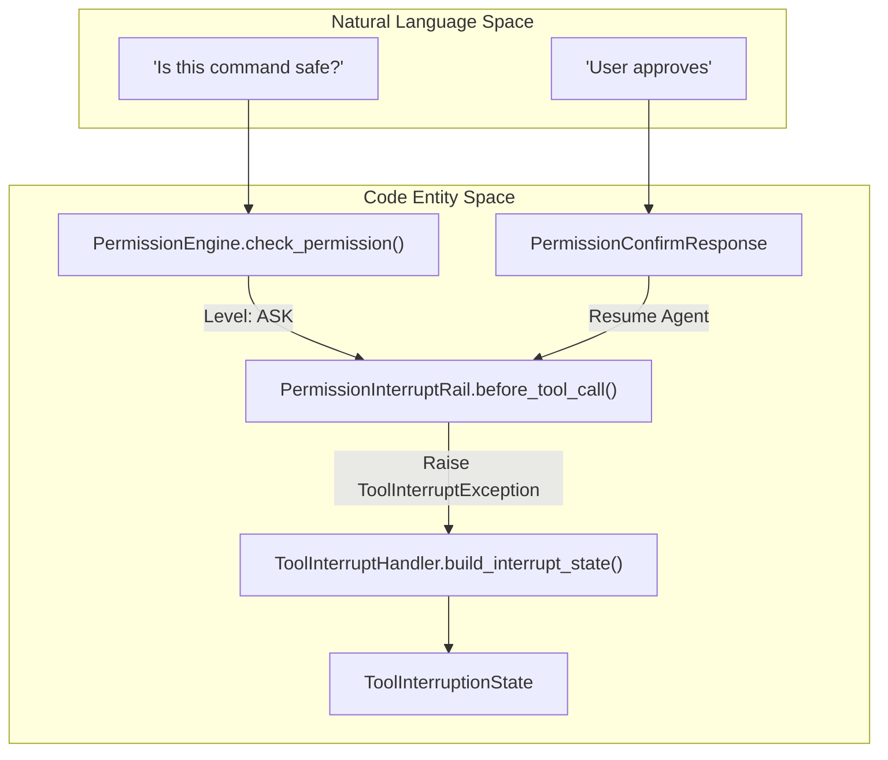
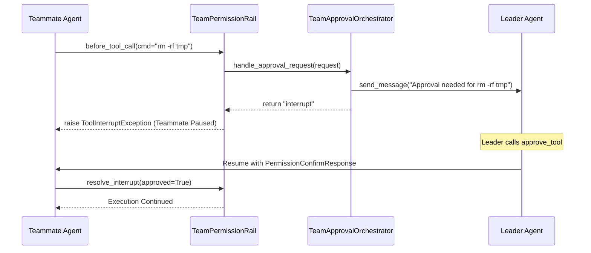

<!-- source: DeepWiki mcp.deepwiki.com · repo openJiuwen-ai/agent-core · page 13.2 Security Guardrails · fetched 2026-11-02 -->

# Security Guardrails

Relevant source files

The following files were used as context for generating this wiki page:

- [openjiuwen/agent_teams/docs/features/F_38_team-permission-system.md](openjiuwen/agent_teams/docs/features/F_38_team-permission-system.md)
- [openjiuwen/agent_teams/rails/confirm_payload.py](openjiuwen/agent_teams/rails/confirm_payload.py)
- [openjiuwen/agent_teams/rails/team_permission_rail.py](openjiuwen/agent_teams/rails/team_permission_rail.py)
- [openjiuwen/agent_teams/security/__init__.py](openjiuwen/agent_teams/security/__init__.py)
- [openjiuwen/agent_teams/security/narrowing.py](openjiuwen/agent_teams/security/narrowing.py)
- [openjiuwen/core/single_agent/interrupt/handler.py](openjiuwen/core/single_agent/interrupt/handler.py)
- [openjiuwen/core/single_agent/interrupt/response.py](openjiuwen/core/single_agent/interrupt/response.py)
- [openjiuwen/core/single_agent/interrupt/state.py](openjiuwen/core/single_agent/interrupt/state.py)
- [openjiuwen/harness/prompts/sections/safety.py](openjiuwen/harness/prompts/sections/safety.py)
- [openjiuwen/harness/rails/evolution/evolution_interrupt_rail.py](openjiuwen/harness/rails/evolution/evolution_interrupt_rail.py)
- [openjiuwen/harness/rails/interrupt/confirm_rail.py](openjiuwen/harness/rails/interrupt/confirm_rail.py)
- [openjiuwen/harness/rails/security/tool_security_rail.py](openjiuwen/harness/rails/security/tool_security_rail.py)
- [openjiuwen/harness/security/__init__.py](openjiuwen/harness/security/__init__.py)
- [openjiuwen/harness/security/checker.py](openjiuwen/harness/security/checker.py)
- [openjiuwen/harness/security/core.py](openjiuwen/harness/security/core.py)
- [openjiuwen/harness/security/file_guard.py](openjiuwen/harness/security/file_guard.py)
- [openjiuwen/harness/security/files/__init__.py](openjiuwen/harness/security/files/__init__.py)
- [openjiuwen/harness/security/files/extract.py](openjiuwen/harness/security/files/extract.py)
- [openjiuwen/harness/security/files/registry.py](openjiuwen/harness/security/files/registry.py)
- [openjiuwen/harness/security/models.py](openjiuwen/harness/security/models.py)
- [openjiuwen/harness/security/patterns.py](openjiuwen/harness/security/patterns.py)
- [openjiuwen/harness/security/tiered_policy.py](openjiuwen/harness/security/tiered_policy.py)
- [tests/system_tests/agent/react_agent/interrupt/test_fine_grained_auto_confirm.py](tests/system_tests/agent/react_agent/interrupt/test_fine_grained_auto_confirm.py)
- [tests/unit_tests/agent/react_agent/interrupt/test_fine_grained_auto_confirm.py](tests/unit_tests/agent/react_agent/interrupt/test_fine_grained_auto_confirm.py)
- [tests/unit_tests/agent/react_agent/interrupt/test_interrupt_resume_routing.py](tests/unit_tests/agent/react_agent/interrupt/test_interrupt_resume_routing.py)
- [tests/unit_tests/harness/rails/evolution/test_evolution_configuration.py](tests/unit_tests/harness/rails/evolution/test_evolution_configuration.py)
- [tests/unit_tests/harness/rails/evolution/test_evolution_interrupt_rail.py](tests/unit_tests/harness/rails/evolution/test_evolution_interrupt_rail.py)
- [tests/unit_tests/harness/security/test_permission_merge_after_auto_confirm.py](tests/unit_tests/harness/security/test_permission_merge_after_auto_confirm.py)

AI agents are capable of autonomous planning and invoking tools, expanding the attack surface for threats like task hijacking and data leakage. The security system in `agent-core` provides a dual-layer defense: a hook-based **Guardrail** system for content inspection and a robust **Permission Engine** for fine-grained tool and file access control.

---

## Overview

The security framework consists of two primary subsystems:
1.  **Detection Guardrails**: Hook-based inspection that subscribes to events (e.g., `llm_invoke_input`) to block malicious content by raising a `GuardrailError`.
2.  **Tool Permission Rails**: Logic that evaluates tool calls against a `PermissionsSection` config, supporting `ALLOW`, `DENY`, and `ASK` (Human-in-the-loop) levels. [openjiuwen/harness/security/models.py:19-29]()

---

## Tool Permission Engine

The `PermissionEngine` is the core evaluator for tool-related security. It processes configurations defined in the agent's YAML under the `permissions` section. [openjiuwen/harness/security/core.py:42-65]()

### Permission Levels
-   **ALLOW**: Execute tool immediately.
-   **ASK**: Trigger an interrupt to request user confirmation.
-   **DENY**: Block execution and return a security error. [openjiuwen/harness/security/models.py:19-28]()

### Evaluation Pipeline
When `check_permission` is called, the engine runs two parallel checks:
1.  **Tiered Policy**: Evaluates tool names and specific argument patterns (e.g., shell commands) using `evaluate_tiered_policy`. [openjiuwen/harness/security/core.py:203-207]()
2.  **File Guard**: A specialized checker (`FileGuardChecker`) that inspects path-based arguments against allowed/denied directories. [openjiuwen/harness/security/core.py:214-222]()

The engine then selects the **strictest** result between the two. [openjiuwen/harness/security/core.py:228-233]()

**Sources:** [openjiuwen/harness/security/core.py:161-240](), [openjiuwen/harness/security/models.py:19-29](), [openjiuwen/harness/security/tiered_policy.py:1-50]()

---

## Permission Interrupt Flow

When the engine returns `ASK`, the system utilizes the `AsyncCallbackFramework` and the `InterruptHandler` to pause execution and wait for user input.

### PermissionInterruptRail
This rail implements the `before_tool_call` callback. If the engine decides `ASK`, the rail raises a `ToolInterruptException`, which is caught by the `ToolInterruptHandler` to save the session state and emit an `InterruptRequest`. [openjiuwen/harness/rails/security/tool_security_rail.py:174-200](), [openjiuwen/core/single_agent/interrupt/handler.py:144-167]()

**Code Entity Space Mapping**

**Sources:** [openjiuwen/harness/security/core.py:161-170](), [openjiuwen/harness/rails/security/tool_security_rail.py:174-190](), [openjiuwen/core/single_agent/interrupt/handler.py:59-83]()

---

## Pattern Matching and Persistence

The system supports wildcard matching for commands and paths to allow for flexible yet secure rules.

### Pattern Matchers
-   **`match_wildcard`**: Supports `*` and `?` while escaping shell metacharacters (`;`, `|`, `&`, etc.) to prevent injection. [openjiuwen/harness/security/patterns.py:122-158]()
-   **`PathMatcher`**: Normalizes path separators and checks parent directory hierarchies. [openjiuwen/harness/security/patterns.py:176-200]()

### Auto-Confirm and Persistence
Users can choose to "Always Allow" a specific pattern.
1.  **Session-Level**: Stored in the session state under `INTERRUPT_AUTO_CONFIRM_KEY`. [openjiuwen/harness/rails/security/tool_security_rail.py:61-63]()
2.  **Disk Persistence**: The rail can merge the new allow rule into the agent's YAML config via `merge_permission_allow_rule_into_permissions` and `write_permissions_section_to_agent_config_yaml`. [openjiuwen/harness/security/patterns.py:38-71](), [openjiuwen/harness/rails/security/tool_security_rail.py:230-245]()

**Sources:** [openjiuwen/harness/security/patterns.py:122-205](), [openjiuwen/harness/rails/security/tool_security_rail.py:210-250](), [tests/unit_tests/harness/security/test_permission_merge_after_auto_confirm.py:41-70]()

---

## Team Security Guardrails

In multi-agent environments, permissions are mediated by the team leader.

### TeamPermissionRail
A subclass of `PermissionInterruptRail` that overrides the persistence logic.
-   **Session Scoped**: Leader approvals are never persisted to disk (`_persist_allow_always` returns `False`) to prevent polluting shared team configurations. [openjiuwen/agent_teams/rails/team_permission_rail.py:120-126]()
-   **Leader Mediation**: Uses `TeamApprovalOrchestrator` to send a message to the leader member when a teammate hits an `ASK` result. [openjiuwen/agent_teams/rails/team_permission_rail.py:43-63]()

**Sequence: Team Tool Approval**

**Sources:** [openjiuwen/agent_teams/rails/team_permission_rail.py:43-107](), [openjiuwen/agent_teams/rails/team_permission_rail.py:109-147]()

---

## Data Models Reference

| Class | Purpose | Key Fields |
| :--- | :--- | :--- |
| `PermissionResult` | Result of a security check. | `permission`, `matched_rule`, `reason` [openjiuwen/harness/security/models.py:32-36]() |
| `PermissionConfirmResponse` | User feedback to an `ASK`. | `approved`, `auto_confirm`, `persist_allow` [openjiuwen/harness/security/models.py:52-67]() |
| `InterruptRequest` | Payload sent to UI for HITL. | `message`, `payload_schema`, `auto_confirm_key` [openjiuwen/core/single_agent/interrupt/response.py:9-17]() |
| `PermissionsSection` | Schema for agent YAML config. | `enabled`, `tools`, `rules`, `file_guard` [openjiuwen/harness/security/models.py:111-152]() |

**Sources:** [openjiuwen/harness/security/models.py:1-163](), [openjiuwen/core/single_agent/interrupt/response.py:9-54]()

---

