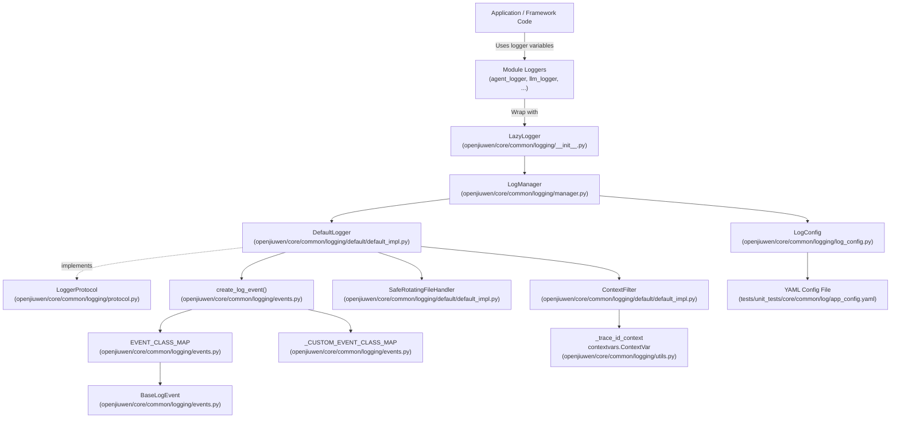
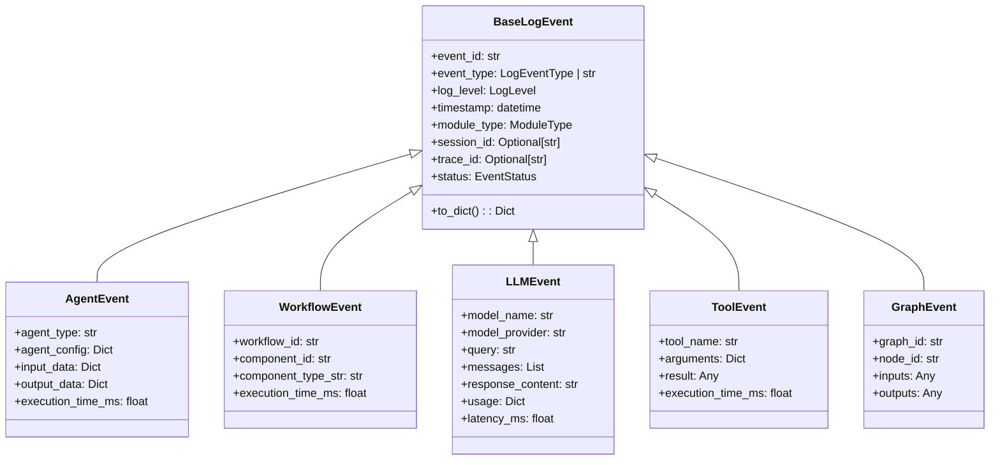
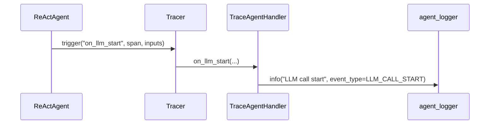

<!-- source: DeepWiki mcp.deepwiki.com · repo openJiuwen-ai/agent-core · page 14 Observability and Logging · fetched 2026-11-02 -->

# Observability and Logging

Relevant source files

The following files were used as context for generating this wiki page:

- [openjiuwen/core/common/logging/__init__.py](openjiuwen/core/common/logging/__init__.py)
- [openjiuwen/core/common/logging/base_impl.py](openjiuwen/core/common/logging/base_impl.py)
- [openjiuwen/core/common/logging/config_manager.py](openjiuwen/core/common/logging/config_manager.py)
- [openjiuwen/core/common/logging/default/__init__.py](openjiuwen/core/common/logging/default/__init__.py)
- [openjiuwen/core/common/logging/default/config_provider.py](openjiuwen/core/common/logging/default/config_provider.py)
- [openjiuwen/core/common/logging/default/constant.py](openjiuwen/core/common/logging/default/constant.py)
- [openjiuwen/core/common/logging/default/default_impl.py](openjiuwen/core/common/logging/default/default_impl.py)
- [openjiuwen/core/common/logging/events.py](openjiuwen/core/common/logging/events.py)
- [openjiuwen/core/common/logging/log_config.py](openjiuwen/core/common/logging/log_config.py)
- [openjiuwen/core/common/logging/log_levels.py](openjiuwen/core/common/logging/log_levels.py)
- [openjiuwen/core/common/logging/loguru/__init__.py](openjiuwen/core/common/logging/loguru/__init__.py)
- [openjiuwen/core/common/logging/loguru/config_provider.py](openjiuwen/core/common/logging/loguru/config_provider.py)
- [openjiuwen/core/common/logging/loguru/loguru_impl.py](openjiuwen/core/common/logging/loguru/loguru_impl.py)
- [openjiuwen/core/common/logging/manager.py](openjiuwen/core/common/logging/manager.py)
- [openjiuwen/core/common/logging/protocol.py](openjiuwen/core/common/logging/protocol.py)
- [openjiuwen/core/common/logging/utils.py](openjiuwen/core/common/logging/utils.py)
- [openjiuwen/core/foundation/tool/tool.py](openjiuwen/core/foundation/tool/tool.py)
- [openjiuwen/core/runner/spawn/child_process.py](openjiuwen/core/runner/spawn/child_process.py)
- [openjiuwen/core/session/internal/agent.py](openjiuwen/core/session/internal/agent.py)
- [openjiuwen/core/session/internal/agent_team.py](openjiuwen/core/session/internal/agent_team.py)
- [openjiuwen/core/session/tracer/handler.py](openjiuwen/core/session/tracer/handler.py)
- [openjiuwen/core/session/tracer/span.py](openjiuwen/core/session/tracer/span.py)
- [openjiuwen/core/session/tracer/tracer.py](openjiuwen/core/session/tracer/tracer.py)
- [openjiuwen/core/session/tracer/workflow_tracer.py](openjiuwen/core/session/tracer/workflow_tracer.py)
- [openjiuwen/extensions/tracer_otel/handler.py](openjiuwen/extensions/tracer_otel/handler.py)
- [openjiuwen/extensions/tracer_otel/semconv.py](openjiuwen/extensions/tracer_otel/semconv.py)
- [tests/unit_tests/core/common/log/app_config.yaml](tests/unit_tests/core/common/log/app_config.yaml)
- [tests/unit_tests/core/common/log/test_auto_format.py](tests/unit_tests/core/common/log/test_auto_format.py)
- [tests/unit_tests/core/common/log/test_logger.py](tests/unit_tests/core/common/log/test_logger.py)
- [tests/unit_tests/core/common/log/test_loguru_backend.py](tests/unit_tests/core/common/log/test_loguru_backend.py)
- [tests/unit_tests/core/common/log/test_structured_log.py](tests/unit_tests/core/common/log/test_structured_log.py)
- [tests/unit_tests/core/session/tracer/test_handler_registration.py](tests/unit_tests/core/session/tracer/test_handler_registration.py)
- [tests/unit_tests/extensions/tracer_otel/test_handler.py](tests/unit_tests/extensions/tracer_otel/test_handler.py)

This page documents the structured logging system in `agent-core`: the event type taxonomy, domain-specific event dataclasses, the `create_log_event` factory, the `EVENT_CLASS_MAP` dispatch table, dynamic event registration, the `sanitize_event_for_logging` utility, the `LogManager`/`DefaultLogger` runtime, and pre-defined per-module loggers.

For workflow-level distributed tracing (spans emitted during graph execution), see the Workflow Tracing page ([Workflow Tracing]()). For the exception hierarchy that populates `error_code` and `error_message` fields in events, see [Exception System]().

---

## Architecture Overview

**Logging system component map**

This structure supports modular and extensible logging per subsystem, with contextual enrichments like trace IDs for distributed correlation.

Sources:  
[openjiuwen/core/common/logging/__init__.py:1-228](), [openjiuwen/core/common/logging/manager.py:1-158](), [openjiuwen/core/common/logging/default/default_impl.py:1-627](), [openjiuwen/core/common/logging/events.py:1-937](), [openjiuwen/core/common/logging/utils.py:1-128]()

---

## Structured Log Events

All structured log data is modeled as Python dataclasses rooted at `BaseLogEvent`, defined in [openjiuwen/core/common/logging/events.py]().

### Supporting Enumerations

| Enum | Values | Purpose |
|------|--------|---------|
| `LogEventType` | ~140 members | Identifies the action being logged. Examples: `AGENT_START`, `LLM_CALL_START`, `TOOL_CALL_END`, etc. |
| `LogLevel` | `DEBUG`, `INFO`, `WARNING`, `ERROR`, `CRITICAL` | Severity of the log entry |
| `ModuleType` | `AGENT`, `WORKFLOW`, `LLM`, `TOOL`, `STORE`, `MEMORY`, `SESSION`, `CONTEXT`, `RETRIEVAL`, `SYSTEM`, `USER`, `SYS_OPERATION` | Indicates the subsystem originating the event |
| `EventStatus` | `SUCCESS`, `FAILURE`, `PENDING`, `TIMEOUT`, `CANCELLED` | Outcome of the recorded operation |

Sources:  
[openjiuwen/core/common/logging/events.py:41-219]()

---

### `LogEventType` Categories

`LogEventType` has members grouped by subsystem [openjiuwen/core/common/logging/events.py:41-181]():

| Category | Notable Members | Description |
|----------|-----------------|-------------|
| **Agent** | `AGENT_START`, `AGENT_END`, `AGENT_INVOKE`, `AGENT_RESPONSE`, `AGENT_ERROR` | Lifecycle and interaction of agents |
| **Workflow** | `WORKFLOW_EXECUTE_START`, `WORKFLOW_EXECUTE_END`, `WORKFLOW_COMPONENT_START` | Workflow engine execution and component states |
| **LLM** | `LLM_CALL_START`, `LLM_CALL_END`, `LLM_CALL_ERROR`, `LLM_STREAM_CHUNK` | LLM invocation and streaming chunks |
| **Tool** | `TOOL_CALL_START`, `TOOL_CALL_END`, `TOOL_CALL_ERROR` | Tool execution phases |
| **Store** | `STORE_ADD`, `STORE_DELETE`, `STORE_UPDATE`, `STORE_RETRIEVE` | Data storage operations |
| **Memory** | `MEMORY_INIT`, `MEMORY_STORE`, `MEMORY_RETRIEVE`, `MEMORY_UPDATE` | Memory subsystem events |
| **Session** | `SESSION_CREATE`, `SESSION_UPDATE`, `SESSION_DELETE` | Session management events |
| **Context** | `CONTEXT_ADD_MESSAGE`, `CONTEXT_CLEAR`, `CONTEXT_RETRIEVE`, `CONTEXT_SAVE` | Context lifecycle events |
| **Retrieval** | `RETRIEVAL_START`, `RETRIEVAL_END`, `RETRIEVAL_ERROR` | Retrieval process events |
| **SysOperation** | `SYS_OP_START`, `SYS_OP_END`, `SYS_OP_ERROR`, `SYS_OP_STREAM` | System operation calls |
| **Graph** | `GRAPH_START`, `GRAPH_END`, `GRAPH_VERTEX_INIT`, `GRAPH_SUPER_STEP_START` | Detailed graph execution and Pregel-based events |
| **Runner** | `RUNNER_START`, `RUNNER_STOP`, `RESOURCE_MGR_ADD_RESOURCE` | Runner lifecycle and resource management |

---

### `BaseLogEvent` Fields

The central dataclass for structured logging is `BaseLogEvent` [openjiuwen/core/common/logging/events.py:222-315]():

| Field | Type | Description |
|-------|------|-------------|
| `event_id` | `str` | Auto-generated UUID for unique event identity |
| `event_type` | `LogEventType \| str` | Event type, e.g., `AGENT_START` |
| `log_level` | `LogLevel` | Log severity level (default `INFO`) |
| `timestamp` | `datetime` | UTC timestamp of event creation |
| `module_type` | `ModuleType` | Subsystem classification, set by subclasses |
| `module_id` | `Optional[str]` | E.g. agent ID, workflow ID, tool name |
| `session_id` | `Optional[str]` | Session context identifier |
| `trace_id` | `Optional[str]` | Distributed trace identifier for correlation |
| `status` | `EventStatus` | Outcome status, default `SUCCESS` |
| `error_code` | `Optional[str]` | Populated if an error occurs |
| `error_message` | `Optional[str]` | Error message text |
| `metadata` | `Dict[str, Any]` | Open map for any additional fields |

The `to_dict()` method returns a dictionary suitable for JSON serialization, converting enums to `.value` and timestamps to ISO8601 strings [openjiuwen/core/common/logging/events.py:284-315]().

---

### Domain-Specific Event Subclasses

Specialized event dataclasses inherit from `BaseLogEvent` and add domain-specific fields [openjiuwen/core/common/logging/events.py:318-596]().

Sources:  
[openjiuwen/core/common/logging/events.py:318-596]()

---

## `EVENT_CLASS_MAP` and the `create_log_event` Factory

### `EVENT_CLASS_MAP`
`EVENT_CLASS_MAP` is a dictionary mapping `LogEventType` enum values to their corresponding event dataclass types [openjiuwen/core/common/logging/events.py:602-711]().

### `create_log_event`
The `create_log_event` factory [openjiuwen/core/common/logging/events.py:829-872]() produces an event instance for a given `event_type` and additional keyword arguments.

1.  **Resolution:** Checks `_CUSTOM_EVENT_CLASS_MAP` first, then `EVENT_CLASS_MAP`, falling back to `BaseLogEvent`.
2.  **Filtering:** It automatically filters `kwargs` to match the fields defined in the resolved dataclass, logging a warning for ignored fields.
3.  **Special Handling:** If `event_class` is `StreamEvent` but contains workflow-specific fields, it upgrades the instance to `WorkflowStreamEvent`.

Sources:  
[openjiuwen/core/common/logging/events.py:829-872]()

---

## Dynamic Event Registration

The system allows external extensions to register custom event types [openjiuwen/core/common/logging/events.py:732-826]():

-   `register_event_class(event_type: str, event_class: type[BaseLogEvent])`: Registers a custom event class. String keys are used to avoid enum conflicts.
-   `unregister_event_class(event_type: str)`: Removes a custom registration.

---

## `sanitize_event_for_logging`

This utility [openjiuwen/core/common/logging/events.py:903-936]() redacts sensitive content before output. Default redacted fields include `messages`, `response_content`, `input_data`, `output_data`, and `tool_calls`. Redacted values are replaced with `"<REDACTED>"`.

---

## Logger Runtime

### `DefaultLogger` Implementation
The `DefaultLogger` [openjiuwen/core/common/logging/default/default_impl.py:221-626]() implements the `LoggerProtocol`. It manages both standard string-based logging and structured event-based logging.

**Message Processing Logic [openjiuwen/core/common/logging/default/default_impl.py:366-443]():**
1.  If an `event` object is provided, it is used directly.
2.  If an `event_type` is provided, `create_log_event` is called to wrap the log message and metadata.
3.  The final payload is serialized (JSON by default) and passed to the underlying Python `logging.Logger`.

### `SafeRotatingFileHandler`
A specialized handler [openjiuwen/core/common/logging/default/default_impl.py:46-181]() that ensures:
-   Secure file permissions (`0o640` for logs, `0o440` for backups).
-   Automatic directory creation.
-   Support for filename patterns (e.g., including `{pid}` or `{timestamp}`).

### Context Propagation
The system uses `contextvars` to propagate IDs across async boundaries [openjiuwen/core/common/logging/utils.py:24-64]():
-   `_trace_id_context`: Stores the current session/trace ID.
-   `_member_id_context`: Stores the current agent member ID in team scenarios.

A `ContextFilter` [openjiuwen/core/common/logging/default/default_impl.py:184-218]() automatically injects these IDs into every log record.

Sources:  
[openjiuwen/core/common/logging/default/default_impl.py:1-627](), [openjiuwen/core/common/logging/utils.py:1-128]()

---

## Distributed Tracing (Tracer)

The `Tracer` system [openjiuwen/core/session/tracer/tracer.py:98-208]() provides a higher-level abstraction for observing complex operations.

**Key Components:**
-   `Tracer`: Manages `SpanManager` instances and triggers registered handlers [openjiuwen/core/session/tracer/tracer.py:98]().
-   `TracerHandlerRegistry`: Global registry for extension handlers like OpenTelemetry [openjiuwen/core/session/tracer/tracer.py:16]().
-   `SpanManager`: Tracks active spans and parent-child relationships [openjiuwen/core/session/tracer/span.py]().

Sources:  
[openjiuwen/core/session/tracer/tracer.py:1-208](), [openjiuwen/core/session/tracer/handler.py:1-212]()

---

## Pre-Defined Module Loggers

The SDK provides specialized loggers for major subsystems [openjiuwen/core/common/logging/__init__.py:112-187]():

| Logger Variable | Manager Key | Purpose |
| :--- | :--- | :--- |
| `agent_logger` | `"agent"` | Single agent lifecycle and logic |
| `workflow_logger` | `"workflow"` | Graph execution and component logic |
| `llm_logger` | `"llm"` | Model requests and responses |
| `tool_logger` | `"tool"` | Tool/Plugin execution |
| `memory_logger` | `"memory"` | Long-term memory operations |
| `runner_logger` | `"runner"` | Runner lifecycle and spawn process logs |
| `team_logger` | `"team"` | Multi-agent team coordination |

Sources:  
[openjiuwen/core/common/logging/__init__.py:109-188]()

---

