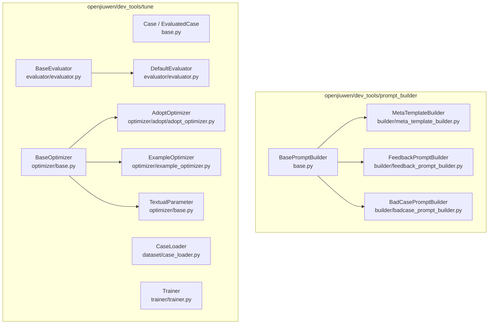
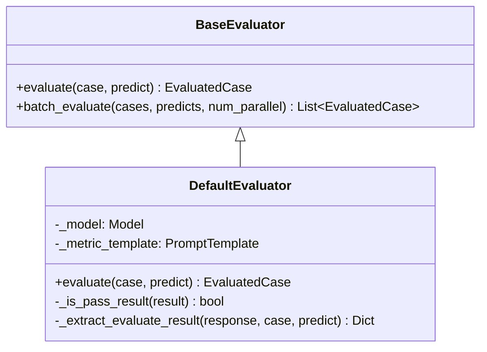

<!-- source: DeepWiki mcp.deepwiki.com · repo openJiuwen-ai/agent-core · page 15 Development Tools · fetched 2026-11-02 -->

# Development Tools

<details>
<summary>Relevant source files</summary>

The following files were used as context for generating this wiki page:

- [openjiuwen/core/foundation/llm/model_clients/dashscope_model_client.py](openjiuwen/core/foundation/llm/model_clients/dashscope_model_client.py)
- [openjiuwen/core/foundation/prompt/assemble/assembler.py](openjiuwen/core/foundation/prompt/assemble/assembler.py)
- [openjiuwen/core/foundation/prompt/assemble/variables/dictable.py](openjiuwen/core/foundation/prompt/assemble/variables/dictable.py)
- [openjiuwen/core/foundation/prompt/assemble/variables/textable.py](openjiuwen/core/foundation/prompt/assemble/variables/textable.py)
- [openjiuwen/core/foundation/prompt/template.py](openjiuwen/core/foundation/prompt/template.py)
- [openjiuwen/dev_tools/prompt_builder/builder/badcase_prompt_builder.py](openjiuwen/dev_tools/prompt_builder/builder/badcase_prompt_builder.py)
- [openjiuwen/dev_tools/prompt_builder/builder/feedback_prompt_builder.py](openjiuwen/dev_tools/prompt_builder/builder/feedback_prompt_builder.py)
- [openjiuwen/dev_tools/prompt_builder/builder/meta_template_builder.py](openjiuwen/dev_tools/prompt_builder/builder/meta_template_builder.py)
- [openjiuwen/dev_tools/prompt_builder/builder/utils.py](openjiuwen/dev_tools/prompt_builder/builder/utils.py)
- [openjiuwen/dev_tools/tune/evaluator/evaluator.py](openjiuwen/dev_tools/tune/evaluator/evaluator.py)
- [openjiuwen/dev_tools/tune/optimizer/adopt/adopt_optimizer.py](openjiuwen/dev_tools/tune/optimizer/adopt/adopt_optimizer.py)
- [openjiuwen/dev_tools/tune/optimizer/base.py](openjiuwen/dev_tools/tune/optimizer/base.py)
- [openjiuwen/dev_tools/tune/optimizer/example_optimizer.py](openjiuwen/dev_tools/tune/optimizer/example_optimizer.py)
- [openjiuwen/dev_tools/tune/trainer/trainer.py](openjiuwen/dev_tools/tune/trainer/trainer.py)
- [openjiuwen/dev_tools/tune/utils.py](openjiuwen/dev_tools/tune/utils.py)
- [tests/system_tests/foundation/llm/test_dashscope_multimodal_generation.py](tests/system_tests/foundation/llm/test_dashscope_multimodal_generation.py)
- [tests/unit_tests/agent_builder/prompt_builder/test_badcase_prompt_builder.py](tests/unit_tests/agent_builder/prompt_builder/test_badcase_prompt_builder.py)
- [tests/unit_tests/agent_builder/prompt_builder/test_feedback_prompt_builder.py](tests/unit_tests/agent_builder/prompt_builder/test_feedback_prompt_builder.py)
- [tests/unit_tests/agent_builder/prompt_builder/test_meta_template_builder.py](tests/unit_tests/agent_builder/prompt_builder/test_meta_template_builder.py)
- [tests/unit_tests/core/foundation/prompt/test_template_assemble.py](tests/unit_tests/core/foundation/prompt/test_template_assemble.py)
- [tests/unit_tests/dev_tools/agent_builder/conftest.py](tests/unit_tests/dev_tools/agent_builder/conftest.py)

</details>


The `dev_tools` package provides tooling for iterative quality improvement of agents. This covers two concerns: **prompt authoring** (prompt builders that call an LLM to write or refine a prompt) and **automated training** (an evaluate–optimize–update loop that adjusts agent parameters against a labelled dataset).

Details on specific classes are split across child pages: see [Prompt Builders](#15.1) for `MetaTemplateBuilder`, `FeedbackPromptBuilder`, and `BadCasePromptBuilder`; see [Optimizers and Trainers](#15.2) for the optimizer and trainer implementations.

---

## Package Layout

The `dev_tools` package is the primary location for these tools.

**Module layout — `dev_tools`**

```
openjiuwen/dev_tools/
├── prompt_builder/
│   ├── base.py                  # BasePromptBuilder
│   └── builder/
│       ├── meta_template_builder.py    # MetaTemplateBuilder
│       ├── feedback_prompt_builder.py  # FeedbackPromptBuilder
│       ├── badcase_prompt_builder.py   # BadCasePromptBuilder
│       ├── prompt_zh.py               # Chinese prompt templates
│       ├── prompt_en.py               # English prompt templates
│       └── utils.py                   # select_template, get_string_prompt
└── tune/
    ├── base.py                  # Case, EvaluatedCase, TuneConstant
    ├── utils.py                 # TuneUtils
    ├── dataset/
    │   └── case_loader.py       # CaseLoader
    ├── evaluator/
    │   └── evaluator.py         # BaseEvaluator, DefaultEvaluator
    ├── optimizer/
    │   ├── base.py              # BaseOptimizer, TextualParameter, TraceNode, OptimizeHistory
    │   ├── example_optimizer.py # ExampleOptimizer
    │   ├── instruction_optimizer.py  # InstructionOptimizer
    │   └── adopt/
    │       └── adopt_optimizer.py    # AdoptOptimizer, PartialOptimizer
    └── trainer/
        ├── base.py              # Progress, Callbacks
        └── trainer.py           # Trainer, ParameterSearcher
```

Sources: [openjiuwen/dev_tools/tune/optimizer/base.py:1-205](), [openjiuwen/dev_tools/prompt_builder/builder/meta_template_builder.py:1-147]()

---

## Component Map

The following diagram maps the major named components to the files and class names they correspond to in the codebase.

**Diagram: Component-to-code map for `dev_tools`**



Sources: [openjiuwen/dev_tools/tune/optimizer/base.py:1-50](), [openjiuwen/dev_tools/tune/trainer/trainer.py:31-90]()

---

## Shared Data Model: `Case` and `EvaluatedCase`

The `dev_tools` package defines the core data models for evaluation and optimization.

| Field | Type | Description |
|---|---|---|
| `Case.inputs` | `Dict` | Keyword arguments passed to `agent.invoke` |
| `Case.label` | `Dict` | Expected output to score against |
| `Case.case_id` | `str` | Unique identifier (auto-generated if omitted) |
| `EvaluatedCase.case` | `Case` | Reference to the original case |
| `EvaluatedCase.answer` | `Dict` | Actual output from agent |
| `EvaluatedCase.score` | `float` | 0.0 (fail) or 1.0 (pass); fractional for `MetricEvaluator` |
| `EvaluatedCase.reason` | `str` | Text explanation from LLM judge |
| `EvaluatedCase.per_metric` | `Dict[str, float]` | Per-metric scores (`MetricEvaluator` only) |

A `CaseLoader` wraps a `List[Case]` and exposes `get_cases()`, `size()`, and `split(ratio)` helpers.

Sources: [openjiuwen/dev_tools/tune/base.py:21-43]()

---

## Prompt Builders

The three prompt builders in `openjiuwen/dev_tools/prompt_builder/` are LLM-assisted tools for writing and refining agent system prompts. They all extend `BasePromptBuilder` and accept `ModelRequestConfig` + `ModelClientConfig` at construction time.

| Class | File | Use case |
|---|---|---|
| `MetaTemplateBuilder` | `builder/meta_template_builder.py` | Generate a structured prompt from a short description using a meta-template |
| `FeedbackPromptBuilder` | `builder/feedback_prompt_builder.py` | Revise an existing prompt given natural-language feedback (general / insert / select modes) |
| `BadCasePromptBuilder` | `builder/badcase_prompt_builder.py` | Rewrite a prompt guided by a list of `EvaluatedCase` failures |

All three expose a coroutine `build(...)` for single-shot output and an async generator `stream_build(...)` for streaming. Language selection (`zh-CN` or `en-US`) is handled via `select_template()` in [openjiuwen/dev_tools/prompt_builder/builder/utils.py:17-18](), which dispatches to either `prompt_zh` or `prompt_en` module.

For details, see [Prompt Builders](#15.1).

Sources: [openjiuwen/dev_tools/prompt_builder/builder/meta_template_builder.py:19-73](), [openjiuwen/dev_tools/prompt_builder/builder/feedback_prompt_builder.py:22-60](), [openjiuwen/dev_tools/prompt_builder/builder/badcase_prompt_builder.py:24-45](), [openjiuwen/dev_tools/prompt_builder/builder/utils.py:17-18]()

---

## Self-Evolving Training Loop

The `dev_tools/tune/trainer/trainer.py` module implements the core training loop.

**Diagram: `Trainer.train` execution flow**

```mermaid
sequenceDiagram
    participant U as "caller"
    participant T as "Trainer\ntrainer.py"
    participant A as "BaseAgent"
    participant E as "BaseEvaluator"
    participant O as "BaseOptimizer"

    U->>T: "train(agent, train_cases, val_cases, num_iterations)"
    T->>T: "_pre_train()"
    T->>O: "bind_parameter(agent.get_llm_calls())"
    T->>A: "invoke() × val_cases [predict()]"
    T->>E: "batch_evaluate(cases, predicts)"
    T-->>U: "callbacks.on_train_begin()"
    loop "epoch in Progress.run_epoch()"
        T-->>U: "callbacks.on_train_epoch_begin()"
        T->>O: "__enter__()"
        T->>A: "invoke() × train_cases [predict()]"
        T->>E: "batch_evaluate()"
        T->>O: "__exit__()"
        T->>O: "backward(cur_evaluated_cases)"
        T->>O: "update()"
        T->>T: "ParameterSearcher.search_best()"
        T->>T: "_update_agent()"
        T-->>U: "callbacks.on_train_epoch_end()"
        alt "early_stop_score reached"
            break
        end
    end
    T-->>U: "callbacks.on_train_end()"
    T-->>U: "agent (updated)"
```

Sources: [openjiuwen/dev_tools/tune/trainer/trainer.py:44-104]()

### `Trainer` constructor parameters

| Parameter | Default | Description |
|---|---|---|
| `optimizer` | required | `BaseOptimizer` instance |
| `evaluator` | required | `BaseEvaluator` instance |
| `num_parallel` | `TuneConstant.DEFAULT_PARALLEL_NUM` | Concurrency for `agent.invoke` |
| `early_stop_score` | `TuneConstant.DEFAULT_EARLY_STOP_SCORE` | Stop when val score reaches this |
| `callbacks` | `Callbacks()` | Lifecycle hooks |

Sources: [openjiuwen/dev_tools/tune/trainer/trainer.py:26-42]()

### `Progress` and `Callbacks`

`Progress` ([openjiuwen/dev_tools/tune/trainer/base.py:15-47]()) is a Pydantic model tracking epoch counts and scores. Its `run_epoch()` method is a generator that yields each epoch index and updates `current_epoch`.

`Callbacks` ([openjiuwen/dev_tools/tune/trainer/base.py:50-67]()) is a base class with four no-op hooks:

| Hook | When called |
|---|---|
| `on_train_begin(agent, progress, eval_info)` | After validation baseline, before epoch loop |
| `on_train_epoch_begin(agent, progress)` | Start of each epoch |
| `on_train_epoch_end(agent, progress, eval_info)` | End of each epoch, after writeback |
| `on_train_end(agent, progress, eval_info)` | After all epochs complete |

Subclass `Callbacks` to attach custom logging, metric export, or early-stopping logic.

Sources: [openjiuwen/dev_tools/tune/trainer/base.py:15-67]()

---

## Evaluators

**Diagram: Evaluator class hierarchy and `evaluate()` contract**



`DefaultEvaluator` calls the LLM as a judge: it submits the question, expected answer, and model answer against `LLM_METRIC_TEMPLATE`, then parses a `{"result": true/false, "reason": "..."}` JSON response. If parsing fails it retries via `LLM_METRIC_RETRY_TEMPLATE`. The `score` field is set to `1.0` on pass and `0.0` on fail.

For details, see [Optimizers and Trainers](#15.2).

Sources: [openjiuwen/dev_tools/tune/evaluator/evaluator.py:20-170]()

---

## Optimizers

The `dev_tools/tune/optimizer/base.py` module defines the `BaseOptimizer` pattern. The key concept is a **`TextualParameter`**, which wraps an `LLMCall` (an operator) and accumulates computed *gradients* (strings describing desired prompt changes).

### `BaseOptimizer` lifecycle

1.  **`bind_parameter(parameters: Dict[str, LLMCall])`** — associates named `LLMCall` operators with the optimizer, wrapping each in a `TextualParameter`. [openjiuwen/dev_tools/tune/optimizer/base.py:45-56]()
2.  **Context manager** (`__enter__`/`__exit__`) — installs `trace_callback` on each operator to record `TraceNode` entries into `OptimizeHistory` during a forward pass. [openjiuwen/dev_tools/tune/optimizer/base.py:31-44]()
3.  **`backward(evaluated_cases)`** — computes textual gradients from `EvaluatedCase` results. Implemented by each concrete subclass. [openjiuwen/dev_tools/tune/optimizer/base.py:58-73]()
4.  **`update()`** — applies the gradients to rewrite the prompt in-place via `LLMCall.update_system_prompt` / `update_user_prompt`. [openjiuwen/dev_tools/tune/optimizer/base.py:75-105]()

| Class | Location | Strategy |
|---|---|---|
| `InstructionOptimizer` | `optimizer/instruction_optimizer.py` | Uses LLM to suggest prompt improvements from bad cases |
| `ExampleOptimizer` | `optimizer/example_optimizer.py` | Adds few-shot examples to the prompt |
| `AdoptOptimizer` | `optimizer/adopt/adopt_optimizer.py` | Multi-step: global gradient → per-node partial gradient → apply |

For details, see [Optimizers and Trainers](#15.2).

Sources: [openjiuwen/dev_tools/tune/optimizer/base.py:21-205](), [openjiuwen/dev_tools/tune/optimizer/adopt/adopt_optimizer.py:28-115]()

### `OptimizeHistory` and `TraceNode`

`OptimizeHistory` ([openjiuwen/dev_tools/tune/optimizer/base.py:178-205]()) is a thread-safe in-memory store mapping `case_id → List[TraceNode]`. A `TraceNode` captures:
- `case_id`, `llm_call_id` — identifiers
- `inputs: Dict[str, Any]` — the prompt variables for one forward call
- `outputs: str` — the model's response
- `history: List[BaseMessage]`, `tools: List[ToolInfo]` — full context

The optimizer uses this history during `backward()` to determine what the model produced for each bad case.

Sources: [openjiuwen/dev_tools/tune/optimizer/base.py:178-205](), [openjiuwen/dev_tools/tune/optimizer/base.py:169-176]()

---

## `TuneConstant`

`TuneConstant` ([openjiuwen/dev_tools/tune/base.py:46-53]()) is a class defining default values and allowed ranges for hyperparameters used throughout the training framework.

| Constant | Default | Bound |
|---|---|---|
| `DEFAULT_ITERATION_NUM` | 3 | 1–20 |
| `DEFAULT_PARALLEL_NUM` | 1 | 1–20 |
| `DEFAULT_EARLY_STOP_SCORE` | 1.0 | — |
| `DEFAULT_EXAMPLE_NUM` | 1 | 0–20 |
| `MAX_CASES_SAMPLE_NUM` | 10 | — |

Sources: [openjiuwen/dev_tools/tune/base.py:46-53]()

---

## Integration with the Agent Model

Agents used in training must implement `get_llm_calls() → Dict[str, LLMCall]`. The `Trainer` discovers `LLMCall` instances via this method and binds the `Optimizer` to them.

For information about agent configuration and invocation, see [Agents](#2) and [ReActAgent](#2.1).

Sources: [openjiuwen/dev_tools/tune/trainer/trainer.py:148-149]()

---

