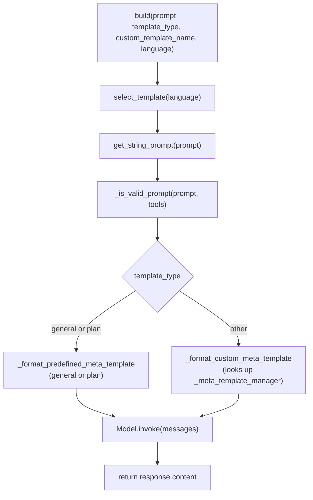
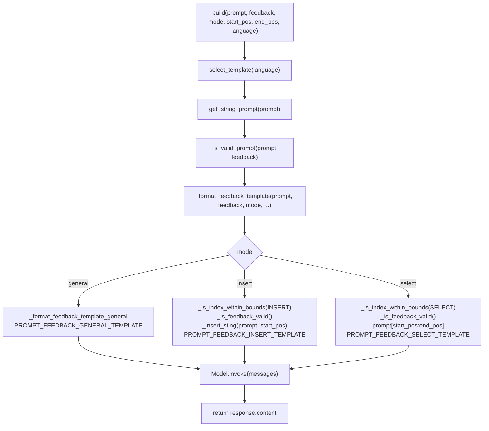
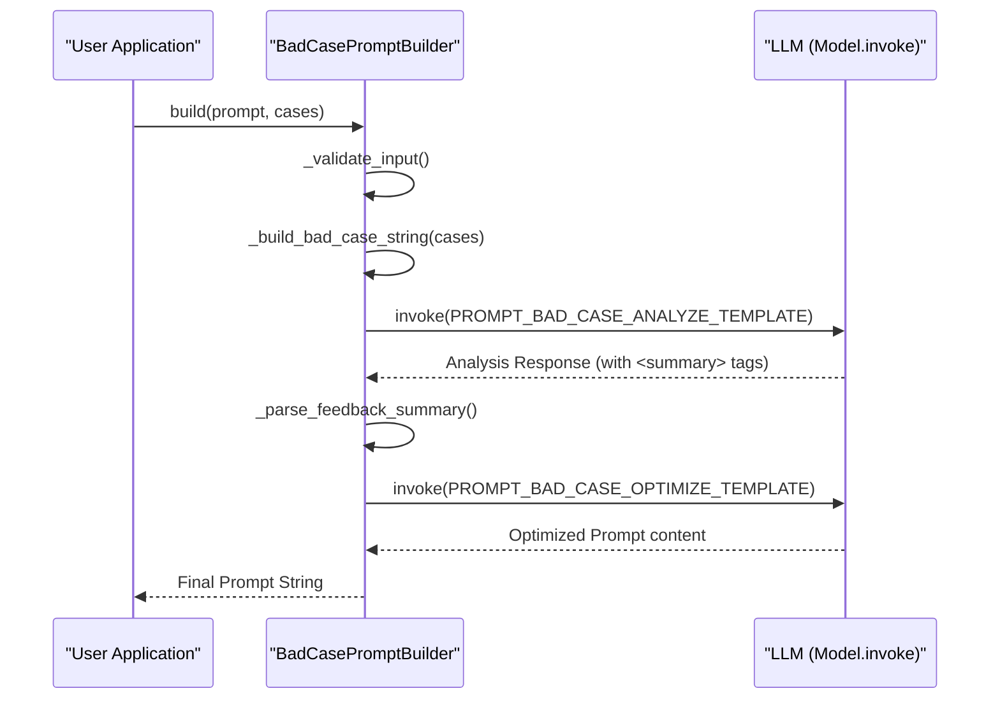

<!-- source: DeepWiki mcp.deepwiki.com · repo openJiuwen-ai/agent-core · page 15.1 Prompt Builders · fetched 2026-11-02 -->

# Prompt Builders

<details>
<summary>Relevant source files</summary>

The following files were used as context for generating this wiki page:

- [openjiuwen/core/foundation/llm/model_clients/dashscope_model_client.py](openjiuwen/core/foundation/llm/model_clients/dashscope_model_client.py)
- [openjiuwen/core/foundation/prompt/assemble/assembler.py](openjiuwen/core/foundation/prompt/assemble/assembler.py)
- [openjiuwen/core/foundation/prompt/assemble/variables/dictable.py](openjiuwen/core/foundation/prompt/assemble/variables/dictable.py)
- [openjiuwen/core/foundation/prompt/assemble/variables/textable.py](openjiuwen/core/foundation/prompt/assemble/variables/textable.py)
- [openjiuwen/core/foundation/prompt/template.py](openjiuwen/core/foundation/prompt/template.py)
- [openjiuwen/dev_tools/prompt_builder/builder/badcase_prompt_builder.py](openjiuwen/dev_tools/prompt_builder/builder/badcase_prompt_builder.py)
- [openjiuwen/dev_tools/prompt_builder/builder/feedback_prompt_builder.py](openjiuwen/dev_tools/prompt_builder/builder/feedback_prompt_builder.py)
- [openjiuwen/dev_tools/prompt_builder/builder/meta_template_builder.py](openjiuwen/dev_tools/prompt_builder/builder/meta_template_builder.py)
- [openjiuwen/dev_tools/prompt_builder/builder/utils.py](openjiuwen/dev_tools/prompt_builder/builder/utils.py)
- [openjiuwen/dev_tools/tune/evaluator/evaluator.py](openjiuwen/dev_tools/tune/evaluator/evaluator.py)
- [openjiuwen/dev_tools/tune/optimizer/adopt/adopt_optimizer.py](openjiuwen/dev_tools/tune/optimizer/adopt/adopt_optimizer.py)
- [openjiuwen/dev_tools/tune/optimizer/base.py](openjiuwen/dev_tools/tune/optimizer/base.py)
- [openjiuwen/dev_tools/tune/optimizer/example_optimizer.py](openjiuwen/dev_tools/tune/optimizer/example_optimizer.py)
- [openjiuwen/dev_tools/tune/trainer/trainer.py](openjiuwen/dev_tools/tune/trainer/trainer.py)
- [openjiuwen/dev_tools/tune/utils.py](openjiuwen/dev_tools/tune/utils.py)
- [tests/system_tests/foundation/llm/test_dashscope_multimodal_generation.py](tests/system_tests/foundation/llm/test_dashscope_multimodal_generation.py)
- [tests/unit_tests/agent_builder/prompt_builder/test_badcase_prompt_builder.py](tests/unit_tests/agent_builder/prompt_builder/test_badcase_prompt_builder.py)
- [tests/unit_tests/agent_builder/prompt_builder/test_feedback_prompt_builder.py](tests/unit_tests/agent_builder/prompt_builder/test_feedback_prompt_builder.py)
- [tests/unit_tests/agent_builder/prompt_builder/test_meta_template_builder.py](tests/unit_tests/agent_builder/prompt_builder/test_meta_template_builder.py)
- [tests/unit_tests/core/foundation/prompt/test_template_assemble.py](tests/unit_tests/core/foundation/prompt/test_template_assemble.py)
- [tests/unit_tests/dev_tools/agent_builder/conftest.py](tests/unit_tests/dev_tools/agent_builder/conftest.py)

</details>


This page covers the three prompt builder classes in the `dev_tools` package: `MetaTemplateBuilder`, `FeedbackPromptBuilder`, and `BadCasePromptBuilder`. These builders use an LLM to help construct or refine agent system prompts during development. They are part of the broader iterative improvement toolkit; for the optimizer and training loop that consumes their output, see [Object Storage](#12.2).

---

## Overview

All three builders are subclasses of `BasePromptBuilder` (defined in `openjiuwen/dev_tools/prompt_builder/base.py`) and share the same constructor signature: they accept a `ModelRequestConfig` and a `ModelClientConfig` to configure the LLM used for prompt generation. Each builder exposes two public methods:

| Method | Return type | Description |
|---|---|---|
| `build(...)` | `Optional[str]` | Awaitable; returns the complete generated prompt string |
| `stream_build(...)` | `AsyncGenerator` | Yields prompt text chunks as they are generated |

### Class Hierarchy and Association

The following diagram associates the logical builder components with their code entities and shows the relationship between natural language prompt requirements and the internal builder logic.

```mermaid
classDiagram
    class BasePromptBuilder {
        <<Abstract>>
        +ModelRequestConfig model_config
        +ModelClientConfig model_client_config
        +build()*
        +stream_build()*
    }
    class MetaTemplateBuilder {
        -dict _meta_template_manager
        +register_meta_template(name, meta_template)
        +get_meta_template(template_name)
        +pop_meta_template(template_name)
        +build(prompt, tools, template_type, custom_template_name, language)
    }
    class FeedbackPromptBuilder {
        +build(prompt, feedback, mode, start_pos, end_pos, language)
    }
    class BadCasePromptBuilder {
        +build(prompt, cases, language)
    }
    BasePromptBuilder <|-- MetaTemplateBuilder
    BasePromptBuilder <|-- FeedbackPromptBuilder
    BasePromptBuilder <|-- BadCasePromptBuilder

    %% Natural Language Space to Code Entity Association
    MetaTemplateBuilder ..> "PROMPT_BUILD_GENERAL_META_SYSTEM_TEMPLATE" : uses
    FeedbackPromptBuilder ..> "PROMPT_FEEDBACK_INTENT_TEMPLATE" : uses
    BadCasePromptBuilder ..> "PROMPT_BAD_CASE_ANALYZE_TEMPLATE" : uses
```

Sources: [openjiuwen/dev_tools/prompt_builder/builder/meta_template_builder.py:19-147](), [openjiuwen/dev_tools/prompt_builder/builder/feedback_prompt_builder.py:22-239](), [openjiuwen/dev_tools/prompt_builder/builder/badcase_prompt_builder.py:19-119]()

---

## MetaTemplateBuilder

`MetaTemplateBuilder` generates a structured, high-quality system prompt from a rough instruction string. It expands a short description into a complete prompt using a *meta-template* — a prompt-about-a-prompt that guides the LLM.

### Template types

The `build` and `stream_build` methods accept a `template_type` argument:

| `template_type` | Predefined template (system) | Predefined template (user) |
|---|---|---|
| `"general"` (default) | `PROMPT_BUILD_GENERAL_META_SYSTEM_TEMPLATE` | `PROMPT_BUILD_GENERAL_META_USER_TEMPLATE` |
| `"plan"` | `PROMPT_BUILD_PLAN_META_SYSTEM_TEMPLATE` | `PROMPT_BUILD_PLAN_META_USER_TEMPLATE` |
| `"other"` | Custom — looked up by `custom_template_name` | *(same custom template)* |

The language-specific template constants live in `openjiuwen/dev_tools/prompt_builder/builder/prompt_zh.py` (Chinese, default) and `openjiuwen/dev_tools/prompt_builder/builder/prompt_en.py` (English).

**MetaTemplateBuilder build flow**



Sources: [openjiuwen/dev_tools/prompt_builder/builder/meta_template_builder.py:44-58](), [openjiuwen/dev_tools/prompt_builder/builder/meta_template_builder.py:74-129]()

### Custom meta-template registration

Custom templates can be registered at runtime and used by passing `template_type="other"` and the registered name as `custom_template_name`:

```python
builder.register_meta_template("custom_general", "your template string")
result = await builder.build(prompt="...", template_type="other", custom_template_name="custom_general")
```

Internally, all registered names are prefixed with `META_TEMPLATE_NAME_PREFIX` (`"META_TEMPLATE_"`) before being stored in `_meta_template_manager` [openjiuwen/dev_tools/prompt_builder/builder/meta_template_builder.py:32]().

`register_meta_template` accepts either a raw `str` (automatically wrapped in a `PromptTemplate`) or a `PromptTemplate` instance. Any other type raises `TOOLCHAIN_META_TEMPLATE_EXECUTION_ERROR` [openjiuwen/dev_tools/prompt_builder/builder/meta_template_builder.py:38-41]().

Sources: [openjiuwen/dev_tools/prompt_builder/builder/meta_template_builder.py:25-43](), [openjiuwen/dev_tools/prompt_builder/builder/meta_template_builder.py:110-129](), [tests/unit_tests/agent_builder/prompt_builder/test_meta_template_builder.py:120-143]()

---

## FeedbackPromptBuilder

`FeedbackPromptBuilder` refines an existing prompt using a natural-language `feedback` string. It supports three editing modes that determine how the feedback is applied.

### Modes

| Mode constant | Value | Behavior |
|---|---|---|
| `MODE_GENERAL` | `"general"` | Applies feedback globally to the whole prompt |
| `MODE_INSERT` | `"insert"` | Inserts new content at `start_pos` character offset |
| `MODE_SELECT` | `"select"` | Rewrites the substring `prompt[start_pos:end_pos]` |

**FeedbackPromptBuilder internal flow**



Sources: [openjiuwen/dev_tools/prompt_builder/builder/feedback_prompt_builder.py:61-127]()

### Feedback intent validation

For `"insert"` and `"select"` modes, the raw `feedback` string is first passed through `_is_feedback_valid`, which calls the LLM using `PROMPT_FEEDBACK_INTENT_TEMPLATE` [openjiuwen/dev_tools/prompt_builder/builder/feedback_prompt_builder.py:139](). The LLM returns a JSON block:

```json
{"intent": true, "optimized_feedback": "..."}
```

`_extract_intent_from_responses` parses this via a regex match for `r"```json(.*?)```"` [openjiuwen/dev_tools/prompt_builder/builder/feedback_prompt_builder.py:155](). If intent is `true` and `optimized_feedback` is non-empty, the refined feedback text replaces the original. On parse failure, the original `feedback` is used as a fallback [openjiuwen/dev_tools/prompt_builder/builder/feedback_prompt_builder.py:149-153]().

Sources: [openjiuwen/dev_tools/prompt_builder/builder/feedback_prompt_builder.py:135-162]()

### Position validation

For `"insert"` mode, `start_pos` must satisfy `0 <= start_pos <= len(prompt)`.  
For `"select"` mode, `start_pos` and `end_pos` must both be provided as `int` and satisfy `0 <= start_pos < end_pos <= len(prompt)`.  
Violations raise `TOOLCHAIN_FEEDBACK_TEMPLATE_EXECUTION_ERROR` [openjiuwen/dev_tools/prompt_builder/builder/feedback_prompt_builder.py:184-208]().

The insertion marker `INSERT_STR = "[用户要插入的位置]"` is embedded in the tagged prompt string passed to the LLM in `"insert"` mode [openjiuwen/dev_tools/prompt_builder/builder/feedback_prompt_builder.py:15]().

Sources: [openjiuwen/dev_tools/prompt_builder/builder/feedback_prompt_builder.py:129-195]()

---

## BadCasePromptBuilder

`BadCasePromptBuilder` takes a list of `EvaluatedCase` objects (failed test cases) and uses them to diagnose weaknesses in a prompt and produce an improved version. This is a two-step LLM call.

### Input

The `build` method signature is:
`build(prompt: str | PromptTemplate, cases: List[EvaluatedCase], language: str) -> Optional[str]` [openjiuwen/dev_tools/prompt_builder/builder/badcase_prompt_builder.py:27-33]().

`EvaluatedCase` is defined in `openjiuwen/dev_tools/tune/base.py` and carries: `case.inputs`, `case.label`, `answer`, `score`, and `reason` [openjiuwen/dev_tools/tune/base.py]().

Input limits are enforced: `cases` cannot be empty and cannot exceed `MAX_CASES_LIMIT = 10` [openjiuwen/dev_tools/prompt_builder/builder/badcase_prompt_builder.py:114-118]().

### Two-step build process

**BadCase Analysis and Optimization Sequence**



Sources: [openjiuwen/dev_tools/prompt_builder/builder/badcase_prompt_builder.py:46-96]()

**Step 1 — Analysis:** `_get_feedback_from_bad_case` formats each `EvaluatedCase` using `FORMAT_BAD_CASE_TEMPLATE` (question, label, answer, reason) and sends the result to the LLM via `PROMPT_BAD_CASE_ANALYZE_TEMPLATE` [openjiuwen/dev_tools/prompt_builder/builder/badcase_prompt_builder.py:59-82](). The response is expected to contain `<summary>...</summary>` XML tags; `_parse_feedback_summary` extracts the last `<summary>` block using `re.findall` [openjiuwen/dev_tools/prompt_builder/builder/badcase_prompt_builder.py:89-96]().

**Step 2 — Optimization:** The extracted summary is passed to `PROMPT_BAD_CASE_OPTIMIZE_TEMPLATE` along with the original prompt [openjiuwen/dev_tools/prompt_builder/builder/badcase_prompt_builder.py:53-57](). The LLM returns a revised prompt.

Sources: [openjiuwen/dev_tools/prompt_builder/builder/badcase_prompt_builder.py:59-96]()

---

## Language support

All three builders accept a `language` parameter on `build` and `stream_build`. The `select_template` utility in `openjiuwen/dev_tools/prompt_builder/builder/utils.py` maps this to the appropriate template module:

| `language` value | Template module |
|---|---|
| `"zh-CN"` (default) | `openjiuwen.dev_tools.prompt_builder.builder.prompt_zh` |
| `"en-US"` | `openjiuwen.dev_tools.prompt_builder.builder.prompt_en` |

Unknown language codes fall back to `TEMPLATE_ZH` (Chinese) [openjiuwen/dev_tools/prompt_builder/builder/utils.py:11-18]().

Sources: [openjiuwen/dev_tools/prompt_builder/builder/utils.py:11-18]()

---

## Prompt input normalization

All three builders normalize their `prompt` argument through `get_string_prompt` before use:

| Input type | Behavior |
|---|---|
| `str` | Passed through as-is |
| `PromptTemplate` with `str` content | Returns `content` directly |
| `PromptTemplate` with `List[BaseMessage]` content | Joins `msg.content` with `"\n"` |
| `PromptTemplate` with `List[dict]` content | Joins dict values with `"\n"` |
| Any other type | Raises `TOOLCHAIN_AGENT_PARAM_ERROR` |

Sources: [openjiuwen/dev_tools/prompt_builder/builder/utils.py:21-33]()

---

## Error codes

| Status code | Raised by |
|---|---|
| `TOOLCHAIN_META_TEMPLATE_EXECUTION_ERROR` | `MetaTemplateBuilder` — invalid template type, missing custom template, None/empty prompt |
| `TOOLCHAIN_FEEDBACK_TEMPLATE_EXECUTION_ERROR` | `FeedbackPromptBuilder` — None/empty prompt or feedback, invalid position bounds |
| `TOOLCHAIN_BAD_CASE_TEMPLATE_EXECUTION_ERROR` | `BadCasePromptBuilder` — empty prompt, empty cases list, exceeding `MAX_CASES_LIMIT` |
| `TOOLCHAIN_AGENT_PARAM_ERROR` | `get_string_prompt` — unsupported prompt type |

Sources: [openjiuwen/dev_tools/prompt_builder/builder/meta_template_builder.py:131-146](), [openjiuwen/dev_tools/prompt_builder/builder/feedback_prompt_builder.py:164-208](), [openjiuwen/dev_tools/prompt_builder/builder/badcase_prompt_builder.py:98-118]()

---

