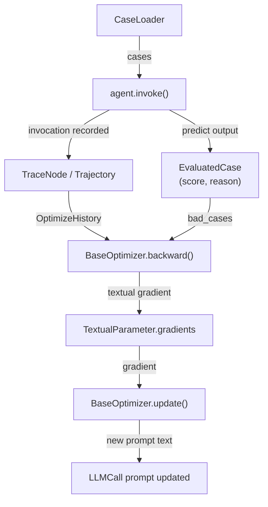
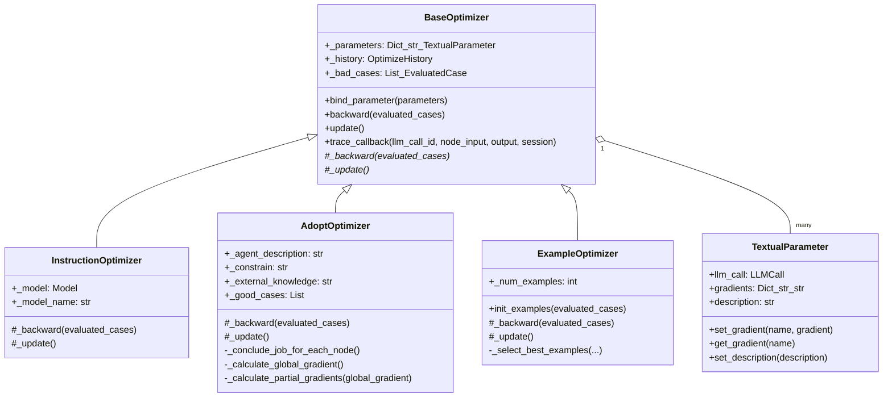
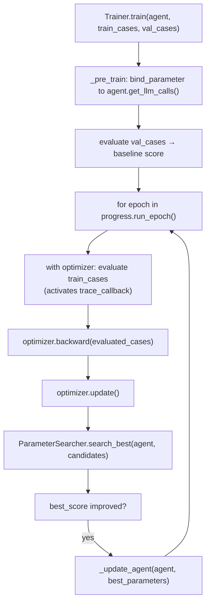
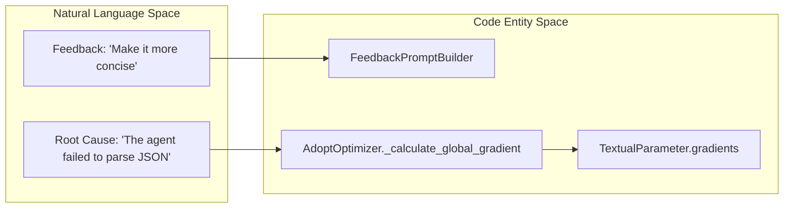

<!-- source: DeepWiki mcp.deepwiki.com · repo openJiuwen-ai/agent-core · page 15.2 Optimizers and Trainers · fetched 2026-11-02 -->

# Optimizers and Trainers

<details>
<summary>Relevant source files</summary>

The following files were used as context for generating this wiki page:

- [openjiuwen/core/foundation/llm/model_clients/dashscope_model_client.py](openjiuwen/core/foundation/llm/model_clients/dashscope_model_client.py)
- [openjiuwen/core/foundation/prompt/assemble/assembler.py](openjiuwen/core/foundation/prompt/assemble/assembler.py)
- [openjiuwen/core/foundation/prompt/assemble/variables/dictable.py](openjiuwen/core/foundation/prompt/assemble/variables/dictable.py)
- [openjiuwen/core/foundation/prompt/assemble/variables/textable.py](openjiuwen/core/foundation/prompt/assemble/variables/textable.py)
- [openjiuwen/core/foundation/prompt/template.py](openjiuwen/core/foundation/prompt/template.py)
- [openjiuwen/dev_tools/prompt_builder/builder/badcase_prompt_builder.py](openjiuwen/dev_tools/prompt_builder/builder/badcase_prompt_builder.py)
- [openjiuwen/dev_tools/prompt_builder/builder/feedback_prompt_builder.py](openjiuwen/dev_tools/prompt_builder/builder/feedback_prompt_builder.py)
- [openjiuwen/dev_tools/prompt_builder/builder/meta_template_builder.py](openjiuwen/dev_tools/prompt_builder/builder/meta_template_builder.py)
- [openjiuwen/dev_tools/prompt_builder/builder/utils.py](openjiuwen/dev_tools/prompt_builder/builder/utils.py)
- [openjiuwen/dev_tools/tune/evaluator/evaluator.py](openjiuwen/dev_tools/tune/evaluator/evaluator.py)
- [openjiuwen/dev_tools/tune/optimizer/adopt/adopt_optimizer.py](openjiuwen/dev_tools/tune/optimizer/adopt/adopt_optimizer.py)
- [openjiuwen/dev_tools/tune/optimizer/base.py](openjiuwen/dev_tools/tune/optimizer/base.py)
- [openjiuwen/dev_tools/tune/optimizer/example_optimizer.py](openjiuwen/dev_tools/tune/optimizer/example_optimizer.py)
- [openjiuwen/dev_tools/tune/trainer/trainer.py](openjiuwen/dev_tools/tune/trainer/trainer.py)
- [openjiuwen/dev_tools/tune/utils.py](openjiuwen/dev_tools/tune/utils.py)
- [tests/system_tests/foundation/llm/test_dashscope_multimodal_generation.py](tests/system_tests/foundation/llm/test_dashscope_multimodal_generation.py)
- [tests/unit_tests/agent_builder/prompt_builder/test_badcase_prompt_builder.py](tests/unit_tests/agent_builder/prompt_builder/test_badcase_prompt_builder.py)
- [tests/unit_tests/agent_builder/prompt_builder/test_feedback_prompt_builder.py](tests/unit_tests/agent_builder/prompt_builder/test_feedback_prompt_builder.py)
- [tests/unit_tests/agent_builder/prompt_builder/test_meta_template_builder.py](tests/unit_tests/agent_builder/prompt_builder/test_meta_template_builder.py)
- [tests/unit_tests/core/foundation/prompt/test_template_assemble.py](tests/unit_tests/core/foundation/prompt/test_template_assemble.py)
- [tests/unit_tests/dev_tools/agent_builder/conftest.py](tests/unit_tests/dev_tools/agent_builder/conftest.py)

</details>


This page covers the self-evolving training infrastructure: the optimizer classes that generate prompt improvements, the evaluators that score agent outputs, and the `Trainer` that orchestrates the iterative improvement loop. The components described here live in two packages:

- **`openjiuwen.agent_evolving`** — the current, primary system (exported public API).
- **`openjiuwen.dev_tools.tune`** — the optimization toolkit, providing prompt optimization logic.

---

## Core Data Structures

The training pipeline passes data between layers through a small set of shared types.

| Type | Location | Description |
|------|----------|-------------|
| `Case` | [openjiuwen/dev_tools/tune/base.py:1-117]() | Input–label pair; `inputs: Dict`, `label: Dict`, `case_id: str`. |
| `EvaluatedCase` | [openjiuwen/dev_tools/tune/base.py:1-117]() | `Case` + `answer: Dict` + `score: float` + `reason: str`. |
| `TextualParameter` | [openjiuwen/dev_tools/tune/optimizer/base.py:150-167]() | Wraps an `LLMCall`; holds computed `gradients: Dict[str, str]` and a `description`. |
| `TraceNode` | [openjiuwen/dev_tools/tune/optimizer/base.py:169-175]() | Per-invocation record: `case_id`, `llm_call_id`, `inputs`, `outputs`, `history`, `tools`. |
| `OptimizeHistory` | [openjiuwen/dev_tools/tune/optimizer/base.py:178-204]() | Thread-safe `Dict[case_id, List[TraceNode]]`; populated during forward tracing. |
| `Trajectory` | `openjiuwen/agent_evolving/trajectory` | Execution trace extracted from a `Session` after `agent.invoke()`. |
| `Updates` | `openjiuwen/agent_evolving/trajectory` | `Dict[(operator_id, target), value]` — the patch set applied to operators. |
| `Progress` | [openjiuwen/dev_tools/tune/trainer/base.py:15-47]() | Pydantic model tracking `current_epoch`, `best_score`, etc. |

**Optimizer Data Flow Diagram**



Sources: [openjiuwen/dev_tools/tune/optimizer/base.py:1-205](), [openjiuwen/dev_tools/tune/base.py:1-117]()

---

## Evaluators

Evaluators convert a `(Case, prediction)` pair into an `EvaluatedCase` with a numeric score.

### `BaseEvaluator`

Abstract base defined in `openjiuwen/dev_tools/tune/evaluator/evaluator.py`.

```python
evaluate(case: Case, predict: Dict) -> EvaluatedCase   # must implement
batch_evaluate(cases, predicts, num_parallel) -> List[EvaluatedCase]  # uses ThreadPoolExecutor
```

Sources: [openjiuwen/dev_tools/tune/evaluator/evaluator.py:29-79]()

### `DefaultEvaluator`

Uses an LLM as a judge. Constructs a prompt from `LLM_METRIC_TEMPLATE` containing the question, expected answer, and model answer, then parses the JSON result for a `result: true/false` field. Binary score: 1.0 for pass, 0.0 for fail.

Sources: [openjiuwen/dev_tools/tune/evaluator/evaluator.py:82-175]()

---

## Optimizers

**Optimizer class hierarchy diagram**



Sources: [openjiuwen/dev_tools/tune/optimizer/base.py:21-147](), [openjiuwen/dev_tools/tune/optimizer/adopt/adopt_optimizer.py:28-314](), [openjiuwen/dev_tools/tune/optimizer/example_optimizer.py:46-229]()

### `BaseOptimizer`

Defined in `openjiuwen/dev_tools/tune/optimizer/base.py`. The core contract:

- **`bind_parameter(parameters: Dict[str, LLMCall])`**: Wraps each `LLMCall` in a `TextualParameter` and stores it in `_parameters`. [openjiuwen/dev_tools/tune/optimizer/base.py:45-56]()
- **`backward(evaluated_cases)`**: Filters bad cases (score == 0), then calls `_backward()`. [openjiuwen/dev_tools/tune/optimizer/base.py:58-73]()
- **`update()`**: Calls `_update()`, logs updated prompts, and clears `OptimizeHistory`. [openjiuwen/dev_tools/tune/optimizer/base.py:75-105]()
- **`trace_callback`**: Records a `TraceNode` into `_history` for every LLM call during a session. [openjiuwen/dev_tools/tune/optimizer/base.py:119-131]()

### `AdoptOptimizer`

The `AdoptOptimizer` implements a multi-step "backward" pass using root-cause analysis.

1. **Root Cause Analysis**: For each bad case, it invokes the model to perform differential analysis between the current output and the ground truth. [openjiuwen/dev_tools/tune/optimizer/adopt/adopt_optimizer.py:115-139]()
2. **Partial Gradient Calculation**: It translates global errors into specific textual modifications (gradients) for each individual LLM call node. [openjiuwen/dev_tools/tune/optimizer/adopt/adopt_optimizer.py:147-150]()
3. **Retry Mechanism**: Uses a `ModelWithRetry` wrapper to handle transient LLM failures during optimization. [openjiuwen/dev_tools/tune/optimizer/adopt/adopt_optimizer.py:38-71]()

Sources: [openjiuwen/dev_tools/tune/optimizer/adopt/adopt_optimizer.py:28-256]()

### `ExampleOptimizer`

Optimizes prompts by selecting representative few-shot examples from a dataset.

- **`_backward`**: Uses an LLM (`EXAMPLE_SELECTION_TEMPLATE`) to select the most representative examples from error cases and representative good cases. [openjiuwen/dev_tools/tune/optimizer/example_optimizer.py:79-94](), [openjiuwen/dev_tools/tune/optimizer/example_optimizer.py:23-43]()
- **`_update`**: Formats the selected examples and appends them to the instruction template. [openjiuwen/dev_tools/tune/optimizer/example_optimizer.py:96-107]()

Sources: [openjiuwen/dev_tools/tune/optimizer/example_optimizer.py:46-229]()

---

## Trainers

### `Trainer` (Legacy)

Located at `openjiuwen/dev_tools/tune/trainer/trainer.py`. It orchestrates the training loop for `LegacyBaseAgent`.

**Training loop:**



Sources: [openjiuwen/dev_tools/tune/trainer/trainer.py:26-176]()

**`ParameterSearcher`**: Generates Cartesian-product combinations of updated parameters and evaluates them on a validation set to select the best configuration. [openjiuwen/dev_tools/tune/trainer/trainer.py:179-232]()

---

## Prompt Builders

Prompt builders are specialized utilities used within the optimization loop to generate or refine instruction text.

### `MetaTemplateBuilder`
Generates a complete prompt template from a short instruction or description using meta-templates.
- **`register_meta_template`**: Allows adding custom templates like "general" or "plan". [openjiuwen/dev_tools/prompt_builder/builder/meta_template_builder.py:31-42]()
- **`build`**: Invokes an LLM to expand the instruction into a structured prompt. [openjiuwen/dev_tools/prompt_builder/builder/meta_template_builder.py:44-58]()

### `FeedbackPromptBuilder`
Refines existing prompts based on natural language feedback.
- **Modes**: Supports `general` (global refinement), `insert` (adding at a specific position), and `select` (replacing a specific span). [openjiuwen/dev_tools/prompt_builder/builder/feedback_prompt_builder.py:69-81]()
- **Intent Recognition**: First validates if the feedback is actionable via `PROMPT_FEEDBACK_INTENT_TEMPLATE`. [openjiuwen/dev_tools/prompt_builder/builder/feedback_prompt_builder.py:135-147]()

### `BadCasePromptBuilder`
Analyzes a set of `EvaluatedCase` objects to identify failure patterns and suggest prompt improvements.
- **`build`**: Aggregates bad cases and generates an optimized prompt that addresses the observed failures. [tests/unit_tests/agent_builder/prompt_builder/test_badcase_prompt_builder.py:117-142]()

Sources: [openjiuwen/dev_tools/prompt_builder/builder/meta_template_builder.py:19-147](), [openjiuwen/dev_tools/prompt_builder/builder/feedback_prompt_builder.py:22-127]()

---

## System-Level Interaction

**Natural Language Space to Code Entity Space**

| Natural Language Concept | Code Entity | File Path |
|--------------------------|-------------|-----------|
| **Instruction Gradient** | `TextualParameter.gradients` | [openjiuwen/dev_tools/tune/optimizer/base.py:153]() |
| **Execution Trace** | `TraceNode` | [openjiuwen/dev_tools/tune/optimizer/base.py:169]() |
| **LLM Judge** | `DefaultEvaluator` | [openjiuwen/dev_tools/tune/evaluator/evaluator.py:82]() |
| **Candidate Selection** | `ParameterSearcher` | [openjiuwen/dev_tools/tune/trainer/trainer.py:179]() |
| **Optimization History** | `OptimizeHistory` | [openjiuwen/dev_tools/tune/optimizer/base.py:178]() |



Sources: [openjiuwen/dev_tools/prompt_builder/builder/feedback_prompt_builder.py:22-127](), [openjiuwen/dev_tools/tune/optimizer/adopt/adopt_optimizer.py:114-145](), [openjiuwen/dev_tools/tune/optimizer/base.py:150-167]()

---

