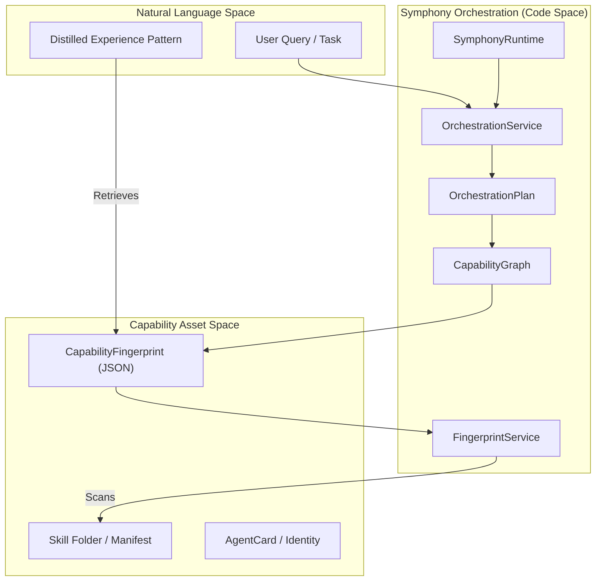

<!-- source: DeepWiki mcp.deepwiki.com · repo openJiuwen-ai/agent-core · page 16 Symphony — Capability Orchestration · fetched 2026-11-02 -->

# Symphony — Capability Orchestration

<details>
<summary>Relevant source files</summary>

The following files were used as context for generating this wiki page:

- [openjiuwen/symphony/README.md](openjiuwen/symphony/README.md)
- [openjiuwen/symphony/__init__.py](openjiuwen/symphony/__init__.py)
- [openjiuwen/symphony/experience/API.md](openjiuwen/symphony/experience/API.md)
- [openjiuwen/symphony/experience/__init__.py](openjiuwen/symphony/experience/__init__.py)
- [openjiuwen/symphony/experience/bank.py](openjiuwen/symphony/experience/bank.py)
- [openjiuwen/symphony/experience/cluster.py](openjiuwen/symphony/experience/cluster.py)
- [openjiuwen/symphony/experience/collector.py](openjiuwen/symphony/experience/collector.py)
- [openjiuwen/symphony/experience/distiller.py](openjiuwen/symphony/experience/distiller.py)
- [openjiuwen/symphony/experience/embed.py](openjiuwen/symphony/experience/embed.py)
- [openjiuwen/symphony/experience/evaluator.py](openjiuwen/symphony/experience/evaluator.py)
- [openjiuwen/symphony/experience/models.py](openjiuwen/symphony/experience/models.py)
- [openjiuwen/symphony/experience/retriever.py](openjiuwen/symphony/experience/retriever.py)
- [openjiuwen/symphony/experience/trace/__init__.py](openjiuwen/symphony/experience/trace/__init__.py)
- [openjiuwen/symphony/experience/trace/parser.py](openjiuwen/symphony/experience/trace/parser.py)
- [openjiuwen/symphony/interfaces/__init__.py](openjiuwen/symphony/interfaces/__init__.py)
- [openjiuwen/symphony/orchestration/__init__.py](openjiuwen/symphony/orchestration/__init__.py)
- [openjiuwen/symphony/orchestration/artifacts.py](openjiuwen/symphony/orchestration/artifacts.py)
- [openjiuwen/symphony/orchestration/graph/__init__.py](openjiuwen/symphony/orchestration/graph/__init__.py)
- [openjiuwen/symphony/orchestration/graph/matcher/__init__.py](openjiuwen/symphony/orchestration/graph/matcher/__init__.py)
- [openjiuwen/symphony/orchestration/graph/matcher/cache.py](openjiuwen/symphony/orchestration/graph/matcher/cache.py)
- [openjiuwen/symphony/orchestration/service.py](openjiuwen/symphony/orchestration/service.py)
- [openjiuwen/symphony/runtime.py](openjiuwen/symphony/runtime.py)
- [tests/unit_tests/symphony/test_models.py](tests/unit_tests/symphony/test_models.py)

</details>


The `openjiuwen.symphony` module is the domain-specific framework within the openJiuwen SDK for discovery, fingerprinting, evaluation, retrieval, orchestration, and experience distillation of capability assets [openjiuwen/symphony/README.md:3-4](). It organizes various capability types—such as skills and agents—into a standardized structure that allows for automated planning and quality assurance [openjiuwen/symphony/README.md:8-13]().

Symphony operates on a "Tree for Retrieval, Graph for Orchestration" architecture [openjiuwen/symphony/README.md:58-60](). It extracts semantic profiles from assets to create fingerprints, which are then used to build relationship graphs for execution planning or experience banks for learning from past trajectories [openjiuwen/symphony/README.md:81-86]().

## System Architecture

The following diagram illustrates how Symphony bridges high-level natural language requirements to specific code entities and capability assets.

**Symphony Asset to Code Mapping**

Sources: [openjiuwen/symphony/README.md:58-79](), [openjiuwen/symphony/runtime.py:14-39](), [openjiuwen/symphony/orchestration/service.py:56-80]()

## Core Modules

### Capability Fingerprinting
The `FingerprintService` is responsible for extracting semantic profiles, normalized I/O schemas, and capability labels from assets [openjiuwen/symphony/README.md:8](). It uses `SkillFolderScanner` to scan directories and `SkillManifestParser` to interpret metadata, ultimately publishing atomic `FingerprintArtifact` objects [openjiuwen/symphony/__init__.py:47-57](). This process ensures that the LLM-based planner has a consistent understanding of what each capability can perform.

For details, see [Symphony Core — Fingerprinting and Orchestration](#16.1).

### Orchestration and Planning
The `OrchestrationService` manages the lifecycle of the capability graph and generates execution plans [openjiuwen/symphony/orchestration/service.py:57-58](). It supports two primary planning modes:
*   **Fast Mode**: Uses `FastOneShotPlanner` for low-latency, single-turn graph generation [openjiuwen/symphony/orchestration/service.py:48]().
*   **Beam Mode**: Uses `BidirectionalBeamPlanner` for complex tasks requiring multi-step reasoning and optimal pathfinding [openjiuwen/symphony/orchestration/service.py:47]().

The service persists these relationships in a versioned `graph.json` artifact [openjiuwen/symphony/orchestration/service.py:163-164]().

For details, see [Symphony Core — Fingerprinting and Orchestration](#16.1).

### Experience Distillation
The `experience` sub-module converts session trajectories into reusable knowledge [openjiuwen/symphony/README.md:11](). It parses logs into `TraceRecord` objects, clusters them by success patterns, and distills them into an `ExperienceBank` [openjiuwen/symphony/experience/collector.py:21-25](). This allows agents to "remember" which combination of capabilities worked for specific types of queries in the past.

**Experience Pipeline Flow**

Sources: [openjiuwen/symphony/experience/trace/parser.py:136-141](), [openjiuwen/symphony/experience/evaluator.py:123-134](), [openjiuwen/symphony/experience/collector.py:57-65](), [openjiuwen/symphony/experience/bank.py:97-111]()

For details, see [Symphony Experience and Evaluation](#16.2).

### Evaluation Suite
`EvaluationSuite` provides a framework for assessing the quality of capability selections and orchestrations [openjiuwen/symphony/__init__.py:10](). It tracks metrics such as success rate, latency, and selection accuracy, providing detailed `MetricResult` objects that include evidence, failure reasons, and improvement suggestions [openjiuwen/symphony/__init__.py:16-34]().

For details, see [Symphony Experience and Evaluation](#16.2).

## Runtime Integration

The `SymphonyRuntime` acts as the primary facade for applications, composing the orchestration service and providing access to the planning APIs [openjiuwen/symphony/runtime.py:14-15]().

### Usage Example
```python
from openjiuwen.symphony import SymphonyRuntime, OrchestrationConfig

symphony = SymphonyRuntime(
    graph_artifact_root=".artifacts/symphony-graph",
    capability_provider=list_capabilities,
    model=llm_model,
    orchestration_config=OrchestrationConfig(mode="fast")
)

# Build the capability graph
await symphony.orchestration.build()

# Generate an execution plan for a user query
plan = await symphony.orchestration.plan(
    query="Extract text from the PDF and summarize it",
    candidate_ids=["pdf-extractor", "summarizer"]
)
```
Sources: [openjiuwen/symphony/README.md:182-199](), [openjiuwen/symphony/runtime.py:17-38]()

## Key Code Entities

| Class | File Path | Role |
| :--- | :--- | :--- |
| `SymphonyRuntime` | [openjiuwen/symphony/runtime.py:14]() | Top-level facade for managing orchestration and planning. |
| `OrchestrationService` | [openjiuwen/symphony/orchestration/service.py:56]() | Manages graph lifecycle, building, and online planning. |
| `FingerprintService` | [openjiuwen/symphony/shared/fingerprint.py:50]() | Extracts and publishes standardized capability fingerprints. |
| `ExperienceBank` | [openjiuwen/symphony/experience/bank.py:97]() | Persistent storage and FAISS-based retrieval for distilled experience. |
| `TraceEvaluator` | [openjiuwen/symphony/experience/evaluator.py:123]() | LLM-driven judge for validating capability selection correctness. |
| `EvaluationSuite` | [openjiuwen/symphony/evaluation/__init__.py:10]() | Orchestrates multi-metric assessment of agent performance. |

Sources: [openjiuwen/symphony/__init__.py:10-57]()

---

