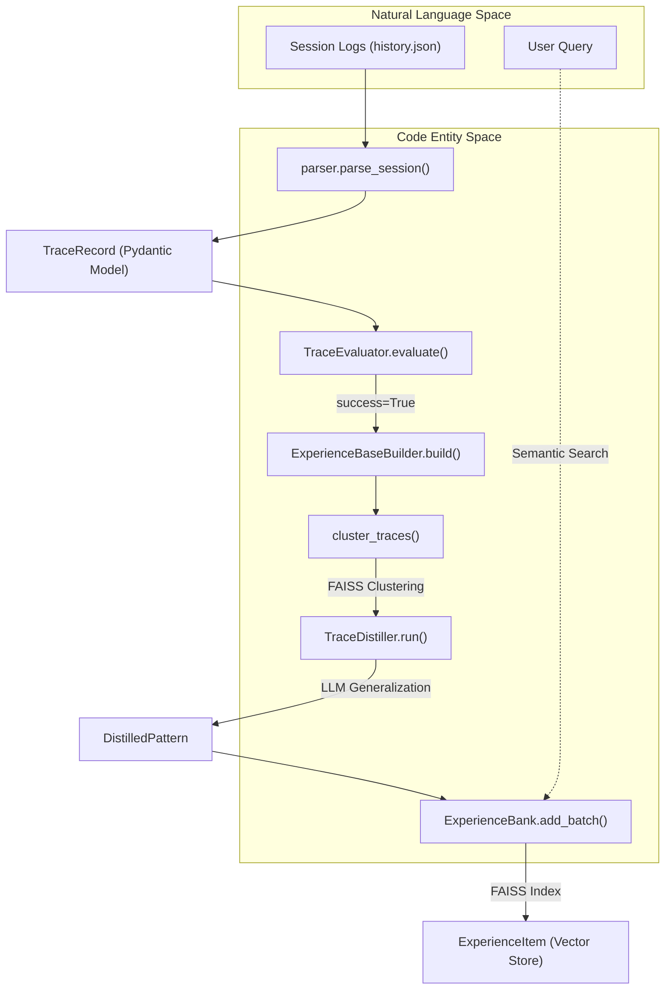
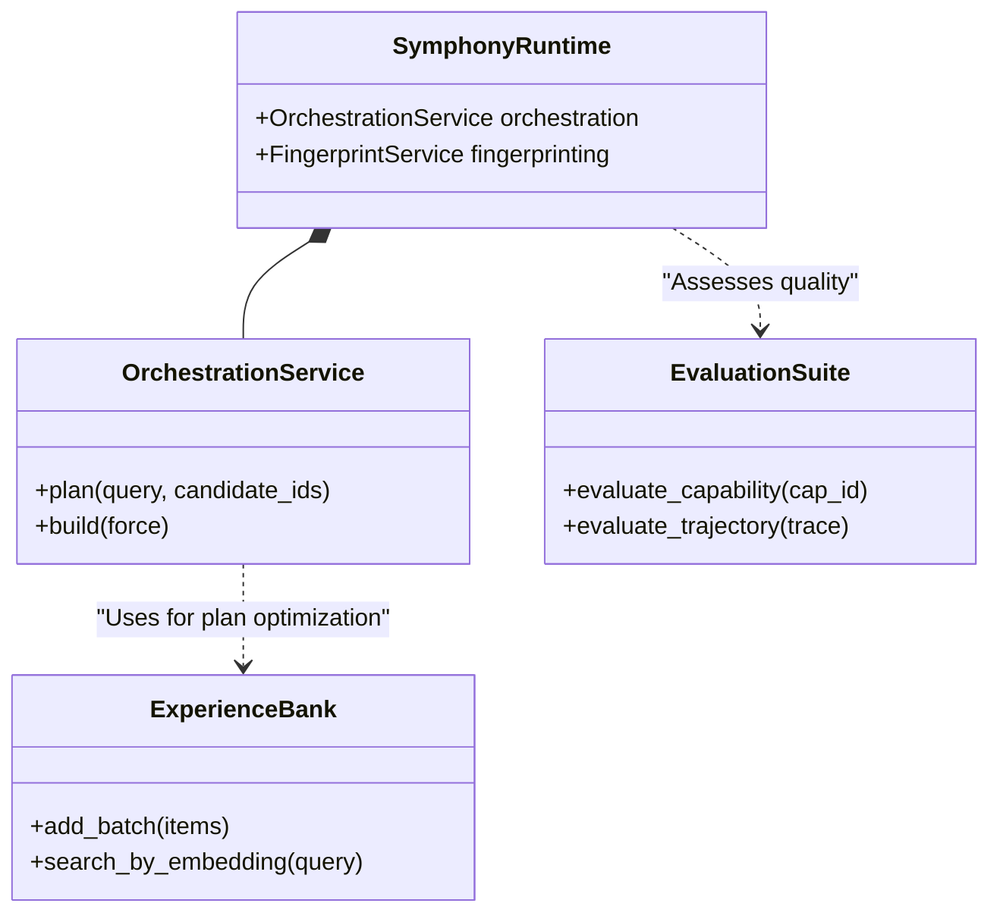

<!-- source: DeepWiki mcp.deepwiki.com · repo openJiuwen-ai/agent-core · page 16.2 Symphony Experience and Evaluation · fetched 2026-11-02 -->

# Symphony Experience and Evaluation

<details>
<summary>Relevant source files</summary>

The following files were used as context for generating this wiki page:

- [openjiuwen/symphony/README.md](openjiuwen/symphony/README.md)
- [openjiuwen/symphony/__init__.py](openjiuwen/symphony/__init__.py)
- [openjiuwen/symphony/experience/API.md](openjiuwen/symphony/experience/API.md)
- [openjiuwen/symphony/experience/__init__.py](openjiuwen/symphony/experience/__init__.py)
- [openjiuwen/symphony/experience/bank.py](openjiuwen/symphony/experience/bank.py)
- [openjiuwen/symphony/experience/cluster.py](openjiuwen/symphony/experience/cluster.py)
- [openjiuwen/symphony/experience/collector.py](openjiuwen/symphony/experience/collector.py)
- [openjiuwen/symphony/experience/distiller.py](openjiuwen/symphony/experience/distiller.py)
- [openjiuwen/symphony/experience/embed.py](openjiuwen/symphony/experience/embed.py)
- [openjiuwen/symphony/experience/evaluator.py](openjiuwen/symphony/experience/evaluator.py)
- [openjiuwen/symphony/experience/models.py](openjiuwen/symphony/experience/models.py)
- [openjiuwen/symphony/experience/retriever.py](openjiuwen/symphony/experience/retriever.py)
- [openjiuwen/symphony/experience/trace/__init__.py](openjiuwen/symphony/experience/trace/__init__.py)
- [openjiuwen/symphony/experience/trace/parser.py](openjiuwen/symphony/experience/trace/parser.py)
- [openjiuwen/symphony/interfaces/__init__.py](openjiuwen/symphony/interfaces/__init__.py)
- [openjiuwen/symphony/orchestration/__init__.py](openjiuwen/symphony/orchestration/__init__.py)
- [openjiuwen/symphony/orchestration/artifacts.py](openjiuwen/symphony/orchestration/artifacts.py)
- [openjiuwen/symphony/orchestration/graph/__init__.py](openjiuwen/symphony/orchestration/graph/__init__.py)
- [openjiuwen/symphony/orchestration/graph/matcher/__init__.py](openjiuwen/symphony/orchestration/graph/matcher/__init__.py)
- [openjiuwen/symphony/orchestration/graph/matcher/cache.py](openjiuwen/symphony/orchestration/graph/matcher/cache.py)
- [openjiuwen/symphony/orchestration/service.py](openjiuwen/symphony/orchestration/service.py)
- [openjiuwen/symphony/runtime.py](openjiuwen/symphony/runtime.py)
- [tests/unit_tests/symphony/test_models.py](tests/unit_tests/symphony/test_models.py)

</details>


The `openjiuwen.symphony` module provides comprehensive capabilities for asset discovery, fingerprinting, orchestration, and evaluation. Specifically, the **Experience** sub-module focuses on distilling reusable patterns from agent execution trajectories, while the **Evaluation** sub-module provides metrics for assessing capability quality and orchestration effectiveness [openjiuwen/symphony/README.md:3-13]().

## 1. Experience System Architecture

The experience system is designed to transform raw session traces into a searchable knowledge base of "Experience Items." These items allow agents to retrieve successful capability selection patterns based on semantic similarity to a user's current query [openjiuwen/symphony/experience/API.md:3-12]().

### Data Flow: Trace to Experience
The following diagram illustrates the transformation of raw session data into distilled experience patterns.

**Trace Distillation Pipeline**

**Sources:** [openjiuwen/symphony/experience/trace/parser.py:136-161](), [openjiuwen/symphony/experience/collector.py:57-127](), [openjiuwen/symphony/experience/API.md:3-12]()

### Key Components

*   **TraceRecord**: The fundamental data structure representing a single interaction segment, including the `query`, `skills` used, `messages` history, and `result` [openjiuwen/symphony/experience/API.md:72-88]().
*   **TraceEvaluator**: An LLM-driven component that judges if the skills selected in a trace were appropriate for the task. It assigns a `success` boolean and categorizes errors (e.g., `wrong_skill`, `skill_error`, `refusal`) [openjiuwen/symphony/experience/evaluator.py:123-142]().
*   **ExperienceBank**: A persistent knowledge base using **FAISS** for vector indexing. It stores `ExperienceItem` objects, which map generalized query patterns to specific `skill_ids` [openjiuwen/symphony/experience/bank.py:97-111]().
*   **ExperienceBaseBuilder**: Orchestrates the `cluster -> distill -> persist` pipeline. It groups similar successful traces using FAISS clustering before using an LLM to distill them into a single generalized pattern [openjiuwen/symphony/experience/collector.py:21-55]().

## 2. Capability Evaluation

The evaluation framework provides a standardized schema for assessing the quality of capabilities and the accuracy of the orchestration planner.

### Evaluation Schema
Evaluation results are structured to provide not just a score, but actionable evidence and suggestions for improvement.

| Class | Purpose | Key Fields |
| :--- | :--- | :--- |
| `MetricResult` | Represents a single metric calculation. | `name`, `status` (MetricStatus), `score`, `reason` |
| `QualityResult` | Aggregates metrics for a capability. | `confidence`, `metrics`, `evidence`, `suggestions` |
| `FailureReason` | Detailed diagnostic for a failure. | `category`, `severity`, `evidence_ref` |
| `ImprovementSuggestion` | Actionable feedback for developers. | `priority`, `description`, `target_artifact` |

**Sources:** [openjiuwen/symphony/__init__.py:16-34](), [openjiuwen/symphony/models.py]()

### Evaluation Metrics
The `EvaluationSuite` supports two primary categories of metrics:
1.  **Static Metrics**: Derived from capability fingerprints (e.g., documentation completeness, IO schema validity).
2.  **Trajectory Metrics**: Derived from `CapabilityCall` records in session traces:
    *   **Success Rate**: Ratio of successful executions.
    *   **Latency**: Time taken for capability resolution and execution.
    *   **Selection Accuracy**: Correctness of the planner in choosing the capability for a given intent.

## 3. Implementation Details

### Trace Parsing
The `parse_session` function processes session directories, extracting `request_id` as the `trace_id`. It specifically recognizes `skill_tool` and `symphony_compose_graph` tool calls to identify which capabilities were invoked [openjiuwen/symphony/experience/trace/parser.py:58-114]().

### Experience Retrieval
During runtime, the `ExperienceRetriever` (or `ExperienceBank.search_by_embedding`) allows the agent to find relevant past experiences.

```python
# Example Retrieval Flow
results = bank.search_by_embedding(
    query="Help me book a flight",
    top_k=1,
    threshold=0.85
)
# Returns list[tuple[similarity_score, ExperienceItem]]
```
**Sources:** [openjiuwen/symphony/experience/bank.py:190-204](), [openjiuwen/symphony/experience/API.md:203-215]()

### Storage Layout
The `ExperienceBank` maintains a structured directory for persistence:
*   `meta.json`: Integrity manifest and versioning [openjiuwen/symphony/experience/bank.py:21-28]().
*   `scalar/metadata.jsonl`: JSONL storage of non-vector metadata [openjiuwen/symphony/experience/bank.py:105]().
*   `vector/faiss_index.bin`: The binary FAISS index for similarity search [openjiuwen/symphony/experience/bank.py:107]().
*   `vector/embeddings.npy`: The raw NumPy matrix of embeddings [openjiuwen/symphony/experience/bank.py:108]().

## 4. Integration with Symphony Runtime

While `ExperienceBank` and `EvaluationSuite` can be used independently, they are designed to be integrated into the `SymphonyRuntime` [openjiuwen/symphony/README.md:90-93]().

**Symphony Runtime Composition**

**Sources:** [openjiuwen/symphony/runtime.py:14-38](), [openjiuwen/symphony/orchestration/service.py:56-79](), [openjiuwen/symphony/README.md:81-88]()

### Planned Features
*   **Agent Toolkit Integration**: A unified entry point for agents to perform combined retrieval and orchestration [openjiuwen/symphony/README.md:106]().
*   **Dynamic Experience Injection**: Automatically injecting retrieved experiences into the LLM prompt during the `orchestration.plan()` phase to improve few-shot selection accuracy.

---

