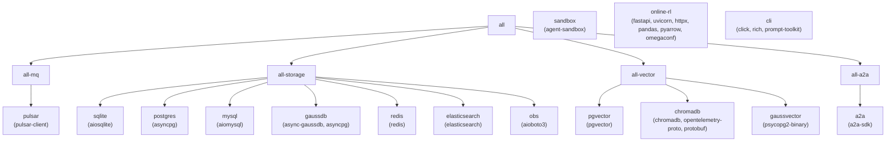
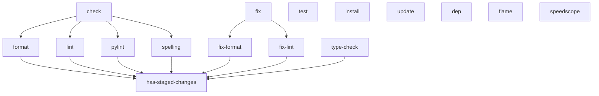
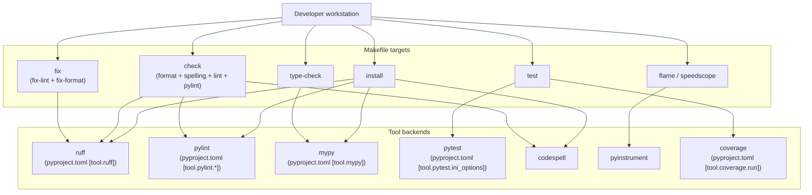

<!-- source: DeepWiki mcp.deepwiki.com · repo openJiuwen-ai/agent-core · page 17 Project Configuration · fetched 2026-11-02 -->

# Project Configuration

<details>
<summary>Relevant source files</summary>

The following files were used as context for generating this wiki page:

- [.gitignore](.gitignore)
- [Makefile](Makefile)
- [openjiuwen/core/common/exception/codes.py](openjiuwen/core/common/exception/codes.py)
- [openjiuwen/core/foundation/tool/mcp/client/openapi_client.py](openjiuwen/core/foundation/tool/mcp/client/openapi_client.py)
- [openjiuwen/core/memory/common/base.py](openjiuwen/core/memory/common/base.py)
- [openjiuwen/core/retrieval/__init__.py](openjiuwen/core/retrieval/__init__.py)
- [openjiuwen/core/runner/resources_manager/resource_manager.py](openjiuwen/core/runner/resources_manager/resource_manager.py)
- [openjiuwen/core/runner/resources_manager/tool_manager.py](openjiuwen/core/runner/resources_manager/tool_manager.py)
- [openjiuwen/core/single_agent/__init__.py](openjiuwen/core/single_agent/__init__.py)
- [pyproject.toml](pyproject.toml)
- [tests/system_tests/runner/test_runner.py](tests/system_tests/runner/test_runner.py)
- [tests/system_tests/tune/test_prompt_tune.py](tests/system_tests/tune/test_prompt_tune.py)
- [tests/system_tests/workflow/test_real_workflow.py](tests/system_tests/workflow/test_real_workflow.py)
- [tests/test_logger.py](tests/test_logger.py)
- [tests/unit_tests/agent_teams/observability/test_team_observability_mock_llm.py](tests/unit_tests/agent_teams/observability/test_team_observability_mock_llm.py)
- [tests/unit_tests/core/context_engine/conftest.py](tests/unit_tests/core/context_engine/conftest.py)
- [uv.lock](uv.lock)

</details>


This page covers the build system and development tooling configuration for the `openjiuwen` package: the `pyproject.toml` structure, optional dependency groups, tool settings for linting, formatting, and type checking, and the `Makefile` targets used in the development workflow. For documentation of the SDK's runtime configuration objects (e.g. `RunnerConfig`, `ReActAgentConfig`, `ModelClientConfig`), see the subsystem pages such as [Agents](#2) and [Workflow Engine](#4).

---

## Package Metadata

The project is defined entirely in [pyproject.toml:1-20]().

| Field | Value |
|---|---|
| `name` | `openjiuwen` |
| `version` | `0.1.16` |
| `requires-python` | `>=3.11, <3.14` |
| `Development Status` | Beta (classifier `4 - Beta`) |
| Supported CPython | 3.11, 3.12, 3.13 |

The package index is pinned to the Aliyun mirror by default via the `[tool.uv]` section [pyproject.toml:182-185]().

Sources: [pyproject.toml:1-20](), [pyproject.toml:182-185]()

---

## Core Dependencies

Core (always-installed) dependencies are declared in [pyproject.toml:21-69]() and grouped by function:

| Category | Packages |
|---|---|
| HTTP clients | `aiohttp`, `requests` |
| Date & time | `python-dateutil` |
| File & locking | `filelock`, `portalocker`, `aiofiles` |
| Database ORM | `sqlalchemy[asyncio]`, `sqlmodel` |
| AI / LLM | `anthropic`, `openai`, `transformers`, `tiktoken`, `dashscope` |
| Vector database | `pymilvus` (pinned `<2.6.10`) |
| MCP server | `fastmcp`, `mcp` |
| Document processing | `beautifulsoup4`, `trafilatura`, `docx2txt`, `python-docx`, `pdfplumber`, `openpyxl` |
| Utilities | `numpy`, `cacheout`, `mermaid-py`, `pycryptodome`, `charset-normalizer`, `pysbd`, `oauthlib`, `python-dotenv`, `json-repair`, `PyYAML`, `tenacity`, `alembic`, `anyio`, `loguru`, `gitcode-api`, `pyoxigraph` |

Sources: [pyproject.toml:21-69]()

---

## Optional Dependency Extras

Optional extras allow consumers to install only the backends they need. Extras are installed with `pip install openjiuwen[<extra>]` or `uv add openjiuwen[<extra>]`.

### Individual Extras

Defined in [pyproject.toml:73-120]():

| Extra | Package | Purpose |
|---|---|---|
| `all-a2a` | `a2a-sdk[http-server]==1.0.0` | Agent-to-Agent communication [pyproject.toml:75]() |
| `pulsar` | `pulsar-client>=3.5.0` | Apache Pulsar message queue |
| `elasticsearch` | `elasticsearch[async]>=8.0.0` | Elasticsearch integration |
| `redis` | `redis>=7.1.0` | Redis KV store |
| `sqlite` | `aiosqlite>=0.22.1` | Async SQLite support |
| `postgres` | `asyncpg>=0.30.0` | Async PostgreSQL support |
| `mysql` | `aiomysql>=0.3.2` | Async MySQL support |
| `gaussdb` | `async-gaussdb~=0.30.0`, `asyncpg>=0.29.0` | GaussDB integration |
| `pgvector` | `pgvector>=0.2.0` | PostgreSQL vector store |
| `gaussvector` | `psycopg2-binary>=2.9.10` | GaussDB vector store |
| `chromadb` | `chromadb>=1.5.4`, `opentelemetry-proto>=1.33.0`, `protobuf>=5.0,<7.0` | ChromaDB vector store |
| `obs` | `aioboto3>=11.0.0` | S3-compatible object storage |
| `sandbox` | `agent-sandbox>=0.0.26` | Agent sandbox environment |
| `mem0` | `mem0ai>=1.0.0` | Mem0 memory provider |
| `jiuwen-memory` | `JiuwenMemory>=0.1.0`, `httpx>=0.24` | OpenJiuwen specialized memory |
| `agentarts` | `agentarts-sdk>=0.1.2,<0.2` | AgentArts integration |
| `mobile-gui` | `uiautomator2`, `pillow` | Mobile UI automation tools |
| `online-rl` | `fastapi`, `uvicorn[standard]`, `httpx`, `pandas`, `pyarrow`, `omegaconf` | Online RL training pipeline [pyproject.toml:107-114]() |
| `cli` | `click`, `rich`, `prompt-toolkit` | Command Line Interface tools |

### Meta-Extras (Convenience Bundles)

Defined in [pyproject.toml:116-124]():

| Meta-Extra | Includes |
|---|---|
| `all-mq` | `pulsar` |
| `all-storage` | `sqlite`, `postgres`, `mysql`, `gaussdb`, `redis`, `elasticsearch`, `obs` |
| `all-vector` | `pgvector`, `chromadb`, `gaussvector` |
| `all` | `all-mq`, `all-storage`, `all-vector`, `all-a2a` |

**Diagram: Optional extra dependency tree**



Sources: [pyproject.toml:73-124]()

---

## Development Dependency Groups

Development dependencies use PEP 735 `[dependency-groups]`, defined in [pyproject.toml:126-157]():

| Group | Packages | Purpose |
|---|---|---|
| `test` | `pytest`, `pytest-asyncio`, `pytest-html`, `pytest-mock`, `pytest-cov`, `coverage`, `fastapi`, `uvicorn`, `sse-starlette`, `a2a-sdk[http-server]`, `aiosqlite` | Test execution and coverage [pyproject.toml:128-141]() |
| `lint` | `ruff`, `pylint`, `mypy`, `codespell`, `types-PyYAML`, `httpx` | Formatting, linting, type checking [pyproject.toml:144-151]() |
| `docs` | `autodoc-pydantic` | API documentation generation |
| `dev` | includes `test` + `lint` + `docs` | Full developer setup [pyproject.toml:157]() |

The `[tool.uv]` section sets `default-groups = ['dev']`, so `uv sync` installs all dev tools automatically [pyproject.toml:179-180]().

Sources: [pyproject.toml:126-180]()

---

## Tool Configurations

### pytest

Configured in [pyproject.toml:208-217]():

| Setting | Value | Effect |
|---|---|---|
| `asyncio_default_fixture_loop_scope` | `function` | Each test gets its own event loop |
| `testpaths` | `["tests"]` | Test discovery root |
| `pythonpath` | `["jiuwen"]` | Added to `sys.path` for imports |
| `addopts` | `-v --html=report/index.html --self-contained-html --ignore=build` | Verbose output + HTML report |

### Coverage

Configured in [pyproject.toml:205-206]():
- `omit = ["tests/*"]` — test files are excluded from coverage measurement.

### Ruff (Formatting & Fast Linting)

Configured in [pyproject.toml:220-227]():

| Setting | Value |
|---|---|
| `line-length` | 120 |
| `target-version` | `py311` |

Ruff is used for both formatting and import sorting (select `I`) [Makefile:178-179]().

### Mypy (Type Checking)

Mypy is configured to target Python 3.11 and includes stubs for YAML [pyproject.toml:147-149]().

Sources: [pyproject.toml:147-227](), [Makefile:178-179]()

---

## Makefile Targets

The `Makefile` provides a cross-platform developer workflow. It auto-detects whether `uv` is available and adjusts commands accordingly [Makefile:88-96]().

**Diagram: Makefile target dependency and grouping**



Sources: [Makefile:1-221]()

### Target Reference

| Target | Command Invoked | Description |
|---|---|---|
| `install` | `uv pip install` or `pip install` | Installs dev tool dependencies (`ruff`, `pylint`, `mypy`, `codespell`, `pipdeptree`, `pyinstrument`) [Makefile:133-143]() |
| `update` | `curl` | Downloads the latest `Makefile` from the repository [Makefile:145-149]() |
| `test` | `pytest $(TESTFLAGS)` | Runs the test suite; pass extra args with `TESTFLAGS="..."` [Makefile:162-165]() |
| `format` | `ruff check --select I`, `ruff format --check` | Checks import ordering and code formatting [Makefile:177-179]() |
| `lint` | `ruff check --show-fixes` | Reports ruff lint violations [Makefile:181-182]() |
| `pylint` | `pylint` | Runs deep pylint analysis [Makefile:184-185]() |
| `spelling` | `codespell` | Checks for spelling errors in source files [Makefile:187-188]() |
| `fix-format` | `ruff check --select I --fix`, `ruff format` | Auto-fixes import order and formatting [Makefile:190-192]() |
| `fix-lint` | `ruff check --fix` | Auto-fixes ruff lint violations [Makefile:194-195]() |
| `type-check` | `mypy` | Runs mypy type checking [Makefile:197-198]() |
| `check` | runs `format`, `spelling`, `lint`, `pylint` | All read-only checks [Makefile:125]() |
| `fix` | runs `fix-lint`, `fix-format` | All auto-fixable issues [Makefile:126]() |
| `dep` | `pipdeptree --reverse --package $(DEP)` | Shows reverse dependency tree for a package [Makefile:129-131]() |
| `flame` | `pyinstrument -r html` | Generates an HTML flame graph for a script [Makefile:151-154]() |
| `speedscope` | `pyinstrument -r speedscope` | Generates a speedscope JSON profile [Makefile:156-160]() |

Sources: [Makefile:98-221]()

### File Scoping

Check and fix targets operate only on **staged Python files** by default, or on files changed in the last `N` commits when `COMMITS=N` is specified [Makefile:46-81]():

```bash
# Check staged files (default)
make check

# Check files changed in last 3 commits
make check COMMITS=3
```

The staged-file detection uses `git diff` filtered via a Python one-liner to identify `.py` and `.pyi` files [Makefile:56-61]().

Sources: [Makefile:46-81](), [Makefile:88-96]()

---

## Development Workflow Overview

**Diagram: Tool invocation flow from pyproject.toml and Makefile**



Sources: [pyproject.toml:126-227](), [Makefile:1-221]()

---

