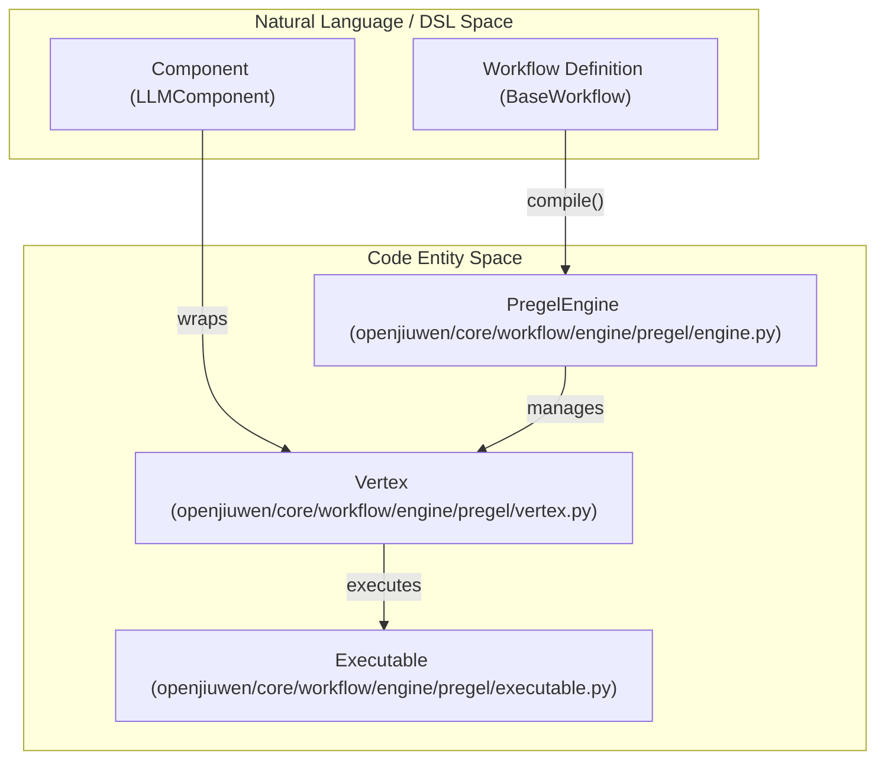
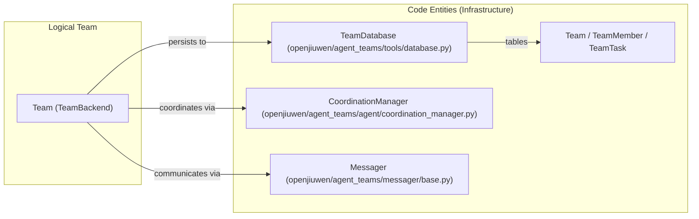

<!-- source: DeepWiki mcp.deepwiki.com · repo openJiuwen-ai/agent-core · page 18 Glossary · fetched 2026-11-02 -->

# Glossary

Relevant source files

The following files were used as context for generating this wiki page:

- [.gitignore](.gitignore)
- [Makefile](Makefile)
- [openjiuwen/agent_teams/agent/coordination/handlers/AGENTS.md](openjiuwen/agent_teams/agent/coordination/handlers/AGENTS.md)
- [openjiuwen/agent_teams/agent/coordination/handlers/CLAUDE.md](openjiuwen/agent_teams/agent/coordination/handlers/CLAUDE.md)
- [openjiuwen/agent_teams/cli/CLAUDE.md](openjiuwen/agent_teams/cli/CLAUDE.md)
- [openjiuwen/agent_teams/docs/AGENTS.md](openjiuwen/agent_teams/docs/AGENTS.md)
- [openjiuwen/agent_teams/docs/features/F_37_swarmflow-stateful-sessions-and-human.md](openjiuwen/agent_teams/docs/features/F_37_swarmflow-stateful-sessions-and-human.md)
- [openjiuwen/agent_teams/docs/features/F_39_swarmflow-e2e-hardening.md](openjiuwen/agent_teams/docs/features/F_39_swarmflow-e2e-hardening.md)
- [openjiuwen/agent_teams/docs/features/F_41_async-tool-control-and-spill.md](openjiuwen/agent_teams/docs/features/F_41_async-tool-control-and-spill.md)
- [openjiuwen/agent_teams/docs/features/F_42_swarmflow-tool-claude-code-alignment.md](openjiuwen/agent_teams/docs/features/F_42_swarmflow-tool-claude-code-alignment.md)
- [openjiuwen/agent_teams/docs/features/F_43_swarmflow-pause-resume.md](openjiuwen/agent_teams/docs/features/F_43_swarmflow-pause-resume.md)
- [openjiuwen/agent_teams/docs/features/F_44_swarmflow-worker-not-teammate-no-db.md](openjiuwen/agent_teams/docs/features/F_44_swarmflow-worker-not-teammate-no-db.md)
- [openjiuwen/agent_teams/docs/features/F_48_swarmflow-inline-script-execution.md](openjiuwen/agent_teams/docs/features/F_48_swarmflow-inline-script-execution.md)
- [openjiuwen/agent_teams/docs/features/F_60_native-harness-pause-abort-resume.md](openjiuwen/agent_teams/docs/features/F_60_native-harness-pause-abort-resume.md)
- [openjiuwen/agent_teams/docs/features/F_61_cold-resume-across-stop-start.md](openjiuwen/agent_teams/docs/features/F_61_cold-resume-across-stop-start.md)
- [openjiuwen/agent_teams/docs/features/F_66_swarmflow-real-token-budget-enforcement.md](openjiuwen/agent_teams/docs/features/F_66_swarmflow-real-token-budget-enforcement.md)
- [openjiuwen/agent_teams/docs/specs/S_18_harness-interaction-contract.md](openjiuwen/agent_teams/docs/specs/S_18_harness-interaction-contract.md)
- [openjiuwen/agent_teams/docs/specs/S_18_swarmflow-engine-and-worker.md](openjiuwen/agent_teams/docs/specs/S_18_swarmflow-engine-and-worker.md)
- [openjiuwen/agent_teams/docs/specs/S_20_native-harness-async-tool-framework.md](openjiuwen/agent_teams/docs/specs/S_20_native-harness-async-tool-framework.md)
- [openjiuwen/agent_teams/docs/specs/S_21_swarmflow-concurrency-governor.md](openjiuwen/agent_teams/docs/specs/S_21_swarmflow-concurrency-governor.md)
- [openjiuwen/agent_teams/harness/AGENTS.md](openjiuwen/agent_teams/harness/AGENTS.md)
- [openjiuwen/agent_teams/runtime/AGENTS.md](openjiuwen/agent_teams/runtime/AGENTS.md)
- [openjiuwen/agent_teams/tools/structured_output_tool.py](openjiuwen/agent_teams/tools/structured_output_tool.py)
- [openjiuwen/agent_teams/workflow/AGENTS.md](openjiuwen/agent_teams/workflow/AGENTS.md)
- [openjiuwen/core/common/exception/codes.py](openjiuwen/core/common/exception/codes.py)
- [openjiuwen/core/foundation/tool/mcp/client/openapi_client.py](openjiuwen/core/foundation/tool/mcp/client/openapi_client.py)
- [openjiuwen/core/memory/common/base.py](openjiuwen/core/memory/common/base.py)
- [openjiuwen/core/retrieval/__init__.py](openjiuwen/core/retrieval/__init__.py)
- [openjiuwen/core/runner/resources_manager/resource_manager.py](openjiuwen/core/runner/resources_manager/resource_manager.py)
- [openjiuwen/core/runner/resources_manager/tool_manager.py](openjiuwen/core/runner/resources_manager/tool_manager.py)
- [openjiuwen/core/single_agent/__init__.py](openjiuwen/core/single_agent/__init__.py)
- [openjiuwen/core/single_agent/ability_manager.py](openjiuwen/core/single_agent/ability_manager.py)
- [openjiuwen/core/single_agent/agent_callback_manager.py](openjiuwen/core/single_agent/agent_callback_manager.py)
- [openjiuwen/core/single_agent/agents/react_agent.py](openjiuwen/core/single_agent/agents/react_agent.py)
- [openjiuwen/core/single_agent/base.py](openjiuwen/core/single_agent/base.py)
- [openjiuwen/core/single_agent/rail/__init__.py](openjiuwen/core/single_agent/rail/__init__.py)
- [openjiuwen/core/single_agent/rail/base.py](openjiuwen/core/single_agent/rail/base.py)
- [openjiuwen/harness/deep_agent.py](openjiuwen/harness/deep_agent.py)
- [openjiuwen/harness/factory.py](openjiuwen/harness/factory.py)
- [openjiuwen/harness/prompts/sections/skills.py](openjiuwen/harness/prompts/sections/skills.py)
- [openjiuwen/harness/rails/skills/skill_use_rail.py](openjiuwen/harness/rails/skills/skill_use_rail.py)
- [openjiuwen/harness/rails/subagent/verification_rail.py](openjiuwen/harness/rails/subagent/verification_rail.py)
- [openjiuwen/harness/rails/sys_operation_rail.py](openjiuwen/harness/rails/sys_operation_rail.py)
- [openjiuwen/harness/schema/config.py](openjiuwen/harness/schema/config.py)
- [openjiuwen/harness/tools/worktree/rails.py](openjiuwen/harness/tools/worktree/rails.py)
- [openjiuwen/symphony/README.md](openjiuwen/symphony/README.md)
- [openjiuwen/symphony/__init__.py](openjiuwen/symphony/__init__.py)
- [openjiuwen/symphony/interfaces/__init__.py](openjiuwen/symphony/interfaces/__init__.py)
- [openjiuwen/symphony/orchestration/__init__.py](openjiuwen/symphony/orchestration/__init__.py)
- [openjiuwen/symphony/orchestration/artifacts.py](openjiuwen/symphony/orchestration/artifacts.py)
- [openjiuwen/symphony/orchestration/graph/__init__.py](openjiuwen/symphony/orchestration/graph/__init__.py)
- [openjiuwen/symphony/orchestration/graph/matcher/__init__.py](openjiuwen/symphony/orchestration/graph/matcher/__init__.py)
- [openjiuwen/symphony/orchestration/graph/matcher/cache.py](openjiuwen/symphony/orchestration/graph/matcher/cache.py)
- [openjiuwen/symphony/orchestration/service.py](openjiuwen/symphony/orchestration/service.py)
- [openjiuwen/symphony/runtime.py](openjiuwen/symphony/runtime.py)
- [pyproject.toml](pyproject.toml)
- [tests/system_tests/rail/test_force_finish_rail.py](tests/system_tests/rail/test_force_finish_rail.py)
- [tests/system_tests/runner/test_runner.py](tests/system_tests/runner/test_runner.py)
- [tests/system_tests/tune/test_prompt_tune.py](tests/system_tests/tune/test_prompt_tune.py)
- [tests/system_tests/workflow/test_real_workflow.py](tests/system_tests/workflow/test_real_workflow.py)
- [tests/test_logger.py](tests/test_logger.py)
- [tests/unit_tests/agent/react_agent/test_new_react_agent_mock.py](tests/unit_tests/agent/react_agent/test_new_react_agent_mock.py)
- [tests/unit_tests/agent_teams/observability/test_team_observability_mock_llm.py](tests/unit_tests/agent_teams/observability/test_team_observability_mock_llm.py)
- [tests/unit_tests/agent_teams/tools/test_structured_output_tool.py](tests/unit_tests/agent_teams/tools/test_structured_output_tool.py)
- [tests/unit_tests/agent_teams/workflow/test_budget.py](tests/unit_tests/agent_teams/workflow/test_budget.py)
- [tests/unit_tests/agent_teams/workflow/test_correlation_id.py](tests/unit_tests/agent_teams/workflow/test_correlation_id.py)
- [tests/unit_tests/core/context_engine/conftest.py](tests/unit_tests/core/context_engine/conftest.py)
- [tests/unit_tests/core/single_agent/rail/test_rail.py](tests/unit_tests/core/single_agent/rail/test_rail.py)
- [tests/unit_tests/core/single_agent/rail/test_rail_init_timing.py](tests/unit_tests/core/single_agent/rail/test_rail_init_timing.py)
- [tests/unit_tests/harness/test_deep_agent.py](tests/unit_tests/harness/test_deep_agent.py)
- [tests/unit_tests/harness/test_filesystem_rail.py](tests/unit_tests/harness/test_filesystem_rail.py)
- [tests/unit_tests/harness/test_skill_rail.py](tests/unit_tests/harness/test_skill_rail.py)
- [tests/unit_tests/symphony/test_models.py](tests/unit_tests/symphony/test_models.py)
- [uv.lock](uv.lock)

This glossary defines technical terms, domain-specific jargon, and architectural concepts used within the `agent-core` SDK. It serves as a reference for onboarding engineers to bridge the gap between high-level agentic concepts and their specific implementations in the codebase.

## Core Agent Concepts

### ReAct (Reasoning and Acting)
A prompting technique and execution loop where the agent interleaves reasoning traces ("Thought") with task-specific actions ("Action"). In this SDK, `ReActAgent` implements this via a controller loop that parses LLM output for tool calls, executes them, and feeds the "Observation" back into the prompt.
*   **Implementation:** `ReActAgent` [openjiuwen/core/single_agent/agents/react_agent.py:208-208]()
*   **Configuration:** `ReActAgentConfig` [openjiuwen/core/single_agent/agents/react_agent.py:193-206]()

### Rail
A modular interceptor system used by `DeepAgent` to inject logic into different stages of the agent's lifecycle (e.g., before planning, after tool execution). Rails are used for safety guardrails, memory management, and specialized reasoning.
*   **Base Class:** `AgentRail` [openjiuwen/core/single_agent/rail/base.py:63-63]()
*   **Harness Base:** `DeepAgentRail` [openjiuwen/harness/deep_agent.py:66-66]()

### DeepAgent
A high-level agent framework that extends the base `ReActAgent` with a structured "Task Loop," a workspace filesystem, and a comprehensive suite of "Rails" for complex autonomous operations.
*   **Implementation:** `DeepAgent` [openjiuwen/harness/deep_agent.py:208-208]()
*   **Configuration:** `DeepAgentConfig` [openjiuwen/harness/schema/config.py:100-100]()

### TeamAgent
A unified implementation that can act as either a **Leader** or a **Teammate** within a multi-agent collaboration. It wraps a `DeepAgent` instance and delegates coordination to specialized managers.
*   **Implementation:** `TeamAgent` [openjiuwen/agent_teams/agent/team_agent.py:62-68]()
*   **Key Property:** `role` (Leader vs Teammate) [openjiuwen/agent_teams/agent/team_agent.py:130-131]()

### HITT (Human-in-the-Team)
A mode where a human collaborator is treated as a first-class member of an agent team. The human has a `HUMAN_AGENT` role and interacts primarily via the `send_message` tool.
*   **Role Definition:** `TeamRole.HUMAN_AGENT` [openjiuwen/agent_teams/schema/team.py:63-63]()
*   **Tool Access:** `HUMAN_AGENT_TOOLS` [openjiuwen/agent_teams/tools/team_tools.py:134-136]()

---

## Workflow and Graph Execution

### Pregel
A graph processing model (inspired by Google's Pregel) used for iterative graph execution. The workflow engine uses a Pregel-like engine to manage state transitions and interruptions across vertices.
*   **Engine:** `PregelEngine` [openjiuwen/core/workflow/engine/pregel/engine.py]()
*   **Interrupts:** `GraphInterrupt` [openjiuwen/core/workflow/engine/pregel/vertex.py:24-24]()

### ComponentAbility
An enumeration defining the execution modes a workflow component supports. A single component can support multiple abilities (e.g., both batch invocation and streaming).
*   **Values:** `INVOKE`, `STREAM`, `COLLECT`, `TRANSFORM`.
*   **Definition:** `ComponentAbility` [openjiuwen/core/workflow/components/base.py:10-10]()
*   **Usage in Vertex:** [openjiuwen/core/workflow/engine/pregel/vertex.py:59-62]()

### Trajectory
A serialized record of an agent's execution path, including thoughts, tool calls, and observations. Trajectories are used for Reinforcement Learning (RL) and skill evolution.
*   **Usage:** Collected via `EvolutionRail` [openjiuwen/harness/rails/evolution/evolution_rail.py]()

### Data Flow: Workflow Execution
The following diagram shows how a `Workflow` translates into `Vertex` execution.

**Diagram: Workflow to Vertex Mapping**

Sources: [openjiuwen/core/workflow/engine/pregel/vertex.py:31-35](), [openjiuwen/core/workflow/workflow.py]()

---

## LLM and Context Management

### ContextEngine
The subsystem responsible for managing the LLM's conversation history, token counting, and windowing logic.
*   **Implementation:** `ContextEngine` [openjiuwen/core/context_engine/context_engine.py:37-37]()
*   **Configuration:** `ContextEngineConfig` [openjiuwen/core/context_engine/schema/config.py:10-10]()

### ContextWindow
The sliding window of messages actually sent to the LLM. It is constrained by `context_window_tokens`.
*   **Configuration:** `ContextEngineConfig.context_window_tokens` [openjiuwen/core/context_engine/schema/config.py:20-20]()

### KV Cache
Key-Value Cache used by inference backends to speed up generation. The SDK includes a `KVCacheManager` to release or manage these resources.
*   **Manager:** `KVCacheManager` [openjiuwen/core/context_engine/context/kv_cache_manager.py:24-24]()
*   **Affinity Config:** `KVCacheAffinityConfig` [openjiuwen/core/foundation/kv_cache.py:50-50]()

### Offload Marker
A placeholder (e.g., `[[OFFLOAD: handle=<id>]]`) inserted into the context when messages are removed from the active window to save tokens. The agent can use a "Reloader Tool" to fetch them back.
*   **Marker Definition:** `_RELOADER_SYSTEM_PROMPT` [openjiuwen/core/context_engine/context/context.py:29-38]()
*   **Reloader Tool:** `reload_original_context_messages` [openjiuwen/core/context_engine/context/context.py:92-117]()

---

## Agent Teams and Infrastructure

### ModelAllocator
A strategy-based component that distributes LLM endpoints from a `ModelPool` to different team members to avoid rate-limiting.
*   **Strategies:** `RoundRobinModelAllocator`, `ByModelNameAllocator`.
*   **Implementation:** [openjiuwen/agent_teams/agent/model_allocator.py]()
*   **Factory:** `build_model_allocator` [tests/unit_tests/agent_teams/test_model_allocator.py:20-20]()

### SpawnManager
Handles the lifecycle of teammate agents, including creating their processes and initializing their configurations.
*   **Implementation:** `SpawnManager` [openjiuwen/agent_teams/agent/spawn_manager.py:29-29]()

### Worktree
A Git-based isolation mechanism where each team member works in a separate directory (worktree) to prevent file conflicts during parallel code generation or editing.
*   **Config:** `WorktreeConfig` [openjiuwen/agent_teams/schema/blueprint.py:40-40]()
*   **Manager:** `WorktreeManager` [openjiuwen/agent_teams/worktree/manager.py]()

### Swarmflow
A structured multi-agent workflow engine designed for orchestrating complex tasks among agent teams. It provides primitives for parallel execution, pipelines, and stateful sessions, with features like concurrency governance and budget enforcement.
*   **Engine Contract:** [openjiuwen/agent_teams/docs/specs/S_18_swarmflow-engine-and-worker.md:31-31]()
*   **Budget Enforcement:** `BudgetLedger` [openjiuwen/agent_teams/docs/specs/S_18_swarmflow-engine-and-worker.md:53-53]()

### TeamBackend to Code Mapping
The following diagram bridges the concept of a "Team" to its underlying database and messaging implementation.

**Diagram: Team Infrastructure Mapping**

Sources: [openjiuwen/agent_teams/tools/team.py:57-68](), [openjiuwen/agent_teams/agent/team_agent.py:101-101]()

---

## Evolution and Learning

### EvolutionRail
A specialized rail that detects "signals" (e.g., success, failure, user correction) to trigger the optimization of an agent's skills or prompts.
*   **Implementation:** `EvolutionRail` [openjiuwen/harness/rails/evolution/evolution_rail.py]()

### EvolutionRecord
A data structure stored in the `EvolutionStore` representing a single improvement step (e.g., a new version of a tool or prompt).
*   **Logic:** `SkillExperienceOptimizer` [openjiuwen/agent_evolving/optimizer/skill_call/experience_optimizer.py]()

### LoRA (Low-Rank Adaptation)
A parameter-efficient fine-tuning technique for large language models, used in the online RL system (`JiuwenClaw`) for hot-loading updated policies.
*   **Usage:** Mentioned in `JiuwenClaw` description [openjiuwen/agent_evolving/agent_rl/online/README.md]()

### PPO / GRPO
Reinforcement Learning algorithms (Proximal Policy Optimization / Group Relative Policy Optimization) used for fine-tuning agents based on collected trajectories.
*   **Trainer:** `MainTrainer` in `openjiuwen/agent_evolving/agent_rl/rl_trainer.py`.

### RRF (Reciprocal Rank Fusion)
A method for combining results from multiple retrieval systems, often used in knowledge retrieval to improve ranking.
*   **Usage:** Typically found in retrieval modules, e.g., `openjiuwen/core/retrieval/retriever/hybrid_retriever.py` (though not explicitly defined in provided files, it's a common technique in the domain).

### TaskMemoryService
A service within the `context_evolver` extension responsible for managing task-specific memories, including summarization and retrieval.
*   **Implementation:** `TaskMemoryService` [openjiuwen/extensions/context_evolver/task_memory_service.py]()

### ContextEvolver
An extension that enhances an agent's ability to manage and evolve its context, often by summarizing past interactions or adapting its memory strategies.
*   **Agent:** `ContextEvolvingReActAgent` [openjiuwen/extensions/context_evolver/context_evolving_agent.py]()

---

## Utility and Status

### StatusCode
A unified enumeration of error and success codes used across the framework to ensure consistent error handling.
*   **Definition:** `StatusCode` [openjiuwen/core/common/exception/codes.py:7-8]()
*   **Example:** `WORKFLOW_EXECUTION_ERROR` (100102) [openjiuwen/core/common/exception/codes.py:54-56]()

### ToolCard / AgentCard / WorkflowCard
Standardized Pydantic models used to define the identity, metadata, and interface of tools, agents, and workflows respectively.
*   **ToolCard:** [openjiuwen/core/foundation/tool/base.py:10-10]()
*   **AgentCard:** [openjiuwen/core/single_agent/schema/agent_card.py:10-10]()
*   **WorkflowCard:** [openjiuwen/core/workflow/workflow.py:10-10]()

### McpServerConfig
Configuration for an MCP (Multi-Agent Communication Protocol) server, defining its endpoint and capabilities. Used by `AbilityManager` to register and manage tools provided by external MCP servers.
*   **Definition:** `McpServerConfig` [openjiuwen/core/foundation/tool/mcp/base.py:10-10]()
*   **Usage:** `AbilityManager` [openjiuwen/core/single_agent/ability_manager.py:40-40]()

### AutoHarness
An autonomous framework that uses a DeepAgent to "harness" itself—automatically assessing its own performance and implementing fixes or improvements.
*   **CLI Entry:** `openjiuwen/harness/cli/cli.py` (sub-commands for auto-harness).

### Symphony
The `openjiuwen.symphony` module focuses on capability orchestration, including asset discovery, fingerprinting, and evaluation. It aims to manage and optimize the use of various agent capabilities.
*   **Module Root:** `openjiuwen/symphony/__init__.py`

### CapabilityFingerprint
A unique identifier or descriptor for a specific capability (e.g., a tool, skill, or agent). Used by the Symphony module for discovery and matching.
*   **Concept:** `CapabilityFingerprint` [openjiuwen/symphony/interfaces/__init__.py]() (conceptual, specific implementation details might be in submodules like `fingerprint/`)

---
**Sources:**
*   [openjiuwen/agent_teams/agent/model_allocator.py]()
*   [openjiuwen/agent_teams/agent/spawn_manager.py]()
*   [openjiuwen/agent_teams/agent/team_agent.py]()
*   [openjiuwen/agent_teams/docs/specs/S_18_swarmflow-engine-and-worker.md]()
*   [openjiuwen/agent_teams/schema/blueprint.py]()
*   [openjiuwen/agent_teams/schema/team.py]()
*   [openjiuwen/agent_teams/tools/team.py]()
*   [openjiuwen/agent_teams/tools/team_tools.py]()
*   [openjiuwen/agent_teams/worktree/manager.py]()
*   [openjiuwen/core/common/exception/codes.py]()
*   [openjiuwen/core/context_engine/context/context.py]()
*   [openjiuwen/core/context_engine/context/kv_cache_manager.py]()
*   [openjiuwen/core/context_engine/context_engine.py]()
*   [openjiuwen/core/context_engine/schema/config.py]()
*   [openjiuwen/core/foundation/kv_cache.py]()
*   [openjiuwen/core/foundation/tool/base.py]()
*   [openjiuwen/core/foundation/tool/mcp/base.py]()
*   [openjiuwen/core/single_agent/ability_manager.py]()
*   [openjiuwen/core/single_agent/agents/react_agent.py]()
*   [openjiuwen/core/single_agent/rail/base.py]()
*   [openjiuwen/core/single_agent/schema/agent_card.py]()
*   [openjiuwen/core/workflow/components/base.py]()
*   [openjiuwen/core/workflow/engine/pregel/engine.py]()
*   [openjiuwen/core/workflow/engine/pregel/executable.py]()
*   [openjiuwen/core/workflow/engine/pregel/vertex.py]()
*   [openjiuwen/core/workflow/workflow.py]()
*   [openjiuwen/extensions/context_evolver/context_evolving_agent.py]()
*   [openjiuwen/extensions/context_evolver/task_memory_service.py]()
*   [openjiuwen/harness/cli/cli.py]()
*   [openjiuwen/harness/deep_agent.py]()
*   [openjiuwen/harness/rails/evolution/evolution_rail.py]()
*   [openjiuwen/harness/schema/config.py]()
*   [openjiuwen/symphony/__init__.py]()
*   [openjiuwen/symphony/interfaces/__init__.py]()
*   [tests/unit_tests/agent_teams/test_model_allocator.py]()