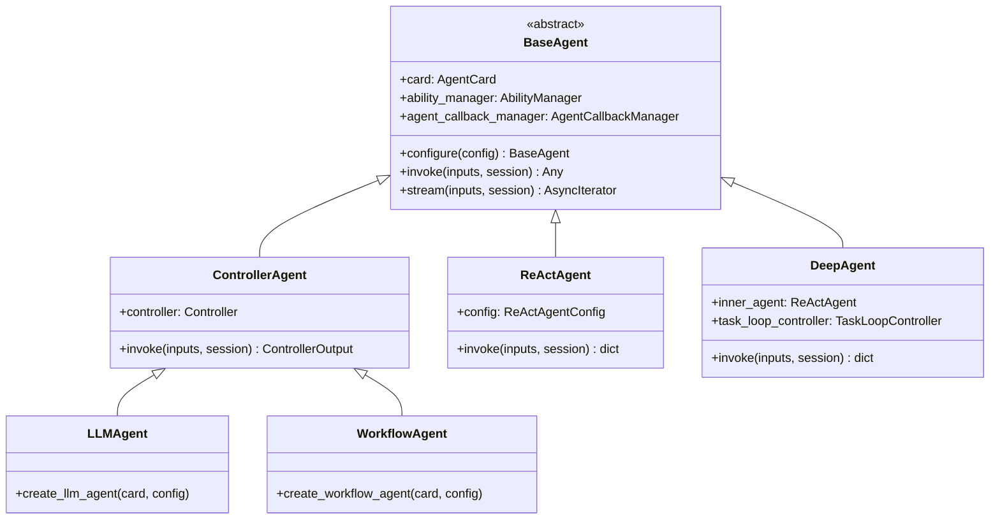
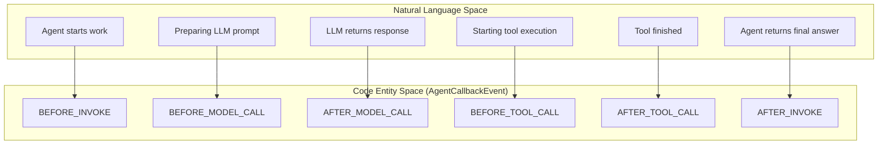
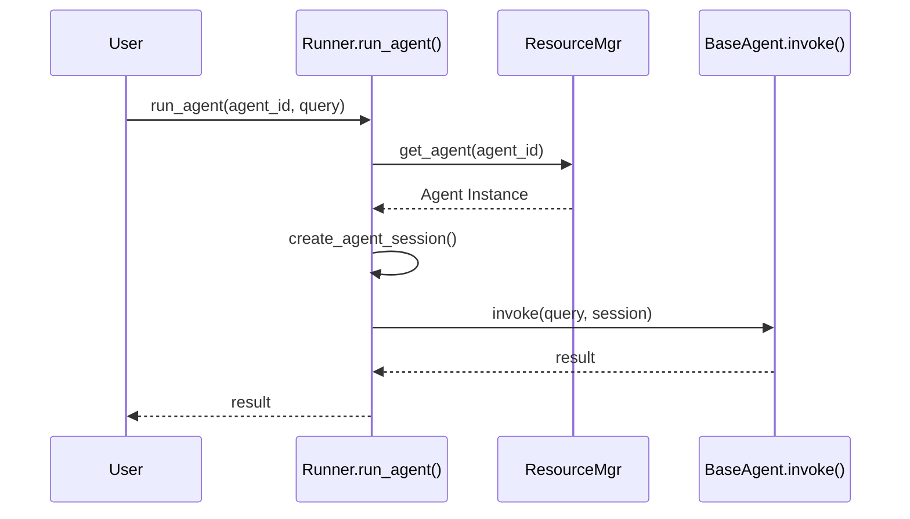

<!-- source: DeepWiki mcp.deepwiki.com · repo openJiuwen-ai/agent-core · page 2 Agents · fetched 2026-11-02 -->

# Agents

Relevant source files

The following files were used as context for generating this wiki page:

- [.gitignore](.gitignore)
- [Makefile](Makefile)
- [openjiuwen/core/common/exception/codes.py](openjiuwen/core/common/exception/codes.py)
- [openjiuwen/core/foundation/tool/mcp/client/openapi_client.py](openjiuwen/core/foundation/tool/mcp/client/openapi_client.py)
- [openjiuwen/core/memory/common/base.py](openjiuwen/core/memory/common/base.py)
- [openjiuwen/core/retrieval/__init__.py](openjiuwen/core/retrieval/__init__.py)
- [openjiuwen/core/runner/resources_manager/resource_manager.py](openjiuwen/core/runner/resources_manager/resource_manager.py)
- [openjiuwen/core/runner/resources_manager/tool_manager.py](openjiuwen/core/runner/resources_manager/tool_manager.py)
- [openjiuwen/core/single_agent/__init__.py](openjiuwen/core/single_agent/__init__.py)
- [openjiuwen/core/single_agent/ability_manager.py](openjiuwen/core/single_agent/ability_manager.py)
- [openjiuwen/core/single_agent/agent_callback_manager.py](openjiuwen/core/single_agent/agent_callback_manager.py)
- [openjiuwen/core/single_agent/agents/react_agent.py](openjiuwen/core/single_agent/agents/react_agent.py)
- [openjiuwen/core/single_agent/base.py](openjiuwen/core/single_agent/base.py)
- [openjiuwen/core/single_agent/rail/__init__.py](openjiuwen/core/single_agent/rail/__init__.py)
- [openjiuwen/core/single_agent/rail/base.py](openjiuwen/core/single_agent/rail/base.py)
- [openjiuwen/harness/deep_agent.py](openjiuwen/harness/deep_agent.py)
- [openjiuwen/harness/factory.py](openjiuwen/harness/factory.py)
- [openjiuwen/harness/prompts/sections/skills.py](openjiuwen/harness/prompts/sections/skills.py)
- [openjiuwen/harness/rails/skills/skill_use_rail.py](openjiuwen/harness/rails/skills/skill_use_rail.py)
- [openjiuwen/harness/rails/subagent/verification_rail.py](openjiuwen/harness/rails/subagent/verification_rail.py)
- [openjiuwen/harness/rails/sys_operation_rail.py](openjiuwen/harness/rails/sys_operation_rail.py)
- [openjiuwen/harness/schema/config.py](openjiuwen/harness/schema/config.py)
- [openjiuwen/harness/tools/worktree/rails.py](openjiuwen/harness/tools/worktree/rails.py)
- [pyproject.toml](pyproject.toml)
- [tests/system_tests/rail/test_force_finish_rail.py](tests/system_tests/rail/test_force_finish_rail.py)
- [tests/system_tests/runner/test_runner.py](tests/system_tests/runner/test_runner.py)
- [tests/system_tests/tune/test_prompt_tune.py](tests/system_tests/tune/test_prompt_tune.py)
- [tests/system_tests/workflow/test_real_workflow.py](tests/system_tests/workflow/test_real_workflow.py)
- [tests/test_logger.py](tests/test_logger.py)
- [tests/unit_tests/agent/react_agent/test_new_react_agent_mock.py](tests/unit_tests/agent/react_agent/test_new_react_agent_mock.py)
- [tests/unit_tests/agent_teams/observability/test_team_observability_mock_llm.py](tests/unit_tests/agent_teams/observability/test_team_observability_mock_llm.py)
- [tests/unit_tests/core/context_engine/conftest.py](tests/unit_tests/core/context_engine/conftest.py)
- [tests/unit_tests/core/single_agent/rail/test_rail.py](tests/unit_tests/core/single_agent/rail/test_rail.py)
- [tests/unit_tests/core/single_agent/rail/test_rail_init_timing.py](tests/unit_tests/core/single_agent/rail/test_rail_init_timing.py)
- [tests/unit_tests/harness/test_deep_agent.py](tests/unit_tests/harness/test_deep_agent.py)
- [tests/unit_tests/harness/test_filesystem_rail.py](tests/unit_tests/harness/test_filesystem_rail.py)
- [tests/unit_tests/harness/test_skill_rail.py](tests/unit_tests/harness/test_skill_rail.py)
- [uv.lock](uv.lock)

This page describes the agent model in `agent-core`: the `BaseAgent` interface, the identity object `AgentCard`, the concrete agent types (`ReActAgent`, `LLMAgent`, `WorkflowAgent`, `TeamAgent`, `DeepAgent`), how agents connect to tools via `AbilityManager`, and the `AgentRail` system for lifecycle hooks.

For detailed documentation on specific agent types and supporting subsystems, see the child pages:
- [ReActAgent](#2.1) — Reasoning + Acting loop with tool execution and session handling.
- [LLMAgent](#2.2) — LLM-driven controller with workflow integration and interrupt/resume patterns.
- [WorkflowAgent](#2.3) — Intent-based routing across multiple compiled workflows.
- [Hierarchical Groups](#2.4) — Multi-agent orchestration and `TeamAgent` coordination.
- [Runner](#2.5) — The lifecycle manager for starting, stopping, and invoking agents.
- [Sessions and Checkpointing](#2.6) — State persistence, `CommitState`, and session isolation.

---

## Agent Model Overview

Every agent in `agent-core` is identified by an `AgentCard` and exposes a consistent async interface (`invoke` / `stream`). The framework uses a "Card + Config" design: the `AgentCard` defines **identity** (who the agent is), while the configuration object defines **behavior** (how the agent runs).

**Available Agent Types**

| Class | Module | Base | Description |
|---|---|---|---|
| `ReActAgent` | `openjiuwen.core.single_agent.agents.react_agent` | `BaseAgent` | Implements the Reasoning + Acting loop directly against an LLM. |
| `LLMAgent` | `openjiuwen.core.application.llm_agent.llm_agent` | `ControllerAgent` | High-level agent wrapping a `LLMController` for complex task loops. |
| `WorkflowAgent` | `openjiuwen.core.application.workflow_agent.workflow_agent` | `ControllerAgent` | Routes requests to compiled `Workflow` instances. |
| `DeepAgent` | `openjiuwen.harness.deep_agent` | `BaseAgent` | High-level agent that delegates to an internal ReActAgent with advanced task loops and rails. |
| `TeamAgent` | `openjiuwen.agent_teams.team_agent` | `BaseAgent` | Orchestrates a team of agents via message bus and shared workspace. |

Sources: [openjiuwen/core/single_agent/base.py:83-107](), [openjiuwen/core/single_agent/agents/react_agent.py:259-270](), [openjiuwen/harness/deep_agent.py:208-210]()

---

## Class Hierarchy and Identity

**Agent Class Hierarchy (Code Entity Space)**

Sources: [openjiuwen/core/single_agent/base.py:83-233](), [openjiuwen/core/single_agent/agents/react_agent.py:259-270](), [openjiuwen/harness/deep_agent.py:208-210]()

### AgentCard
The `AgentCard` ([openjiuwen/core/single_agent/schema/agent_card.py]()) is required for every agent. It contains:
- `id`: A unique identifier (often used as a `tag` in `ResourceMgr`).
- `name`: Human-readable name.
- `description`: Purpose of the agent.

---

## BaseAgent Interface

The `BaseAgent` ([openjiuwen/core/single_agent/base.py:83-233]()) provides the foundation for all agents. It uses a metaclass `_AgentMeta` to automatically wrap `invoke` and `stream` methods with telemetry and callback emission [openjiuwen/core/single_agent/base.py:55-79]().

### Core Methods
- `configure(config)`: Sets the agent's runtime configuration (e.g., `ReActAgentConfig`). Supports chaining [openjiuwen/core/single_agent/base.py:134-137]().
- `invoke(inputs, session)`: Async execution returning a final result.
- `stream(inputs, session)`: Async iterator yielding execution chunks.
- `register_rail(rail)`: Attaches an `AgentRail` to intercept lifecycle events [openjiuwen/core/single_agent/base.py:188-199]().

### AbilityManager
Each agent maintains an `AbilityManager` [openjiuwen/core/single_agent/ability_manager.py:87-95]() to manage its tools, workflows, and sub-agents.
- `add(ability)`: Registers a `ToolCard`, `WorkflowCard`, or `AgentCard` [openjiuwen/core/single_agent/ability_manager.py:191-203]().
- `execute(tool_call, session)`: Dispatches tool calls to the `ResourceMgr` for execution [openjiuwen/core/single_agent/ability_manager.py:284-300]().

Sources: [openjiuwen/core/single_agent/base.py:107-110](), [openjiuwen/core/single_agent/ability_manager.py:87-111]()

---

## Agent Lifecycle Hooks (Rails)

The SDK uses a "Rail" system to provide clean separation between core agent logic and cross-cutting concerns like memory, logging, or security.

**Agent Lifecycle Events (Natural Language to Code Mapping)**

### AgentRail Class
Developers can subclass `AgentRail` to implement these hooks. For example, `SkillUseRail` ([openjiuwen/harness/rails/skills/skill_use_rail.py:36]()) manages skill prompt injection and tool registration during the agent's initialization and invocation lifecycle.

Sources: [openjiuwen/core/single_agent/rail/base.py:23-32](), [openjiuwen/harness/rails/skills/skill_use_rail.py:36-45]()

---

## ReActAgent

`ReActAgent` implements the Reasoning + Acting loop. It iterates until it reaches a final answer or hits `max_iterations` [openjiuwen/core/single_agent/agents/react_agent.py:197]().

### Configuration
`ReActAgentConfig` includes [openjiuwen/core/single_agent/agents/react_agent.py:193-257]():
- `model_name` & `model_provider`: LLM backend details.
- `max_iterations`: Loop limit (default 5).
- `prompt_template`: The system instructions.
- `context_engine_config`: Window management and token limits.

### Invocation and Streaming
- **Invoke**: Returns a result dictionary containing the final output [openjiuwen/core/single_agent/agents/react_agent.py:560-570]().
- **Stream**: Yields execution chunks. It internally runs the ReAct loop and writes LLM tokens and tool call events to the session's stream [openjiuwen/core/single_agent/agents/react_agent.py:572-627]().

Sources: [openjiuwen/core/single_agent/agents/react_agent.py:193-257](), [openjiuwen/core/single_agent/agents/react_agent.py:411-570]()

---

## Registration and Invocation via ResourceMgr

Agents and their resources are managed by the `ResourceMgr` ([openjiuwen/core/runner/resources_manager/resource_manager.py:68]()).

**Invocation Flow via Runner**

When an agent is registered with `ResourceMgr`, it is stored alongside its `AgentCard`. The `ResourceMgr` also handles registration of `Tool`, `Workflow`, and `SysOperation` instances, which the agent's `AbilityManager` accesses during execution.

Sources: [openjiuwen/core/runner/resources_manager/resource_manager.py:82-90](), [openjiuwen/core/single_agent/ability_manager.py:94-95]()

---

