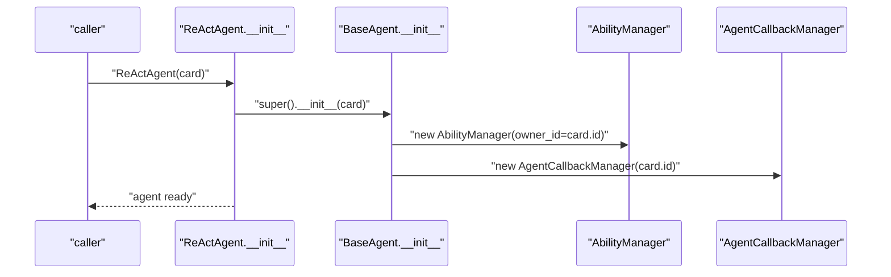
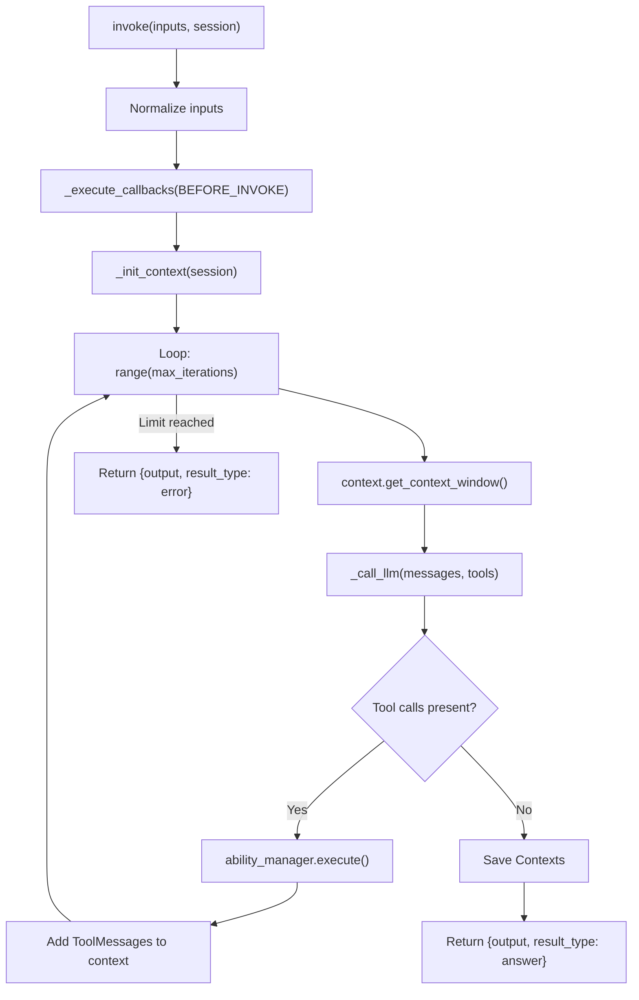

<!-- source: DeepWiki mcp.deepwiki.com · repo openJiuwen-ai/agent-core · page 2.1 ReActAgent · fetched 2026-11-02 -->

# ReActAgent

<details>
<summary>Relevant source files</summary>

The following files were used as context for generating this wiki page:

- [openjiuwen/core/session/tracer/decorator.py](openjiuwen/core/session/tracer/decorator.py)
- [openjiuwen/core/single_agent/ability_manager.py](openjiuwen/core/single_agent/ability_manager.py)
- [openjiuwen/core/single_agent/agent_callback_manager.py](openjiuwen/core/single_agent/agent_callback_manager.py)
- [openjiuwen/core/single_agent/agents/react_agent.py](openjiuwen/core/single_agent/agents/react_agent.py)
- [openjiuwen/core/single_agent/base.py](openjiuwen/core/single_agent/base.py)
- [openjiuwen/core/single_agent/legacy/agent.py](openjiuwen/core/single_agent/legacy/agent.py)
- [openjiuwen/core/single_agent/rail/__init__.py](openjiuwen/core/single_agent/rail/__init__.py)
- [openjiuwen/core/single_agent/rail/base.py](openjiuwen/core/single_agent/rail/base.py)
- [openjiuwen/core/workflow/components/llm/intent_detection_comp.py](openjiuwen/core/workflow/components/llm/intent_detection_comp.py)
- [openjiuwen/core/workflow/components/llm/llm_comp.py](openjiuwen/core/workflow/components/llm/llm_comp.py)
- [openjiuwen/core/workflow/components/llm/questioner_comp.py](openjiuwen/core/workflow/components/llm/questioner_comp.py)
- [openjiuwen/core/workflow/components/tool/tool_comp.py](openjiuwen/core/workflow/components/tool/tool_comp.py)
- [openjiuwen/harness/deep_agent.py](openjiuwen/harness/deep_agent.py)
- [openjiuwen/harness/factory.py](openjiuwen/harness/factory.py)
- [openjiuwen/harness/prompts/sections/skills.py](openjiuwen/harness/prompts/sections/skills.py)
- [openjiuwen/harness/rails/skills/skill_use_rail.py](openjiuwen/harness/rails/skills/skill_use_rail.py)
- [openjiuwen/harness/rails/subagent/verification_rail.py](openjiuwen/harness/rails/subagent/verification_rail.py)
- [openjiuwen/harness/rails/sys_operation_rail.py](openjiuwen/harness/rails/sys_operation_rail.py)
- [openjiuwen/harness/schema/config.py](openjiuwen/harness/schema/config.py)
- [openjiuwen/harness/tools/worktree/rails.py](openjiuwen/harness/tools/worktree/rails.py)
- [tests/system_tests/rail/test_force_finish_rail.py](tests/system_tests/rail/test_force_finish_rail.py)
- [tests/unit_tests/agent/react_agent/test_new_react_agent_mock.py](tests/unit_tests/agent/react_agent/test_new_react_agent_mock.py)
- [tests/unit_tests/core/agent/controller/test_base_controller_conversation_isolation.py](tests/unit_tests/core/agent/controller/test_base_controller_conversation_isolation.py)
- [tests/unit_tests/core/component/test_intent_detection_comp.py](tests/unit_tests/core/component/test_intent_detection_comp.py)
- [tests/unit_tests/core/component/test_llm_comp.py](tests/unit_tests/core/component/test_llm_comp.py)
- [tests/unit_tests/core/component/test_questioner_comp.py](tests/unit_tests/core/component/test_questioner_comp.py)
- [tests/unit_tests/core/component/test_tool_comp.py](tests/unit_tests/core/component/test_tool_comp.py)
- [tests/unit_tests/core/component/test_visualize_workflow.py](tests/unit_tests/core/component/test_visualize_workflow.py)
- [tests/unit_tests/core/runner/test_runner.py](tests/unit_tests/core/runner/test_runner.py)
- [tests/unit_tests/core/session/tracer/test_decorator.py](tests/unit_tests/core/session/tracer/test_decorator.py)
- [tests/unit_tests/core/single_agent/rail/test_rail.py](tests/unit_tests/core/single_agent/rail/test_rail.py)
- [tests/unit_tests/core/single_agent/rail/test_rail_init_timing.py](tests/unit_tests/core/single_agent/rail/test_rail_init_timing.py)
- [tests/unit_tests/harness/test_deep_agent.py](tests/unit_tests/harness/test_deep_agent.py)
- [tests/unit_tests/harness/test_filesystem_rail.py](tests/unit_tests/harness/test_filesystem_rail.py)
- [tests/unit_tests/harness/test_skill_rail.py](tests/unit_tests/harness/test_skill_rail.py)

</details>


This page covers `ReActAgent` and `ReActAgentConfig` — the primary agent implementation in the SDK that follows the ReAct (Reasoning + Acting) paradigm. It documents configuration options, the tool-use loop, session handling, context engine integration, and the callback system.

For the abstract base class that `ReActAgent` extends, see page [2.0]() (Agents overview). For the `LLMAgent`, which wraps a `ControllerAgent` with a ReAct-style loop driven by a Controller, see [2.2](). For the `Runner` that manages agent invocation lifecycle, see [2.5]().

---

## Overview

`ReActAgent` [openjiuwen/core/single_agent/agents/react_agent.py:259-626]() implements a synchronous ReAct loop: at each iteration it calls an LLM, inspects the response for tool calls, executes any requested tools, appends results to the context, and repeats until the model produces a plain-text answer or `max_iterations` is exhausted.

`ReActAgentConfig` [openjiuwen/core/single_agent/agents/react_agent.py:193-256]() is a Pydantic model that carries all configuration for a `ReActAgent` instance. Its setter methods return `self` to enable fluent chaining.

**Class hierarchy:**

```mermaid
classDiagram
    class "BaseAgent" {
        +card: AgentCard
        +ability_manager: AbilityManager
        +agent_callback_manager: AgentCallbackManager
        +configure(config) BaseAgent
        +invoke(inputs, session) Any
        +stream(inputs, session, stream_modes) AsyncIterator
        +register_callback(event, callback, priority)
        +register_rail(rail) BaseAgent
    }
    class "ReActAgent" {
        +context_engine: ContextEngine
        -_config: ReActAgentConfig
        -_llm: Model
        +configure(config) BaseAgent
        +invoke(inputs, session) Dict
        +stream(inputs, session, stream_modes) AsyncIterator
        -_get_llm() Model
        -_call_llm(messages, tools) AssistantMessage
        -_init_context(session) ModelContext
        -_init_memory_scope()
    }
    class "ReActAgentConfig" {
        +model_name: str
        +model_provider: str
        +api_key: str
        +api_base: str
        +prompt_template: List~Dict~
        +max_iterations: int
        +model_client_config: ModelClientConfig
        +model_config_obj: ModelRequestConfig
        +context_engine_config: ContextEngineConfig
        +context_processors: List
        +mem_scope_id: str
        +sys_operation_id: str
        +configure_model_client(...)
        +configure_prompt_template(...)
        +configure_context_engine(...)
        +configure_max_iterations(...)
        +configure_mem_scope(...)
    }
    class "AbilityManager" {
        +add(ability)
        +remove(name)
        +list() List
        +list_tool_info() List~ToolInfo~
        +execute(tool_call, session, tag) List
    }
    class "ContextEngine" {
        +create_context(session, processors, token_counter) ModelContext
        +save_contexts(session)
    }
    class "Model" {
        +invoke(messages, tools) AssistantMessage
    }
    "BaseAgent" <|-- "ReActAgent"
    "ReActAgent" --> "ReActAgentConfig"
    "ReActAgent" --> "AbilityManager"
    "ReActAgent" --> "ContextEngine"
    "ReActAgent" --> "Model"
```

Sources: [openjiuwen/core/single_agent/agents/react_agent.py:193-290](), [openjiuwen/core/single_agent/base.py:85-232](), [openjiuwen/core/single_agent/ability_manager.py:87-112]()

---

## ReActAgentConfig

`ReActAgentConfig` holds all options for a `ReActAgent`. Every field has a default value so the object can be created empty and populated via fluent setter methods.

### Fields

| Field | Type | Default | Description |
|---|---|---|---|
| `model_name` | `str` | `""` | Model name passed to `Model.invoke()` |
| `model_provider` | `str` | `"openai"` | Provider identifier |
| `api_key` | `str` | `""` | API key |
| `api_base` | `str` | `""` | API base URL |
| `prompt_template_name` | `str` | `""` | Named prompt template reference |
| `prompt_template` | `List[Dict]` | `[]` | Inline prompt; each dict has `role` and `content` |
| `max_iterations` | `int` | `5` | Maximum ReAct loop iterations |
| `model_client_config` | `ModelClientConfig \| None` | `None` | Full client config [openjiuwen/core/single_agent/agents/react_agent.py:207-207]() |
| `model_config_obj` | `ModelRequestConfig \| None` | `None` | Per-request model parameters |
| `sys_operation_id` | `str \| None` | `None` | System operation ID for skill utilities |
| `context_engine_config` | `ContextEngineConfig` | `max=None, window=None` | Context management parameters [openjiuwen/core/single_agent/agents/react_agent.py:218-221]() |
| `mem_scope_id` | `str` | `""` | Long-term memory scope identifier |

Sources: [openjiuwen/core/single_agent/agents/react_agent.py:193-225]()

### Configure Methods

All configure methods mutate the config in-place and return `self` [openjiuwen/core/single_agent/agents/react_agent.py:227-256]().

| Method | Key Parameters | Effect |
|---|---|---|
| `configure_model(model_name)` | `model_name: str` | Sets `model_name` |
| `configure_model_provider(provider, api_key, api_base)` | strings | Sets provider/key/base |
| `configure_model_client(provider, api_key, api_base, model_name, verify_ssl)` | strings + bool | Constructs `model_client_config` and `model_config_obj` |
| `configure_prompt(prompt_name)` | `prompt_name: str` | Sets `prompt_template_name` |
| `configure_prompt_template(prompt_template)` | `List[Dict]` | Sets `prompt_template` inline |
| `configure_context_engine(max_context_message_num, default_window_round_num, enable_reload)` | ints + bool | Replaces `context_engine_config` |
| `configure_mem_scope(mem_scope_id)` | `str` | Sets `mem_scope_id` |
| `configure_max_iterations(max_iterations)` | `int` | Sets `max_iterations` |

Sources: [openjiuwen/core/single_agent/agents/react_agent.py:227-256]()

---

## Instantiation and Configuration

`ReActAgent.__init__` requires an `AgentCard` [openjiuwen/core/single_agent/agents/react_agent.py:275-290]():

```python
agent = ReActAgent(card=AgentCard(name="my_agent", description="..."))
agent.configure(config)  # attach ReActAgentConfig after construction
```

`configure()` [openjiuwen/core/single_agent/agents/react_agent.py:306-342]() compares old and new configs and selectively resets LLM clients, context engines, memory scopes, and skill utilities.

**Construction flow:**



Sources: [openjiuwen/core/single_agent/agents/react_agent.py:275-342](), [openjiuwen/core/single_agent/base.py:100-115]()

---

## Tool Selection and Execution

Tools are managed via the `AbilityManager`. It handles the storage of metadata Cards and the execution of concrete tool instances retrieved from the `ResourceManager` [openjiuwen/core/single_agent/ability_manager.py:87-95]().

### Tool Call Execution
1.  **Normalization**: The agent uses `_normalize_tool_calls` to ensure tool call objects are in a consistent list format [openjiuwen/core/single_agent/ability_manager.py:169-181]().
2.  **Lane Management**: To prevent race conditions (e.g., multiple file writes in one turn), the `AbilityManager` uses `_tool_execution_resource_key` to identify resources that require ordered execution [openjiuwen/core/single_agent/ability_manager.py:183-200]().
3.  **Dispatch**: Execution occurs via `AbilityManager.execute()`, which handles tool timeouts and exception mapping [openjiuwen/core/single_agent/ability_manager.py:246-278]().
4.  **Result Formatting**: The `_build_tool_message_content` helper converts raw tool results into strings suitable for LLM context [openjiuwen/core/single_agent/ability_manager.py:144-163]().

Sources: [openjiuwen/core/single_agent/ability_manager.py:87-278](), [openjiuwen/core/single_agent/agents/react_agent.py:510-541]()

---

## The ReAct Loop: `invoke()` and `stream()`

### `invoke()` patterns
The `invoke` method executes the Reasoning + Acting loop up to `max_iterations` [openjiuwen/core/single_agent/agents/react_agent.py:411-570]().

**Loop execution diagram:**



### `stream()` patterns
`stream()` [openjiuwen/core/single_agent/agents/react_agent.py:572-626]() runs the ReAct loop in an async task and yields `OutputSchema` chunks through the session's stream iterator. It utilizes `StreamMode` to determine which types of data (e.g., thoughts, tool calls, final answers) are yielded to the caller.

Sources: [openjiuwen/core/single_agent/agents/react_agent.py:411-626]()

---

## Session Handling and Backward Compatibility

### Session Integration
`ReActAgent` is decorated with `@with_session`, allowing it to access `Session` objects for state persistence [openjiuwen/core/single_agent/agents/react_agent.py:259](). It supports:
- **Interruption State**: Loading and saving `ToolInterruptionState` to handle human-in-the-loop tool confirmations [openjiuwen/core/single_agent/agents/react_agent.py:448-460]().
- **KV Cache Affinity**: Using session IDs to optimize LLM performance via KV cache affinity [openjiuwen/core/single_agent/agents/react_agent.py:48-51]().

### Legacy Interface
The SDK maintains backward compatibility through the `BaseAgent` in the legacy namespace [openjiuwen/core/single_agent/legacy/agent.py:116-176](). This legacy interface provides:
-   `_config_wrapper`: A `Config` object for compatibility with older plugins [openjiuwen/core/single_agent/legacy/agent.py:127-130]().
-   `_create_context_engine()`: Default initialization using `reserved_max_chat_rounds` from legacy config structures [openjiuwen/core/single_agent/legacy/agent.py:162-176]().

Sources: [openjiuwen/core/single_agent/agents/react_agent.py:448-460](), [openjiuwen/core/single_agent/legacy/agent.py:116-176]()

---

