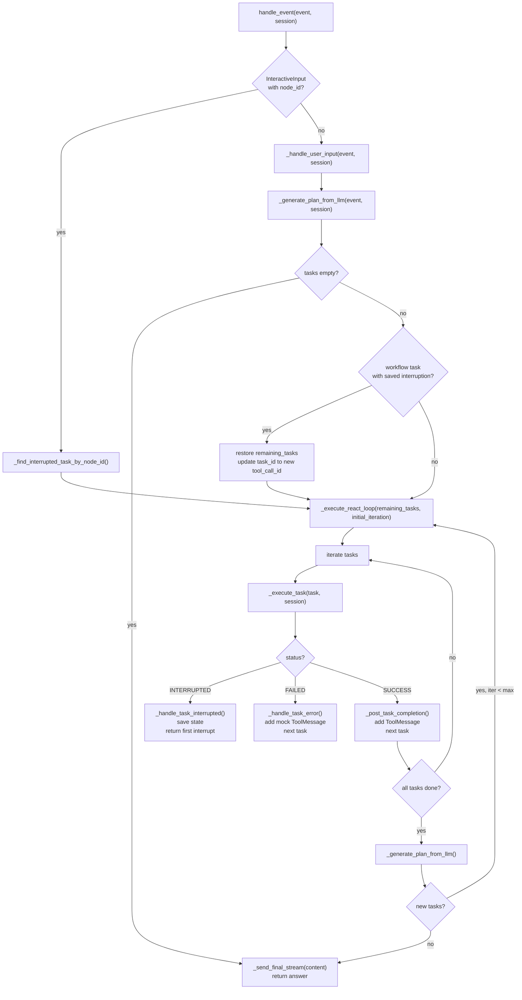
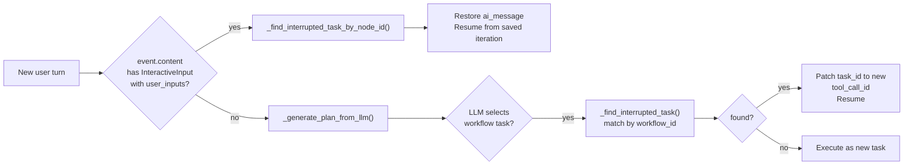
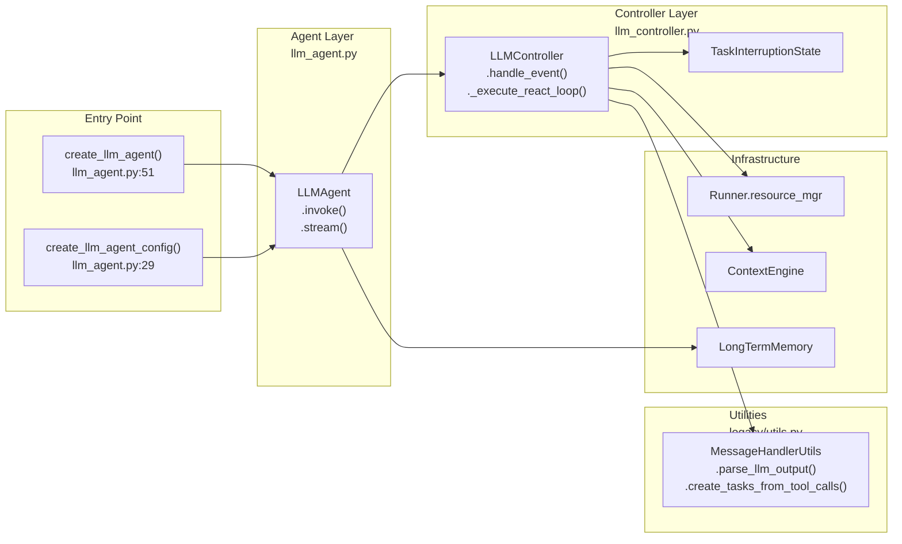

<!-- source: DeepWiki mcp.deepwiki.com · repo openJiuwen-ai/agent-core · page 2.2 LLMAgent · fetched 2026-11-02 -->

# LLMAgent

<details>
<summary>Relevant source files</summary>

The following files were used as context for generating this wiki page:

- [examples/workflow_agent/multi_workflow_agent_demo/workflow_event_handler.py](examples/workflow_agent/multi_workflow_agent_demo/workflow_event_handler.py)
- [examples/workflow_agent/multi_workflow_agent_demo/workflow_executor.py](examples/workflow_agent/multi_workflow_agent_demo/workflow_executor.py)
- [openjiuwen/core/application/llm_agent/llm_agent.py](openjiuwen/core/application/llm_agent/llm_agent.py)
- [openjiuwen/core/application/llm_agent/llm_controller.py](openjiuwen/core/application/llm_agent/llm_controller.py)
- [openjiuwen/core/application/workflow_agent/workflow_event_handler.py](openjiuwen/core/application/workflow_agent/workflow_event_handler.py)
- [openjiuwen/core/common/clients/llm_client.py](openjiuwen/core/common/clients/llm_client.py)
- [openjiuwen/core/common/utils/message_utils.py](openjiuwen/core/common/utils/message_utils.py)
- [openjiuwen/core/controller/__init__.py](openjiuwen/core/controller/__init__.py)
- [openjiuwen/core/controller/base.py](openjiuwen/core/controller/base.py)
- [openjiuwen/core/controller/config.py](openjiuwen/core/controller/config.py)
- [openjiuwen/core/controller/legacy/utils.py](openjiuwen/core/controller/legacy/utils.py)
- [openjiuwen/core/controller/modules/__init__.py](openjiuwen/core/controller/modules/__init__.py)
- [openjiuwen/core/controller/modules/event_handler.py](openjiuwen/core/controller/modules/event_handler.py)
- [openjiuwen/core/controller/modules/event_queue.py](openjiuwen/core/controller/modules/event_queue.py)
- [openjiuwen/core/controller/modules/intent_recognizer.py](openjiuwen/core/controller/modules/intent_recognizer.py)
- [openjiuwen/core/controller/modules/task_executor.py](openjiuwen/core/controller/modules/task_executor.py)
- [openjiuwen/core/controller/modules/task_manager.py](openjiuwen/core/controller/modules/task_manager.py)
- [openjiuwen/core/controller/modules/task_scheduler.py](openjiuwen/core/controller/modules/task_scheduler.py)
- [openjiuwen/core/controller/schema/__init__.py](openjiuwen/core/controller/schema/__init__.py)
- [openjiuwen/core/controller/schema/controller_output.py](openjiuwen/core/controller/schema/controller_output.py)
- [openjiuwen/core/controller/schema/dataframe.py](openjiuwen/core/controller/schema/dataframe.py)
- [openjiuwen/core/controller/schema/intent.py](openjiuwen/core/controller/schema/intent.py)
- [openjiuwen/core/controller/schema/task.py](openjiuwen/core/controller/schema/task.py)
- [openjiuwen/core/foundation/llm/headers_helper.py](openjiuwen/core/foundation/llm/headers_helper.py)
- [openjiuwen/core/foundation/llm/model.py](openjiuwen/core/foundation/llm/model.py)
- [openjiuwen/core/foundation/llm/schema/config.py](openjiuwen/core/foundation/llm/schema/config.py)
- [openjiuwen/core/foundation/llm/schema/mode_info.py](openjiuwen/core/foundation/llm/schema/mode_info.py)
- [openjiuwen/core/retrieval/query_rewriter/query_rewriter.py](openjiuwen/core/retrieval/query_rewriter/query_rewriter.py)
- [openjiuwen/core/single_agent/legacy/react_agent.py](openjiuwen/core/single_agent/legacy/react_agent.py)
- [tests/unit_tests/agent/react_agent/test_react_agent_interrupt.py](tests/unit_tests/agent/react_agent/test_react_agent_interrupt.py)
- [tests/unit_tests/agent/react_agent/test_react_agent_streaming.py](tests/unit_tests/agent/react_agent/test_react_agent_streaming.py)
- [tests/unit_tests/agent/react_agent/test_react_agent_workflow_interrupt_mock.py](tests/unit_tests/agent/react_agent/test_react_agent_workflow_interrupt_mock.py)
- [tests/unit_tests/core/common/clients/test_llm_client.py](tests/unit_tests/core/common/clients/test_llm_client.py)
- [tests/unit_tests/core/foundation/llm/test_model_client_config.py](tests/unit_tests/core/foundation/llm/test_model_client_config.py)
- [tests/unit_tests/core/memory/test_session_id_in_memory.py](tests/unit_tests/core/memory/test_session_id_in_memory.py)
- [tests/unit_tests/core/retrieval/query_rewriter/test_query_rewriter.py](tests/unit_tests/core/retrieval/query_rewriter/test_query_rewriter.py)

</details>


This page covers `LLMAgent` and its internal controller `LLMController`: how they are configured, how the ReAct execution loop works, how tools and workflows are invoked, and how interrupt/resume state is managed across turns. For the simpler, lower-level `ReActAgent` (the legacy single-agent without the controller layer), see [ReActAgent](2.1). For the workflow-only agent pattern, see [WorkflowAgent](2.3).

---

## Overview

`LLMAgent` is an application-level agent that implements the ReAct (Reasoning + Acting) paradigm. It wraps a `ControllerAgent` base class and delegates all reasoning and task execution to an `LLMController`. The controller drives a multi-iteration loop: at each step it calls the LLM, parses tool calls from the response, dispatches tasks (plugin calls or workflow runs), and feeds results back into the LLM context for the next reasoning step.

**Class relationship diagram**

```mermaid
classDiagram
    class "ControllerAgent" {
        +invoke(inputs, session)
        +stream(inputs, session)
        +controller
        +context_engine
    }
    class "LLMAgent" {
        +invoke(inputs, session)
        +stream(inputs, session)
        +set_prompt_template(template)
        -_write_messages_to_memory(inputs, result)
        -_enable_memory: bool
        -_memory_scope_id: str
    }
    class "LLMController" {
        +handle_event(event, session)
        -_handle_user_input(event, session)
        -_generate_plan_from_llm(event, session)
        -_execute_react_loop(tasks, session)
        -_execute_task(task, session)
        -_execute_workflow_task(task, session)
        -_execute_plugin_task(task, session)
        -_handle_task_interrupted(state, output)
        -_handle_task_completed(task, result, session)
    }
    class "BaseController" {
        +invoke(inputs, session)
        +interrupt_task(state)
    }
    class "LegacyReActAgentConfig" {
        +id: str
        +model: ModelConfig
        +prompt_template: List~Dict~
        +workflows: List~WorkflowSchema~
        +plugins: List~PluginSchema~
        +constrain: ConstrainConfig
        +memory_scope_id: str
        +agent_memory_config: AgentMemoryConfig
    }
    "ControllerAgent" <|-- "LLMAgent"
    "BaseController" <|-- "LLMController"
    "LLMAgent" --> "LLMController" : "controller"
    "LLMAgent" --> "LegacyReActAgentConfig" : "agent_config"
    "LLMController" --> "LegacyReActAgentConfig" : "config"
```

Sources: [openjiuwen/core/application/llm_agent/llm_agent.py:96-131](), [openjiuwen/core/application/llm_agent/llm_controller.py:60-83]()

---

## Configuration

`LLMAgent` is configured via `LegacyReActAgentConfig` (also exported as `ReActAgentConfig`).

| Field | Type | Default | Description |
|---|---|---|---|
| `id` | `str` | `""` | Agent identifier; used as a resource tag |
| `version` | `str` | `""` | Agent version |
| `description` | `str` | `""` | Human-readable description |
| `controller_type` | `ControllerType` | `ReActController` | Must be `ControllerType.ReActController` |
| `model` | `ModelConfig` | `None` | LLM provider and model info |
| `prompt_template` | `List[Dict]` | `[]` | System/user prompt messages |
| `workflows` | `List[WorkflowSchema]` | `[]` | Workflows exposed to the LLM as tools |
| `plugins` | `List[PluginSchema]` | `[]` | Plugins exposed to the LLM as tools |
| `constrain.max_iteration` | `int` | `5` | Maximum ReAct iterations |
| `constrain.reserved_max_chat_rounds` | `int` | `10` | Chat history window sent to LLM |
| `memory_scope_id` | `str` | `""` | Long-term memory scope; empty disables memory |
| `agent_memory_config` | `AgentMemoryConfig` | — | Controls which memory features are active |

Sources: [openjiuwen/core/single_agent/legacy/react_agent.py:27-29](), [openjiuwen/core/application/llm_agent/llm_agent.py:106-130]()

### Factory functions

Two factory helpers are provided in `openjiuwen/core/application/llm_agent/llm_agent.py`:

- **`create_llm_agent_config(...)`** — assembles a `LegacyReActAgentConfig` from named parameters.
- **`create_llm_agent(agent_config, workflows, tools)`** — constructs an `LLMAgent`, calling `add_workflows()` and `add_tools()` before returning.

```python
# Typical construction
llm_agent_config = create_llm_agent_config(
    agent_id="my_agent",
    agent_version="1.0",
    description="...",
    model=model_config,
    prompt_template=[{"role": "system", "content": "..."}],
    plugins=[],
    workflows=[],
)
llm_agent = create_llm_agent(agent_config=llm_agent_config, workflows=[], tools=[])
```

Sources: [openjiuwen/core/application/llm_agent/llm_agent.py:29-58]()

---

## LLMAgent methods

### `invoke(inputs, session=None)`

Delegates entirely to `ControllerAgent.invoke()`, which calls `LLMController.invoke()`. After the controller returns, if memory is enabled, `_write_messages_to_memory()` is scheduled as a background `asyncio.Task` [openjiuwen/core/application/llm_agent/llm_agent.py:145-150]().

**Input dict keys:**

| Key | Required | Description |
|---|---|---|
| `query` | Yes | User's question |
| `conversation_id` | No | Session ID for multi-turn continuity |
| `user_id` | No | Required for long-term memory writes |

Returns `{"output": "...", "result_type": "answer"}` on success.

Sources: [openjiuwen/core/application/llm_agent/llm_agent.py:132-151]()

### `stream(inputs, session=None)`

Launches `controller.invoke()` as an `asyncio.Task`, then reads chunks from `agent_session.stream_iterator()` and yields each one. Stream chunks are `OutputSchema` objects; the `type` field distinguishes their content [openjiuwen/core/application/llm_agent/llm_agent.py:152-161]().

| `OutputSchema.type` | Content |
|---|---|
| `llm_reasoning` | Chain-of-thought text from the LLM |
| `llm_output` | Regular LLM response text |
| `plugin_final` | Plugin/tool execution result |
| `workflow_final` | Workflow completion result |
| `__interaction__` | Workflow interrupt requiring user input |

When `session` is provided externally (e.g., from `HierarchicalGroup`), the agent skips creating its own stream and yields the final result object directly.

Sources: [openjiuwen/core/application/llm_agent/llm_agent.py:152-227]()

---

## LLMController and the ReAct Loop

`LLMController` owns the multi-step reasoning logic. It extends `BaseController` and overrides `handle_event()`, which is only called with `EventType.USER_INPUT` [openjiuwen/core/application/llm_agent/llm_controller.py:88-102]().

**ReAct execution flow**



Sources: [openjiuwen/core/application/llm_agent/llm_controller.py:122-160](), [openjiuwen/core/application/llm_agent/llm_controller.py:412-508]()

### Plan generation: `_generate_plan_from_llm()`

1. Loads available tool schemas via `Runner.resource_mgr.get_tool_infos(tag=config.id)` [openjiuwen/core/single_agent/legacy/react_agent.py:123]().
2. Retrieves chat history from `ContextEngine` [openjiuwen/core/single_agent/legacy/react_agent.py:101]().
3. Formats messages via `MessageHandlerUtils.format_llm_inputs()` [openjiuwen/core/controller/legacy/utils.py:34-54]().
4. Streams the LLM response chunk by chunk, writing `llm_reasoning` and `llm_output` frames to the session stream.
5. Parses `tool_calls` from the response via `MessageHandlerUtils.parse_llm_output()` [openjiuwen/core/controller/legacy/utils.py:69-73]().
6. Returns `(List[Task], AssistantMessage)`.

Sources: [openjiuwen/core/application/llm_agent/llm_controller.py:666-711](), [openjiuwen/core/controller/legacy/utils.py:69-146]()

### Task dispatch

`_execute_task()` routes to one of two executors:

| `task.task_type` | Executor | Description |
|---|---|---|
| `TaskType.PLUGIN` | `_execute_plugin_task()` | Fetches tool from `Runner.resource_mgr`, calls `tool.invoke(args)` |
| `TaskType.WORKFLOW` | `_execute_workflow_task()` | Calls `Runner.run_workflow(workflow, inputs, session, context)` |

Sources: [openjiuwen/core/application/llm_agent/llm_controller.py:510-529](), [openjiuwen/core/controller/legacy/utils.py:149-158]()

---

## Interrupt and Resume

When a workflow inside a task raises an `InteractiveInput` interruption, `LLMController` suspends the loop and saves state [openjiuwen/core/application/llm_agent/llm_controller.py:879-959]().

**`TaskInterruptionState` dataclass** groups interruption data:

| Field | Type | Purpose |
|---|---|---|
| `task` | `Task` | The interrupted task |
| `session` | `Session` | Session context |
| `ai_message` | `AssistantMessage` | LLM output that triggered this task |
| `remaining_tasks` | `list[Task]` | Tasks not yet executed |
| `interaction_data` | `list` | Raw interaction frames from the workflow |
| `current_iteration` | `int` | Loop iteration at time of interruption |

Sources: [openjiuwen/core/application/llm_agent/llm_controller.py:34-46]()

**Resume paths:**



Sources: [openjiuwen/core/application/llm_agent/llm_controller.py:137-150](), [openjiuwen/core/application/llm_agent/llm_controller.py:165-176]()

---

## Code Entity Map

The diagram below ties the high-level conceptual names to the concrete file and class locations.



Sources: [openjiuwen/core/application/llm_agent/llm_agent.py](), [openjiuwen/core/application/llm_agent/llm_controller.py](), [openjiuwen/core/controller/legacy/utils.py]()

---

