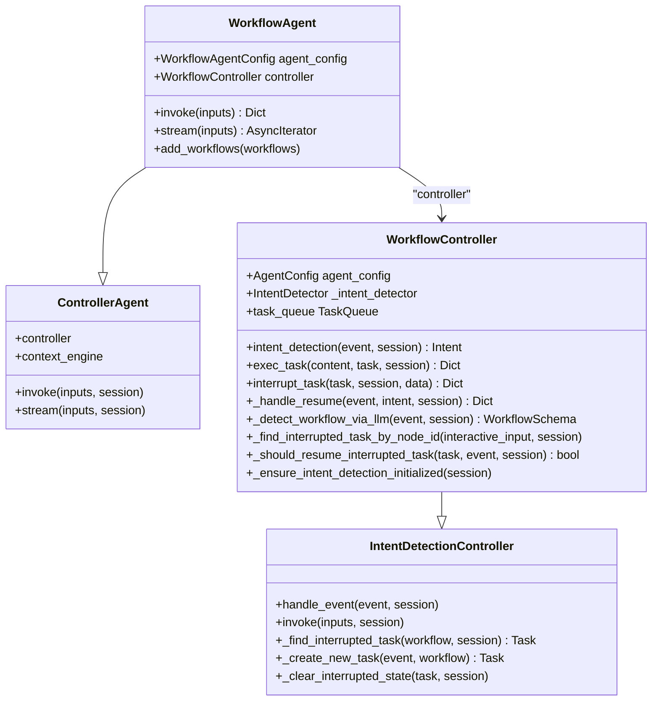
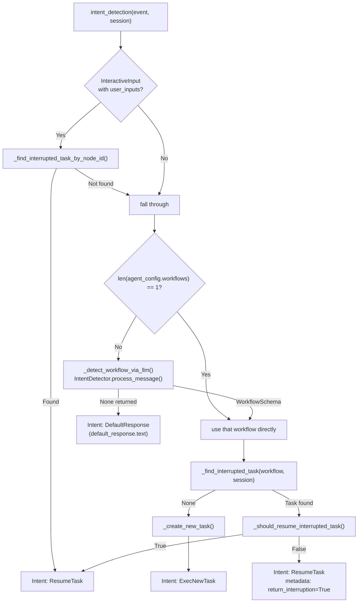
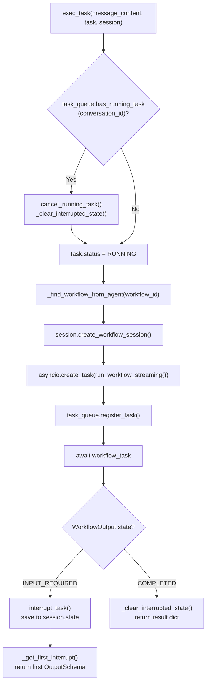
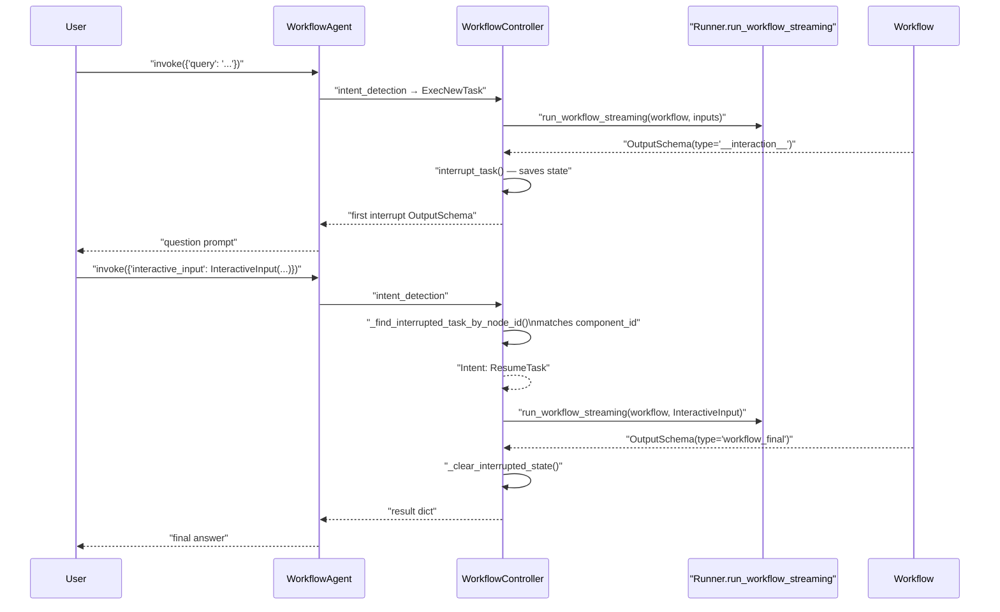

<!-- source: DeepWiki mcp.deepwiki.com · repo openJiuwen-ai/agent-core · page 2.3 WorkflowAgent · fetched 2026-11-02 -->

# WorkflowAgent

<details>
<summary>Relevant source files</summary>

The following files were used as context for generating this wiki page:

- [examples/workflow_agent/multi_workflow_agent_demo/workflow_event_handler.py](examples/workflow_agent/multi_workflow_agent_demo/workflow_event_handler.py)
- [examples/workflow_agent/multi_workflow_agent_demo/workflow_executor.py](examples/workflow_agent/multi_workflow_agent_demo/workflow_executor.py)
- [openjiuwen/core/application/workflow_agent/workflow_controller.py](openjiuwen/core/application/workflow_agent/workflow_controller.py)
- [openjiuwen/core/common/utils/message_utils.py](openjiuwen/core/common/utils/message_utils.py)
- [openjiuwen/core/controller/__init__.py](openjiuwen/core/controller/__init__.py)
- [openjiuwen/core/controller/base.py](openjiuwen/core/controller/base.py)
- [openjiuwen/core/controller/config.py](openjiuwen/core/controller/config.py)
- [openjiuwen/core/controller/legacy/controller.py](openjiuwen/core/controller/legacy/controller.py)
- [openjiuwen/core/controller/legacy/reasoner/intent_detector.py](openjiuwen/core/controller/legacy/reasoner/intent_detector.py)
- [openjiuwen/core/controller/modules/__init__.py](openjiuwen/core/controller/modules/__init__.py)
- [openjiuwen/core/controller/modules/event_handler.py](openjiuwen/core/controller/modules/event_handler.py)
- [openjiuwen/core/controller/modules/event_queue.py](openjiuwen/core/controller/modules/event_queue.py)
- [openjiuwen/core/controller/modules/intent_recognizer.py](openjiuwen/core/controller/modules/intent_recognizer.py)
- [openjiuwen/core/controller/modules/task_executor.py](openjiuwen/core/controller/modules/task_executor.py)
- [openjiuwen/core/controller/modules/task_manager.py](openjiuwen/core/controller/modules/task_manager.py)
- [openjiuwen/core/controller/modules/task_scheduler.py](openjiuwen/core/controller/modules/task_scheduler.py)
- [openjiuwen/core/controller/schema/__init__.py](openjiuwen/core/controller/schema/__init__.py)
- [openjiuwen/core/controller/schema/controller_output.py](openjiuwen/core/controller/schema/controller_output.py)
- [openjiuwen/core/controller/schema/dataframe.py](openjiuwen/core/controller/schema/dataframe.py)
- [openjiuwen/core/controller/schema/intent.py](openjiuwen/core/controller/schema/intent.py)
- [openjiuwen/core/controller/schema/task.py](openjiuwen/core/controller/schema/task.py)
- [tests/unit_tests/agent/llm_agent/test_llm_agent_invoke_with_workflow_interrupt_mock.py](tests/unit_tests/agent/llm_agent/test_llm_agent_invoke_with_workflow_interrupt_mock.py)
- [tests/unit_tests/agent/llm_agent/test_llm_agent_with_interrupt.py](tests/unit_tests/agent/llm_agent/test_llm_agent_with_interrupt.py)
- [tests/unit_tests/agent/react_agent/test_react_agent_interrupt.py](tests/unit_tests/agent/react_agent/test_react_agent_interrupt.py)
- [tests/unit_tests/agent/react_agent/test_react_agent_mock.py](tests/unit_tests/agent/react_agent/test_react_agent_mock.py)
- [tests/unit_tests/agent/react_agent/test_react_agent_streaming.py](tests/unit_tests/agent/react_agent/test_react_agent_streaming.py)
- [tests/unit_tests/agent/react_agent/test_react_agent_workflow_interrupt_mock.py](tests/unit_tests/agent/react_agent/test_react_agent_workflow_interrupt_mock.py)
- [tests/unit_tests/agent/workflow_agent/test_workflow_agent.py](tests/unit_tests/agent/workflow_agent/test_workflow_agent.py)
- [tests/unit_tests/agent/workflow_agent/test_workflow_agent_mock.py](tests/unit_tests/agent/workflow_agent/test_workflow_agent_mock.py)
- [tests/unit_tests/fixtures/__init__.py](tests/unit_tests/fixtures/__init__.py)

</details>


`WorkflowAgent` drives one or more pre-defined workflow graphs directly, without a ReAct planning loop. It handles intent-based routing across multiple registered workflows, executes them as streaming async tasks, and manages the complete interrupt/resume lifecycle when a workflow needs user input mid-execution.

This page covers `WorkflowAgent`, `WorkflowController`, `WorkflowAgentConfig`, multi-workflow registration, intent routing, streaming execution, `InteractiveInput` resumption, and session state management for interrupted workflows.

For the LLM-driven (ReAct) agent that selects workflows at runtime via tool-calling, see [LLMAgent](2.2). For building the workflow graphs that `WorkflowAgent` executes, see [Workflow Engine](4). For session state and checkpointing, see [Sessions and Checkpointing](2.6).

---

## Class Structure

`WorkflowAgent` extends `ControllerAgent` and delegates all routing and execution logic to a `WorkflowController`. `WorkflowController` [[openjiuwen/core/application/workflow_agent/workflow_controller.py:33-40]]() extends `IntentDetectionController` from the legacy controller layer and overrides two hook methods: `intent_detection()` and `exec_task()`.

**WorkflowAgent and WorkflowController class hierarchy**



Sources: [[openjiuwen/core/application/workflow_agent/workflow_controller.py:33-80]](), [[openjiuwen/core/controller/base.py:41-58]](), [[openjiuwen/core/controller/modules/task_executor.py:36-48]]()

---

## Configuration

`WorkflowAgentConfig` is defined in `openjiuwen/core/single_agent/legacy/config.py` as an extension of `AgentConfig`.

| Field | Type | Purpose |
|-------|------|---------|
| `id` | `str` | Unique agent identifier |
| `version` | `str` | Agent version |
| `description` | `str` | Human-readable description |
| `workflows` | `List[WorkflowSchema \| WorkflowCard]` | Registered workflow descriptors; usually populated via `add_workflows()` |
| `model` | `Optional[ModelConfig]` | LLM for intent detection — required when more than one workflow is registered |
| `default_response` | (nested) | Text returned when no workflow matches intent |
| `controller_type` | `ControllerType` | Identifies the controller variant |

`WorkflowSchema` carries the per-workflow metadata used during routing:

| Field | Role |
|-------|------|
| `id` | Workflow identifier |
| `version` | Workflow version |
| `name` | Used as fallback intent category label |
| `description` | Preferred intent category label for LLM routing |

Sources: [[openjiuwen/core/application/workflow_agent/workflow_controller.py:638-659]](), [[openjiuwen/core/controller/config.py:1-50]]()

---

## Multi-Workflow Registration

When using a `WorkflowAgent`, workflows are registered with the agent to allow for intent-based routing. `add_workflows()` extracts each `Workflow.card` to produce `WorkflowSchema` entries appended to `config.workflows`, and also registers each `Workflow` instance with `Runner.resource_mgr` so it is retrievable during execution.

Sources: [[openjiuwen/core/application/workflow_agent/workflow_controller.py:101-105]](), [[openjiuwen/core/controller/modules/task_manager.py:108-141]]()

---

## Intent Detection and Routing

`WorkflowController.intent_detection()` [[openjiuwen/core/application/workflow_agent/workflow_controller.py:80-199]]() determines which workflow to run and whether to start fresh or resume an interrupted execution.

**Intent detection routing logic**



Sources: [[openjiuwen/core/application/workflow_agent/workflow_controller.py:80-199]](), [[openjiuwen/core/controller/modules/intent_recognizer.py:51-186]](), [[openjiuwen/core/controller/legacy/reasoner/intent_detector.py:27-146]]()

### Multi-Workflow LLM Routing

When more than one workflow is registered, `_detect_workflow_via_llm()` [[openjiuwen/core/application/workflow_agent/workflow_controller.py:553-620]]() lazily initializes an `IntentDetector` [[openjiuwen/core/controller/legacy/reasoner/intent_detector.py:27-297]]() via `_ensure_intent_detection_initialized()` [[openjiuwen/core/application/workflow_agent/workflow_controller.py:622-659]]().

The `IntentDetector` is configured with:
- `category_list`: each workflow's `description` if set, else `name`
- `category_info`: newline-joined descriptions
- `enable_history=True`, `enable_input=True`

The LLM returns a category index, which is mapped back to a `WorkflowSchema` by description/name match. If no match, the first workflow is used as a fallback.

### Resume Decision: `_should_resume_interrupted_task()`

[[openjiuwen/core/application/workflow_agent/workflow_controller.py:661-727]]()

| Condition | Decision |
|-----------|----------|
| User provided `InteractiveInput` with `user_inputs` | Always resume |
| `last_interaction_value` is `dict` or `list` (structured component output) | Return the saved interruption again (do not re-execute yet) |
| `last_interaction_value` is `str` (human-readable question text) | Resume execution |
| No saved state found | Resume |

---

## Task Execution

`WorkflowController.exec_task()` [[openjiuwen/core/application/workflow_agent/workflow_controller.py:201-425]]() runs the selected workflow as an async streaming task and handles the result.

**exec_task execution flow**



Sources: [[openjiuwen/core/application/workflow_agent/workflow_controller.py:201-425]](), [[openjiuwen/core/controller/modules/task_scheduler.py:84-98]](), [[openjiuwen/core/controller/modules/task_executor.py:72-83]]()

### Streaming Chunk Routing

Inside `run_workflow_streaming()`, each chunk from `Runner.run_workflow_streaming()` is handled:

| Chunk type | Action |
|------------|--------|
| `OutputSchema(type=INTERACTION)` | Set `has_interaction = True`; **not** passed to session (held back) |
| `OutputSchema(type="workflow_final")` | Written to `session.write_stream()`; saved as `final_result` |
| `OutputSchema` (any other type) | Written to `session.write_stream()` |
| `CustomSchema` | Written to `session.write_custom_stream()` |

After iteration: if `has_interaction` is `True` → `WorkflowOutput(state=WorkflowExecutionState.INPUT_REQUIRED)`; otherwise → `WorkflowOutput(state=WorkflowExecutionState.COMPLETED)`.

Sources: [[openjiuwen/core/application/workflow_agent/workflow_controller.py:280-340]]()

---

## InteractiveInput Interruptions

When a workflow component (e.g., `QuestionerComponent`) triggers an interaction, the following two-turn sequence applies:

**Interrupt and resume sequence**



Sources: [[openjiuwen/core/application/workflow_agent/workflow_controller.py:80-199]](), [[openjiuwen/core/application/workflow_agent/workflow_controller.py:492-551]](), [[openjiuwen/core/controller/modules/event_handler.py:122-134]]()

### Interruption State Storage

`interrupt_task()` [[openjiuwen/core/application/workflow_agent/workflow_controller.py:492-551]]() writes to `session.state["workflow_controller"]["interrupted_tasks"][<state_key>]` where `<state_key> = workflow_id.replace('.', '_')`.

Each entry has the shape:

```python
{
    "task": task.model_dump(),          # full serialized Task object
    "component_id": "questioner",       # str (single) or List[str] (parallel interrupts)
    "last_interaction_value": "..."     # str or dict; drives resume vs. re-interrupt decision
}
```

`_find_interrupted_task_by_node_id()` [[openjiuwen/core/application/workflow_agent/workflow_controller.py:729-799]]() matches keys from `InteractiveInput.user_inputs` against stored `component_id` values — supporting both legacy string format and list format for parallel component interrupts.

### `_handle_resume` Override

`WorkflowController._handle_resume()` [[openjiuwen/core/application/workflow_agent/workflow_controller.py:427-490]]() overrides the parent's default. When `intent.metadata["return_interruption"] == True` (structured/dict-type interruption), it reconstructs an `InteractionOutput` from the saved `last_interaction_value` and emits it directly — without re-executing the workflow. This lets the caller see the question again before providing structured input.

---

## Session-Level Task Queue

`WorkflowController` uses an internal `task_queue` to track active `asyncio.Task` objects per `conversation_id`. If a new request arrives while a workflow task is in progress for the same conversation, the in-flight task is cancelled and its interrupted state is cleared before the new task starts.

| Method | Action |
|--------|--------|
| `task_queue.has_running_task(conversation_id)` | Check for active task |
| `task_queue.cancel_running_task(conversation_id)` | Cancel and unregister |
| `task_queue.register_task(conversation_id, task, coroutine, target_id)` | Register new task |
| `task_queue.unregister_task(conversation_id)` | Clean up after completion or cancellation |

Sources: [[openjiuwen/core/application/workflow_agent/workflow_controller.py:225-255]](), [[openjiuwen/core/application/workflow_agent/workflow_controller.py:342-362]]()

---

## Error Handling

The `WorkflowAgent` and its controller utilize the framework's unified exception system defined in `openjiuwen/core/common/exception/errors.py`. Specific error codes for workflows and agents are mapped to appropriate exception classes.

| Error Class | Range | Use Case |
|-------------|-------|----------|
| `WorkflowError` | 100000–100999 | Errors during workflow graph execution |
| `AgentError` | 120000–129999 | Errors specific to agent lifecycle or logic |
| `ValidationError` | N/A | Parameter or configuration mismatches |

Sources: [[openjiuwen/core/common/exception/errors.py:19-51]](), [[openjiuwen/core/common/exception/status_mapping.py:51-61]](), [[openjiuwen/core/common/exception/code_template.py:69-86]]()

---

## Key Code Locations

| Symbol | File | Role |
|--------|------|------|
| `WorkflowAgent` | `openjiuwen/core/application/workflow_agent/` | Top-level agent class |
| `WorkflowController` | `openjiuwen/core/application/workflow_agent/workflow_controller.py` | All routing and execution logic |
| `IntentDetectionController` | `openjiuwen/core/controller/legacy/` | Base controller; provides `invoke()` and hook stubs |
| `IntentDetector` | `openjiuwen/core/controller/legacy/reasoner/intent_detector.py` | LLM-based intent classification |
| `TaskManager` | `openjiuwen/core/controller/modules/task_manager.py` | Manages task state, priorities, and hierarchies |
| `TaskScheduler` | `openjiuwen/core/controller/modules/task_scheduler.py` | Coordinates execution of submitted tasks |
| `BaseError` | `openjiuwen/core/common/exception/errors.py` | Framework unified exception base class |

---

