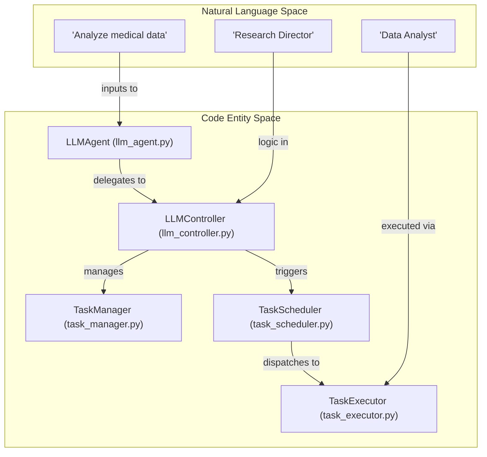
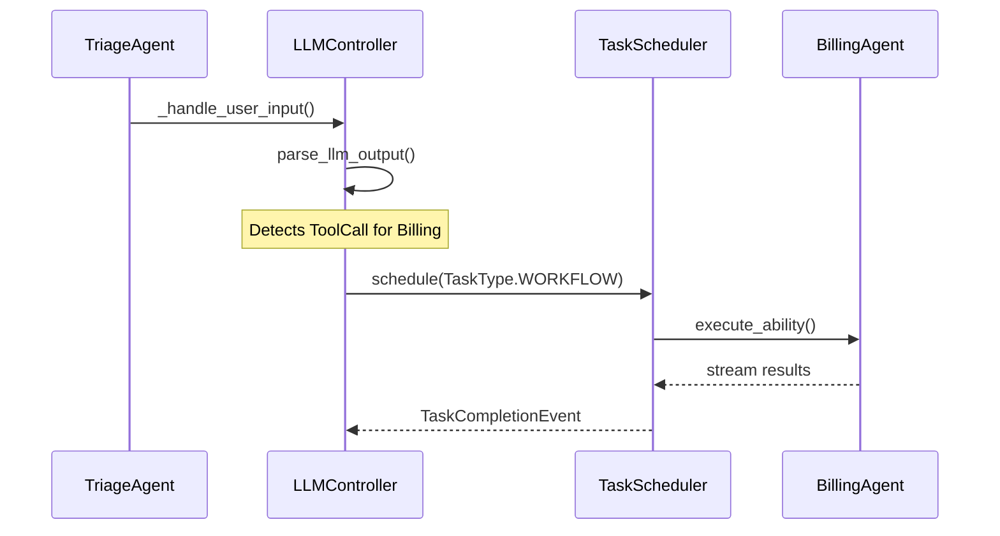

<!-- source: DeepWiki mcp.deepwiki.com · repo openJiuwen-ai/agent-core · page 2.4 Hierarchical Groups · fetched 2026-11-02 -->

# Hierarchical Groups

Relevant source files

The following files were used as context for generating this wiki page:

- [examples/workflow_agent/multi_workflow_agent_demo/workflow_event_handler.py](examples/workflow_agent/multi_workflow_agent_demo/workflow_event_handler.py)
- [examples/workflow_agent/multi_workflow_agent_demo/workflow_executor.py](examples/workflow_agent/multi_workflow_agent_demo/workflow_executor.py)
- [openjiuwen/core/application/llm_agent/llm_agent.py](openjiuwen/core/application/llm_agent/llm_agent.py)
- [openjiuwen/core/application/llm_agent/llm_controller.py](openjiuwen/core/application/llm_agent/llm_controller.py)
- [openjiuwen/core/application/workflow_agent/workflow_event_handler.py](openjiuwen/core/application/workflow_agent/workflow_event_handler.py)
- [openjiuwen/core/common/clients/llm_client.py](openjiuwen/core/common/clients/llm_client.py)
- [openjiuwen/core/common/utils/message_utils.py](openjiuwen/core/common/utils/message_utils.py)
- [openjiuwen/core/controller/__init__.py](openjiuwen/core/controller/__init__.py)
- [openjiuwen/core/controller/base.py](openjiuwen/core/controller/base.py)
- [openjiuwen/core/controller/config.py](openjiuwen/core/controller/config.py)
- [openjiuwen/core/controller/legacy/utils.py](openjiuwen/core/controller/legacy/utils.py)
- [openjiuwen/core/controller/modules/__init__.py](openjiuwen/core/controller/modules/__init__.py)
- [openjiuwen/core/controller/modules/event_handler.py](openjiuwen/core/controller/modules/event_handler.py)
- [openjiuwen/core/controller/modules/event_queue.py](openjiuwen/core/controller/modules/event_queue.py)
- [openjiuwen/core/controller/modules/intent_recognizer.py](openjiuwen/core/controller/modules/intent_recognizer.py)
- [openjiuwen/core/controller/modules/task_executor.py](openjiuwen/core/controller/modules/task_executor.py)
- [openjiuwen/core/controller/modules/task_manager.py](openjiuwen/core/controller/modules/task_manager.py)
- [openjiuwen/core/controller/modules/task_scheduler.py](openjiuwen/core/controller/modules/task_scheduler.py)
- [openjiuwen/core/controller/schema/__init__.py](openjiuwen/core/controller/schema/__init__.py)
- [openjiuwen/core/controller/schema/controller_output.py](openjiuwen/core/controller/schema/controller_output.py)
- [openjiuwen/core/controller/schema/dataframe.py](openjiuwen/core/controller/schema/dataframe.py)
- [openjiuwen/core/controller/schema/intent.py](openjiuwen/core/controller/schema/intent.py)
- [openjiuwen/core/controller/schema/task.py](openjiuwen/core/controller/schema/task.py)
- [openjiuwen/core/foundation/llm/headers_helper.py](openjiuwen/core/foundation/llm/headers_helper.py)
- [openjiuwen/core/foundation/llm/model.py](openjiuwen/core/foundation/llm/model.py)
- [openjiuwen/core/foundation/llm/schema/config.py](openjiuwen/core/foundation/llm/schema/config.py)
- [openjiuwen/core/foundation/llm/schema/mode_info.py](openjiuwen/core/foundation/llm/schema/mode_info.py)
- [openjiuwen/core/retrieval/query_rewriter/query_rewriter.py](openjiuwen/core/retrieval/query_rewriter/query_rewriter.py)
- [openjiuwen/core/single_agent/legacy/react_agent.py](openjiuwen/core/single_agent/legacy/react_agent.py)
- [tests/unit_tests/agent/react_agent/test_react_agent_interrupt.py](tests/unit_tests/agent/react_agent/test_react_agent_interrupt.py)
- [tests/unit_tests/agent/react_agent/test_react_agent_streaming.py](tests/unit_tests/agent/react_agent/test_react_agent_streaming.py)
- [tests/unit_tests/agent/react_agent/test_react_agent_workflow_interrupt_mock.py](tests/unit_tests/agent/react_agent/test_react_agent_workflow_interrupt_mock.py)
- [tests/unit_tests/core/common/clients/test_llm_client.py](tests/unit_tests/core/common/clients/test_llm_client.py)
- [tests/unit_tests/core/foundation/llm/test_model_client_config.py](tests/unit_tests/core/foundation/llm/test_model_client_config.py)
- [tests/unit_tests/core/memory/test_session_id_in_memory.py](tests/unit_tests/core/memory/test_session_id_in_memory.py)
- [tests/unit_tests/core/retrieval/query_rewriter/test_query_rewriter.py](tests/unit_tests/core/retrieval/query_rewriter/test_query_rewriter.py)

This page documents the orchestration patterns for multi-agent coordination in the openjiuwen SDK. It covers the message-bus driven `HierarchicalTeam`, the `HandoffTeam` for sequential transfers, and the core controllers enabling hierarchical orchestration such as `LLMController` and `HierarchicalMainController`. These structures allow for complex agent topologies including supervisor-worker hierarchies and peer-to-peer handoffs.

---

## Hierarchical Orchestration Controllers

The SDK provides specialized controllers that manage the lifecycle of multi-step reasoning and delegation. The `LLMController` acts as the primary engine for ReAct-style agents, while the `HierarchicalMainController` (often used in legacy groups) focuses on intent detection and routing.

### LLMController: The ReAct Engine
The `LLMController` is responsible for the core ReAct loop: receiving user input, invoking LLM reasoning to generate task plans (tool calls), executing those tasks, and looping until completion [openjiuwen/core/application/llm_agent/llm_controller.py:61-68]().

**Key Features:**
*   **Intent Detection & Routing**: It converts user queries into a sequence of `Task` objects (Workflow or Plugin) based on tool definitions [openjiuwen/core/controller/legacy/utils.py:76-147]().
*   **Interruption Propagation**: It handles `TaskInterruptionState`, allowing agents to pause for `InteractiveInput` and resume once user data is provided [openjiuwen/core/application/llm_agent/llm_controller.py:34-47]().
*   **Session Isolation**: It manages the `Session` context, ensuring that conversation history and memory variables are correctly scoped during delegation [openjiuwen/core/application/llm_agent/llm_controller.py:122-131]().

Sources: [openjiuwen/core/application/llm_agent/llm_controller.py:61-68](), [openjiuwen/core/application/llm_agent/llm_controller.py:133-150](), [openjiuwen/core/controller/legacy/utils.py:76-147]()

---

## HierarchicalTeam (MessageBus Pattern)

`HierarchicalTeam` is a multi-agent coordination structure driven by a **Supervisor Agent**. It utilizes a `TeamRuntime` and a `MessageBus` to facilitate communication between the supervisor and its sub-agents via P2P (Point-to-Point) messaging.

### Architecture and Data Flow

In a `HierarchicalTeam`, the supervisor agent is configured with sub-agents registered as tools. When the supervisor decides to delegate a task, it emits a `ToolCall`. The `P2PAbilityManager` intercepts this call and routes it as a P2P message to the target sub-agent.

**Natural Language to Code Entity Mapping: Hierarchical Team**

Sources: [openjiuwen/core/application/llm_agent/llm_agent.py:96-104](), [openjiuwen/core/application/llm_agent/llm_controller.py:61-68](), [openjiuwen/core/controller/modules/task_scheduler.py:84-91]()

### Parallel Dispatch and Execution
Multi-agent teams often require parallel processing. The `TaskScheduler` and `TaskExecutor` components enable concurrent execution of sub-agent tasks [openjiuwen/core/controller/modules/task_scheduler.py:12-18]().

1.  **Task Registration**: Sub-agents are registered in the `TaskExecutorRegistry` [openjiuwen/core/controller/modules/task_scheduler.py:154-166]().
2.  **Concurrent Execution**: The `TaskScheduler` manages multiple `TaskExecutor` instances to run sub-tasks in parallel while streaming results back to the supervisor [openjiuwen/core/controller/modules/task_scheduler.py:10-18]().
3.  **Status Tracking**: The `TaskManager` maintains the state (Submitted, Running, Interrupted, Completed) of each delegated sub-task [openjiuwen/core/controller/modules/task_manager.py:28-29]().

Sources: [openjiuwen/core/controller/modules/task_scheduler.py:154-166](), [openjiuwen/core/controller/modules/task_scheduler.py:10-18](), [openjiuwen/core/controller/base.py:82-91]()

---

## Handoff Teams (Transfer Pattern)

`HandoffTeam` implements a pattern where agents can "hand off" a conversation to another agent. This is common in customer service scenarios (e.g., Triage -> Technical Support).

### Handoff Signals and Tools

Agents trigger a handoff by calling a specialized tool. The `MessageHandlerUtils` parses these tool calls to determine if a transition to another agent (or a different workflow) is required [openjiuwen/core/controller/legacy/utils.py:83-112]().

**Handoff Execution Sequence**

Sources: [openjiuwen/core/application/llm_agent/llm_controller.py:122-131](), [openjiuwen/core/controller/legacy/utils.py:76-81](), [openjiuwen/core/controller/modules/task_scheduler.py:89-99]()

---

## Session Isolation and Interruption Propagation

Maintaining state across a hierarchy of agents requires robust session management and interruption handling.

### Session Isolation
Each agent in the hierarchy maintains its own `Session` context [openjiuwen/core/application/llm_agent/llm_agent.py:132-143](). The `LLMController` ensures that when a sub-agent is called, the relevant parts of the parent session (like `conversation_id`) are propagated while keeping the sub-agent's execution environment isolated [openjiuwen/core/application/llm_agent/llm_controller.py:88-101]().

### Interruption Propagation
When a sub-agent requires human intervention (via `InteractiveInput`), the interruption must bubble up to the main controller:
1.  **Detection**: The `TaskScheduler` detects an interaction event from the `TaskExecutor` [openjiuwen/core/controller/modules/task_scheduler.py:30-32]().
2.  **State Preservation**: The `LLMController` saves the `TaskInterruptionState`, including the `AssistantMessage` and `remaining_tasks` [openjiuwen/core/application/llm_agent/llm_controller.py:34-47]().
3.  **Resumption**: When the user responds, the controller identifies the interrupted task by its `node_id` and resumes execution from the saved state [openjiuwen/core/application/llm_agent/llm_controller.py:138-150]().

Sources: [openjiuwen/core/application/llm_agent/llm_controller.py:34-47](), [openjiuwen/core/application/llm_agent/llm_controller.py:138-150](), [openjiuwen/core/controller/modules/task_scheduler.py:30-32](), [openjiuwen/core/application/llm_agent/llm_agent.py:132-143]()

---

