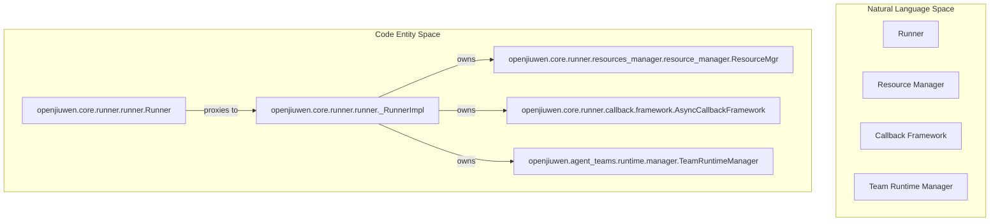
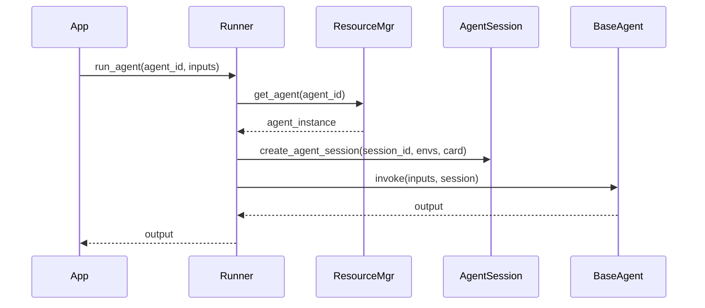

<!-- source: DeepWiki mcp.deepwiki.com · repo openJiuwen-ai/agent-core · page 2.5 Runner · fetched 2026-11-02 -->

# Runner

Relevant source files

The following files were used as context for generating this wiki page:

- [.gitignore](.gitignore)
- [Makefile](Makefile)
- [openjiuwen/agent_teams/agent/recovery_manager.py](openjiuwen/agent_teams/agent/recovery_manager.py)
- [openjiuwen/agent_teams/prompts/messages.py](openjiuwen/agent_teams/prompts/messages.py)
- [openjiuwen/agent_teams/runtime/manager.py](openjiuwen/agent_teams/runtime/manager.py)
- [openjiuwen/agent_teams/team_context.py](openjiuwen/agent_teams/team_context.py)
- [openjiuwen/core/common/exception/codes.py](openjiuwen/core/common/exception/codes.py)
- [openjiuwen/core/foundation/tool/mcp/client/openapi_client.py](openjiuwen/core/foundation/tool/mcp/client/openapi_client.py)
- [openjiuwen/core/memory/common/base.py](openjiuwen/core/memory/common/base.py)
- [openjiuwen/core/retrieval/__init__.py](openjiuwen/core/retrieval/__init__.py)
- [openjiuwen/core/runner/callback/decorator.py](openjiuwen/core/runner/callback/decorator.py)
- [openjiuwen/core/runner/callback/framework.py](openjiuwen/core/runner/callback/framework.py)
- [openjiuwen/core/runner/resources_manager/resource_manager.py](openjiuwen/core/runner/resources_manager/resource_manager.py)
- [openjiuwen/core/runner/resources_manager/tool_manager.py](openjiuwen/core/runner/resources_manager/tool_manager.py)
- [openjiuwen/core/runner/runner.py](openjiuwen/core/runner/runner.py)
- [openjiuwen/core/session/__init__.py](openjiuwen/core/session/__init__.py)
- [openjiuwen/core/session/agent.py](openjiuwen/core/session/agent.py)
- [openjiuwen/core/session/internal/workflow.py](openjiuwen/core/session/internal/workflow.py)
- [openjiuwen/core/session/session.py](openjiuwen/core/session/session.py)
- [openjiuwen/core/session/workflow.py](openjiuwen/core/session/workflow.py)
- [openjiuwen/core/single_agent/__init__.py](openjiuwen/core/single_agent/__init__.py)
- [openjiuwen/harness/image_modality_probe.py](openjiuwen/harness/image_modality_probe.py)
- [pyproject.toml](pyproject.toml)
- [tests/conftest.py](tests/conftest.py)
- [tests/system_tests/harness/conftest.py](tests/system_tests/harness/conftest.py)
- [tests/system_tests/runner/test_runner.py](tests/system_tests/runner/test_runner.py)
- [tests/system_tests/tune/test_prompt_tune.py](tests/system_tests/tune/test_prompt_tune.py)
- [tests/system_tests/workflow/test_real_workflow.py](tests/system_tests/workflow/test_real_workflow.py)
- [tests/test_logger.py](tests/test_logger.py)
- [tests/unit_tests/agent_teams/observability/test_team_observability_mock_llm.py](tests/unit_tests/agent_teams/observability/test_team_observability_mock_llm.py)
- [tests/unit_tests/agent_teams/test_runner_team_runtime.py](tests/unit_tests/agent_teams/test_runner_team_runtime.py)
- [tests/unit_tests/core/context_engine/conftest.py](tests/unit_tests/core/context_engine/conftest.py)
- [tests/unit_tests/core/context_engine/test_processor_imports.py](tests/unit_tests/core/context_engine/test_processor_imports.py)
- [tests/unit_tests/core/runner/callback/test_emit_sync.py](tests/unit_tests/core/runner/callback/test_emit_sync.py)
- [tests/unit_tests/core/runner/callback/test_framework_chain_breakdown.py](tests/unit_tests/core/runner/callback/test_framework_chain_breakdown.py)
- [tests/unit_tests/core/runner/callback/test_framework_generators.py](tests/unit_tests/core/runner/callback/test_framework_generators.py)
- [tests/unit_tests/core/runner/callback/test_framework_wrap.py](tests/unit_tests/core/runner/callback/test_framework_wrap.py)
- [tests/unit_tests/core/runner/callback/test_metaclass_callbacks.py](tests/unit_tests/core/runner/callback/test_metaclass_callbacks.py)
- [tests/unit_tests/core/runner/callback/test_runner_callback_framework.py](tests/unit_tests/core/runner/callback/test_runner_callback_framework.py)
- [tests/unit_tests/core/runner/callback/test_transform_io.py](tests/unit_tests/core/runner/callback/test_transform_io.py)
- [tests/unit_tests/harness/conftest.py](tests/unit_tests/harness/conftest.py)
- [uv.lock](uv.lock)

The `Runner` is the central execution coordinator for the openJiuwen agent-core SDK. It provides a singleton interface for managing the runtime environment lifecycle, registering resources via `ResourceMgr`, and dispatching execution to agents, workflows, and agent teams.

## Architecture

`Runner` is a static proxy class that delegates all calls to a process-level singleton, `GLOBAL_RUNNER`, which is an instance of `_RunnerImpl` [openjiuwen/core/runner/runner.py:657-687](). This design ensures that resource registries, message queues, and callback frameworks are shared across the application without requiring manual dependency injection.

**Runner Entity Mapping**

Sources: [openjiuwen/core/runner/runner.py:62-102](), [openjiuwen/core/runner/runner.py:657-687]()

---

## Lifecycle: Start and Stop

The `Runner` lifecycle must be managed to ensure background tasks (like message queue consumers) and resource connections (like MCP servers) are properly initialized and torn down.

### `start()`
`Runner.start()` initializes subsystems in the following order:
1.  **Checkpointer**: If `RunnerConfig.checkpointer_config` is provided, it initializes the persistence layer for session state via `CheckpointerFactory` [openjiuwen/core/runner/runner.py:284-293]().
2.  **Message Queue**: Starts the `LocalMessageQueue`. If `distributed_mode` is enabled, it also initializes the distributed MQ and a `ReplyTopicSubscription` [openjiuwen/core/runner/runner.py:303-330]().
3.  **Root Task Group**: Initializes an `anyio` task group for managing background task lifecycles [openjiuwen/core/runner/runner.py:152-170]().

### `stop()`
`Runner.stop()` performs a graceful shutdown:
1.  **Task Group**: Cancels the root task group and all associated background tasks [openjiuwen/core/runner/runner.py:171-197]().
2.  **Message Queue**: Deactivates MQ subscriptions and stops message queue background tasks [openjiuwen/core/runner/runner.py:335-342]().
3.  **Resource Release**: Calls `ResourceMgr.release()`, which triggers cleanup for all registered resources, including disconnecting MCP clients [openjiuwen/core/runner/runner.py:344-346]().

Sources: [openjiuwen/core/runner/runner.py:274-346](), [openjiuwen/core/runner/runner.py:152-197]()

---

## ResourceMgr

`ResourceMgr` (accessible via `Runner.resource_mgr`) is the registry for all components used by agents. It uses a `ResourceRegistry` for storage and a `TagMgr` for categorization.

### Resource Isolation with Tags
Every resource (Agent, Tool, Model, etc.) can be associated with one or more `Tag` objects. This allows for multi-tenant isolation or agent-specific tool scoping.

| Strategy | Description |
| :--- | :--- |
| `TagMatchStrategy.ALL` | Returns resources that possess **every** specified tag [openjiuwen/core/runner/resources_manager/base.py:23-23](). |
| `TagMatchStrategy.ANY` | Returns resources that possess **at least one** of the specified tags [openjiuwen/core/runner/resources_manager/base.py:24-24](). |

### Tool Management (`ToolMgr`)
The `ResourceMgr` delegates tool-logic to `ToolMgr`. It supports:
*   **Standard Tools**: Registered via `add_tool` [openjiuwen/core/runner/resources_manager/tool_manager.py:61-64]().
*   **MCP Servers**: Added via `add_tool_server`. It serializes registrations for the same `server_id` using `asyncio.Lock` to prevent race conditions during parallel agent initialization [openjiuwen/core/runner/resources_manager/tool_manager.py:104-135]().
*   **System Operations**: Integration with `SysOperationCard` to expose shell, code, or filesystem operations as tools [openjiuwen/core/runner/resources_manager/resource_manager.py:32-34]().

Sources: [openjiuwen/core/runner/resources_manager/resource_manager.py:68-132](), [openjiuwen/core/runner/resources_manager/tool_manager.py:39-135]()

---

## Execution Methods

The `Runner` provides high-level methods to execute agents, workflows, and teams, handling session creation and lifecycle hooks automatically.

### Agent Execution Flow
When `run_agent` or `run_agent_streaming` is called, the following sequence occurs:

Sources: [openjiuwen/core/runner/runner.py:438-466](), [openjiuwen/core/runner/runner.py:596-618]()

### Workflow Execution
Workflows can be executed via `run_workflow` or `run_workflow_streaming`. A key feature is the ability to pass an existing `AgentSession` into a workflow execution. The `Runner` will automatically convert it into a `WorkflowSession` using `create_workflow_session()`, allowing the workflow to share memory and context with the calling agent [openjiuwen/core/runner/runner.py:404-436]().

### Agent Team Execution
Agent teams are managed via the `TeamRuntimeManager`. The `Runner` dispatches `run_agent_team_streaming` calls which involve:
1.  **Activation**: Resolving the `TeamAgent` and session via `TeamRuntimeManager.activate` [openjiuwen/agent_teams/runtime/manager.py:115-174]().
2.  **Dispatch**: Deciding between `NEW_TEAM`, `COLD_RECOVER`, or `RESUME` actions based on the current session state [openjiuwen/agent_teams/runtime/dispatch.py:52-108]().
3.  **Finalization**: Settling the run cycle (pause vs stop) via `TeamRuntimeManager.finalize` [openjiuwen/agent_teams/runtime/manager.py:176-218]().

Sources: [openjiuwen/core/runner/runner.py:545-594](), [openjiuwen/agent_teams/runtime/manager.py:104-218]()

---

## Async Callback Framework

The `AsyncCallbackFramework` (accessible via `Runner.callback_framework`) is an event system used for observability, guardrails, and runtime modifications.

### Core Features
*   **Priority-based Execution**: Callbacks run based on priority; higher values run first [openjiuwen/core/runner/callback/framework.py:220-230]().
*   **Performance Monitoring**: Automatically logs "slow" callbacks if they exceed `SLOW_CALLBACK_SECONDS` (1.0s) or if the whole chain exceeds `SLOW_CALLBACK_CHAIN_SECONDS` (0.05s) [openjiuwen/core/runner/callback/framework.py:73-80]().
*   **IO Transformation**: Decorators like `transform_io` allow callbacks to modify inputs or outputs dynamically [openjiuwen/core/runner/callback/decorator.py:43-44]().
*   **Signature Matching**: Uses `_narrow_call` to trim arguments to match the specific callback signature, ensuring compatibility across different hook implementations [openjiuwen/core/runner/callback/framework.py:137-181]().

Sources: [openjiuwen/core/runner/callback/framework.py:212-250](), [openjiuwen/core/runner/callback/decorator.py:1-49]()

---

## RunnerConfig

`RunnerConfig` is a Pydantic model that configures the global runtime.

| Field | Type | Description |
| :--- | :--- | :--- |
| `distributed_mode` | `bool` | Whether to enable distributed message queue and remote agents [openjiuwen/core/runner/runner_config.py:34-34](). |
| `checkpointer_config` | `CheckpointerConfig` | Configuration for session state persistence [openjiuwen/core/runner/runner_config.py:37-37](). |
| `distributed_config` | `DistributedConfig` | MQ-specific settings (e.g., Pulsar, Redis) [openjiuwen/core/runner/runner_config.py:35-35](). |

Sources: [openjiuwen/core/runner/runner_config.py:31-40]()

---

