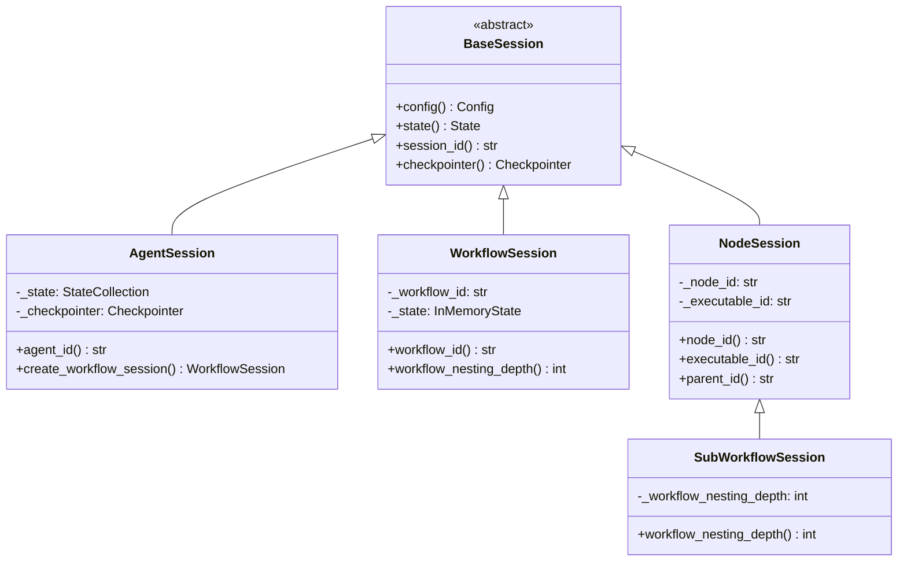
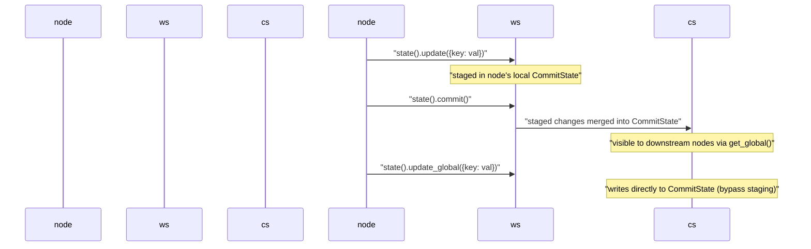
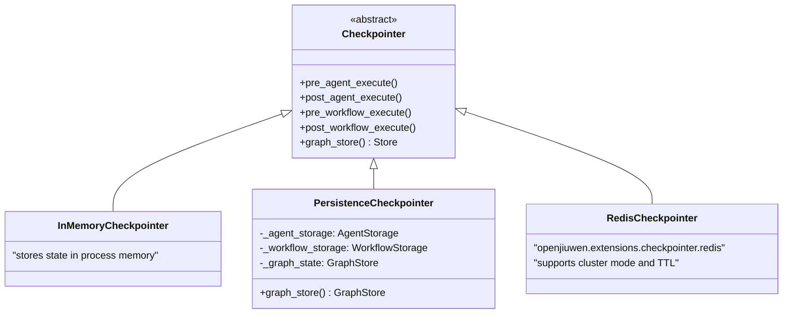
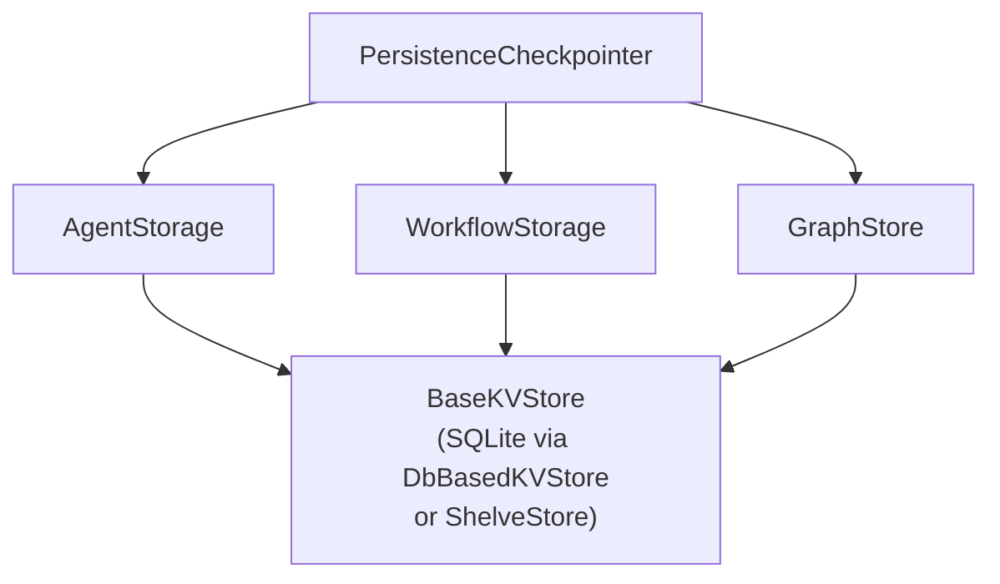
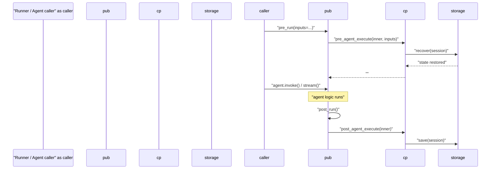
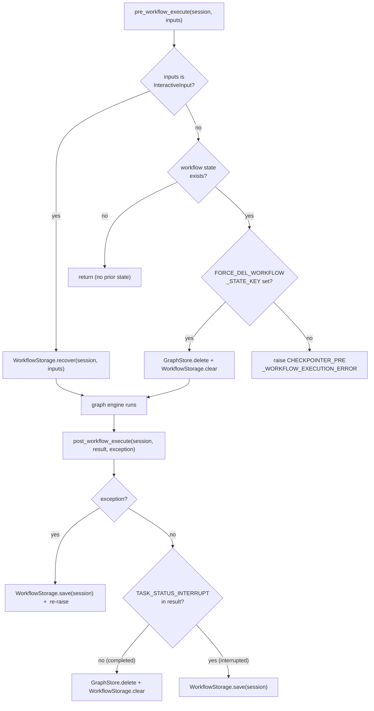

<!-- source: DeepWiki mcp.deepwiki.com · repo openJiuwen-ai/agent-core · page 2.6 Sessions and Checkpointing · fetched 2026-11-02 -->

# Sessions and Checkpointing

<details>
<summary>Relevant source files</summary>

The following files were used as context for generating this wiki page:

- [docs/en/2.Development Guide/Advanced Usage/Checkpointer Checkpoint Mechanism.md](docs/en/2.Development Guide/Advanced Usage/Checkpointer Checkpoint Mechanism.md)
- [openjiuwen/agent_teams/agent/recovery_manager.py](openjiuwen/agent_teams/agent/recovery_manager.py)
- [openjiuwen/agent_teams/runtime/manager.py](openjiuwen/agent_teams/runtime/manager.py)
- [openjiuwen/core/runner/callback/utils.py](openjiuwen/core/runner/callback/utils.py)
- [openjiuwen/core/runner/runner.py](openjiuwen/core/runner/runner.py)
- [openjiuwen/core/session/__init__.py](openjiuwen/core/session/__init__.py)
- [openjiuwen/core/session/agent.py](openjiuwen/core/session/agent.py)
- [openjiuwen/core/session/checkpointer/__init__.py](openjiuwen/core/session/checkpointer/__init__.py)
- [openjiuwen/core/session/checkpointer/base.py](openjiuwen/core/session/checkpointer/base.py)
- [openjiuwen/core/session/checkpointer/inmemory.py](openjiuwen/core/session/checkpointer/inmemory.py)
- [openjiuwen/core/session/checkpointer/persistence.py](openjiuwen/core/session/checkpointer/persistence.py)
- [openjiuwen/core/session/internal/workflow.py](openjiuwen/core/session/internal/workflow.py)
- [openjiuwen/core/session/node.py](openjiuwen/core/session/node.py)
- [openjiuwen/core/session/session.py](openjiuwen/core/session/session.py)
- [openjiuwen/core/session/state/agent_state.py](openjiuwen/core/session/state/agent_state.py)
- [openjiuwen/core/session/state/base.py](openjiuwen/core/session/state/base.py)
- [openjiuwen/core/session/state/workflow_state.py](openjiuwen/core/session/state/workflow_state.py)
- [openjiuwen/core/session/utils.py](openjiuwen/core/session/utils.py)
- [openjiuwen/core/session/workflow.py](openjiuwen/core/session/workflow.py)
- [openjiuwen/core/workflow/components/component.py](openjiuwen/core/workflow/components/component.py)
- [openjiuwen/extensions/checkpointer/redis/checkpointer.py](openjiuwen/extensions/checkpointer/redis/checkpointer.py)
- [openjiuwen/extensions/checkpointer/redis/storage.py](openjiuwen/extensions/checkpointer/redis/storage.py)
- [tests/unit_tests/agent_teams/test_runner_team_runtime.py](tests/unit_tests/agent_teams/test_runner_team_runtime.py)
- [tests/unit_tests/core/runner/test_resource_manager.py](tests/unit_tests/core/runner/test_resource_manager.py)
- [tests/unit_tests/core/session/checkpointer/test_inmemory_storage.py](tests/unit_tests/core/session/checkpointer/test_inmemory_storage.py)
- [tests/unit_tests/core/session/checkpointer/test_persistence_storage.py](tests/unit_tests/core/session/checkpointer/test_persistence_storage.py)
- [tests/unit_tests/core/session/test_session.py](tests/unit_tests/core/session/test_session.py)
- [tests/unit_tests/extensions/checkpointer/test_agent_storage.py](tests/unit_tests/extensions/checkpointer/test_agent_storage.py)

</details>


This page documents the `Session` hierarchy available to agents and workflow components, the `CommitState` model governing how workflow state is staged and committed, and the `Checkpointer` subsystem that persists and restores session state across execution boundaries.

For the Runner-level configuration that wires a `Checkpointer` into the execution environment, see [Runner](#2.5). For the graph execution engine's own internal `GraphState` abstraction, see [Graph Execution Engine](#4.4). For the KV-store backends that `PersistenceCheckpointer` sits on top of, see [Key-Value Stores](#12.1).

---

## Session Object Model

Every unit of work in the SDK (an agent invocation, a workflow run, or an individual component execution) operates inside a **session**. Sessions carry configuration, state, streaming writers, tracing, and a reference to the active `Checkpointer`.

### BaseSession — the core interface

`BaseSession` ([openjiuwen/core/session/session.py:17-48]()) is the abstract base class from which all concrete session types derive. It defines the complete surface area visible to the rest of the framework:

| Method | Returns | Role |
|---|---|---|
| `config()` | `Config` | Key/value environment variables for this invocation |
| `state()` | `State` | Read/write access to the session's data store |
| `tracer()` | `Any` | Workflow tracing handle |
| `stream_writer_manager()` | `StreamWriterManager` | Output/custom stream writers |
| `session_id()` | `str` | Unique session identifier |
| `checkpointer()` | `Checkpointer` | Active checkpoint implementation |

`ProxySession` ([openjiuwen/core/session/session.py:49-72]()) is a passthrough decorator over a `BaseSession`; it is used internally when a session reference needs to be swapped at runtime.

Sources: [openjiuwen/core/session/session.py:17-72]()

---

### Concrete Session Types

**Session type hierarchy:**



Sources: [openjiuwen/core/session/internal/agent.py:1-80](), [openjiuwen/core/session/internal/workflow.py:1-202]()

#### AgentSession

`AgentSession` ([openjiuwen/core/session/internal/agent.py:17-80]()) is the internal session created for each agent invocation. It owns:

- A `StateCollection` for agent-scoped state.
- A `StreamWriterManager` backed by a `StreamEmitter`.
- A `Checkpointer` resolved via `CheckpointerFactory.get_checkpointer()` at construction time (unless overridden).

Agents do not interact with `AgentSession` directly; they use the **public façade** `openjiuwen.core.session.agent.Session` ([openjiuwen/core/session/agent.py:32-163]()) which wraps it.

#### WorkflowSession

`WorkflowSession` ([openjiuwen/core/session/internal/workflow.py:33-97]()) is created by `AgentSession.create_workflow_session()` when an agent launches a workflow. It inherits `session_id` and `config` from the parent `AgentSession` and delegates `checkpointer()` back to it. It carries its own `InMemoryState` and a `workflow_id` string.

#### NodeSession

`NodeSession` ([openjiuwen/core/session/internal/workflow.py:31-31]()) represents execution context for a single graph node. Each node receives a `NodeSession` whose state is scoped to that node's `executable_id`, built as `parent_id + "." + node_id` for nested workflows. Commits to node state propagate to the parent `WorkflowSession` via `commit()`.

#### SubWorkflowSession

`SubWorkflowSession` ([openjiuwen/core/session/internal/workflow.py:32-32]()) extends `NodeSession` with an incremented `workflow_nesting_depth` counter. It is used when a workflow node is itself a workflow, allowing nested graph execution with correct state scoping.

Sources: [openjiuwen/core/session/internal/agent.py:17-80](), [openjiuwen/core/session/internal/workflow.py:31-97]()

---

### Public Session Façades

Components and agents are given higher-level session objects rather than direct `BaseSession` instances:

| Façade class | Module | Wraps | Used by |
|---|---|---|---|
| `agent.Session` | `openjiuwen.core.session.agent` | `AgentSession` | Single agents (`ReActAgent`, `LLMAgent`) |
| `workflow.Session` | `openjiuwen.core.session.workflow` | `BaseSession` (parent) | Workflow runners |

`agent.Session` exposes `get_state` / `update_state` ([openjiuwen/core/session/agent.py:178-182]()), streaming helpers (`write_stream`, `write_custom_stream`) ([openjiuwen/core/session/agent.py:187-192]()), lifecycle hooks (`pre_run`, `post_run`) ([openjiuwen/core/session/agent.py:206-232]()), and an `interact()` method for suspension points ([openjiuwen/core/session/agent.py:237-240]()).

#### Team and Cache Context
`Session` objects also manage KV cache affinity for multi-agent teams. `get_cache_identity` ([openjiuwen/core/session/agent.py:117-163]()) resolves the cache ID based on the session ID, parent session ID, or explicit team member scope set via `set_team_cache_scope` ([openjiuwen/core/session/agent.py:111-115]()).

Sources: [openjiuwen/core/session/agent.py:32-240](), [openjiuwen/core/session/workflow.py:20-20]()

---

### WrappedSession and RouterSession

`WrappedSession` ([openjiuwen/core/session/internal/wrapper.py:37-37]()) is an abstract base for objects that wrap a `BaseSession` and expose a typed surface to workflow component implementations. `RouterSession` ([openjiuwen/core/session/internal/wrapper.py:36-36]()) is used during intent routing where stream writes and state updates are intentionally suppressed.

Sources: [openjiuwen/core/session/internal/wrapper.py:36-37]()

---

## Workflow State and CommitState

State inside a workflow is structured as a two-layer commit model to support the graph execution engine's vertex-by-vertex incremental processing.

**State flow within a WorkflowSession:**



- `state().update(data)` ([openjiuwen/core/session/state/workflow_state.py:51-54]()) stages changes into the current node's local state.
- `state().commit()` ([openjiuwen/core/session/state/workflow_state.py:139-144]()) flushes staged changes into the shared `CommitState`.
- `state().update_global(data)` ([openjiuwen/core/session/state/workflow_state.py:43-46]()) writes directly to `CommitState`, bypassing the node's staging area.
- `state().get_global(key)` ([openjiuwen/core/session/state/workflow_state.py:33-41]()) reads from the committed global state visible to all nodes.

`CommitState` ([openjiuwen/core/session/state/workflow_state.py:82-181]()) is the object the graph execution engine serializes and restores at checkpoints. It manages `io_state`, `global_state`, `comp_state`, and `workflow_state` ([openjiuwen/core/session/state/workflow_state.py:85-98]()).

Sources: [openjiuwen/core/session/state/base.py:137-200](), [openjiuwen/core/session/state/workflow_state.py:82-181]()

---

## Checkpointer Subsystem

### Checkpointer Interface

`Checkpointer` ([openjiuwen/core/session/checkpointer/base.py]()) is an abstract class that defines lifecycle hooks for both agent and workflow execution.

**Agent lifecycle hooks:**

| Method | Trigger | Action |
|---|---|---|
| `pre_agent_execute(session, inputs)` | Before agent runs | Restore agent state from storage |
| `post_agent_execute(session)` | Agent completes | Save final agent state |

**Workflow lifecycle hooks:**

| Method | Trigger | Action |
|---|---|---|
| `pre_workflow_execute(session, inputs)` | Before workflow runs | Restore or clear workflow state |
| `post_workflow_execute(session, result, exception)` | Workflow completes/fails/interrupts | Save or clear workflow state |

Sources: [openjiuwen/core/session/checkpointer/base.py](), [openjiuwen/core/session/checkpointer/persistence.py:667-879]()

---

### CheckpointerFactory and CheckpointerConfig

`CheckpointerFactory` ([openjiuwen/core/session/checkpointer/checkpointer.py:60-126]()) is a registry-based factory that maps type names to `CheckpointerProvider` implementations.

`CheckpointerConfig` ([openjiuwen/core/session/checkpointer/checkpointer.py:41-52]()) is a Pydantic model:

```
CheckpointerConfig
  type: str         # "in_memory" | "persistence" | "redis"
  conf: dict        # type-specific configuration
```

Key factory methods:

| Method | Description |
|---|---|
| `CheckpointerFactory.register(name)` | Decorator to register a `CheckpointerProvider` under a name |
| `CheckpointerFactory.create(config)` | Async factory — creates a `Checkpointer` from a `CheckpointerConfig` |
| `CheckpointerFactory.get_checkpointer(store_type=None)` | Retrieve the active checkpointer |

`Runner` ([openjiuwen/core/runner/runner.py:35]()) uses `CheckpointerFactory` to wire the session persistence layer.

Sources: [openjiuwen/core/session/checkpointer/checkpointer.py:41-126](), [openjiuwen/core/runner/runner.py:35]()

---

### Checkpointer Implementations



| Implementation | Module | Storage | Best for |
|---|---|---|---|
| `InMemoryCheckpointer` | `openjiuwen.core.session.checkpointer.inmemory` | Process memory | Development/testing |
| `PersistenceCheckpointer` | `openjiuwen.core.session.checkpointer.persistence` | SQLite or Shelve | Single-machine production |
| `RedisCheckpointer` | `openjiuwen.extensions.checkpointer.redis` | Redis / Redis Cluster | Distributed production |

Sources: [openjiuwen/core/session/checkpointer/inmemory.py:23-30](), [openjiuwen/core/session/checkpointer/persistence.py:667-686](), [openjiuwen/extensions/checkpointer/redis/checkpointer.py]()

---

### PersistenceCheckpointer Internals

`PersistenceCheckpointer` composes internal storage objects, each derived from `BaseStorage` ([openjiuwen/core/session/checkpointer/persistence.py:62-78]()) and backed by a single `BaseKVStore` instance ([openjiuwen/core/foundation/store/kv/base.py]()):



Sources: [openjiuwen/core/session/checkpointer/persistence.py:62-686]()

#### Key namespace structure

All keys follow the pattern `session_id:namespace:entity_id:suffix`:

| Namespace constant | Value | Used by |
|---|---|---|
| `SESSION_NAMESPACE_AGENT` | `"agent"` | `AgentStorage` |
| `SESSION_NAMESPACE_WORKFLOW` | `"workflow"` | `WorkflowStorage` |
| `WORKFLOW_NAMESPACE_GRAPH` | `"workflow-graph"` | `GraphStore` |

Sources: [openjiuwen/core/session/checkpointer/persistence.py:53-58]()

#### AgentStorage

`AgentStorage` ([openjiuwen/core/session/checkpointer/persistence.py:114-263]()) serializes agent state using `pickle` into KV keys per (session, agent) pair. Operations use `BaseKVStore.pipeline()` for batched reads/writes ([openjiuwen/core/session/checkpointer/persistence.py:188-192]()).

#### WorkflowStorage

`WorkflowStorage` ([openjiuwen/core/session/checkpointer/persistence.py:266-493]()) saves both the current state snapshot and the pending updates list. The `recover()` method processes `InteractiveInput` ([openjiuwen/core/session/checkpointer/persistence.py:317-332]()).

Sources: [openjiuwen/core/session/checkpointer/persistence.py:114-664]()

---

### Team Runtime and Recovery

For multi-agent teams, the `TeamRuntimeManager` ([openjiuwen/agent_teams/runtime/manager.py:104-113]()) and `RecoveryManager` ([openjiuwen/agent_teams/agent/recovery_manager.py:22-30]()) handle session-scoped persistence for the whole team.

`RecoveryManager.persist_leader_config` ([openjiuwen/agent_teams/agent/recovery_manager.py:79-102]()) snapshots the `TeamAgentSpec`, `TeamRuntimeContext`, and `ModelAllocator` state into the session manifest via `write_team_namespace`.

Sources: [openjiuwen/agent_teams/runtime/manager.py:104-113](), [openjiuwen/agent_teams/agent/recovery_manager.py:22-102]()

---

## Checkpoint Lifecycle

### Agent Checkpoint Flow



Sources: [openjiuwen/core/session/agent.py:206-232](), [openjiuwen/core/session/checkpointer/persistence.py:687-720]()

### Workflow Checkpoint Flow



Sources: [openjiuwen/core/session/checkpointer/persistence.py:722-813](), [openjiuwen/core/session/checkpointer/inmemory.py:32-111]()

---

## Session Constants Reference

Key constants exported from `openjiuwen.core.session` that control execution-time behaviour:

| Constant | Purpose |
|---|---|
| `WORKFLOW_EXECUTE_TIMEOUT` | Max seconds a workflow execution may run |
| `WORKFLOW_STREAM_FIRST_FRAME_TIMEOUT` | Max seconds before first stream frame arrives |
| `WORKFLOW_STREAM_FRAME_TIMEOUT` | Max seconds between stream frames |
| `COMP_STREAM_CALL_TIMEOUT_KEY` | Per-component streaming call timeout |
| `LOOP_NUMBER_MAX_LIMIT_KEY` | Maximum iterations for `LoopComp` |
| `FORCE_DEL_WORKFLOW_STATE_KEY` | If truthy, stale workflow state is deleted instead of erroring |

Sources: [openjiuwen/core/session/constants.py:14-26]()

---

