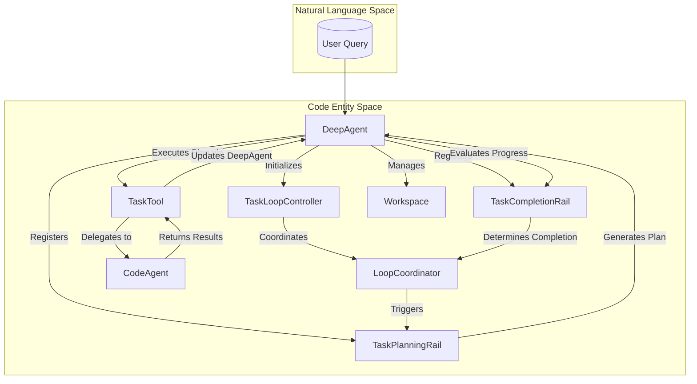

<!-- source: DeepWiki mcp.deepwiki.com · repo openJiuwen-ai/agent-core · page 3 DeepAgent and Harness · fetched 2026-11-02 -->

# DeepAgent and Harness

Relevant source files

The following files were used as context for generating this wiki page:

- [openjiuwen/agent_teams/harness/manifest/__init__.py](openjiuwen/agent_teams/harness/manifest/__init__.py)
- [openjiuwen/agent_teams/rails/builtin_elements.py](openjiuwen/agent_teams/rails/builtin_elements.py)
- [openjiuwen/agent_teams/rails/registration.py](openjiuwen/agent_teams/rails/registration.py)
- [openjiuwen/agent_teams/rails/subagent_elements.py](openjiuwen/agent_teams/rails/subagent_elements.py)
- [openjiuwen/agent_teams/schema/build_context.py](openjiuwen/agent_teams/schema/build_context.py)
- [openjiuwen/core/single_agent/ability_manager.py](openjiuwen/core/single_agent/ability_manager.py)
- [openjiuwen/core/single_agent/agent_callback_manager.py](openjiuwen/core/single_agent/agent_callback_manager.py)
- [openjiuwen/core/single_agent/agents/react_agent.py](openjiuwen/core/single_agent/agents/react_agent.py)
- [openjiuwen/core/single_agent/base.py](openjiuwen/core/single_agent/base.py)
- [openjiuwen/core/single_agent/rail/__init__.py](openjiuwen/core/single_agent/rail/__init__.py)
- [openjiuwen/core/single_agent/rail/base.py](openjiuwen/core/single_agent/rail/base.py)
- [openjiuwen/harness/deep_agent.py](openjiuwen/harness/deep_agent.py)
- [openjiuwen/harness/factory.py](openjiuwen/harness/factory.py)
- [openjiuwen/harness/prompts/sections/__init__.py](openjiuwen/harness/prompts/sections/__init__.py)
- [openjiuwen/harness/prompts/sections/skills.py](openjiuwen/harness/prompts/sections/skills.py)
- [openjiuwen/harness/prompts/tools/audio.py](openjiuwen/harness/prompts/tools/audio.py)
- [openjiuwen/harness/rails/__init__.py](openjiuwen/harness/rails/__init__.py)
- [openjiuwen/harness/rails/skills/skill_use_rail.py](openjiuwen/harness/rails/skills/skill_use_rail.py)
- [openjiuwen/harness/rails/subagent/verification_rail.py](openjiuwen/harness/rails/subagent/verification_rail.py)
- [openjiuwen/harness/rails/sys_operation_rail.py](openjiuwen/harness/rails/sys_operation_rail.py)
- [openjiuwen/harness/schema/config.py](openjiuwen/harness/schema/config.py)
- [openjiuwen/harness/subagents/__init__.py](openjiuwen/harness/subagents/__init__.py)
- [openjiuwen/harness/subagents/verification_agent.py](openjiuwen/harness/subagents/verification_agent.py)
- [openjiuwen/harness/tools/__init__.py](openjiuwen/harness/tools/__init__.py)
- [openjiuwen/harness/tools/agent_mode_tools.py](openjiuwen/harness/tools/agent_mode_tools.py)
- [openjiuwen/harness/tools/worktree/rails.py](openjiuwen/harness/tools/worktree/rails.py)
- [tests/system_tests/rail/test_force_finish_rail.py](tests/system_tests/rail/test_force_finish_rail.py)
- [tests/unit_tests/agent/react_agent/test_new_react_agent_mock.py](tests/unit_tests/agent/react_agent/test_new_react_agent_mock.py)
- [tests/unit_tests/core/single_agent/rail/test_rail.py](tests/unit_tests/core/single_agent/rail/test_rail.py)
- [tests/unit_tests/core/single_agent/rail/test_rail_init_timing.py](tests/unit_tests/core/single_agent/rail/test_rail_init_timing.py)
- [tests/unit_tests/harness/test_deep_agent.py](tests/unit_tests/harness/test_deep_agent.py)
- [tests/unit_tests/harness/test_filesystem_rail.py](tests/unit_tests/harness/test_filesystem_rail.py)
- [tests/unit_tests/harness/test_skill_rail.py](tests/unit_tests/harness/test_skill_rail.py)
- [tests/unit_tests/harness/test_verification_rail.py](tests/unit_tests/harness/test_verification_rail.py)

This page provides a high-level overview of the DeepAgent framework, which is built on top of the ReActAgent. It introduces the core components of the `harness` package, including the task loop, the rails system, sub-agents, workspace management, and the command-line interface (CLI). For detailed information on each of these topics, please refer to the linked child pages.

## DeepAgent Core

DeepAgent is a high-level agent that delegates to an internal `ReActAgent` for its core reasoning and action capabilities [openjiuwen/harness/deep_agent.py:208-209](). It extends the functionality of a standard ReActAgent by incorporating advanced features such as a task loop, a flexible rail system, and sub-agent orchestration. The `create_deep_agent` factory function is the primary entry point for constructing DeepAgent instances [openjiuwen/harness/factory.py:187-210](). Similarly, `create_code_agent` is a specialized factory for creating agents pre-configured for coding tasks [openjiuwen/harness/subagents/__init__.py:1-10]().

The behavior of a DeepAgent is governed by its `DeepAgentConfig`, which allows for extensive customization, including model selection, system prompts, tool integration, and sub-agent definitions [openjiuwen/harness/schema/config.py:164-210](). DeepAgent supports a task loop, enabled via `enable_task_loop`, which allows for iterative problem-solving [openjiuwen/harness/schema/config.py:188-189](). It also features a "plan mode" and "normal mode" managed via `AgentMode` to guide its behavior during complex execution phases [openjiuwen/harness/schema/agent_mode.py:1-10](). Sub-agent delegation is facilitated through the `TaskTool`, enabling DeepAgent to orchestrate specialized sub-agents for specific tasks [openjiuwen/harness/tools/__init__.py:51-53](). The `Workspace` abstraction provides a structured environment for file operations and project management [openjiuwen/harness/workspace/workspace.py:1-10]().

For details, see [DeepAgent Core](#3.1).

Sources:
- [openjiuwen/harness/deep_agent.py:208-209]()
- [openjiuwen/harness/factory.py:187-210]()
- [openjiuwen/harness/schema/config.py:164-210]()
- [openjiuwen/harness/schema/config.py:188-189]()
- [openjiuwen/harness/tools/__init__.py:51-53]()

## Harness Rails

The harness rail system provides a powerful mechanism for intercepting and modifying the agent's lifecycle events. `DeepAgentRail` serves as the base class for all rails within the harness [openjiuwen/harness/rails/base.py:25-26](). These rails allow developers to inject custom logic at various stages, such as before or after tool calls, model invocations, or task iterations [openjiuwen/core/single_agent/rail/base.py:6-9]().

The framework includes a comprehensive set of built-in rails designed to handle common agent functionalities:
- `TaskPlanningRail` and `TaskCompletionRail`: Manage the planning and completion phases of tasks [openjiuwen/harness/factory.py:27-28]().
- `SysOperationRail`: Integrates system operations, allowing the agent to interact with the underlying OS [openjiuwen/harness/rails/sys_operation_rail.py:1-10]().
- `SkillUseRail`: Manages skill prompt injection and tool registration from a `skills_dir` [openjiuwen/harness/rails/skills/skill_use_rail.py:36-38]().
- `SecurityRail`: Enforces security policies and manages permissions [openjiuwen/harness/factory.py:23]().
- `EvolutionRail` and `SkillEvolutionRail`: Support the agent's ability to learn and evolve skills over time.
- `AgentModeRail`: Manages the agent's operational mode, such as "plan" or "normal".

These rails intercept various `AgentCallbackEvent`s, such as `BEFORE_INVOKE`, `BEFORE_MODEL_CALL`, and `BEFORE_TOOL_CALL` [openjiuwen/core/single_agent/rail/base.py:152-205]().

For details, see [Harness Rails](#3.2).

Sources:
- [openjiuwen/harness/rails/base.py:25-26]()
- [openjiuwen/core/single_agent/rail/base.py:6-9]()
- [openjiuwen/harness/rails/skills/skill_use_rail.py:36-38]()
- [openjiuwen/core/single_agent/rail/base.py:152-205]()

## Harness Tools

The `harness` package provides a rich set of built-in tools registered with the agent via `ToolCard` entries in `DeepAgentConfig.tools` [openjiuwen/harness/schema/config.py:164-210](). The `SessionToolkit` acts as a registry for session-specific tools [openjiuwen/harness/tools/__init__.py:50]().

Key categories of tools include:
- **Filesystem Tools**: `ReadFileTool`, `WriteFileTool`, `EditFileTool`, `GlobTool`, `ListDirTool`, `GrepTool` [openjiuwen/harness/tools/__init__.py:23-30]().
- **Web Tools**: `WebFetchWebpageTool`, `WebFreeSearchTool`, `WebPaidSearchTool` [openjiuwen/harness/tools/__init__.py:64-68]().
- **Shell/Code Tools**: `BashTool`, `PowerShellTool`, `CodeTool` [openjiuwen/harness/tools/__init__.py:17-42]().
- **Todo/Task Tools**: `TodoTool` and `TaskTool` for managing tasks and sub-agent spawning [openjiuwen/harness/tools/__init__.py:51-60]().
- **HITL**: `AskUserTool` for prompting the user for input [openjiuwen/harness/tools/__init__.py:15]().
- **Multimodal Tools**: `ImageOCRTool`, `VisualQuestionAnsweringTool`, `AudioTranscriptionTool` [openjiuwen/harness/tools/__init__.py:32-41]().

For details, see [Harness Tools](#3.3).

Sources:
- [openjiuwen/harness/tools/__init__.py:15-68]()
- [openjiuwen/harness/tools/__init__.py:50]()

## Sub-Agents and Task Loop

DeepAgent leverages a sub-agent system to handle complex tasks by delegating responsibilities to specialized agents. Key sub-agents include:
- `ExploreAgent`: Designed for initial understanding and exploration.
- `PlanAgent`: Focuses on designing implementation approaches.
- `CodeAgent`: Specializes in translating tasks into runnable code [openjiuwen/harness/subagents/code_agent.py:1-10]().
- `ResearchAgent`: For conducting research and gathering information.

The `TaskLoopController` and `LoopCoordinator` manage the execution flow of tasks [openjiuwen/harness/deep_agent.py:78-86](). The task loop allows DeepAgent to iteratively process tasks, plan, execute, and refine its approach. DeepAgent delegates tasks to sub-agents using the `TaskTool`, which allows it to spawn and manage sub-agent sessions [openjiuwen/harness/tools/__init__.py:51-53]().

For details, see [Sub-Agents and Task Loop](#3.4).

Sources:
- [openjiuwen/harness/deep_agent.py:78-86]()
- [openjiuwen/harness/tools/__init__.py:51-53]()

## CLI and Auto-Harness

The `openjiuwen` command-line interface (CLI) provides a way to interact with agents via commands like `chat` and `run`. The Auto-Harness framework is designed for autonomous optimization of agents, implementing an assess/plan/implement/verify pipeline. It utilizes the `EvolutionStore` to store agent experiences and trajectories for learning [openjiuwen/harness/rails/skills/skill_use_rail.py:28]().

For details, see [CLI and Auto-Harness](#3.5).

Sources:
- [openjiuwen/harness/rails/skills/skill_use_rail.py:28]()

## DeepAgent Architecture Overview

The following diagram illustrates the high-level architecture of DeepAgent and its interaction with various components within the `harness` package.

```mermaid
graph TD
    subgraph "Natural Language Space"
        UserRequest[("User Request")]
    end

    subgraph "Code Entity Space"
        UserRequest --> DeepAgent["DeepAgent (openjiuwen/harness/deep_agent.py)"]

        DeepAgent -- "Configures with" --> DeepAgentConfig["DeepAgentConfig (openjiuwen/harness/schema/config.py)"]
        DeepAgentConfig -- "Defines" --> AgentCard["AgentCard (openjiuwen/core/single_agent/schema/agent_card.py)"]
        DeepAgentConfig -- "Includes" --> Tools["List[Tool | ToolCard]"]
        DeepAgentConfig -- "Includes" --> SubAgents["List[SubAgentConfig]"]
        DeepAgentConfig -- "Includes" --> Rails["List[AgentRail]"]
        DeepAgentConfig -- "Manages" --> Workspace["Workspace (openjiuwen/harness/workspace/workspace.py)"]

        DeepAgent -- "Delegates to" --> ReActAgent["ReActAgent (openjiuwen/core/single_agent/agents/react_agent.py)"]
        DeepAgent -- "Orchestrates" --> TaskLoopController["TaskLoopController (openjiuwen/harness/task_loop/task_loop_controller.py)"]
        DeepAgent -- "Uses" --> LoopCoordinator["LoopCoordinator (openjiuwen/harness/task_loop/loop_coordinator.py)"]

        DeepAgent -- "Interacts with" --> HarnessRails["Harness Rails"]
        HarnessRails -- "Base Class" --> DeepAgentRail["DeepAgentRail (openjiuwen/harness/rails/base.py)"]
        HarnessRails -- "Examples" --> SysOperationRail["SysOperationRail (openjiuwen/harness/rails/sys_operation_rail.py)"]
        HarnessRails -- "Examples" --> SkillUseRail["SkillUseRail (openjiuwen/harness/rails/skills/skill_use_rail.py)"]

        DeepAgent -- "Utilizes" --> HarnessTools["Harness Tools (openjiuwen/harness/tools/__init__.py)"]
        HarnessTools -- "Examples" --> ReadFileTool["ReadFileTool"]
        HarnessTools -- "Examples" --> BashTool["BashTool"]
        HarnessTools -- "Examples" --> TaskTool["TaskTool"]
        HarnessTools -- "Managed by" --> SessionToolkit["SessionToolkit"]

        TaskTool -- "Spawns" --> CodeAgent["CodeAgent (openjiuwen/harness/subagents/code_agent.py)"]
    end
```

Sources:
- [openjiuwen/harness/deep_agent.py:208-209]()
- [openjiuwen/harness/schema/config.py:164-210]()
- [openjiuwen/harness/rails/base.py:25-26]()
- [openjiuwen/harness/tools/__init__.py:1-143]()

## DeepAgent Task Loop and Sub-Agent Delegation

The following diagram illustrates the flow of control and data within the DeepAgent's task loop.

Sources:
- [openjiuwen/harness/deep_agent.py:78-86]()
- [openjiuwen/harness/tools/__init__.py:51-53]()
- [openjiuwen/harness/workspace/workspace.py:1-10]()

---

