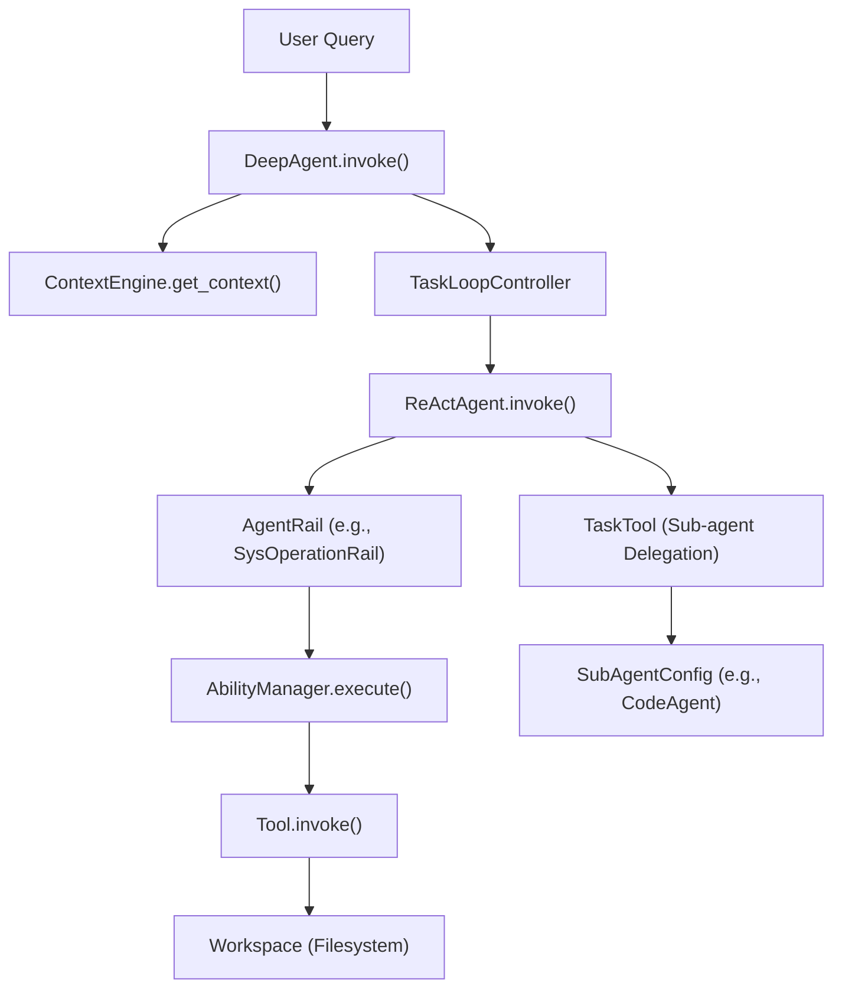
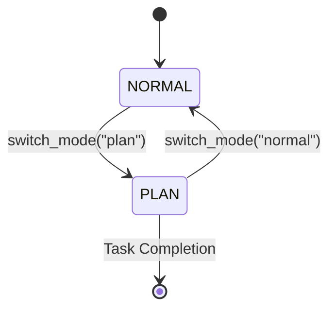

<!-- source: DeepWiki mcp.deepwiki.com · repo openJiuwen-ai/agent-core · page 3.1 DeepAgent Core · fetched 2026-11-02 -->

# DeepAgent Core

Relevant source files

The following files were used as context for generating this wiki page:

- [openjiuwen/agent_teams/docs/features/F_45_tiny-agent.md](openjiuwen/agent_teams/docs/features/F_45_tiny-agent.md)
- [openjiuwen/agent_teams/schema/__init__.py](openjiuwen/agent_teams/schema/__init__.py)
- [openjiuwen/agent_teams/schema/deep_agent_spec.py](openjiuwen/agent_teams/schema/deep_agent_spec.py)
- [openjiuwen/agent_teams/team_workspace/__init__.py](openjiuwen/agent_teams/team_workspace/__init__.py)
- [openjiuwen/agent_teams/team_workspace/manager.py](openjiuwen/agent_teams/team_workspace/manager.py)
- [openjiuwen/agent_teams/team_workspace/models.py](openjiuwen/agent_teams/team_workspace/models.py)
- [openjiuwen/agent_teams/team_workspace/rails.py](openjiuwen/agent_teams/team_workspace/rails.py)
- [openjiuwen/agent_teams/team_workspace/tools.py](openjiuwen/agent_teams/team_workspace/tools.py)
- [openjiuwen/agent_teams/tiny_agent.py](openjiuwen/agent_teams/tiny_agent.py)
- [openjiuwen/agent_teams/workspace_layout.py](openjiuwen/agent_teams/workspace_layout.py)
- [openjiuwen/core/single_agent/ability_manager.py](openjiuwen/core/single_agent/ability_manager.py)
- [openjiuwen/core/single_agent/agent_callback_manager.py](openjiuwen/core/single_agent/agent_callback_manager.py)
- [openjiuwen/core/single_agent/agents/react_agent.py](openjiuwen/core/single_agent/agents/react_agent.py)
- [openjiuwen/core/single_agent/base.py](openjiuwen/core/single_agent/base.py)
- [openjiuwen/core/single_agent/rail/__init__.py](openjiuwen/core/single_agent/rail/__init__.py)
- [openjiuwen/core/single_agent/rail/base.py](openjiuwen/core/single_agent/rail/base.py)
- [openjiuwen/harness/deep_agent.py](openjiuwen/harness/deep_agent.py)
- [openjiuwen/harness/factory.py](openjiuwen/harness/factory.py)
- [openjiuwen/harness/prompts/sections/skills.py](openjiuwen/harness/prompts/sections/skills.py)
- [openjiuwen/harness/rails/skills/skill_use_rail.py](openjiuwen/harness/rails/skills/skill_use_rail.py)
- [openjiuwen/harness/rails/subagent/verification_rail.py](openjiuwen/harness/rails/subagent/verification_rail.py)
- [openjiuwen/harness/rails/sys_operation_rail.py](openjiuwen/harness/rails/sys_operation_rail.py)
- [openjiuwen/harness/schema/config.py](openjiuwen/harness/schema/config.py)
- [openjiuwen/harness/schema/deep_agent_spec.py](openjiuwen/harness/schema/deep_agent_spec.py)
- [openjiuwen/harness/tools/shell/bash/_semantics.py](openjiuwen/harness/tools/shell/bash/_semantics.py)
- [openjiuwen/harness/tools/worktree/rails.py](openjiuwen/harness/tools/worktree/rails.py)
- [openjiuwen/harness/workspace/workspace.py](openjiuwen/harness/workspace/workspace.py)
- [tests/system_tests/rail/test_force_finish_rail.py](tests/system_tests/rail/test_force_finish_rail.py)
- [tests/unit_tests/agent/react_agent/test_new_react_agent_mock.py](tests/unit_tests/agent/react_agent/test_new_react_agent_mock.py)
- [tests/unit_tests/agent_teams/reliability/__init__.py](tests/unit_tests/agent_teams/reliability/__init__.py)
- [tests/unit_tests/agent_teams/reliability/conftest.py](tests/unit_tests/agent_teams/reliability/conftest.py)
- [tests/unit_tests/agent_teams/reliability/test_detectors.py](tests/unit_tests/agent_teams/reliability/test_detectors.py)
- [tests/unit_tests/agent_teams/reliability/test_handler.py](tests/unit_tests/agent_teams/reliability/test_handler.py)
- [tests/unit_tests/agent_teams/reliability/test_integration.py](tests/unit_tests/agent_teams/reliability/test_integration.py)
- [tests/unit_tests/agent_teams/reliability/test_pingpong.py](tests/unit_tests/agent_teams/reliability/test_pingpong.py)
- [tests/unit_tests/agent_teams/reliability/test_rail.py](tests/unit_tests/agent_teams/reliability/test_rail.py)
- [tests/unit_tests/agent_teams/reliability/test_rail_lifecycle.py](tests/unit_tests/agent_teams/reliability/test_rail_lifecycle.py)
- [tests/unit_tests/agent_teams/reliability/test_remediation.py](tests/unit_tests/agent_teams/reliability/test_remediation.py)
- [tests/unit_tests/agent_teams/reliability/test_reporter.py](tests/unit_tests/agent_teams/reliability/test_reporter.py)
- [tests/unit_tests/agent_teams/reliability/test_window.py](tests/unit_tests/agent_teams/reliability/test_window.py)
- [tests/unit_tests/agent_teams/team_workspace/__init__.py](tests/unit_tests/agent_teams/team_workspace/__init__.py)
- [tests/unit_tests/agent_teams/team_workspace/test_manager.py](tests/unit_tests/agent_teams/team_workspace/test_manager.py)
- [tests/unit_tests/agent_teams/team_workspace/test_models.py](tests/unit_tests/agent_teams/team_workspace/test_models.py)
- [tests/unit_tests/agent_teams/test_paths.py](tests/unit_tests/agent_teams/test_paths.py)
- [tests/unit_tests/agent_teams/test_tiny_agent.py](tests/unit_tests/agent_teams/test_tiny_agent.py)
- [tests/unit_tests/agent_teams/test_workspace_layout.py](tests/unit_tests/agent_teams/test_workspace_layout.py)
- [tests/unit_tests/agent_teams/workflow/test_runner.py](tests/unit_tests/agent_teams/workflow/test_runner.py)
- [tests/unit_tests/core/single_agent/rail/test_rail.py](tests/unit_tests/core/single_agent/rail/test_rail.py)
- [tests/unit_tests/core/single_agent/rail/test_rail_init_timing.py](tests/unit_tests/core/single_agent/rail/test_rail_init_timing.py)
- [tests/unit_tests/harness/test_deep_agent.py](tests/unit_tests/harness/test_deep_agent.py)
- [tests/unit_tests/harness/test_deep_agent_workspace.py](tests/unit_tests/harness/test_deep_agent_workspace.py)
- [tests/unit_tests/harness/test_filesystem_rail.py](tests/unit_tests/harness/test_filesystem_rail.py)
- [tests/unit_tests/harness/test_skill_rail.py](tests/unit_tests/harness/test_skill_rail.py)
- [tests/unit_tests/harness/test_workspace_links.py](tests/unit_tests/harness/test_workspace_links.py)
- [tests/unit_tests/harness/tools/test_bash/test_semantics.py](tests/unit_tests/harness/tools/test_bash/test_semantics.py)

`DeepAgent` is a high-level agent framework built on top of `ReActAgent`. It introduces an autonomous task loop, sophisticated state management for planning and execution modes, and a robust workspace abstraction. It serves as the primary engine for complex, multi-step reasoning tasks that require tool usage, sub-agent delegation, and persistent environment interaction.

## Overview and Architecture

`DeepAgent` functions by wrapping an internal `ReActAgent` and extending its capabilities through a system of "Rails" and specialized controllers. It manages the transition between high-level task planning and concrete execution.

### Key Components

*   **DeepAgent**: The core class managing the lifecycle of the internal `ReActAgent` [openjiuwen/harness/deep_agent.py:208-212](). It bridges lifecycle events like `BEFORE_MODEL_CALL` and `AFTER_TOOL_CALL` to the inner agent [openjiuwen/harness/deep_agent.py:146-162]().
*   **DeepAgentConfig**: A comprehensive configuration object covering LLM models, identity cards, tools, sub-agents, and operational parameters [openjiuwen/harness/schema/config.py:164-206]().
*   **Task Loop**: Managed by `TaskLoopController` and `LoopCoordinator`, this system handles iterative task execution, event queuing, and goal management [openjiuwen/harness/deep_agent.py:78-86]().
*   **Workspace**: An abstraction for the filesystem environment where the agent operates, including support for memory, skills, and plans [openjiuwen/harness/workspace/workspace.py:82-97]().

### Data Flow: Natural Language to Code Entity

The following diagram illustrates how a natural language request is transformed into code-level executions within the `DeepAgent` ecosystem.

**DeepAgent Execution Flow**

Sources: [openjiuwen/harness/deep_agent.py:208-250](), [openjiuwen/core/single_agent/ability_manager.py:87-111](), [openjiuwen/harness/workspace/workspace.py:82-97]()

## Agent Factories

The SDK provides factory functions for instantiating agents with pre-configured behaviors and rails.

### `create_deep_agent`
This factory produces a `DeepAgent` instance by resolving its parts (config, rails, tools). It automatically injects essential rails such as `SecurityRail`, `SysOperationRail`, and `TaskPlanningRail` [openjiuwen/harness/factory.py:187-206]().

### `create_code_agent`
A specialized factory tailored for software engineering. It pre-configures a `DeepAgent` with:
*   **Sub-agents**: Includes `ExploreAgent` and `PlanAgent` for codebase navigation [tests/unit_tests/harness/test_deep_agent.py:47-51]().
*   **Specialized Prompts**: Uses `DEFAULT_CODE_AGENT_SYSTEM_PROMPT` focused on technical implementation [tests/unit_tests/harness/test_deep_agent.py:52-55]().

Sources: [openjiuwen/harness/factory.py:161-206](), [tests/unit_tests/harness/test_deep_agent.py:47-55]()

## Task Loop and Modes

`DeepAgent` supports an extended execution model beyond a single ReAct turn.

### enable_task_loop
When `enable_task_loop` is set to `True` in `DeepAgentConfig`, the agent uses a `TaskLoopController` to manage iterative execution [openjiuwen/harness/schema/config.py:188-189](). This enables the agent to process `FollowUpEvent` and `TaskInteractionEvent` signals [openjiuwen/harness/deep_agent.py:38-41]().

### Plan vs. Normal Mode
The agent operates in distinct modes to separate architectural thinking from implementation.

| Mode | Description | Constraints |
| :--- | :--- | :--- |
| **NORMAL** | Standard execution mode. | Full tool access (read/write). |
| **PLAN** | Planning-only mode. | Restricted toolset; focus on generating plan artifacts. |

**Mode Transition Logic**

Sources: [openjiuwen/harness/deep_agent.py:121-122](), [openjiuwen/harness/rails/task_completion_rail.py:68-70]()

## Sub-agent Delegation via TaskTool

`DeepAgent` can delegate complex sub-tasks to specialized agents using the `TaskTool`.

*   **Delegation**: The parent agent utilizes `SubagentRail` to manage the lifecycle of sub-agents [openjiuwen/harness/factory.py:25-28]().
*   **Configuration**: Sub-agents are defined via `SubAgentConfig`, which includes their own `AgentCard`, `Model`, and specific `tools` or `skills` [openjiuwen/harness/schema/config.py:208-232]().
*   **Execution**: Sub-agents can be spawned synchronously (TaskTool) or asynchronously depending on `enable_async_subagent` [openjiuwen/harness/schema/config.py:190-192]().

Sources: [openjiuwen/harness/schema/config.py:208-232](), [openjiuwen/harness/factory.py:118-158]()

## Workspace Abstraction

The `Workspace` class manages the filesystem environment, providing a structured layout for agent operations [openjiuwen/harness/workspace/workspace.py:82-97]().

### Key Features
*   **Hot-Reloading**: `SkillUseRail` supports reloading skills from `skills_dir` dynamically [openjiuwen/harness/rails/skills/skill_use_rail.py:127-132](). It uses an incremental refresh mechanism to load updated `SKILL.md` files [openjiuwen/harness/rails/skills/skill_use_rail.py:151-153]().
*   **Tool Management**: `AbilityManager` handles the registration and execution of tools, including MCP servers [openjiuwen/core/single_agent/ability_manager.py:87-106](). It supports resource-locking for file operations to prevent race conditions [openjiuwen/core/single_agent/ability_manager.py:184-190]().
*   **Skill Integration**: `SkillUseRail` manages skill prompt injection and tool registration based on `skill_mode` (e.g., `all` or `auto_list`) [openjiuwen/harness/rails/skills/skill_use_rail.py:36-66]().

Sources: [openjiuwen/harness/workspace/workspace.py:82-153](), [openjiuwen/harness/rails/skills/skill_use_rail.py:127-168](), [openjiuwen/core/single_agent/ability_manager.py:87-111]()

---

