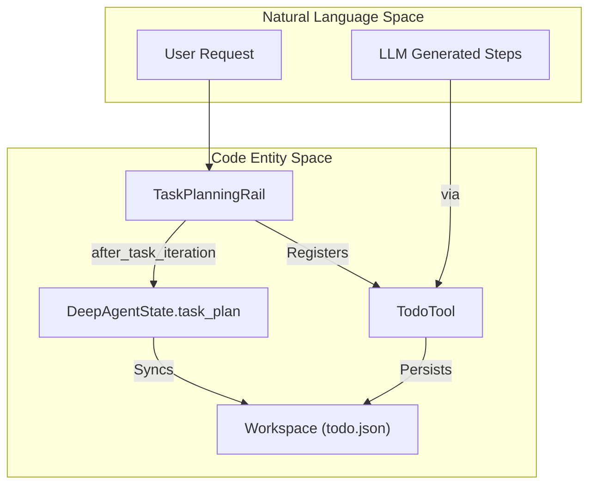
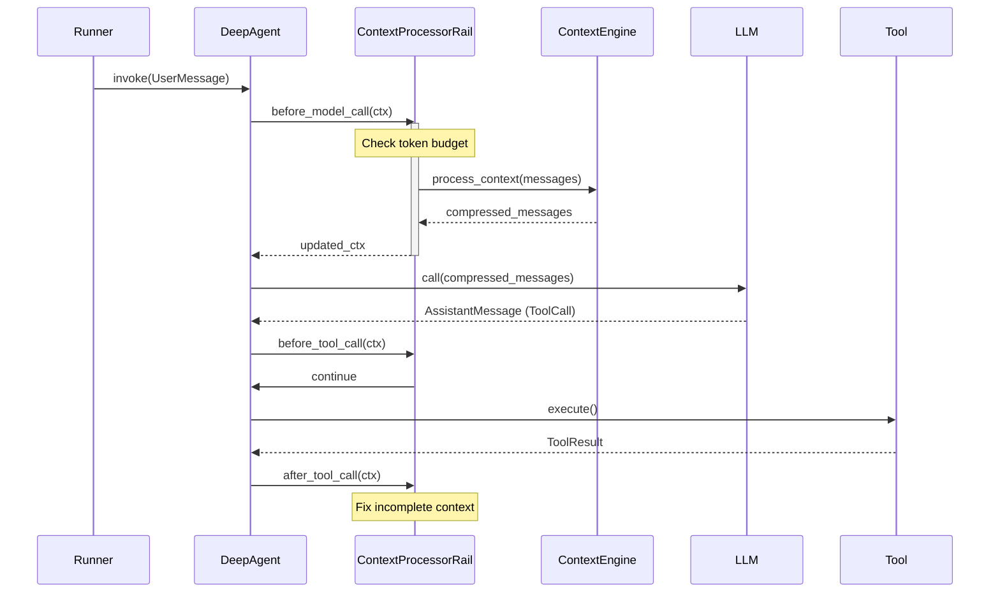

<!-- source: DeepWiki mcp.deepwiki.com · repo openJiuwen-ai/agent-core · page 3.2 Harness Rails · fetched 2026-11-02 -->

# Harness Rails

Relevant source files

The following files were used as context for generating this wiki page:

- [docs/en/2.Development Guide/Agents/Building LSP Agent en.md](docs/en/2.Development Guide/Agents/Building LSP Agent en.md)
- [examples/lsp/deep_agent_lsp_demo.py](examples/lsp/deep_agent_lsp_demo.py)
- [openjiuwen/agent_evolving/agent_rl/__init__.py](openjiuwen/agent_evolving/agent_rl/__init__.py)
- [openjiuwen/agent_evolving/agent_rl/rl_rail.py](openjiuwen/agent_evolving/agent_rl/rl_rail.py)
- [openjiuwen/agent_teams/prompts/cn/team_plan_agent.md](openjiuwen/agent_teams/prompts/cn/team_plan_agent.md)
- [openjiuwen/agent_teams/prompts/cn/team_plan_mode.md](openjiuwen/agent_teams/prompts/cn/team_plan_mode.md)
- [openjiuwen/agent_teams/prompts/en/team_plan_agent.md](openjiuwen/agent_teams/prompts/en/team_plan_agent.md)
- [openjiuwen/agent_teams/prompts/en/team_plan_mode.md](openjiuwen/agent_teams/prompts/en/team_plan_mode.md)
- [openjiuwen/agent_teams/prompts/team_plan_agent.py](openjiuwen/agent_teams/prompts/team_plan_agent.py)
- [openjiuwen/agent_teams/prompts/team_plan_mode.py](openjiuwen/agent_teams/prompts/team_plan_mode.py)
- [openjiuwen/agent_teams/rails/team_plan_mode_rail.py](openjiuwen/agent_teams/rails/team_plan_mode_rail.py)
- [openjiuwen/core/single_agent/ability_manager.py](openjiuwen/core/single_agent/ability_manager.py)
- [openjiuwen/core/single_agent/agent_callback_manager.py](openjiuwen/core/single_agent/agent_callback_manager.py)
- [openjiuwen/core/single_agent/agents/react_agent.py](openjiuwen/core/single_agent/agents/react_agent.py)
- [openjiuwen/core/single_agent/base.py](openjiuwen/core/single_agent/base.py)
- [openjiuwen/core/single_agent/rail/__init__.py](openjiuwen/core/single_agent/rail/__init__.py)
- [openjiuwen/core/single_agent/rail/base.py](openjiuwen/core/single_agent/rail/base.py)
- [openjiuwen/harness/deep_agent.py](openjiuwen/harness/deep_agent.py)
- [openjiuwen/harness/factory.py](openjiuwen/harness/factory.py)
- [openjiuwen/harness/lsp/__init__.py](openjiuwen/harness/lsp/__init__.py)
- [openjiuwen/harness/lsp/core/client.py](openjiuwen/harness/lsp/core/client.py)
- [openjiuwen/harness/lsp/core/instance.py](openjiuwen/harness/lsp/core/instance.py)
- [openjiuwen/harness/lsp/core/manager.py](openjiuwen/harness/lsp/core/manager.py)
- [openjiuwen/harness/lsp/core/utils/file_uri.py](openjiuwen/harness/lsp/core/utils/file_uri.py)
- [openjiuwen/harness/lsp/servers/registry.py](openjiuwen/harness/lsp/servers/registry.py)
- [openjiuwen/harness/lsp/servers/servers/python.py](openjiuwen/harness/lsp/servers/servers/python.py)
- [openjiuwen/harness/prompts/builder.py](openjiuwen/harness/prompts/builder.py)
- [openjiuwen/harness/prompts/prompt_attachment_manager.py](openjiuwen/harness/prompts/prompt_attachment_manager.py)
- [openjiuwen/harness/prompts/sections/agent_mode.py](openjiuwen/harness/prompts/sections/agent_mode.py)
- [openjiuwen/harness/prompts/sections/context.py](openjiuwen/harness/prompts/sections/context.py)
- [openjiuwen/harness/prompts/sections/heartbeat.py](openjiuwen/harness/prompts/sections/heartbeat.py)
- [openjiuwen/harness/prompts/sections/memory.py](openjiuwen/harness/prompts/sections/memory.py)
- [openjiuwen/harness/prompts/sections/prompt_attachments.py](openjiuwen/harness/prompts/sections/prompt_attachments.py)
- [openjiuwen/harness/prompts/sections/skills.py](openjiuwen/harness/prompts/sections/skills.py)
- [openjiuwen/harness/prompts/sections/task_tool.py](openjiuwen/harness/prompts/sections/task_tool.py)
- [openjiuwen/harness/prompts/sections/todo.py](openjiuwen/harness/prompts/sections/todo.py)
- [openjiuwen/harness/prompts/sections/workspace.py](openjiuwen/harness/prompts/sections/workspace.py)
- [openjiuwen/harness/prompts/tools/agent_mode.py](openjiuwen/harness/prompts/tools/agent_mode.py)
- [openjiuwen/harness/prompts/tools/cron.py](openjiuwen/harness/prompts/tools/cron.py)
- [openjiuwen/harness/prompts/tools/session_tools.py](openjiuwen/harness/prompts/tools/session_tools.py)
- [openjiuwen/harness/prompts/tools/task_tool.py](openjiuwen/harness/prompts/tools/task_tool.py)
- [openjiuwen/harness/prompts/tools/todo.py](openjiuwen/harness/prompts/tools/todo.py)
- [openjiuwen/harness/prompts/workspace_content/cn/AGENT.md](openjiuwen/harness/prompts/workspace_content/cn/AGENT.md)
- [openjiuwen/harness/prompts/workspace_content/en/AGENT.md](openjiuwen/harness/prompts/workspace_content/en/AGENT.md)
- [openjiuwen/harness/prompts/workspace_content/workspace_header.py](openjiuwen/harness/prompts/workspace_content/workspace_header.py)
- [openjiuwen/harness/rails/agent_mode_rail.py](openjiuwen/harness/rails/agent_mode_rail.py)
- [openjiuwen/harness/rails/context_engineer/context_assemble_rail.py](openjiuwen/harness/rails/context_engineer/context_assemble_rail.py)
- [openjiuwen/harness/rails/heartbeat_rail.py](openjiuwen/harness/rails/heartbeat_rail.py)
- [openjiuwen/harness/rails/lsp_rail.py](openjiuwen/harness/rails/lsp_rail.py)
- [openjiuwen/harness/rails/skills/skill_use_rail.py](openjiuwen/harness/rails/skills/skill_use_rail.py)
- [openjiuwen/harness/rails/subagent/__init__.py](openjiuwen/harness/rails/subagent/__init__.py)
- [openjiuwen/harness/rails/subagent/subagent_rail.py](openjiuwen/harness/rails/subagent/subagent_rail.py)
- [openjiuwen/harness/rails/subagent/verification_rail.py](openjiuwen/harness/rails/subagent/verification_rail.py)
- [openjiuwen/harness/rails/sys_operation_rail.py](openjiuwen/harness/rails/sys_operation_rail.py)
- [openjiuwen/harness/rails/task_planning_rail.py](openjiuwen/harness/rails/task_planning_rail.py)
- [openjiuwen/harness/schema/config.py](openjiuwen/harness/schema/config.py)
- [openjiuwen/harness/schema/state.py](openjiuwen/harness/schema/state.py)
- [openjiuwen/harness/schema/task.py](openjiuwen/harness/schema/task.py)
- [openjiuwen/harness/tools/cron.py](openjiuwen/harness/tools/cron.py)
- [openjiuwen/harness/tools/lsp_tool/_formatter.py](openjiuwen/harness/tools/lsp_tool/_formatter.py)
- [openjiuwen/harness/tools/lsp_tool/_tool.py](openjiuwen/harness/tools/lsp_tool/_tool.py)
- [openjiuwen/harness/tools/todo.py](openjiuwen/harness/tools/todo.py)
- [openjiuwen/harness/tools/worktree/rails.py](openjiuwen/harness/tools/worktree/rails.py)
- [tests/system_tests/harness/rail/test_task_planning_rail_system.py](tests/system_tests/harness/rail/test_task_planning_rail_system.py)
- [tests/system_tests/rail/test_force_finish_rail.py](tests/system_tests/rail/test_force_finish_rail.py)
- [tests/unit_tests/agent/react_agent/test_new_react_agent_mock.py](tests/unit_tests/agent/react_agent/test_new_react_agent_mock.py)
- [tests/unit_tests/core/single_agent/rail/test_rail.py](tests/unit_tests/core/single_agent/rail/test_rail.py)
- [tests/unit_tests/core/single_agent/rail/test_rail_init_timing.py](tests/unit_tests/core/single_agent/rail/test_rail_init_timing.py)
- [tests/unit_tests/harness/prompts/test_context_file_cache.py](tests/unit_tests/harness/prompts/test_context_file_cache.py)
- [tests/unit_tests/harness/rails/test_agent_mode_rail.py](tests/unit_tests/harness/rails/test_agent_mode_rail.py)
- [tests/unit_tests/harness/rails/test_lsp_rail.py](tests/unit_tests/harness/rails/test_lsp_rail.py)
- [tests/unit_tests/harness/rails/test_memory_rail.py](tests/unit_tests/harness/rails/test_memory_rail.py)
- [tests/unit_tests/harness/test_context_assemble_rail.py](tests/unit_tests/harness/test_context_assemble_rail.py)
- [tests/unit_tests/harness/test_deep_agent.py](tests/unit_tests/harness/test_deep_agent.py)
- [tests/unit_tests/harness/test_filesystem_rail.py](tests/unit_tests/harness/test_filesystem_rail.py)
- [tests/unit_tests/harness/test_heartbeat_rail.py](tests/unit_tests/harness/test_heartbeat_rail.py)
- [tests/unit_tests/harness/test_prompt_attachment_manager.py](tests/unit_tests/harness/test_prompt_attachment_manager.py)
- [tests/unit_tests/harness/test_security_rail.py](tests/unit_tests/harness/test_security_rail.py)
- [tests/unit_tests/harness/test_skill_rail.py](tests/unit_tests/harness/test_skill_rail.py)
- [tests/unit_tests/harness/test_subagent_rail.py](tests/unit_tests/harness/test_subagent_rail.py)
- [tests/unit_tests/harness/test_task_plan.py](tests/unit_tests/harness/test_task_plan.py)
- [tests/unit_tests/harness/test_task_planning_rail.py](tests/unit_tests/harness/test_task_planning_rail.py)
- [tests/unit_tests/harness/tools/test_lsp_tool.py](tests/unit_tests/harness/tools/test_lsp_tool.py)
- [tests/unit_tests/harness/tools/test_todo.py](tests/unit_tests/harness/tools/test_todo.py)

The Harness Rail system is a middleware framework designed specifically for `DeepAgent`. It extends the base agent lifecycle by intercepting key events—such as initialization, model calls, and task iterations—to inject system prompts, register domain-specific tools, and manage complex context processing logic.

## DeepAgentRail Base Class

All harness rails inherit from `DeepAgentRail`, which provides the foundation for interacting with the agent's workspace and system operations. Rails are executed based on a `priority` attribute, where higher values indicate earlier execution in the lifecycle hooks.

### Lifecycle Hooks
Rails can implement the following methods to intercept `DeepAgent` events:
- `init(agent)`: Called when the rail is registered or the agent is initialized.
- `before_model_call(ctx)`: Triggered before the LLM is invoked.
- `after_model_call(ctx)`: Triggered after the LLM returns a response.
- `before_tool_call(ctx)`: Triggered before a tool is executed.
- `after_tool_call(ctx)`: Triggered after tool execution.
- `after_task_iteration(ctx)`: Specific to `DeepAgent` task loops, called after each loop cycle.

**Sources:** [openjiuwen/harness/rails/base.py:11-30](), [openjiuwen/harness/deep_agent.py:145-178](), [openjiuwen/core/single_agent/rail/base.py:63-99]()

---

## Built-in Rails

### Task Planning and Completion
These rails manage the transition between the LLM's natural language intent and the structured task management system.

| Rail | Purpose | Key Functionality |
| :--- | :--- | :--- |
| `TaskPlanningRail` | Task orchestration | Registers `TodoTool` (Create, List, Modify, Get). Bridges LLM-created todos into `TaskPlan` objects [openjiuwen/harness/rails/task_planning_rail.py:32-40](). |
| `TaskCompletionRail` | Goal verification | Intercepts the end of a task loop to verify if the global goal has been achieved [openjiuwen/harness/rails/task_completion_rail.py:68-70](). |

#### Task Planning Data Flow
The `TaskPlanningRail` ensures that the agent's internal "To-Do" list is synchronized with the `DeepAgentState`.

**Sources:** [openjiuwen/harness/rails/task_planning_rail.py:77-134](), [openjiuwen/harness/tools/todo.py:107-142](), [openjiuwen/harness/schema/state.py:72-76]()

### Context and Workspace Rails
These rails are responsible for assembling the "Working Memory" of the agent by injecting environment details into the system prompt.

*   **`ContextAssembleRail`**: Injects the workspace directory structure, available tools, and relevant context files (like `AGENT.md`, `USER.md`, `IDENTITY.md`) into the `system_prompt_builder` [openjiuwen/harness/rails/context_engineer/context_assemble_rail.py:15-25]().
*   **`ContextProcessorRail`**: Configures `ContextEngine` processors like `MessageSummaryOffloader` and `DialogueCompressor`. It manages token budgets and offloads large tool results to maintain context window efficiency [openjiuwen/harness/rails/context_engineer/context_processor_rail.py:35-45]().

**Sources:** [openjiuwen/harness/prompts/sections/context.py:24-30](), [openjiuwen/harness/rails/context_engineer/context_assemble_rail.py:42-80](), [openjiuwen/harness/rails/context_engineer/context_processor_rail.py:147-185]()

### Memory and Skill Rails
*   **`SkillUseRail`**: Manages skill prompt injection and tool registration. It can expose skills in `all` mode (injecting all into system prompt) or `auto_list` mode (providing a `list_skill` tool) [openjiuwen/harness/rails/skills/skill_use_rail.py:36-62]().
*   **`EvolutionRail` / `SkillEvolutionRail`**: Collects trajectories (success/failure signals) during agent execution to power the self-evolution and skill optimization loops.
*   **`MemoryRail`**: Bootstraps the workspace-based memory system, providing strategies for proactive or passive memory usage [openjiuwen/harness/prompts/sections/memory.py:143-165]().

### System, Security, and Mode Rails
*   **`SysOperationRail`**: Ensures the agent has access to `SysOperation` (Shell, FS, Code) and configures the execution mode (LOCAL vs SANDBOX) [openjiuwen/harness/factory.py:19-28]().
*   **`SecurityRail`**: Intercepts tool calls to perform risk assessment. It can raise `GuardrailError` to block malicious or out-of-scope operations.
*   **`AgentModeRail`**: Injects prompt sections based on the current `AgentMode` (e.g., `PLAN`, `NORMAL`) to guide the agent's behavior [openjiuwen/harness/rails/agent_mode_rail.py:10-30]().
*   **`HeartbeatRail`**: Injects a heartbeat monitoring section into the prompt. It requires the agent to respond with `HEARTBEAT_OK` or process pending background tasks [openjiuwen/harness/rails/heartbeat_rail.py:15-30]().
*   **`LSPRail`**: Provides Language Server Protocol support by registering tools for code intelligence (definition, references, symbols) [openjiuwen/harness/rails/lsp_rail.py:20-40]().

---

## Rail Interception Logic

The following diagram illustrates how rails bridge the gap between the Runner's execution and the Agent's cognitive state.

### Key Functions and Classes
- `init_rail`: Central utility for initializing a rail and recording its setup cost [openjiuwen/core/single_agent/rail/base.py:63-99]().
- `AgentCallbackManager`: The registry within each agent that handles the dispatch of lifecycle events to registered rails [openjiuwen/core/single_agent/agent_callback_manager.py:10-40]().
- `AbilityManager`: Used by rails during `init` to register tools like `TodoTool` or `SkillTool` [openjiuwen/core/single_agent/ability_manager.py:87-111]().
- `PromptAttachmentManager`: Used by rails (like `SkillUseRail`) to dynamically attach content to the system prompt during runtime [openjiuwen/harness/prompts/prompt_attachment_manager.py:15-35]().

**Sources:** [openjiuwen/core/single_agent/rail/base.py:63-99](), [openjiuwen/core/single_agent/base.py:190-202](), [openjiuwen/harness/rails/skills/skill_use_rail.py:100-120](), [openjiuwen/core/single_agent/ability_manager.py:87-111]()

---

