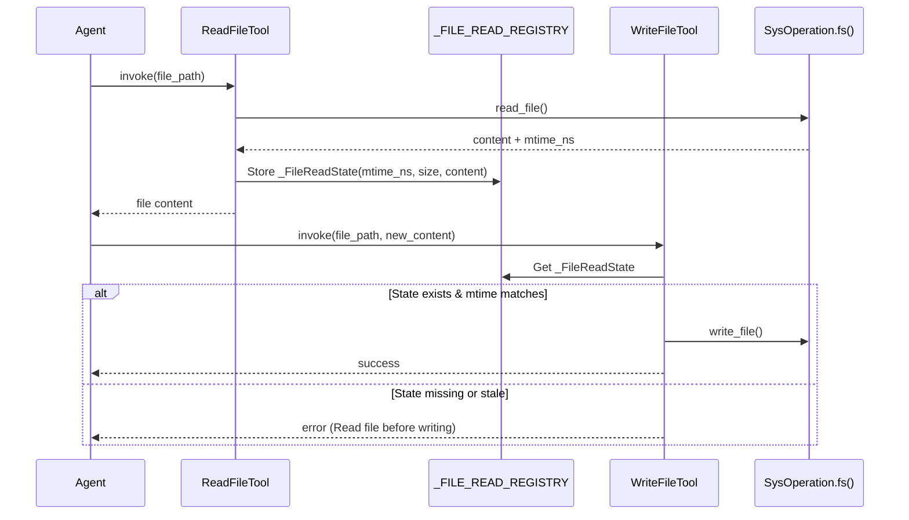
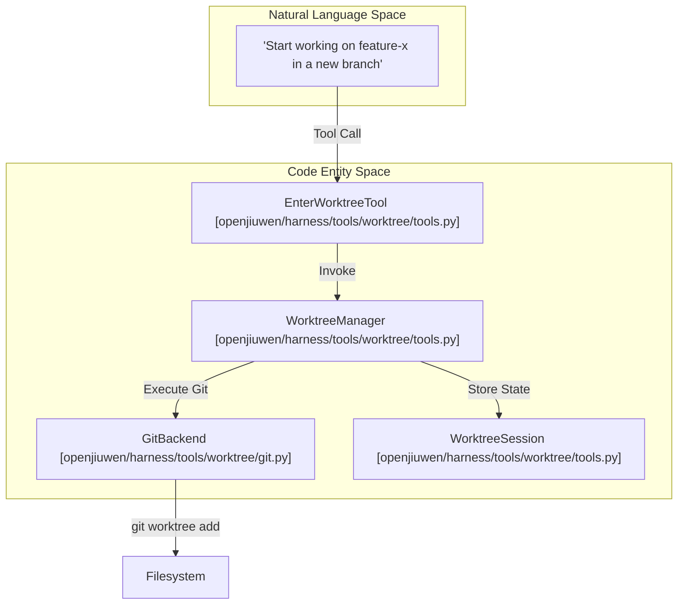

<!-- source: DeepWiki mcp.deepwiki.com · repo openJiuwen-ai/agent-core · page 3.3 Harness Tools · fetched 2026-11-02 -->

# Harness Tools

Relevant source files

The following files were used as context for generating this wiki page:

- [docs/en/2.Development Guide/API Docs/openjiuwen.harness/subagents/browser_agent.md](docs/en/2.Development Guide/API Docs/openjiuwen.harness/subagents/browser_agent.md)
- [docs/en/2.Development Guide/API Docs/openjiuwen.harness/subagents/subagents.md](docs/en/2.Development Guide/API Docs/openjiuwen.harness/subagents/subagents.md)
- [docs/en/2.Development Guide/API Docs/openjiuwen.harness/tools/browser_tools.md](docs/en/2.Development Guide/API Docs/openjiuwen.harness/tools/browser_tools.md)
- [docs/en/2.Development Guide/API Docs/openjiuwen.harness/tools/tools.md](docs/en/2.Development Guide/API Docs/openjiuwen.harness/tools/tools.md)
- [examples/harness/deepagent_with_worktree.py](examples/harness/deepagent_with_worktree.py)
- [examples/harness/worktree/__init__.py](examples/harness/worktree/__init__.py)
- [examples/harness/worktree/single_deepagent_e2e.py](examples/harness/worktree/single_deepagent_e2e.py)
- [openjiuwen/core/context_engine/processor/offloader/tool_result_window_processor.py](openjiuwen/core/context_engine/processor/offloader/tool_result_window_processor.py)
- [openjiuwen/harness/manifest/harness_elements.py](openjiuwen/harness/manifest/harness_elements.py)
- [openjiuwen/harness/prompts/sections/reload.py](openjiuwen/harness/prompts/sections/reload.py)
- [openjiuwen/harness/prompts/tools/bash.py](openjiuwen/harness/prompts/tools/bash.py)
- [openjiuwen/harness/prompts/tools/enter_worktree.py](openjiuwen/harness/prompts/tools/enter_worktree.py)
- [openjiuwen/harness/prompts/tools/powershell.py](openjiuwen/harness/prompts/tools/powershell.py)
- [openjiuwen/harness/prompts/tools/web_tools.py](openjiuwen/harness/prompts/tools/web_tools.py)
- [openjiuwen/harness/subagent_lifecycle.py](openjiuwen/harness/subagent_lifecycle.py)
- [openjiuwen/harness/subagents/browser_agent.py](openjiuwen/harness/subagents/browser_agent.py)
- [openjiuwen/harness/tools/browser_move/__init__.py](openjiuwen/harness/tools/browser_move/__init__.py)
- [openjiuwen/harness/tools/browser_move/controllers/__init__.py](openjiuwen/harness/tools/browser_move/controllers/__init__.py)
- [openjiuwen/harness/tools/browser_move/drivers/managed_browser.py](openjiuwen/harness/tools/browser_move/drivers/managed_browser.py)
- [openjiuwen/harness/tools/browser_move/offload_recall.py](openjiuwen/harness/tools/browser_move/offload_recall.py)
- [openjiuwen/harness/tools/browser_move/playwright_runtime/__init__.py](openjiuwen/harness/tools/browser_move/playwright_runtime/__init__.py)
- [openjiuwen/harness/tools/browser_move/playwright_runtime/agents.py](openjiuwen/harness/tools/browser_move/playwright_runtime/agents.py)
- [openjiuwen/harness/tools/browser_move/playwright_runtime/browser_tools.py](openjiuwen/harness/tools/browser_move/playwright_runtime/browser_tools.py)
- [openjiuwen/harness/tools/browser_move/playwright_runtime/config.py](openjiuwen/harness/tools/browser_move/playwright_runtime/config.py)
- [openjiuwen/harness/tools/browser_move/playwright_runtime/probes.py](openjiuwen/harness/tools/browser_move/playwright_runtime/probes.py)
- [openjiuwen/harness/tools/browser_move/playwright_runtime/runtime.py](openjiuwen/harness/tools/browser_move/playwright_runtime/runtime.py)
- [openjiuwen/harness/tools/browser_move/playwright_runtime/runtime_tools.py](openjiuwen/harness/tools/browser_move/playwright_runtime/runtime_tools.py)
- [openjiuwen/harness/tools/browser_move/playwright_runtime/service.py](openjiuwen/harness/tools/browser_move/playwright_runtime/service.py)
- [openjiuwen/harness/tools/browser_move/playwright_runtime/site_profiles.py](openjiuwen/harness/tools/browser_move/playwright_runtime/site_profiles.py)
- [openjiuwen/harness/tools/browser_move/utils/env.py](openjiuwen/harness/tools/browser_move/utils/env.py)
- [openjiuwen/harness/tools/filesystem.py](openjiuwen/harness/tools/filesystem.py)
- [openjiuwen/harness/tools/shell/bash/_output.py](openjiuwen/harness/tools/shell/bash/_output.py)
- [openjiuwen/harness/tools/shell/bash/_security.py](openjiuwen/harness/tools/shell/bash/_security.py)
- [openjiuwen/harness/tools/shell/bash/_tool.py](openjiuwen/harness/tools/shell/bash/_tool.py)
- [openjiuwen/harness/tools/shell/powershell/_output.py](openjiuwen/harness/tools/shell/powershell/_output.py)
- [openjiuwen/harness/tools/shell/powershell/_tool.py](openjiuwen/harness/tools/shell/powershell/_tool.py)
- [openjiuwen/harness/tools/web/__init__.py](openjiuwen/harness/tools/web/__init__.py)
- [openjiuwen/harness/tools/web/_common.py](openjiuwen/harness/tools/web/_common.py)
- [openjiuwen/harness/tools/web/_decode.py](openjiuwen/harness/tools/web/_decode.py)
- [openjiuwen/harness/tools/web/_http.py](openjiuwen/harness/tools/web/_http.py)
- [openjiuwen/harness/tools/web/fetch_webpage.py](openjiuwen/harness/tools/web/fetch_webpage.py)
- [openjiuwen/harness/tools/web/free_search.py](openjiuwen/harness/tools/web/free_search.py)
- [openjiuwen/harness/tools/web/paid_search.py](openjiuwen/harness/tools/web/paid_search.py)
- [openjiuwen/harness/tools/worktree/__init__.py](openjiuwen/harness/tools/worktree/__init__.py)
- [openjiuwen/harness/tools/worktree/backend.py](openjiuwen/harness/tools/worktree/backend.py)
- [openjiuwen/harness/tools/worktree/git.py](openjiuwen/harness/tools/worktree/git.py)
- [openjiuwen/harness/tools/worktree/manager.py](openjiuwen/harness/tools/worktree/manager.py)
- [openjiuwen/harness/tools/worktree/models.py](openjiuwen/harness/tools/worktree/models.py)
- [openjiuwen/harness/tools/worktree/session.py](openjiuwen/harness/tools/worktree/session.py)
- [openjiuwen/harness/tools/worktree/slug.py](openjiuwen/harness/tools/worktree/slug.py)
- [openjiuwen/harness/tools/worktree/tools.py](openjiuwen/harness/tools/worktree/tools.py)
- [tests/system_tests/harness/tools/worktree/conftest.py](tests/system_tests/harness/tools/worktree/conftest.py)
- [tests/unit_tests/core/context_engine/test_tool_result_window_processor.py](tests/unit_tests/core/context_engine/test_tool_result_window_processor.py)
- [tests/unit_tests/harness/tools/browser_move/test_browser_probe_cards.py](tests/unit_tests/harness/tools/browser_move/test_browser_probe_cards.py)
- [tests/unit_tests/harness/tools/browser_move/test_browser_probe_interactives.py](tests/unit_tests/harness/tools/browser_move/test_browser_probe_interactives.py)
- [tests/unit_tests/harness/tools/browser_move/test_browser_runtime_rail.py](tests/unit_tests/harness/tools/browser_move/test_browser_runtime_rail.py)
- [tests/unit_tests/harness/tools/browser_move/test_browser_runtime_tools.py](tests/unit_tests/harness/tools/browser_move/test_browser_runtime_tools.py)
- [tests/unit_tests/harness/tools/browser_move/test_browser_site_profiles.py](tests/unit_tests/harness/tools/browser_move/test_browser_site_profiles.py)
- [tests/unit_tests/harness/tools/browser_move/test_config.py](tests/unit_tests/harness/tools/browser_move/test_config.py)
- [tests/unit_tests/harness/tools/browser_move/test_create_browser_agent.py](tests/unit_tests/harness/tools/browser_move/test_create_browser_agent.py)
- [tests/unit_tests/harness/tools/browser_move/test_heartbeat.py](tests/unit_tests/harness/tools/browser_move/test_heartbeat.py)
- [tests/unit_tests/harness/tools/browser_move/test_managed_browser.py](tests/unit_tests/harness/tools/browser_move/test_managed_browser.py)
- [tests/unit_tests/harness/tools/browser_move/test_service.py](tests/unit_tests/harness/tools/browser_move/test_service.py)
- [tests/unit_tests/harness/tools/test_bash/test_bash_tool.py](tests/unit_tests/harness/tools/test_bash/test_bash_tool.py)
- [tests/unit_tests/harness/tools/test_filesystem_tools.py](tests/unit_tests/harness/tools/test_filesystem_tools.py)
- [tests/unit_tests/harness/tools/test_shell_tools.py](tests/unit_tests/harness/tools/test_shell_tools.py)
- [tests/unit_tests/harness/tools/test_task_tool.py](tests/unit_tests/harness/tools/test_task_tool.py)
- [tests/unit_tests/harness/tools/web/test_web_tools_v2.py](tests/unit_tests/harness/tools/web/test_web_tools_v2.py)
- [tests/unit_tests/harness/tools/worktree/test_manager.py](tests/unit_tests/harness/tools/worktree/test_manager.py)
- [tests/unit_tests/harness/tools/worktree/test_rails.py](tests/unit_tests/harness/tools/worktree/test_rails.py)
- [tests/unit_tests/harness/tools/worktree/test_session.py](tests/unit_tests/harness/tools/worktree/test_session.py)
- [tests/unit_tests/harness/tools/worktree/test_slug.py](tests/unit_tests/harness/tools/worktree/test_slug.py)
- [tests/unit_tests/harness/tools/worktree/test_tools.py](tests/unit_tests/harness/tools/worktree/test_tools.py)

Harness tools are the built-in functional capabilities provided to `DeepAgent` and other agents within the openjiuwen ecosystem. These tools enable agents to interact with the physical world (filesystem, shell), the digital world (web browsing, search), and internal system states (memory, tasks, sub-agents).

The tool system is built upon the `Tool` base class [openjiuwen/core/foundation/tool/base.py:24-24]() and is managed via the `SessionToolkit` registry.

## Filesystem Tools

Filesystem tools provide secure and structured access to the local or sandboxed environment. A key architectural feature is the `_FILE_READ_REGISTRY`, which enforces a "read-before-edit" policy to prevent data loss or race conditions [openjiuwen/harness/tools/filesystem.py:145-145]().

### Core Tools
| Tool | Class | Purpose |
| :--- | :--- | :--- |
| `read_file` | `ReadFileTool` | Reads text, PDF, or image files with offset/limit support. Supports multimodal image output [openjiuwen/harness/tools/filesystem.py:136-136](). |
| `write_file` | `WriteFileTool` | Creates or overwrites files; requires previous read for existing files to ensure context [openjiuwen/harness/tools/filesystem.py:536-536](). |
| `edit_file` | `EditFileTool` | Performs string replacements; validates file integrity using `mtime_ns` and line ranges [openjiuwen/harness/tools/filesystem.py:633-633](). |
| `list_dir` | `ListDirTool` | Lists directory contents with recursion and depth control [openjiuwen/harness/tools/filesystem.py:840-840](). |
| `grep` | `GrepTool` | Regex search within files using `SysOperation` [openjiuwen/harness/tools/filesystem.py:881-881](). |
| `glob` | `GlobTool` | File search using glob patterns [openjiuwen/harness/tools/filesystem.py:803-803](). |

### Data Flow: File Integrity Protection
The system prevents stale writes by tracking file states in the `_FILE_READ_REGISTRY`. `WriteFileTool` and `EditFileTool` check this registry before execution [openjiuwen/harness/tools/filesystem.py:557-564]().

**File Operation Sequence**

**Sources:** [openjiuwen/harness/tools/filesystem.py:39-145](), [openjiuwen/harness/tools/filesystem.py:536-580]()

## Browser and Web Tools

The harness provides sophisticated web interaction through the `BrowserAgent` and associated runtime services.

### Playwright Runtime
The `BrowserService` manages sticky logical sessions and provides a CDP (Chrome DevTools Protocol) endpoint for automation [openjiuwen/harness/tools/browser_move/playwright_runtime/service.py:119-120](). It utilizes a `ManagedBrowserDriver` to launch isolated Chrome instances [openjiuwen/harness/tools/browser_move/drivers/managed_browser.py:169-170]().

*   **`browser_batch_interact`**: Executes multiple actions (click, fill, extract) in a single turn to save tokens and time [openjiuwen/harness/tools/browser_move/playwright_runtime/runtime.py:84-95]().
*   **`browser_probe_cards`**: Specialized tool for identifying repeated structures like product cards or search results [openjiuwen/harness/tools/browser_move/playwright_runtime/runtime.py:42-42]().
*   **`browser_snapshot`**: Captures the accessibility tree and page state [openjiuwen/harness/tools/browser_move/playwright_runtime/runtime.py:102-103]().

### Search and Fetch
*   **`WebFreeSearchTool`**: Uses DuckDuckGo/Bing via scraping [openjiuwen/harness/tools/web/free_search.py]().
*   **`WebPaidSearchTool`**: Integrates with Bocha, Serper, and Perplexity [openjiuwen/harness/tools/web/paid_search.py]().
*   **`WebFetchWebpageTool`**: Converts HTML to Markdown [openjiuwen/harness/tools/web/fetch_webpage.py]().

**Sources:** [openjiuwen/harness/tools/browser_move/playwright_runtime/service.py:119-169](), [openjiuwen/harness/subagents/browser_agent.py:61-125](), [openjiuwen/harness/tools/browser_move/playwright_runtime/runtime.py:152-169]()

## Shell and Code Tools

Execution tools allow agents to run arbitrary logic within the environment defined by the `SysOperation` [openjiuwen/core/sys_operation/__init__.py]().

*   **`BashTool`**: Executes shell commands. Features semantic exit-code interpretation (e.g., `grep` exit code 1 is success with empty output) [openjiuwen/harness/tools/shell/bash/_tool.py:73-74](), [openjiuwen/harness/tools/shell/bash/_semantics.py:38-38]().
*   **`PowerShellTool`**: Similar to `BashTool` but optimized for Windows environments using `powershell` [openjiuwen/harness/tools/shell/powershell/_tool.py:58-59]().
*   **`CodeTool`**: Executes Python code blocks via `SysOperation.code().execute_code()` [openjiuwen/harness/tools/code.py]().

**Sources:** [openjiuwen/harness/tools/shell/bash/_tool.py:73-164](), [openjiuwen/harness/tools/shell/powershell/_tool.py:58-135]()

## Worktree and Workspace Tools

For complex coding tasks, agents use `Worktree` tools to isolate changes in Git.

*   **`EnterWorktreeTool`**: Creates a new Git worktree for a specific task [openjiuwen/harness/tools/worktree/tools.py:24-25]().
*   **`ExitWorktreeTool`**: Finalizes changes, allowing the agent to "keep" (commit) or "discard" changes [openjiuwen/harness/tools/worktree/tools.py:30-31]().

**Entity Mapping: Worktree Management**

**Sources:** [openjiuwen/harness/tools/worktree/tools.py:24-40](), [openjiuwen/harness/tools/worktree/git.py:10-20]()

## Memory and Knowledge Tools

Memory tools facilitate the persistence of information across sessions using the workspace filesystem.

*   **`LiteMemory`**: Lightweight file-based memory storage [openjiuwen/harness/tools/memory/lite_memory.py]().
*   **`CodingMemoryTool`**: Specialized memory for managing code snippets and architectural notes [openjiuwen/harness/tools/memory/coding_memory.py]().

**Sources:** [openjiuwen/harness/prompts/sections/memory.py:17-146](), [openjiuwen/harness/tools/memory/lite_memory.py]()

## Task and Session Management

The `SessionToolkit` manages the lifecycle of tasks and sub-agent sessions.

*   **`TodoTool` Suite**: Includes `TodoCreateTool`, `TodoListTool`, and `TodoModifyTool` for managing a local `todo/` directory [openjiuwen/harness/tools/todo.py:21-28]().
*   **`SessionsSpawnTool`**: Used by `DeepAgent` to delegate complex sub-tasks to specialized sub-agents [openjiuwen/harness/tools/agent_control.py:121-121]().
*   **`TaskTool`**: Manages the high-level task plan (PLAN mode), allowing the agent to update its own progress [openjiuwen/harness/tools/agent_control.py:61-61]().

**Sources:** [openjiuwen/harness/tools/todo.py:21-28](), [openjiuwen/harness/tools/agent_control.py:61-123]()

## Tool Registration and Discovery

Tools are grouped and registered through factory functions and the `SessionToolkit`.

| Registry / Factory | Function | Tools Included |
| :--- | :--- | :--- |
| `create_web_tools` | [openjiuwen/harness/tools/web_tools.py:43-43]() | `free_search`, `paid_search`, `fetch_webpage` |
| `build_browser_runtime_tools`| [openjiuwen/harness/tools/browser_move/playwright_runtime/runtime_tools.py:39-41]() | `browser_batch_interact`, `browser_snapshot`, etc. |
| `build_session_tools`| [openjiuwen/harness/tools/agent_control.py:123-123]() | `sessions_list`, `sessions_spawn`, `sessions_cancel` |
| `SearchToolsTool` | [openjiuwen/harness/tools/tool_discovery.py:19-19]() | Dynamic tool discovery via keywords |

**Sources:** [openjiuwen/harness/tools/__init__.py:1-127](), [openjiuwen/harness/tools/browser_move/playwright_runtime/runtime_tools.py:39-41]()

---

