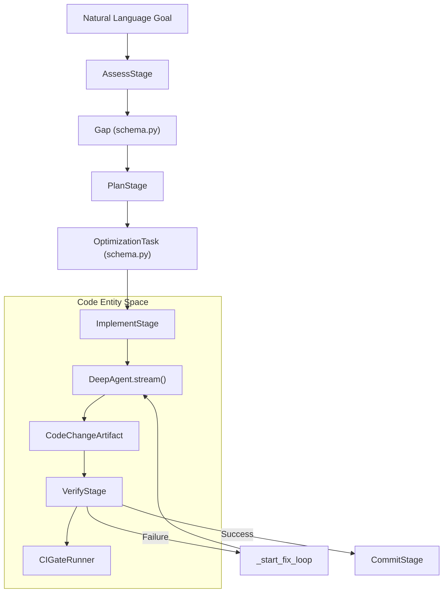
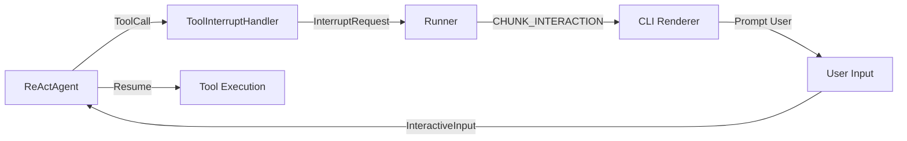

<!-- source: DeepWiki mcp.deepwiki.com · repo openJiuwen-ai/agent-core · page 3.5 CLI and Auto-Harness · fetched 2026-11-02 -->

# CLI and Auto-Harness

Relevant source files

The following files were used as context for generating this wiki page:

- [openjiuwen/core/single_agent/ability_manager.py](openjiuwen/core/single_agent/ability_manager.py)
- [openjiuwen/core/single_agent/agent_callback_manager.py](openjiuwen/core/single_agent/agent_callback_manager.py)
- [openjiuwen/core/single_agent/agents/react_agent.py](openjiuwen/core/single_agent/agents/react_agent.py)
- [openjiuwen/core/single_agent/base.py](openjiuwen/core/single_agent/base.py)
- [openjiuwen/core/single_agent/rail/__init__.py](openjiuwen/core/single_agent/rail/__init__.py)
- [openjiuwen/core/single_agent/rail/base.py](openjiuwen/core/single_agent/rail/base.py)
- [openjiuwen/harness/cli/cli.py](openjiuwen/harness/cli/cli.py)
- [openjiuwen/harness/cli/rails/tool_tracker.py](openjiuwen/harness/cli/rails/tool_tracker.py)
- [openjiuwen/harness/cli/ui/renderer.py](openjiuwen/harness/cli/ui/renderer.py)
- [openjiuwen/harness/cli/ui/repl.py](openjiuwen/harness/cli/ui/repl.py)
- [openjiuwen/harness/cli/ui/todo_render.py](openjiuwen/harness/cli/ui/todo_render.py)
- [openjiuwen/harness/cli/ui/tool_display.py](openjiuwen/harness/cli/ui/tool_display.py)
- [openjiuwen/harness/deep_agent.py](openjiuwen/harness/deep_agent.py)
- [openjiuwen/harness/factory.py](openjiuwen/harness/factory.py)
- [openjiuwen/harness/prompts/sections/skills.py](openjiuwen/harness/prompts/sections/skills.py)
- [openjiuwen/harness/rails/skills/skill_use_rail.py](openjiuwen/harness/rails/skills/skill_use_rail.py)
- [openjiuwen/harness/rails/subagent/verification_rail.py](openjiuwen/harness/rails/subagent/verification_rail.py)
- [openjiuwen/harness/rails/sys_operation_rail.py](openjiuwen/harness/rails/sys_operation_rail.py)
- [openjiuwen/harness/schema/config.py](openjiuwen/harness/schema/config.py)
- [openjiuwen/harness/tools/worktree/rails.py](openjiuwen/harness/tools/worktree/rails.py)
- [tests/cli/e2e/test_auto_harness.py](tests/cli/e2e/test_auto_harness.py)
- [tests/cli/unit/test_renderer.py](tests/cli/unit/test_renderer.py)
- [tests/cli/unit/test_todo_render.py](tests/cli/unit/test_todo_render.py)
- [tests/cli/unit/test_tool_display.py](tests/cli/unit/test_tool_display.py)
- [tests/system_tests/rail/test_force_finish_rail.py](tests/system_tests/rail/test_force_finish_rail.py)
- [tests/unit_tests/agent/react_agent/test_new_react_agent_mock.py](tests/unit_tests/agent/react_agent/test_new_react_agent_mock.py)
- [tests/unit_tests/cli/test_auto_harness_cli.py](tests/unit_tests/cli/test_auto_harness_cli.py)
- [tests/unit_tests/cli/test_auto_harness_repl.py](tests/unit_tests/cli/test_auto_harness_repl.py)
- [tests/unit_tests/core/single_agent/rail/test_rail.py](tests/unit_tests/core/single_agent/rail/test_rail.py)
- [tests/unit_tests/core/single_agent/rail/test_rail_init_timing.py](tests/unit_tests/core/single_agent/rail/test_rail_init_timing.py)
- [tests/unit_tests/harness/test_deep_agent.py](tests/unit_tests/harness/test_deep_agent.py)
- [tests/unit_tests/harness/test_filesystem_rail.py](tests/unit_tests/harness/test_filesystem_rail.py)
- [tests/unit_tests/harness/test_skill_rail.py](tests/unit_tests/harness/test_skill_rail.py)

This section provides documentation for the OpenJiuWen Command Line Interface (CLI) and the Auto-Harness framework. The CLI serves as the primary user-facing entry point for interacting with agents, while Auto-Harness provides an autonomous pipeline for repository-level code optimization and gap analysis.

## 1. OpenJiuWen CLI

The OpenJiuWen CLI is a terminal-based AI programming assistant built on the `agent-core` SDK. It supports both interactive multi-turn conversations and non-interactive single-task execution [openjiuwen/harness/cli/cli.py:1-7]().

### 1.1 Command Structure
The CLI is implemented using the `click` library and supports the following primary commands:
*   `openjiuwen` / `openjiuwen chat`: Launches the interactive REPL [openjiuwen/harness/cli/cli.py:216-230]().
*   `openjiuwen run <PROMPT>`: Executes a single prompt and exits. Supports piping via `-` and structured output formats like `json` or `stream-json` [openjiuwen/harness/cli/cli.py:6-7]().

### 1.2 Interactive REPL
The REPL is built using `prompt_toolkit` and `rich`, providing a high-fidelity terminal experience with stream rendering and slash commands [openjiuwen/harness/cli/ui/repl.py:1-9]().

**Key Features:**
*   **Interrupt Management**: A three-layer Ctrl+C handler. The first press aborts the current LLM stream, the second warns the user, and the third exits the application [openjiuwen/harness/cli/ui/repl.py:49-80]().
*   **Slash Commands**: Built-in commands for system control:
    *   `/status`: Displays model information and token usage tracked by `TokenTrackingRail` [openjiuwen/harness/cli/ui/repl.py:137-166]().
    *   `/sessions`: Lists saved conversation sessions from the `SessionStore` [openjiuwen/harness/cli/ui/repl.py:101-103]().
    *   `/auto-harness`: Entry point for autonomous optimization tasks [openjiuwen/harness/cli/ui/repl.py:105-107]().
*   **Shell Passthrough**: Commands prefixed with `!` are executed directly in the local shell [openjiuwen/harness/cli/ui/repl.py:108]().

### 1.3 Stream Rendering
The `render_stream` function maps `OutputSchema` chunks from the agent to terminal visuals [openjiuwen/harness/cli/ui/renderer.py:1-13]().

| Chunk Type | Rendering Behavior |
| :--- | :--- |
| `llm_output` | Progressively rendered text accumulated into the final result [openjiuwen/harness/cli/ui/renderer.py:53](). |
| `llm_reasoning` | Hidden by default; shows "thinking" steps if enabled [openjiuwen/harness/cli/ui/renderer.py:54](). |
| `tool_call` | Rendered as a cyan bullet point (●) with arguments [openjiuwen/harness/cli/ui/renderer.py:162-183](). |
| `tool_result` | Rendered as a summary (⎿) under the call [openjiuwen/harness/cli/ui/renderer.py:185-195](). |
| `__interaction__` | Triggers Human-in-the-Loop (HITL) input prompts [openjiuwen/harness/cli/ui/renderer.py:56](). |

**Sources:** [openjiuwen/harness/cli/cli.py:1-230](), [openjiuwen/harness/cli/ui/repl.py:1-166](), [openjiuwen/harness/cli/ui/renderer.py:1-200]().

---

## 2. Auto-Harness Framework

Auto-Harness is an autonomous optimization pipeline designed to assess, plan, and implement code improvements within a repository. It operates using a worktree-isolated environment to ensure safety during destructive operations [openjiuwen/harness/deep_agent.py:143-144]().

### 2.1 The Optimization Pipeline
Auto-Harness follows a multi-stage execution flow managed by the `TaskStage` architecture. The pipeline bridges high-level goals into concrete code changes using a structured workflow.

#### Data Flow: Natural Language to Code Changes
This diagram illustrates how a user's natural language goal is transformed into verified code entities through the Auto-Harness stages.

### 2.2 Key Components

#### 1. ExperienceStore and Skill Evolution
Auto-Harness maintains an `ExperienceStore` to persist lessons learned from previous optimization cycles. This is integrated via `EvolutionRail` and `SkillEvolutionRail` [openjiuwen/harness/rails/skills/skill_use_rail.py:28-29]().
*   **Experience Types**: During the `ImplementStage`, related experiences are retrieved and injected into the agent's prompt to avoid repeating past mistakes [openjiuwen/harness/rails/skills/skill_use_rail.py:109-111]().
*   **Skill Scoring**: `SkillExperienceOptimizer` and `ExperienceScorer` evaluate skill effectiveness and utilization [openjiuwen/harness/rails/skills/skill_use_rail.py:79-80]().

#### 2. CI Gate and Fix Loop
The verification process uses a CI gate to run automated tests. If the CI fails, the system enters a fix loop where the agent is provided with the error logs to attempt a self-correction [openjiuwen/harness/deep_agent.py:84-86]().

#### 3. Worktree Isolation
To prevent corrupting the user's active development branch, Auto-Harness utilizes Git worktrees via the `WorktreeRail` and `Workspace` abstraction [openjiuwen/harness/deep_agent.py:143-144]().
*   **`Workspace`**: Manages the root path and provides isolated directories for each optimization run [openjiuwen/harness/deep_agent.py:208-210]().
*   **Edit Scope**: Path restrictions are enforced to ensure the agent only modifies files within the task's declared scope [openjiuwen/harness/rails/sys_operation_rail.py:77-80]().

### 2.3 Auto-Harness Sub-commands
Available via the `/auto-harness` slash command in the REPL [openjiuwen/harness/cli/ui/repl.py:105-107]():
*   `run [--task TOPIC] [--goal TEXT]`: Starts a full optimization cycle.
*   `gap-analyze`: Performs a competitive analysis to identify missing features.
*   `experience search`: Queries the experience vector store.
*   `history`: Displays the status of previous optimization tasks.

**Sources:** [openjiuwen/harness/deep_agent.py:1-210](), [openjiuwen/harness/rails/skills/skill_use_rail.py:1-120](), [openjiuwen/harness/cli/ui/repl.py:1-166]().

---

## 3. Human-in-the-Loop (HITL) Integration

The CLI integrates the `agent-core` HITL mechanism, allowing agents to pause for user confirmation or information through the `InteractiveInput` system [openjiuwen/harness/deep_agent.py:47]().

### 3.1 Interaction Flow
When an agent triggers an interruption, the CLI REPL intercepts the `__interaction__` chunk via the `renderer` [openjiuwen/harness/cli/ui/renderer.py:56]().

### 3.2 Data Entities
*   **`ToolInterruptHandler`**: Manages the state of tool interruptions and resumes [openjiuwen/core/single_agent/agents/react_agent.py:59]().
*   **`BaseInterruptionState`**: Persists the interruption state, including the start iteration for resuming [openjiuwen/core/single_agent/agents/react_agent.py:60-65]().
*   **`InteractiveInput`**: The object used to resume the agent with the user's decision, often dispatched via `InputDispatchMode` [openjiuwen/harness/deep_agent.py:104]().

**Sources:** [openjiuwen/core/single_agent/agents/react_agent.py:59-65](), [openjiuwen/harness/cli/ui/renderer.py:52-77](), [openjiuwen/harness/deep_agent.py:47-108]().

---

