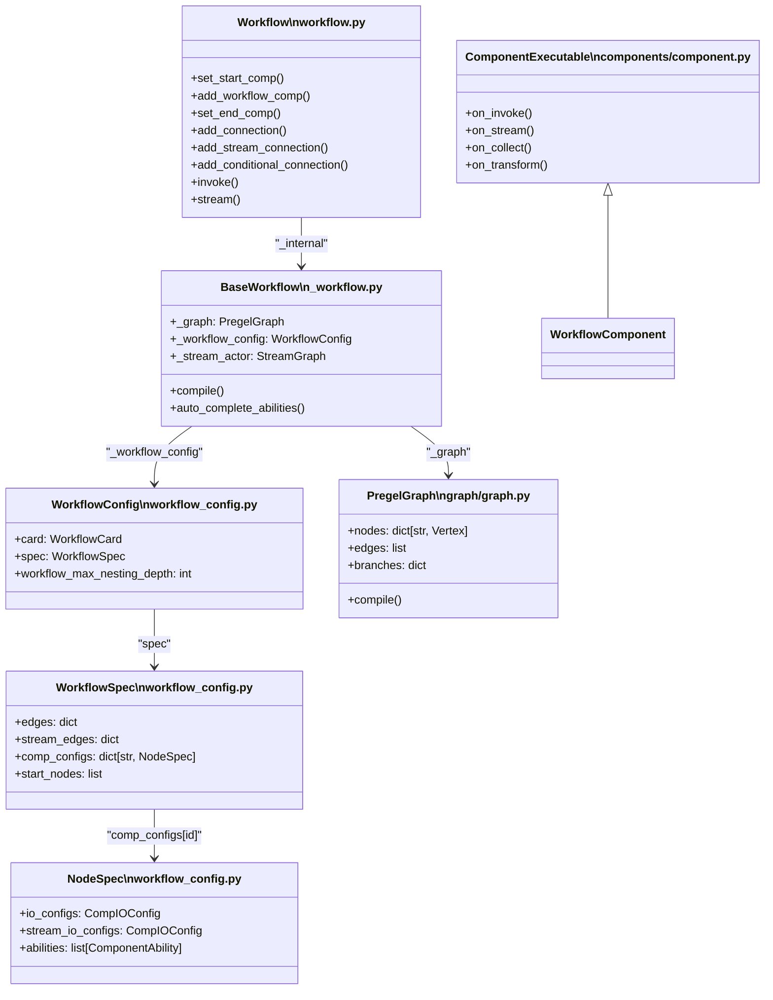
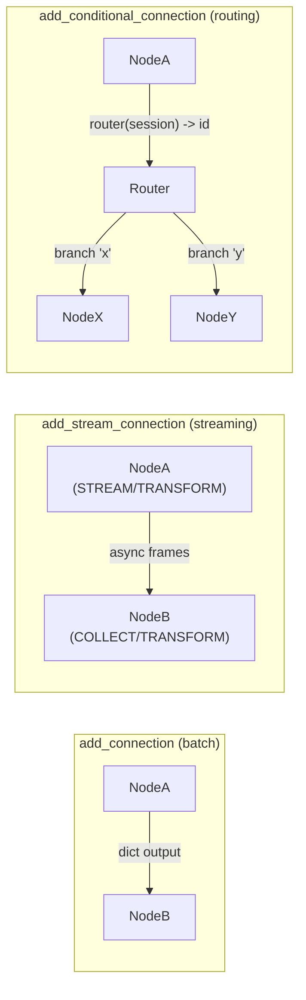
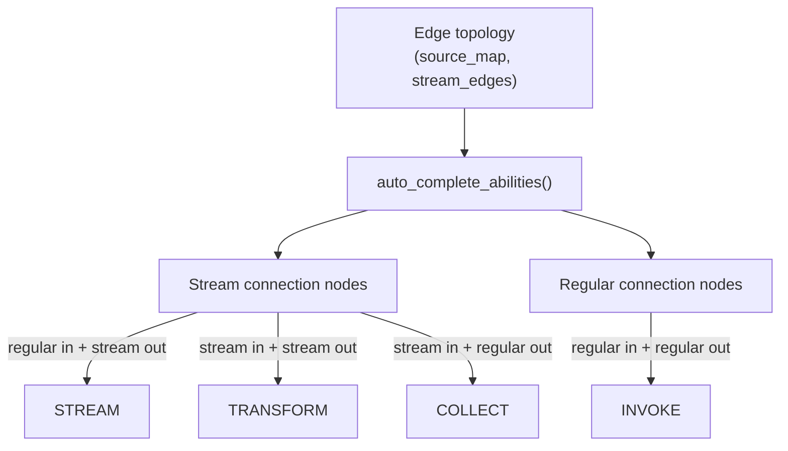
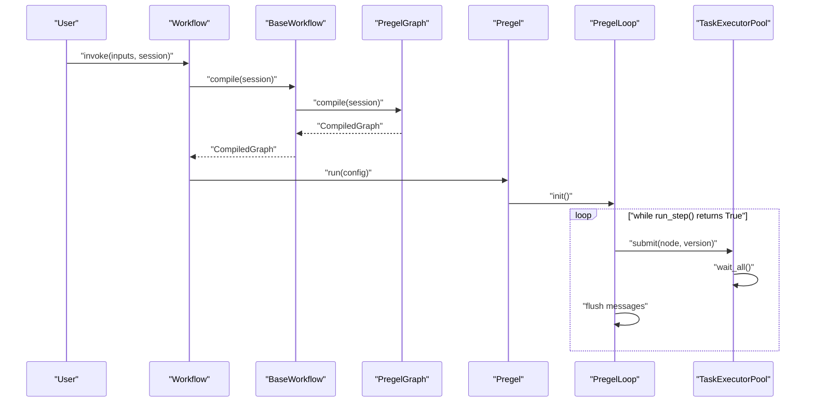
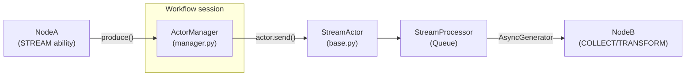

<!-- source: DeepWiki mcp.deepwiki.com · repo openJiuwen-ai/agent-core · page 4 Workflow Engine · fetched 2026-11-02 -->

# Workflow Engine

<details>
<summary>Relevant source files</summary>

The following files were used as context for generating this wiki page:

- [openjiuwen/core/graph/graph.py](openjiuwen/core/graph/graph.py)
- [openjiuwen/core/graph/pregel/builder.py](openjiuwen/core/graph/pregel/builder.py)
- [openjiuwen/core/graph/pregel/channels.py](openjiuwen/core/graph/pregel/channels.py)
- [openjiuwen/core/graph/pregel/engine.py](openjiuwen/core/graph/pregel/engine.py)
- [openjiuwen/core/graph/pregel/task.py](openjiuwen/core/graph/pregel/task.py)
- [openjiuwen/core/graph/stream_actor/base.py](openjiuwen/core/graph/stream_actor/base.py)
- [openjiuwen/core/graph/stream_actor/manager.py](openjiuwen/core/graph/stream_actor/manager.py)
- [openjiuwen/core/graph/vertex.py](openjiuwen/core/graph/vertex.py)
- [openjiuwen/core/workflow/__init__.py](openjiuwen/core/workflow/__init__.py)
- [openjiuwen/core/workflow/_workflow.py](openjiuwen/core/workflow/_workflow.py)
- [openjiuwen/core/workflow/components/flow/branch_comp.py](openjiuwen/core/workflow/components/flow/branch_comp.py)
- [openjiuwen/core/workflow/components/flow/branch_router.py](openjiuwen/core/workflow/components/flow/branch_router.py)
- [openjiuwen/core/workflow/components/flow/end_comp.py](openjiuwen/core/workflow/components/flow/end_comp.py)
- [openjiuwen/core/workflow/workflow.py](openjiuwen/core/workflow/workflow.py)
- [openjiuwen/core/workflow/workflow_config.py](openjiuwen/core/workflow/workflow_config.py)
- [tests/unit_tests/core/graph/test_barrier_cnf.py](tests/unit_tests/core/graph/test_barrier_cnf.py)
- [tests/unit_tests/core/session/tracer/test_workflow_tracer.py](tests/unit_tests/core/session/tracer/test_workflow_tracer.py)
- [tests/unit_tests/core/workflow/test_workflow.py](tests/unit_tests/core/workflow/test_workflow.py)
- [tests/unit_tests/core/workflow/test_workflow_with_comp_stream.py](tests/unit_tests/core/workflow/test_workflow_with_comp_stream.py)

</details>


This page covers the workflow engine: how workflows are defined using the `Workflow` DSL, how the graph is compiled and executed, what connection and component types are available, and how data flows between components at runtime.

For information about the agents that run workflows (e.g. `WorkflowAgent`, `LLMAgent`), see the [Agents](#2) page. For details on specific built-in component implementations, see [Built-in Components](#4.2). For custom component authoring, see [Custom Components](#4.3). For the internal graph execution details, see [Graph Execution Engine](#4.4).

---

## Key Concepts

| Concept | Role |
|---|---|
| `Workflow` | User-facing DSL class; wraps `BaseWorkflow`. [openjiuwen/core/workflow/workflow.py:98-115]() |
| `BaseWorkflow` | Internal orchestration; holds `PregelGraph` and `WorkflowSpec`. [openjiuwen/core/workflow/_workflow.py:143-162]() |
| `PregelGraph` | Directed graph representation compiled into a `Pregel` engine. [openjiuwen/core/graph/graph.py:34-56]() |
| `ComponentAbility` | Enum describing how a node handles batch/streaming I/O (INVOKE, STREAM, COLLECT, TRANSFORM). [openjiuwen/core/workflow/components/base.py:27-31]() |
| `WorkflowSpec` | Structural description of nodes and edges stored in `WorkflowConfig`. [openjiuwen/core/workflow/workflow_config.py:34-54]() |
| `ActorManager` | Manages message routing for stream edges at runtime. [openjiuwen/core/graph/stream_actor/manager.py:27-51]() |

---

## Class Structure

**Workflow engine core classes and their file locations**



Sources: [openjiuwen/core/workflow/workflow.py:42-115](), [openjiuwen/core/workflow/_workflow.py:143-162](), [openjiuwen/core/workflow/workflow_config.py:12-59]()

---

## Defining a Workflow

A `Workflow` is assembled by calling builder methods. Execution occurs via `invoke()` (batch) or `stream()` (streaming). Compilation happens internally when execution begins.

**Typical construction pattern:**

```python
flow = Workflow()
flow.set_start_comp("start", Start(), inputs_schema={"x": "${x}"})
flow.add_workflow_comp("proc", MyComponent(), inputs_schema={"value": "${start.x}"})
flow.set_end_comp("end", End(), inputs_schema={"result": "${proc.output}"})
flow.add_connection("start", "proc")
flow.add_connection("proc", "end")

result = await flow.invoke({"x": 42}, create_workflow_session())
```

### Builder Methods

| Method | Purpose |
|---|---|
| `set_start_comp(id, comp, ...)` | Designates the entry-point component. [openjiuwen/core/workflow/workflow.py:136-163]() |
| `add_workflow_comp(id, comp, ...)` | Adds an intermediate component. [openjiuwen/core/workflow/workflow.py:165-192]() |
| `set_end_comp(id, comp, ...)` | Designates the terminal component. [openjiuwen/core/workflow/workflow.py:255-279]() |
| `add_connection(src, target)` | Adds a regular (batch) edge. [openjiuwen/core/workflow/workflow.py:195-212]() |
| `add_stream_connection(src, target)` | Adds a streaming edge. [openjiuwen/core/workflow/workflow.py:214-230]() |
| `add_conditional_connection(src, router)` | Adds a conditional routing edge. [openjiuwen/core/workflow/workflow.py:232-242]() |

### Input Schema Reference Syntax

`inputs_schema` dicts use `${node_id.field}` to reference outputs from upstream nodes:

| Expression | Meaning |
|---|---|
| `"${start.a}"` | Field `a` from node `start`. [tests/unit_tests/core/workflow/test_workflow.py:105-106]() |
| `"${l.index}"` | Loop variable `index` from loop node `l`. [tests/unit_tests/core/workflow/test_workflow.py:72-72]() |
| `"${a.output}"` | Field `output` from node `a`. [tests/unit_tests/core/workflow/test_workflow_with_comp_stream.py:132-132]() |

Sources: [openjiuwen/core/workflow/workflow.py:136-279](), [tests/unit_tests/core/workflow/test_workflow.py:62-111]()

---

## Connection Types

**Connection types and their data flow semantics**



| Connection | Graph method | Ability implications |
|---|---|---|
| `add_connection` | `PregelGraph.add_edge` | Sets `INVOKE` on target. [openjiuwen/core/workflow/_workflow.py:174-182]() |
| `add_stream_connection` | `PregelGraph.add_edge` | Sets `STREAM` on source, `COLLECT` on target. [openjiuwen/core/workflow/_workflow.py:184-192]() |
| `add_conditional_connection` | `PregelGraph.add_conditional_edges` | Dynamic routing via `Router`. [openjiuwen/core/workflow/_workflow.py:216-224]() |

Sources: [openjiuwen/core/workflow/_workflow.py:137-236](), [openjiuwen/core/workflow/workflow.py:195-242]()

---

## Component Ability Model

The `ComponentAbility` enum describes how a component handles its input and output streams. Abilities are auto-inferred by `BaseWorkflow.auto_complete_abilities()` from the graph topology. [openjiuwen/core/workflow/_workflow.py:238-344]()

**Ability inference from edge topology**



| Ability | Input | Output | Interface method |
|---|---|---|---|
| `INVOKE` | batch `dict` | batch `dict` | `on_invoke()` |
| `STREAM` | batch `dict` | `AsyncIterator[dict]` | `on_stream()` |
| `COLLECT` | `AsyncIterator[dict]` | batch `dict` | `on_collect()` |
| `TRANSFORM` | `AsyncIterator[dict]` | `AsyncIterator[dict]` | `on_transform()` |

Sources: [openjiuwen/core/workflow/_workflow.py:238-344](), [openjiuwen/core/graph/vertex.py:94-150](), [openjiuwen/core/workflow/components/base.py:27-31]()

---

## Graph Compilation and Execution

When `invoke()` or `stream()` is called, the graph is compiled into a `Pregel` engine for execution.

**Execution sequence from Workflow call to Pregel loop**



### Key Implementation Points

- `BaseWorkflow.compile()` produces a `CompiledGraph` wrapping a `Pregel` instance. [openjiuwen/core/workflow/_workflow.py:194-214]()
- `PregelLoop.run_step()` advances one super-step per iteration. [openjiuwen/core/graph/pregel/engine.py:62-81]()
- Each super-step uses `TaskExecutorPool` to run active nodes concurrently. [openjiuwen/core/graph/pregel/engine.py:138-142]()
- `Vertex.call()` executes the specific `ComponentAbility` logic for a node. [openjiuwen/core/graph/vertex.py:80-150]()

Sources: [openjiuwen/core/graph/pregel/engine.py:23-163](), [openjiuwen/core/graph/vertex.py:80-150](), [openjiuwen/core/workflow/_workflow.py:194-214]()

---

## Streaming Data Flow

The `ActorManager` mediates frame-by-frame delivery from producer nodes to consumer nodes using `StreamActor` and `StreamProcessor`.

**Streaming pipeline between nodes**



- `ActorManager.produce()` routes frames to downstream `StreamActor` instances. [openjiuwen/core/graph/stream_actor/manager.py:80-88]()
- `StreamActor.send()` initializes the consumer's `stream_call` if it hasn't started. [openjiuwen/core/graph/stream_actor/base.py:64-101]()
- `StreamProcessor` maintains the queue and provides the generator to the component. [openjiuwen/core/graph/stream_actor/base.py:105-108]()

Sources: [openjiuwen/core/graph/stream_actor/manager.py:27-102](), [openjiuwen/core/graph/stream_actor/base.py:51-108]()

---

## Flow Control Components

Built-in components provide logic for branching and looping. For details, see [Built-in Components](#4.2).

- **Branching**: `BranchComponent` and `BranchRouter` route execution based on conditions. [openjiuwen/core/workflow/components/flow/branch_comp.py:1-50](), [openjiuwen/core/workflow/components/flow/branch_router.py:1-50]()
- **Looping**: `LoopComponent` and `AdvancedLoopComponent` manage iterations with `LoopGroup`. [openjiuwen/core/workflow/components/flow/loop/loop_comp.py:1-100]()
- **Sub-Workflows**: `SubWorkflowComponent` allows nesting workflows as single nodes. [openjiuwen/core/workflow/components/flow/workflow_comp.py:1-50]()

Sources: [openjiuwen/core/workflow/__init__.py:112-124](), [tests/unit_tests/core/workflow/test_workflow.py:62-91]()

---

## Tracing

Workflow execution is traced via `TracerWorkflowUtils`, emitting spans for workflow and component lifecycles. For details, see [Workflow Tracing](#4.5).

Sources: [openjiuwen/core/graph/vertex.py:23-23](), [openjiuwen/core/workflow/workflow.py:53-56]()

---

