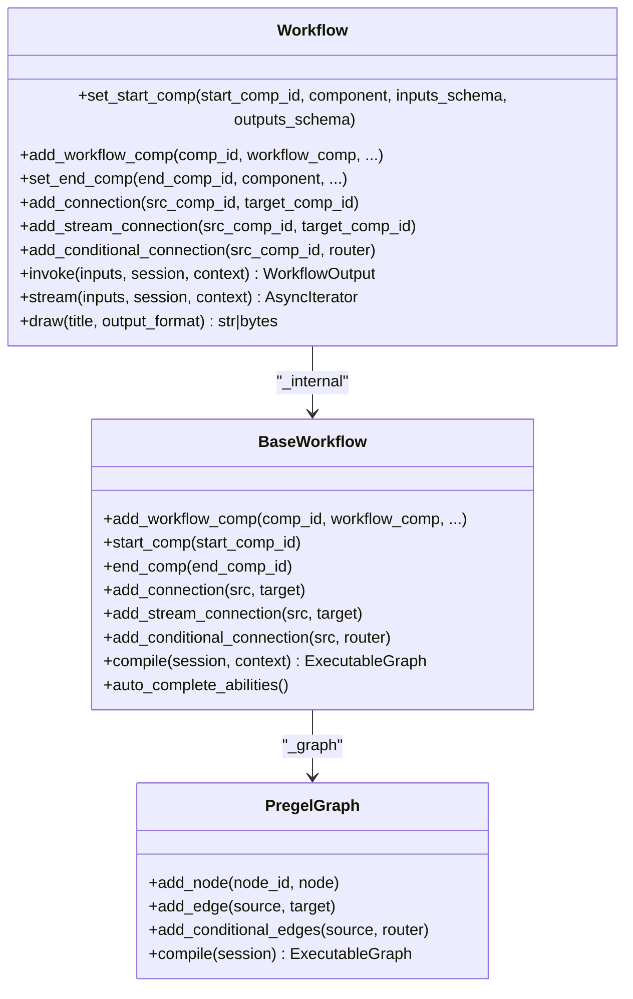
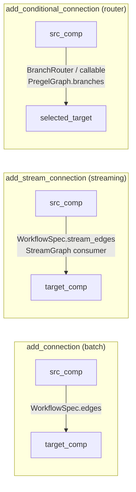
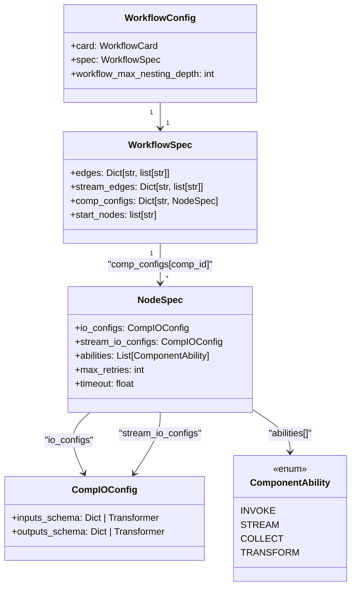
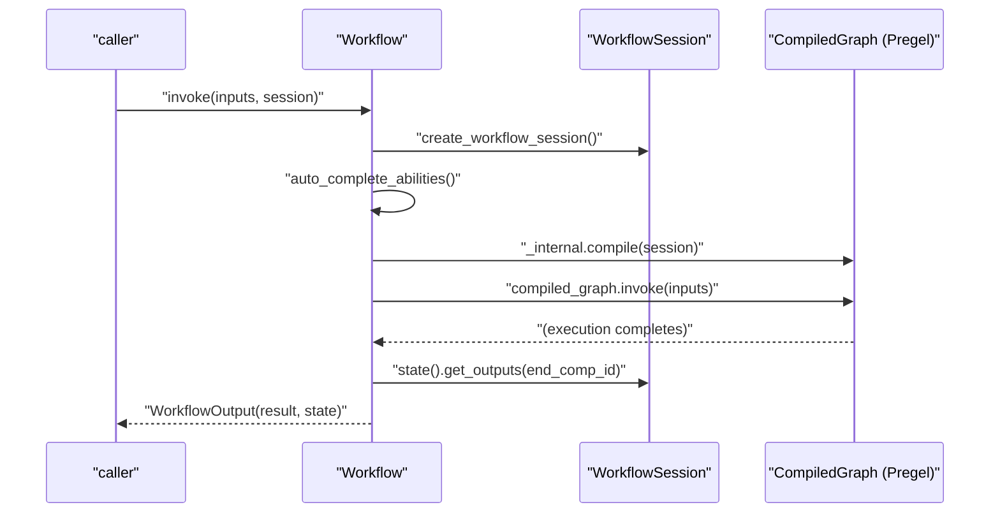

<!-- source: DeepWiki mcp.deepwiki.com · repo openJiuwen-ai/agent-core · page 4.1 Defining Workflows · fetched 2026-11-02 -->

# Defining Workflows

<details>
<summary>Relevant source files</summary>

The following files were used as context for generating this wiki page:

- [openjiuwen/core/graph/graph.py](openjiuwen/core/graph/graph.py)
- [openjiuwen/core/graph/pregel/builder.py](openjiuwen/core/graph/pregel/builder.py)
- [openjiuwen/core/graph/pregel/channels.py](openjiuwen/core/graph/pregel/channels.py)
- [openjiuwen/core/graph/pregel/engine.py](openjiuwen/core/graph/pregel/engine.py)
- [openjiuwen/core/graph/pregel/task.py](openjiuwen/core/graph/pregel/task.py)
- [openjiuwen/core/graph/stream_actor/base.py](openjiuwen/core/graph/stream_actor/base.py)
- [openjiuwen/core/graph/stream_actor/manager.py](openjiuwen/core/graph/stream_actor/manager.py)
- [openjiuwen/core/graph/vertex.py](openjiuwen/core/graph/vertex.py)
- [openjiuwen/core/runner/callback/utils.py](openjiuwen/core/runner/callback/utils.py)
- [openjiuwen/core/session/node.py](openjiuwen/core/session/node.py)
- [openjiuwen/core/session/state/agent_state.py](openjiuwen/core/session/state/agent_state.py)
- [openjiuwen/core/session/state/base.py](openjiuwen/core/session/state/base.py)
- [openjiuwen/core/session/state/workflow_state.py](openjiuwen/core/session/state/workflow_state.py)
- [openjiuwen/core/session/utils.py](openjiuwen/core/session/utils.py)
- [openjiuwen/core/workflow/__init__.py](openjiuwen/core/workflow/__init__.py)
- [openjiuwen/core/workflow/_workflow.py](openjiuwen/core/workflow/_workflow.py)
- [openjiuwen/core/workflow/components/component.py](openjiuwen/core/workflow/components/component.py)
- [openjiuwen/core/workflow/components/flow/branch_comp.py](openjiuwen/core/workflow/components/flow/branch_comp.py)
- [openjiuwen/core/workflow/components/flow/branch_router.py](openjiuwen/core/workflow/components/flow/branch_router.py)
- [openjiuwen/core/workflow/components/flow/end_comp.py](openjiuwen/core/workflow/components/flow/end_comp.py)
- [openjiuwen/core/workflow/workflow.py](openjiuwen/core/workflow/workflow.py)
- [openjiuwen/core/workflow/workflow_config.py](openjiuwen/core/workflow/workflow_config.py)
- [tests/unit_tests/core/graph/test_barrier_cnf.py](tests/unit_tests/core/graph/test_barrier_cnf.py)
- [tests/unit_tests/core/session/test_session.py](tests/unit_tests/core/session/test_session.py)
- [tests/unit_tests/core/session/tracer/test_workflow_tracer.py](tests/unit_tests/core/session/tracer/test_workflow_tracer.py)
- [tests/unit_tests/core/workflow/test_workflow.py](tests/unit_tests/core/workflow/test_workflow.py)
- [tests/unit_tests/core/workflow/test_workflow_with_comp_stream.py](tests/unit_tests/core/workflow/test_workflow_with_comp_stream.py)

</details>


This page describes how to construct a workflow using the `Workflow` and `BaseWorkflow` DSL classes: registering components, connecting them with batch, stream, or conditional edges, mapping inputs and outputs via schema expressions, and the configuration objects that represent the resulting graph. For information on the built-in components you can place inside a workflow, see **4.2 Built-in Components**. For information on how the graph is executed once compiled, see **4.4 Graph Execution Engine**.

---

## Overview

A workflow is a directed graph of `WorkflowComponent` nodes. You construct one by instantiating `Workflow`, registering components (nodes) with their I/O schemas, and wiring them together with typed edges (connections). Calling `invoke` or `stream` on the workflow compiles the graph and drives it to completion.

**Workflow class hierarchy:**



Sources: [openjiuwen/core/workflow/workflow.py:98-193](), [openjiuwen/core/workflow/_workflow.py:143-214]()

---

## The Workflow Class

`Workflow` ([openjiuwen/core/workflow/workflow.py:98-193]()) is the primary DSL object for end users. It wraps a `BaseWorkflow` instance stored as `_internal` and delegates all graph mutations to it.

`Workflow.__init__` accepts:

| Parameter | Type | Description |
|---|---|---|
| `card` | `WorkflowCard` | Optional identity and metadata for the workflow. If omitted, a UUID-based card is generated. |
| `**kwargs` | any | Forwarded to `WorkflowConfig` (e.g., `workflow_max_nesting_depth`). |

`WorkflowCard` fields used at construction time:

| Field | Purpose |
|---|---|
| `id` | Unique identifier used in session scoping and tracing. |
| `name` | Human-readable name surfaced in logs and traces. |
| `version` | Optional semantic version string. |

Sources: [openjiuwen/core/workflow/workflow.py:106-115](), [openjiuwen/core/workflow/workflow_config.py:73-77]()

---

## Registering Components

### Start component — `set_start_comp`

[openjiuwen/core/workflow/workflow.py:136-163]()

```python
flow.set_start_comp("start", Start(), inputs_schema={"a": "${a}", "b": "${b}"})
```

Marks the component as the graph entry point. Internally calls `add_workflow_comp` with `wait_for_all=False` then `start_comp(id)`, which adds a `START → node` edge in `PregelGraph`.

### Intermediate components — `add_workflow_comp`

[openjiuwen/core/workflow/workflow.py:165-192]()

```python
flow.add_workflow_comp(
    "my_node",
    MyComponent(),
    wait_for_all=False,
    inputs_schema={"x": "${start.x}"},
    stream_inputs_schema=None,
    comp_ability=None
)
```

| Parameter | Type | Default | Description |
|---|---|---|---|
| `comp_id` | `str` | required | Unique node identifier. Must match `[A-Za-z0-9_-]`, max 100 chars. |
| `workflow_comp` | `ComponentComposable` | required | The component instance. |
| `wait_for_all` | `bool` | `None` (→ `False`) | If `True`, node waits until all predecessor edges have data before executing. Required for `COLLECT`/`TRANSFORM` nodes. |
| `inputs_schema` | `dict \| Transformer` | `None` | Maps component input keys to values/expressions. |
| `outputs_schema` | `dict \| Transformer` | `None` | Remaps component output keys before writing to state. |
| `stream_inputs_schema` | `dict \| Transformer` | `None` | Schema for inputs arriving over a stream connection. |
| `stream_outputs_schema` | `dict \| Transformer` | `None` | Schema for outputs emitted via a stream connection. |
| `comp_ability` | `list[ComponentAbility]` | `None` | Explicit execution abilities; auto-inferred if omitted. |

`inputs_schema` and `stream_inputs_schema` must not share keys ([openjiuwen/core/workflow/_workflow.py:180-181]()).

### End component — `set_end_comp`

[openjiuwen/core/workflow/workflow.py:244-302]()

```python
flow.set_end_comp(
    "end",
    End(),
    inputs_schema={"result": "${my_node.output}"},
    response_mode=None          # or "streaming"
)
```

The `response_mode` parameter governs which `ComponentAbility` values are assigned ([openjiuwen/core/workflow/workflow.py:271-302]()):

| `response_mode` | `inputs_schema` present | `stream_inputs_schema` present | Abilities assigned |
|---|---|---|---|
| `None` (default) | yes | no | `[INVOKE]` |
| `None` | no | yes | `[INVOKE, COLLECT]` |
| `"streaming"` | yes | no | `[STREAM]` |
| `"streaming"` | no | yes | `[TRANSFORM]` |
| `"streaming"` | yes | yes | `[STREAM, TRANSFORM]` |

When `COLLECT` or `TRANSFORM` is implied, `wait_for_all` is set to `True` automatically.

Sources: [openjiuwen/core/workflow/workflow.py:271-302]()

---

## Input/Output Schema Syntax

Schemas are `dict` values where each value is either a **reference expression** or a **literal**. The syntax is handled by `is_ref_path` and `extract_origin_key` utilities ([openjiuwen/core/session/utils.py:23-23]()).

| Value form | Meaning |
|---|---|
| `"${node_id.key}"` | Reads `key` from node `node_id`'s output state. |
| `"${node_id}"` | Reads the entire output dict of `node_id`. |
| `"${key}"` | Reads `key` from the workflow's global input dict (available at the start component). |
| `"${l.item}"` | Special loop variable: current array element inside a loop. |
| `"${l.index}"` | Special loop variable: current iteration index. |
| `1` / `[1,2,3]` / `"text"` | Static literal value embedded into the input. |

A `Transformer` callable can be provided instead of a dict for full programmatic control ([openjiuwen/core/session/state/base.py:22-22]()).

Examples from tests:

```python
# Static literal and ref mix
flow.set_start_comp("start", MockStartNode("start"),
    inputs_schema={"a": "${a}", "b": "${b}", "c": 1, "d": [1, 2, 3]})

# Read from predecessor output
flow.add_workflow_comp("a", Node1("a"),
    inputs_schema={"aa": "${start.a}", "ac": "${start.c}"})

# End reads from intermediate node
flow.set_end_comp("end", MockEndNode("end"),
    inputs_schema={"result": "${a.aa}"})
```

Sources: [tests/unit_tests/core/workflow/test_workflow.py:97-111](), [openjiuwen/core/graph/vertex.py:33-62]()

---

## Connection Types

Three kinds of directed edges connect components. They are recorded in `WorkflowSpec.edges` and `WorkflowSpec.stream_edges`, and govern how `ComponentAbility` is inferred.

**Connection type comparison:**



Sources: [openjiuwen/core/workflow/_workflow.py:138-142](), [openjiuwen/core/workflow/workflow_config.py:54-61]()

### `add_connection`

[openjiuwen/core/workflow/workflow.py:304-318]()

Regular (batch) data-flow edge. `src_comp_id` may be a `str` or `list[str]` (fan-in). The edge is stored in `WorkflowSpec.edges` and becomes a `PregelGraph` edge.

```python
flow.add_connection("start", "a")
flow.add_connection(["a", "b"], "end")   # fan-in: both a and b feed into end
```

### `add_stream_connection`

[openjiuwen/core/workflow/workflow.py:320-334]()

Streaming edge. Registers the target as a `StreamConsumer` in `StreamGraph` and records the edge in `WorkflowSpec.stream_edges`. The target must implement `stream`/`transform`/`collect` as appropriate.

```python
flow.add_stream_connection("producer", "end")
```

### `add_conditional_connection`

[openjiuwen/core/workflow/workflow.py:336-351]()

Attaches routing logic to a source node. The `router` argument can be:

- A plain callable `(session: Session) -> str` returning a target component ID.
- A `BranchRouter` instance built with `router.add_branch(condition_expr, target_id)`.

`BranchRouter` conditions use expression syntax like `NumberCondition` or `ArrayCondition` ([openjiuwen/core/workflow/__init__.py:70-74]()).

```python
router = BranchRouter()
router.add_branch(NumberCondition("${start.a}", ">", 10), "node_a")
flow.add_conditional_connection("start", router=router)
```

Sources: [openjiuwen/core/workflow/_workflow.py:160-192](), [tests/unit_tests/core/workflow/test_workflow.py:135-156]()

---

## Configuration Schemas

The build process maintains configuration objects that form a serializable representation of the graph's structure.



Sources: [openjiuwen/core/workflow/workflow_config.py:12-77]()

| Class | File | Purpose |
|---|---|---|
| `WorkflowConfig` | `workflow_config.py` | Top-level config: card identity + spec + nesting depth limit. |
| `WorkflowSpec` | `workflow_config.py` | Graph topology: edges, stream edges, per-node specs, start nodes. |
| `NodeSpec` | `workflow_config.py` | Per-node config: normal I/O schema, streaming I/O schema, abilities list. |
| `CompIOConfig` | `workflow_config.py` | Holds `inputs_schema` and `outputs_schema` as `dict` or `Transformer`. |

---

## Compiling and Executing

### compile()

`BaseWorkflow.compile(session, context)` ([openjiuwen/core/workflow/_workflow.py:194-213]()) converts the DSL calls into an `ExecutableGraph`. It enforces the `workflow_max_nesting_depth` limit (default `5`) for sub-workflows.

### auto_complete_abilities()

Before compilation, `auto_complete_abilities()` ([openjiuwen/core/workflow/_workflow.py:238-247]()) inspects the topology to infer `ComponentAbility` for any node that does not have an explicit `comp_ability` list:

| Topology condition | Inferred ability |
|---|---|
| Incoming regular edge + Outgoing regular edge | `INVOKE` |
| Incoming regular edge + Outgoing stream edge | `STREAM` |
| Incoming stream edge + Outgoing stream edge | `TRANSFORM` |
| Incoming stream edge + Outgoing regular edge | `COLLECT` |

### invoke() and stream()



Sources: [openjiuwen/core/workflow/workflow.py:433-532](), [openjiuwen/core/workflow/_workflow.py:194-213]()

---

## Parallel Fan-Out and Fan-In

Components can receive connections from multiple predecessors. The `wait_for_all` flag in `add_workflow_comp` ([openjiuwen/core/workflow/workflow.py:165-192]()) determines execution behavior:

- `wait_for_all=True`: The node waits for all upstream outputs before executing. Required for `COLLECT` and `TRANSFORM` nodes.
- `wait_for_all=False`: The node executes as soon as any predecessor delivers output.

Sources: [openjiuwen/core/workflow/workflow.py:165-192](), [tests/unit_tests/core/workflow/test_workflow.py:122-132]()

---

## Workflow Visualization

`Workflow.draw()` ([openjiuwen/core/workflow/workflow.py:496-524]()) produces diagrams. It is activated by the environment variable `WORKFLOW_DRAWABLE=true`.

| `output_format` | Return type |
|---|---|
| `"mermaid"` | `str` — Mermaid source |
| `"png"` | `bytes` — PNG image |
| `"svg"` | `bytes` — SVG image |

Sources: [openjiuwen/core/workflow/workflow.py:496-524](), [openjiuwen/core/workflow/_workflow.py:219-233]()

---

