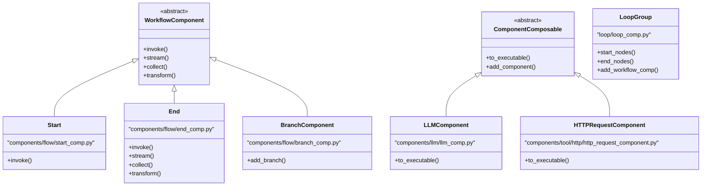
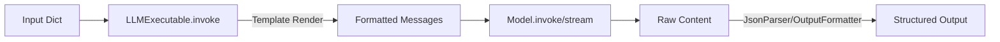
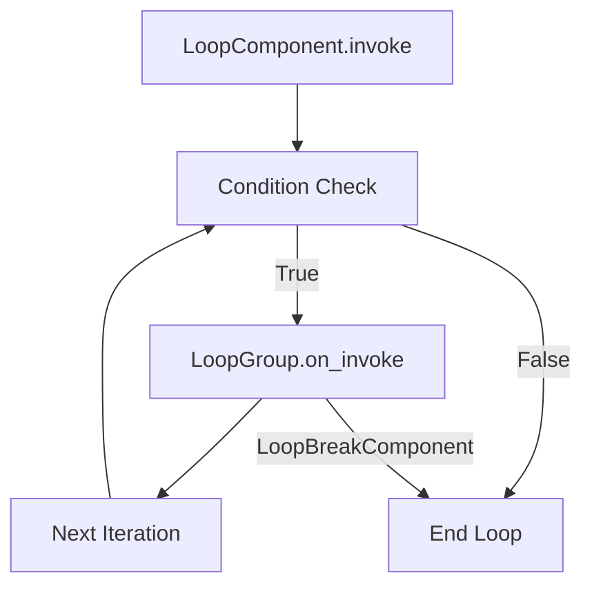

<!-- source: DeepWiki mcp.deepwiki.com · repo openJiuwen-ai/agent-core · page 4.2 Built-in Components · fetched 2026-11-02 -->

# Built-in Components

<details>
<summary>Relevant source files</summary>

The following files were used as context for generating this wiki page:

- [openjiuwen/core/common/exception/code_template.py](openjiuwen/core/common/exception/code_template.py)
- [openjiuwen/core/common/exception/errors.py](openjiuwen/core/common/exception/errors.py)
- [openjiuwen/core/common/exception/status_mapping.py](openjiuwen/core/common/exception/status_mapping.py)
- [openjiuwen/core/common/security/exception_utils.py](openjiuwen/core/common/security/exception_utils.py)
- [openjiuwen/core/common/security/json_utils.py](openjiuwen/core/common/security/json_utils.py)
- [openjiuwen/core/common/security/ssl_utils.py](openjiuwen/core/common/security/ssl_utils.py)
- [openjiuwen/core/common/security/url_utils.py](openjiuwen/core/common/security/url_utils.py)
- [openjiuwen/core/common/security/user_config.py](openjiuwen/core/common/security/user_config.py)
- [openjiuwen/core/common/task_manager/__init__.py](openjiuwen/core/common/task_manager/__init__.py)
- [openjiuwen/core/common/task_manager/manager.py](openjiuwen/core/common/task_manager/manager.py)
- [openjiuwen/core/common/task_manager/task.py](openjiuwen/core/common/task_manager/task.py)
- [openjiuwen/core/foundation/tool/auth/auth_callback.py](openjiuwen/core/foundation/tool/auth/auth_callback.py)
- [openjiuwen/core/session/tracer/data.py](openjiuwen/core/session/tracer/data.py)
- [openjiuwen/core/session/tracer/decorator.py](openjiuwen/core/session/tracer/decorator.py)
- [openjiuwen/core/single_agent/legacy/__init__.py](openjiuwen/core/single_agent/legacy/__init__.py)
- [openjiuwen/core/single_agent/legacy/agent.py](openjiuwen/core/single_agent/legacy/agent.py)
- [openjiuwen/core/workflow/components/condition/expression.py](openjiuwen/core/workflow/components/condition/expression.py)
- [openjiuwen/core/workflow/components/flow/loop/loop_comp.py](openjiuwen/core/workflow/components/flow/loop/loop_comp.py)
- [openjiuwen/core/workflow/components/flow/workflow_comp.py](openjiuwen/core/workflow/components/flow/workflow_comp.py)
- [openjiuwen/core/workflow/components/llm/intent_detection_comp.py](openjiuwen/core/workflow/components/llm/intent_detection_comp.py)
- [openjiuwen/core/workflow/components/llm/llm_comp.py](openjiuwen/core/workflow/components/llm/llm_comp.py)
- [openjiuwen/core/workflow/components/llm/questioner_comp.py](openjiuwen/core/workflow/components/llm/questioner_comp.py)
- [openjiuwen/core/workflow/components/tool/http/http_request_component.py](openjiuwen/core/workflow/components/tool/http/http_request_component.py)
- [openjiuwen/core/workflow/components/tool/tool_comp.py](openjiuwen/core/workflow/components/tool/tool_comp.py)
- [openjiuwen/dev_tools/tune/chat_agent/chat_agent.py](openjiuwen/dev_tools/tune/chat_agent/chat_agent.py)
- [openjiuwen/symphony/evaluation/__init__.py](openjiuwen/symphony/evaluation/__init__.py)
- [openjiuwen/symphony/evaluation/base.py](openjiuwen/symphony/evaluation/base.py)
- [openjiuwen/symphony/evaluation/evaluators.py](openjiuwen/symphony/evaluation/evaluators.py)
- [openjiuwen/symphony/evaluation/suite.py](openjiuwen/symphony/evaluation/suite.py)
- [openjiuwen/symphony/interfaces/capability.py](openjiuwen/symphony/interfaces/capability.py)
- [openjiuwen/symphony/interfaces/llm.py](openjiuwen/symphony/interfaces/llm.py)
- [tests/unit_tests/agent/test_backward_compatibility.py](tests/unit_tests/agent/test_backward_compatibility.py)
- [tests/unit_tests/core/__init__.py](tests/unit_tests/core/__init__.py)
- [tests/unit_tests/core/agent/controller/test_base_controller_conversation_isolation.py](tests/unit_tests/core/agent/controller/test_base_controller_conversation_isolation.py)
- [tests/unit_tests/core/common/security/test_security_url_utils.py](tests/unit_tests/core/common/security/test_security_url_utils.py)
- [tests/unit_tests/core/common/test_errors.py](tests/unit_tests/core/common/test_errors.py)
- [tests/unit_tests/core/common/test_task_manager.py](tests/unit_tests/core/common/test_task_manager.py)
- [tests/unit_tests/core/component/test_branch_comp.py](tests/unit_tests/core/component/test_branch_comp.py)
- [tests/unit_tests/core/component/test_end.py](tests/unit_tests/core/component/test_end.py)
- [tests/unit_tests/core/component/test_http_component.py](tests/unit_tests/core/component/test_http_component.py)
- [tests/unit_tests/core/component/test_intent_detection_comp.py](tests/unit_tests/core/component/test_intent_detection_comp.py)
- [tests/unit_tests/core/component/test_llm_comp.py](tests/unit_tests/core/component/test_llm_comp.py)
- [tests/unit_tests/core/component/test_loop_comp.py](tests/unit_tests/core/component/test_loop_comp.py)
- [tests/unit_tests/core/component/test_questioner_comp.py](tests/unit_tests/core/component/test_questioner_comp.py)
- [tests/unit_tests/core/component/test_sub_workflow_comp.py](tests/unit_tests/core/component/test_sub_workflow_comp.py)
- [tests/unit_tests/core/component/test_tool_comp.py](tests/unit_tests/core/component/test_tool_comp.py)
- [tests/unit_tests/core/component/test_visualize_workflow.py](tests/unit_tests/core/component/test_visualize_workflow.py)
- [tests/unit_tests/core/condition/test_condition.py](tests/unit_tests/core/condition/test_condition.py)
- [tests/unit_tests/core/foundation/tool/test_auth.py](tests/unit_tests/core/foundation/tool/test_auth.py)
- [tests/unit_tests/core/foundation/tool/test_validation.py](tests/unit_tests/core/foundation/tool/test_validation.py)
- [tests/unit_tests/core/memory/__init__.py](tests/unit_tests/core/memory/__init__.py)
- [tests/unit_tests/core/memory/manage/__init__.py](tests/unit_tests/core/memory/manage/__init__.py)
- [tests/unit_tests/core/memory/test_add_messages_result_and_proactive_memory.py](tests/unit_tests/core/memory/test_add_messages_result_and_proactive_memory.py)
- [tests/unit_tests/core/runner/__init__.py](tests/unit_tests/core/runner/__init__.py)
- [tests/unit_tests/core/runner/callback/test_events_scope.py](tests/unit_tests/core/runner/callback/test_events_scope.py)
- [tests/unit_tests/core/runner/dunner/test_remote_agent.py](tests/unit_tests/core/runner/dunner/test_remote_agent.py)
- [tests/unit_tests/core/runner/test_runner.py](tests/unit_tests/core/runner/test_runner.py)
- [tests/unit_tests/core/session/tracer/test_agent.py](tests/unit_tests/core/session/tracer/test_agent.py)
- [tests/unit_tests/core/session/tracer/test_decorator.py](tests/unit_tests/core/session/tracer/test_decorator.py)
- [tests/unit_tests/core/workflow/__init__.py](tests/unit_tests/core/workflow/__init__.py)
- [tests/unit_tests/core/workflow/mock_nodes.py](tests/unit_tests/core/workflow/mock_nodes.py)
- [tests/unit_tests/core/workflow/test_workflow_with_interrupt.py](tests/unit_tests/core/workflow/test_workflow_with_interrupt.py)
- [tests/unit_tests/dev_tools/tune/test_chat_agent_invoke.py](tests/unit_tests/dev_tools/tune/test_chat_agent_invoke.py)
- [tests/unit_tests/harness/tools/test_file_op_history.py](tests/unit_tests/harness/tools/test_file_op_history.py)

</details>


This page documents every workflow component bundled with the SDK. It covers each component's config class, inputs, outputs, and usage patterns. For information on how to define a workflow graph and wire components together, see [4.1](). For implementing custom components, see [4.3](). For the graph execution model that drives these components, see [4.4]().

---

## Component Catalog

All built-in components implement either `WorkflowComponent` or `ComponentComposable` from [openjiuwen/core/workflow/components/component.py]().

| Component | Config Class | File |
|---|---|---|
| `Start` | — | `components/flow/start_comp.py` |
| `End` | `EndConfig` | `components/flow/end_comp.py` |
| `LLMComponent` | `LLMCompConfig` | `components/llm/llm_comp.py` |
| `QuestionerComponent` | `QuestionerConfig` | `components/llm/questioner_comp.py` |
| `IntentDetectionComponent` | `IntentDetectionCompConfig` | `components/llm/intent_detection_comp.py` |
| `ToolComponent` | `ToolComponentConfig` | `components/tool/tool_comp.py` |
| `HTTPRequestComponent` | `HttpComponentConfig` | `components/tool/http/http_request_component.py` |
| `ReActAgentComponent` | `ReActAgentCompConfig` | `components/llm/react/react_component.py` |
| `BranchComponent` | — | `components/flow/branch_comp.py` |
| `LoopComponent` | — | `components/flow/loop/loop_comp.py` |
| `LoopGroup` | — | `components/flow/loop/loop_comp.py` |
| `LoopSetVariableComponent` | — | `components/flow/loop/loop_comp.py` |
| `LoopBreakComponent` | — | `components/flow/loop/loop_comp.py` |
| `SubWorkflowComponent` | — | `components/flow/workflow_comp.py` |

**Component class hierarchy**



Sources: [openjiuwen/core/workflow/components/component.py:15-16](), [openjiuwen/core/workflow/components/llm/llm_comp.py:14-15](), [openjiuwen/core/workflow/components/tool/http/http_request_component.py:23-24]()

---

## Start and End Components

### Start
**Class:** `Start`  
**File:** `openjiuwen/core/workflow/components/flow/start_comp.py`

The `Start` component is the entry point of the workflow. It receives user inputs and forwards them to downstream nodes based on the `inputs_schema` configured via the workflow builder.

### End
**Class:** `End`  
**Config:** `EndConfig`  
**File:** `openjiuwen/core/workflow/components/flow/end_comp.py`

The `End` component defines the output point. It supports four capabilities: `invoke`, `stream`, `transform`, and `collect`.

- **Template Rendering:** Uses `{{}}` syntax to fill slots from input parameters.
- **Response Mode:** If configured with a `response_template`, it returns a structured `response` field. Otherwise, it returns the raw `output` dictionary.

---

## LLMComponent

**Class:** `LLMComponent` | **Executable:** `LLMExecutable` | **Config:** `LLMCompConfig`

Wraps a single LLM call. Supports text, markdown, and JSON response formats with schema validation.

### Config: `LLMCompConfig`

| Field | Type | Description |
|---|---|---|
| `model_id` | `Optional[str]` | Lookup via `Runner.resource_mgr` |
| `template_content` | `List[Any]` | List of role/content dicts for the prompt |
| `response_format` | `dict` | `{"type": "text" | "json" | "markdown"}` |
| `output_config` | `dict` | Schema for parsing JSON outputs |

**Data Flow in LLMExecutable**



**Implementation Details:**
- `LLMExecutable` handles the conversion of input variables into the final prompt using `PromptTemplate` [openjiuwen/core/workflow/components/llm/llm_comp.py:20-23]().
- It uses `JsonParser` to clean markdown blocks (e.g., ` ```json `) before parsing structured outputs [openjiuwen/core/workflow/components/llm/llm_comp.py:168-185]().
- Output validation is performed by `ValidationUtils` to ensure the LLM response matches the expected JSON schema [openjiuwen/core/workflow/components/llm/llm_comp.py:68-100]().

Sources: [openjiuwen/core/workflow/components/llm/llm_comp.py:168-185](), [tests/unit_tests/core/component/test_llm_comp.py:137-146]()

---

## QuestionerComponent

**Class:** `QuestionerComponent` | **Executable:** `QuestionerExecutable` | **Config:** `QuestionerConfig`

An interactive component for collecting missing parameters from users via multi-turn dialogue.

- **Interruption:** If required fields (defined in `field_names`) are missing, it uses `QuestionerState` to track progress and can trigger an interactive loop [openjiuwen/core/workflow/components/llm/questioner_comp.py:172-198]().
- **State Management:** `QuestionerState` persists `extracted_key_fields` across turns [openjiuwen/core/workflow/components/llm/questioner_comp.py:172-177]().
- **Language Support:** Supports English and Chinese templates for the internal LLM agent [openjiuwen/core/workflow/components/llm/questioner_comp.py:38-101]().

Sources: [openjiuwen/core/workflow/components/llm/questioner_comp.py:120-143](), [openjiuwen/core/workflow/components/llm/questioner_comp.py:172-198]()

---

## IntentDetectionComponent

**Class:** `IntentDetectionComponent` | **Executable:** `IntentDetectionExecutable` | **Config:** `IntentDetectionCompConfig`

Classifies user input into categories. It automatically configures a `BranchRouter` to drive conditional connections in the workflow [openjiuwen/core/workflow/components/llm/intent_detection_comp.py:185-195]().

- **Prompting:** Uses a default system prompt and user prompt that includes `category_info` and `chat_history` [openjiuwen/core/workflow/components/llm/intent_detection_comp.py:89-132]().
- **Output:** Returns `classification_id`, `category_name`, and `reason` [openjiuwen/core/workflow/components/llm/intent_detection_comp.py:178-181]().
- **Robustness:** Includes a `_refix_llm_output` method to handle common LLM formatting errors in JSON blocks [openjiuwen/core/workflow/components/llm/intent_detection_comp.py:197-198]().

Sources: [openjiuwen/core/workflow/components/llm/intent_detection_comp.py:153-181](), [openjiuwen/core/workflow/components/llm/intent_detection_comp.py:185-195]()

---

## ToolComponent

**Class:** `ToolComponent` | **Executable:** `ToolExecutable` | **Config:** `ToolComponentConfig`

Executes a specific tool by ID. Supports `RestfulApi` and local function tools.

- **Initialization:** Binds a tool from `Runner.resource_mgr` using `tool_id`.
- **Execution:** Validates inputs against tool schema and handles `BaseError` during invocation.

Sources: [openjiuwen/core/workflow/components/tool/tool_comp.py:22-43]()

---

## HTTPRequestComponent

**Class:** `HTTPRequestComponent` | **Executable:** `HTTPRequestExecutable` | **Config:** `HttpComponentConfig`

Performs raw HTTP requests with advanced configuration for auth, retries, and SSL.

### Config: `HttpRequestParamConfig`
| Field | Type | Description |
|---|---|---|
| `url` | `str` | Supports `{{placeholder}}` syntax [openjiuwen/core/workflow/components/tool/http/http_request_component.py:171-176]() |
| `method` | `str` | GET, POST, etc. |
| `authentication` | `HttpAuthConfig` | Basic, Bearer, API Key, AWS Sig [openjiuwen/core/workflow/components/tool/http/http_request_component.py:54-69]() |
| `retry_config` | `HttpRetryConfig` | Max retries and backoff logic [openjiuwen/core/workflow/components/tool/http/http_request_component.py:102-108]() |

**Auth Strategies:**
The component utilizes `AuthStrategyRegistry` to resolve different authentication types like `SSLAuthStrategy` and `HeaderQueryAuthStrategy` [openjiuwen/core/foundation/tool/auth/auth_callback.py:11-17]().

Sources: [openjiuwen/core/workflow/components/tool/http/http_request_component.py:116-133](), [openjiuwen/core/foundation/tool/auth/auth_callback.py:11-17]()

---

## Branch and Loop Components

### Branching
- **BranchComponent:** A dedicated node for multi-path routing.
- **BranchRouter:** Evaluates conditions (DSL strings or callables) to determine the next node.

### Looping
- **LoopComponent:** The entry point for iterations. Configures `loop_type` (number/array).
- **LoopGroup:** A sub-graph container for nodes executed within the loop [openjiuwen/core/workflow/components/flow/loop/loop_comp.py:46-55]().
- **LoopBreakComponent:** Terminates the loop based on a condition [openjiuwen/core/workflow/components/flow/loop/loop_comp.py:79-80]().

**Loop Execution Flow**



**Key Implementation Logic:**
- `LoopGroup` manages its own internal `SubWorkflowSession` to isolate iteration state [openjiuwen/core/workflow/components/flow/loop/loop_comp.py:118-120]().
- `LoopGroup` ensures that `LoopComponent` cannot be nested directly within another `LoopGroup` to prevent recursion complexity [openjiuwen/core/workflow/components/flow/loop/loop_comp.py:70-74]().

Sources: [openjiuwen/core/workflow/components/flow/loop/loop_comp.py:46-130](), [openjiuwen/core/workflow/components/flow/loop/loop_comp.py:118-120]()

---

