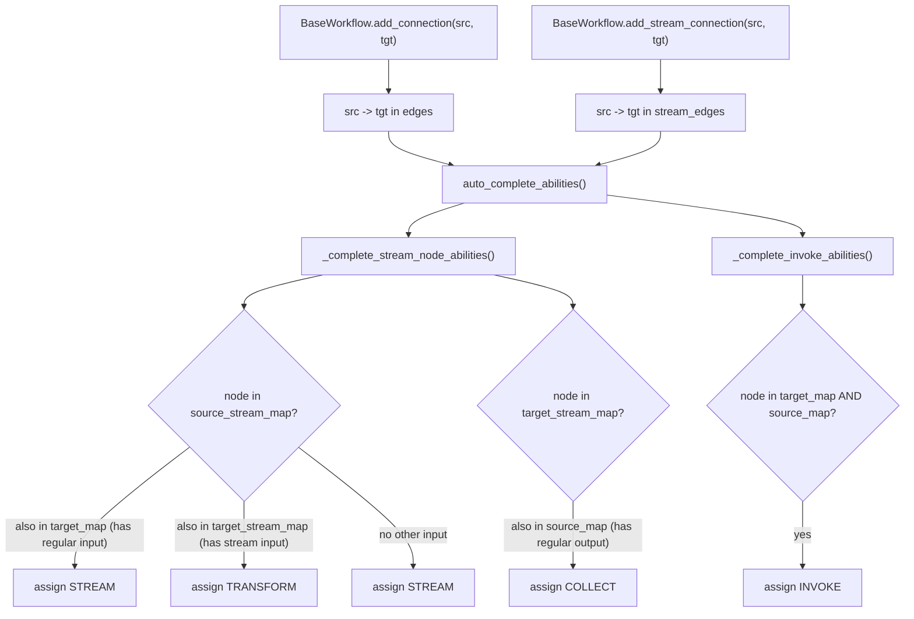
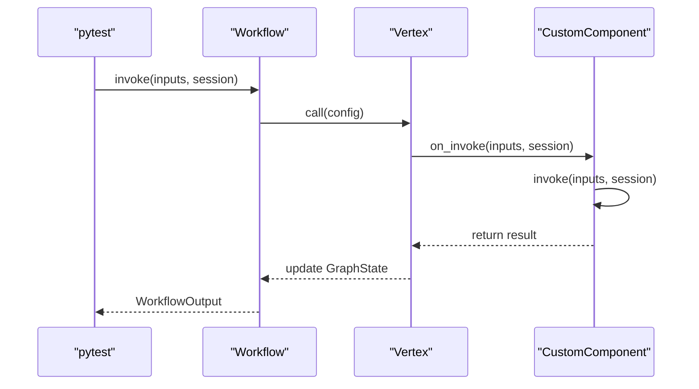

<!-- source: DeepWiki mcp.deepwiki.com · repo openJiuwen-ai/agent-core · page 4.3 Custom Components · fetched 2026-11-02 -->

# Custom Components

<details>
<summary>Relevant source files</summary>

The following files were used as context for generating this wiki page:

- [openjiuwen/core/graph/graph.py](openjiuwen/core/graph/graph.py)
- [openjiuwen/core/graph/pregel/builder.py](openjiuwen/core/graph/pregel/builder.py)
- [openjiuwen/core/graph/pregel/channels.py](openjiuwen/core/graph/pregel/channels.py)
- [openjiuwen/core/graph/pregel/engine.py](openjiuwen/core/graph/pregel/engine.py)
- [openjiuwen/core/graph/pregel/task.py](openjiuwen/core/graph/pregel/task.py)
- [openjiuwen/core/graph/stream_actor/base.py](openjiuwen/core/graph/stream_actor/base.py)
- [openjiuwen/core/graph/stream_actor/manager.py](openjiuwen/core/graph/stream_actor/manager.py)
- [openjiuwen/core/graph/vertex.py](openjiuwen/core/graph/vertex.py)
- [openjiuwen/core/runner/callback/utils.py](openjiuwen/core/runner/callback/utils.py)
- [openjiuwen/core/session/node.py](openjiuwen/core/session/node.py)
- [openjiuwen/core/session/state/agent_state.py](openjiuwen/core/session/state/agent_state.py)
- [openjiuwen/core/session/state/base.py](openjiuwen/core/session/state/base.py)
- [openjiuwen/core/session/state/workflow_state.py](openjiuwen/core/session/state/workflow_state.py)
- [openjiuwen/core/session/utils.py](openjiuwen/core/session/utils.py)
- [openjiuwen/core/workflow/__init__.py](openjiuwen/core/workflow/__init__.py)
- [openjiuwen/core/workflow/_workflow.py](openjiuwen/core/workflow/_workflow.py)
- [openjiuwen/core/workflow/components/component.py](openjiuwen/core/workflow/components/component.py)
- [openjiuwen/core/workflow/components/flow/branch_comp.py](openjiuwen/core/workflow/components/flow/branch_comp.py)
- [openjiuwen/core/workflow/components/flow/branch_router.py](openjiuwen/core/workflow/components/flow/branch_router.py)
- [openjiuwen/core/workflow/components/flow/end_comp.py](openjiuwen/core/workflow/components/flow/end_comp.py)
- [openjiuwen/core/workflow/workflow.py](openjiuwen/core/workflow/workflow.py)
- [openjiuwen/core/workflow/workflow_config.py](openjiuwen/core/workflow/workflow_config.py)
- [tests/unit_tests/core/graph/test_barrier_cnf.py](tests/unit_tests/core/graph/test_barrier_cnf.py)
- [tests/unit_tests/core/session/test_session.py](tests/unit_tests/core/session/test_session.py)
- [tests/unit_tests/core/session/tracer/test_workflow_tracer.py](tests/unit_tests/core/session/tracer/test_workflow_tracer.py)
- [tests/unit_tests/core/workflow/test_workflow.py](tests/unit_tests/core/workflow/test_workflow.py)
- [tests/unit_tests/core/workflow/test_workflow_with_comp_stream.py](tests/unit_tests/core/workflow/test_workflow_with_comp_stream.py)

</details>


This page explains how to implement custom `WorkflowComponent` subclasses for use in a workflow graph. It covers the execution interfaces (`ComponentExecutable`, `ComponentComposable`), the four execution methods, how `ComponentAbility` is assigned from graph topology, and how to use the `Session` object inside a component.

For documentation on the built-in components (`LLMComponent`, `BranchComp`, `LoopComp`, etc.), see [4.2](). For the graph execution internals that call these methods, see [4.4](). For workflow construction (`add_workflow_comp`, `add_stream_connection`, etc.), see [4.1]().

---

## Component Architecture

Every component in the workflow system is defined by two separable concerns: **execution logic** and **graph construction**. These are separated into two abstract base classes that `WorkflowComponent` unifies.

**Component class hierarchy diagram**

```mermaid
classDiagram
    class "Executable" {
        +on_invoke(inputs, session)
        +on_stream(inputs, session)
        +on_collect(inputs, session)
        +on_transform(inputs, session)
        +skip_trace() bool
        +graph_invoker() bool
        +post_commit() bool
        +component_type() str
    }

    class "ComponentExecutable" {
        +on_invoke(inputs, session)
        +on_stream(inputs, session)
        +on_collect(inputs, session)
        +on_transform(inputs, session)
        +invoke(inputs, session, context)
        +stream(inputs, session, context)
        +collect(inputs, session, context)
        +transform(inputs, session, context)
    }

    class "ComponentComposable" {
        +add_component(graph, node_id, wait_for_all)
        +to_executable() Executable
    }

    class "WorkflowComponent" {
    }

    "Executable" <|-- "ComponentExecutable"
    "ComponentExecutable" <|-- "WorkflowComponent"
    "ComponentComposable" <|-- "WorkflowComponent"
```

- **`Executable`** [openjiuwen/core/graph/executable.py:15-63]() — the low-level interface the graph engine calls. Its `on_*` methods wrap and delegate to the user-facing methods on `ComponentExecutable`.
- **`ComponentExecutable`** [openjiuwen/core/workflow/components/component.py:77-170]() — defines the four public user-facing methods (`invoke`, `stream`, `collect`, `transform`) and implements the `on_*` delegation. It also integrates with the `lazy_callback_framework` to emit events like `COMPONENT_BATCH_INPUT` and `COMPONENT_STREAM_OUTPUT` [openjiuwen/core/workflow/components/component.py:22-74]().
- **`ComponentComposable`** [openjiuwen/core/workflow/components/component.py:173-219]() — defines `add_component`, which registers the component as a node in the underlying `Graph`, and `to_executable`, which returns the runtime representation.
- **`WorkflowComponent`** [openjiuwen/core/workflow/components/component.py:222-243]() — the standard base class for user-defined components. Subclass this for typical use cases.

Sources: [openjiuwen/core/workflow/components/component.py:22-243](), [openjiuwen/core/graph/executable.py:15-63]()

---

## The Four Execution Methods

The four methods correspond to the four data-flow patterns that can appear in a workflow graph.

| Method | Input | Output | Triggered when |
|---|---|---|---|
| `invoke` | `dict` (batch) | `dict` (batch) | Connected via `add_connection` only |
| `stream` | `dict` (batch) | `AsyncIterator[dict]` | Component is a source on `add_stream_connection` |
| `collect` | `dict` containing `AsyncIterator` | `dict` (batch) | Component is a target on `add_stream_connection` with a regular output edge |
| `transform` | `dict` containing `AsyncIterator` | `AsyncIterator[dict]` | Component is both a target and source on `add_stream_connection` |

All four methods share the same signature pattern:

```python
async def invoke(self, inputs: Input, session: Session, context: ModelContext) -> Output: ...
async def stream(self, inputs: Input, session: Session, context: ModelContext) -> AsyncIterator[Output]: ...
async def collect(self, inputs: Input, session: Session, context: ModelContext) -> Output: ...
async def transform(self, inputs: Input, session: Session, context: ModelContext) -> AsyncIterator[Output]: ...
```

Sources: [openjiuwen/core/workflow/components/component.py:95-170]()

### `invoke`
Receives a `dict` and returns a `dict`. The most common pattern for simple transformations. [openjiuwen/core/workflow/components/component.py:124-146]()

### `stream`
Receives a `dict` and is an `async def` that uses `yield` to emit output chunks. Each yielded value is forwarded downstream as a stream frame. [openjiuwen/core/workflow/components/component.py:148-170]()

### `collect`
Receives a `dict` where values are `AsyncIterator` objects. Iterates the stream and returns a single `dict` when all input is consumed. [openjiuwen/core/workflow/components/component.py:109-114]()

### `transform`
Receives a `dict` where values are `AsyncIterator` objects. Uses `yield` to re-emit transformed chunks. Input and output are both streaming. [openjiuwen/core/workflow/components/component.py:116-122]()

---

## ComponentAbility and Graph Topology Inference

`ComponentAbility` is an enum with four values: `INVOKE`, `STREAM`, `COLLECT`, `TRANSFORM`. [openjiuwen/core/workflow/components/base.py:15-19]() The `Vertex` execution engine reads these abilities from `NodeSpec.abilities` to decide which `on_*` strategy to call at runtime. [openjiuwen/core/graph/vertex.py:93-97]()

**Ability inference from graph topology diagram**



`auto_complete_abilities()` [openjiuwen/core/workflow/_workflow.py:238-251]() is called automatically during workflow compilation. If a user provides `comp_ability` explicitly in `add_workflow_comp`, that component is skipped by the auto-complete logic. [openjiuwen/core/workflow/_workflow.py:188-192]()

### Explicit ability override

Pass `comp_ability` to `add_workflow_comp` to bypass inference:

```python
workflow.add_workflow_comp(
    'C',
    MyComponent(),
    inputs_schema={'a': '${B.result}'},
    stream_inputs_schema={'data': '${A.output}'},
    comp_ability=[ComponentAbility.TRANSFORM, ComponentAbility.STREAM]
)
```

**Rule:** Components with `TRANSFORM` or `COLLECT` abilities must set `wait_for_all=True`. The framework enforces this with a validation error. [openjiuwen/core/workflow/_workflow.py:177-178]()

Sources: [openjiuwen/core/workflow/_workflow.py:238-344](), [openjiuwen/core/graph/vertex.py:93-97](), [openjiuwen/core/workflow/components/base.py:15-19]()

---

## The `ComponentComposable` Interface

`ComponentComposable.add_component` [openjiuwen/core/workflow/components/component.py:173-196]() is called by `BaseWorkflow.add_workflow_comp` to register the component into the `Graph`. By default, it calls `graph.add_node(node_id, self.to_executable(), ...)`.

```python
def add_component(self, graph: Graph, node_id: str, wait_for_all: bool = False) -> None:
    graph.add_node(node_id, self.to_executable(), wait_for_all=wait_for_all)
```

`to_executable()` [openjiuwen/core/workflow/components/component.py:198-219]() returns `self` if the component already implements `Executable` (which `WorkflowComponent` does). For composite or wrapping components, this can be overridden to return a different `Executable` instance.

Sources: [openjiuwen/core/workflow/components/component.py:173-219]()

---

## Session Object

The `Session` object (aliased from `openjiuwen.core.session.node.Session`) is passed as the `session` argument to all four execution methods. It provides access to runtime context and state. [openjiuwen/core/session/node.py:17-101]()

**Session API**

| Method | Description |
|---|---|
| `get_workflow_id()` | The workflow's unique ID |
| `get_component_id()` | This component's node ID |
| `get_session_id()` | The user session ID |
| `update_state(data)` | Write to component-local state |
| `get_state(key)` | Read from component-local state |
| `update_global_state(data)` | Write to workflow-global state |
| `get_global_state(key)` | Read from workflow-global state |
| `write_stream(data)` | Emit a stream frame directly to the output writer |
| `interact(value)` | Pause and request user input (emits `INTERACTION` event) |
| `trace(data)` | Emit structured trace data |
| `get_env(key)` | Read a workflow environment variable |

Sources: [openjiuwen/core/session/node.py:17-101](), [openjiuwen/core/workflow/components/component.py:15-17]()

---

## Building a Custom Component

### Minimal `invoke`-only component

```python
from openjiuwen.core.workflow import WorkflowComponent, Input, Output
from openjiuwen.core.workflow.components import Session
from openjiuwen.core.context_engine import ModelContext

class MyTransformComponent(WorkflowComponent):
    async def invoke(self, inputs: Input, session: Session, context: ModelContext) -> Output:
        value = inputs.get("text", "")
        return {"result": value.upper()}
```

### Component with streaming output

```python
class MyStreamComponent(WorkflowComponent):
    async def stream(self, inputs: Input, session: Session, context: ModelContext):
        items = inputs.get("array", [])
        for item in items:
            yield {"chunk": item}
```

Sources: [tests/unit_tests/core/workflow/test_workflow_with_comp_stream.py:33-52](), [tests/unit_tests/core/workflow/test_workflow_with_comp_stream.py:73-82]()

---

## Testing Custom Components

Custom components are tested by constructing a `Workflow` object, registering the component, and calling `invoke` or iterating `stream`. [tests/unit_tests/core/workflow/test_workflow.py:94-113]()

For unit testing individual components without a full workflow graph, the `execute_single_component` utility can be used. [openjiuwen/core/workflow/_workflow.py:55-135]()

**Component Execution Test Pattern diagram**



```python
from openjiuwen.core.workflow import Workflow, Start, End, create_workflow_session

async def test_my_component():
    wf = Workflow()
    wf.set_start_comp("start", Start())
    wf.add_workflow_comp("node", MyTransformComponent(), inputs_schema={"text": "${start.text}"})
    wf.set_end_comp("end", End(), inputs_schema={"result": "${node.result}"})
    wf.add_connection("start", "node")
    wf.add_connection("node", "end")

    result = await wf.invoke({"text": "hello"}, create_workflow_session())
    assert result.result == {"result": "HELLO"}
```

Sources: [tests/unit_tests/core/workflow/test_workflow.py:94-113](), [openjiuwen/core/workflow/_workflow.py:55-135]()

---

