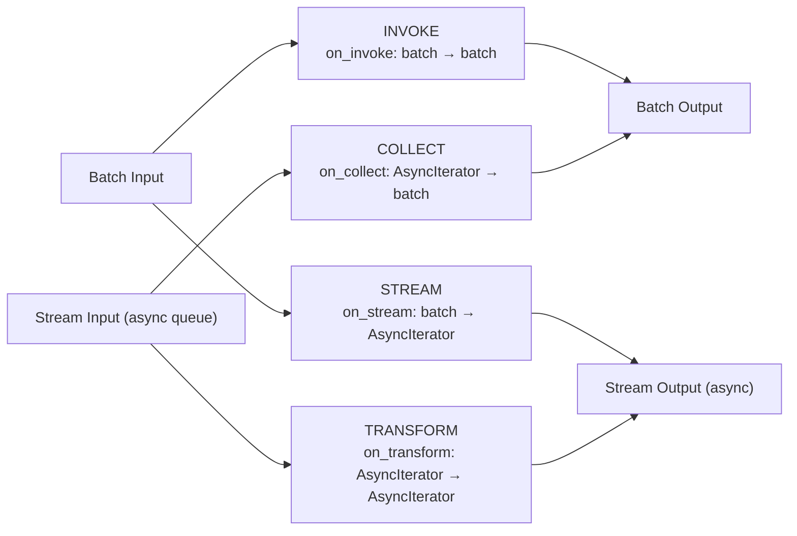
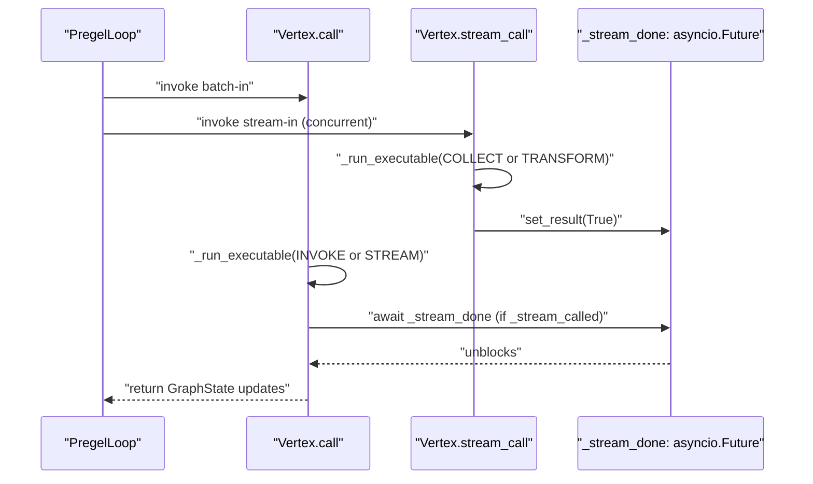
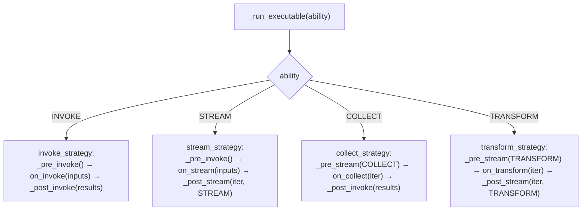
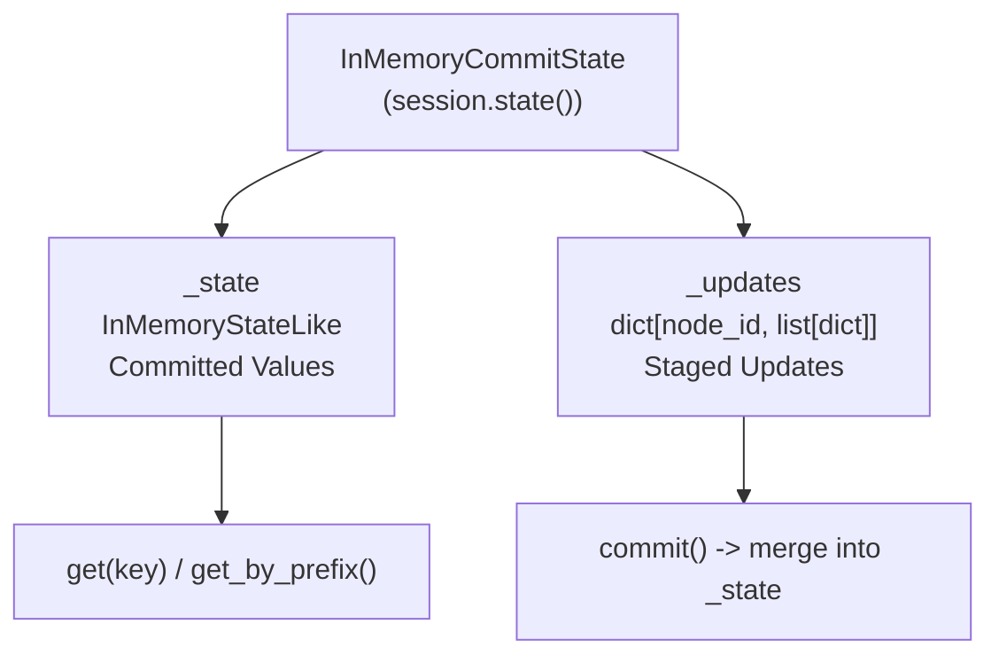
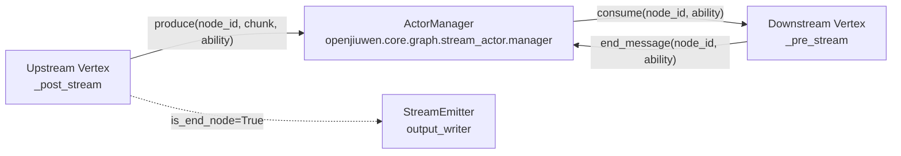

<!-- source: DeepWiki mcp.deepwiki.com · repo openJiuwen-ai/agent-core · page 4.4 Graph Execution Engine · fetched 2026-11-02 -->

# Graph Execution Engine

<details>
<summary>Relevant source files</summary>

The following files were used as context for generating this wiki page:

- [openjiuwen/core/graph/graph.py](openjiuwen/core/graph/graph.py)
- [openjiuwen/core/graph/pregel/builder.py](openjiuwen/core/graph/pregel/builder.py)
- [openjiuwen/core/graph/pregel/channels.py](openjiuwen/core/graph/pregel/channels.py)
- [openjiuwen/core/graph/pregel/engine.py](openjiuwen/core/graph/pregel/engine.py)
- [openjiuwen/core/graph/pregel/task.py](openjiuwen/core/graph/pregel/task.py)
- [openjiuwen/core/graph/stream_actor/base.py](openjiuwen/core/graph/stream_actor/base.py)
- [openjiuwen/core/graph/stream_actor/manager.py](openjiuwen/core/graph/stream_actor/manager.py)
- [openjiuwen/core/graph/vertex.py](openjiuwen/core/graph/vertex.py)
- [openjiuwen/core/runner/callback/utils.py](openjiuwen/core/runner/callback/utils.py)
- [openjiuwen/core/session/node.py](openjiuwen/core/session/node.py)
- [openjiuwen/core/session/state/agent_state.py](openjiuwen/core/session/state/agent_state.py)
- [openjiuwen/core/session/state/base.py](openjiuwen/core/session/state/base.py)
- [openjiuwen/core/session/state/workflow_state.py](openjiuwen/core/session/state/workflow_state.py)
- [openjiuwen/core/session/utils.py](openjiuwen/core/session/utils.py)
- [openjiuwen/core/workflow/__init__.py](openjiuwen/core/workflow/__init__.py)
- [openjiuwen/core/workflow/_workflow.py](openjiuwen/core/workflow/_workflow.py)
- [openjiuwen/core/workflow/components/component.py](openjiuwen/core/workflow/components/component.py)
- [openjiuwen/core/workflow/components/flow/branch_comp.py](openjiuwen/core/workflow/components/flow/branch_comp.py)
- [openjiuwen/core/workflow/components/flow/branch_router.py](openjiuwen/core/workflow/components/flow/branch_router.py)
- [openjiuwen/core/workflow/components/flow/end_comp.py](openjiuwen/core/workflow/components/flow/end_comp.py)
- [openjiuwen/core/workflow/workflow.py](openjiuwen/core/workflow/workflow.py)
- [openjiuwen/core/workflow/workflow_config.py](openjiuwen/core/workflow/workflow_config.py)
- [tests/unit_tests/core/graph/test_barrier_cnf.py](tests/unit_tests/core/graph/test_barrier_cnf.py)
- [tests/unit_tests/core/session/test_session.py](tests/unit_tests/core/session/test_session.py)
- [tests/unit_tests/core/session/tracer/test_workflow_tracer.py](tests/unit_tests/core/session/tracer/test_workflow_tracer.py)
- [tests/unit_tests/core/workflow/test_workflow.py](tests/unit_tests/core/workflow/test_workflow.py)
- [tests/unit_tests/core/workflow/test_workflow_with_comp_stream.py](tests/unit_tests/core/workflow/test_workflow_with_comp_stream.py)

</details>


This page documents the internals of the graph execution engine: the `Vertex` lifecycle, the `Executable` interface, the `ComponentAbility` dispatch model, `GraphState` and `CommitState` structures, streaming data flow between vertices, and sub-workflow execution.

For how to construct workflow graphs using the DSL (adding components and connections), see [4.1 Defining Workflows](). For how `WorkflowComponent` subclasses implement the executable interface from the user's perspective, see [4.3 Custom Components](). For tracing instrumentation added at the vertex level, see [4.5 Workflow Tracing](). For session checkpointing and interrupt/resume, see [2.6 Sessions and Checkpointing]().

---

## Core Abstractions

### Executable Interface

`Executable` [openjiuwen/core/graph/executable.py:16-63]() is the base class for any node that can be placed in a graph. It defines four entry-point methods, one per ability mode:

| Method | Signature | Corresponding Ability |
|---|---|---|
| `on_invoke` | `(inputs, session, **kwargs) → Output` | `INVOKE` |
| `on_stream` | `(inputs, session, **kwargs) → AsyncIterator[Output]` | `STREAM` |
| `on_collect` | `(AsyncIterator[Input], session, **kwargs) → Output` | `COLLECT` |
| `on_transform` | `(AsyncIterator[Input], session, **kwargs) → AsyncIterator[Output]` | `TRANSFORM` |

Metadata methods on `Executable`:

| Method | Default | Effect |
|---|---|---|
| `skip_trace()` | `False` | Suppresses all tracing calls on the vertex when `True` [openjiuwen/core/graph/executable.py:38-46]() |
| `graph_invoker()` | `False` | When `True`, inputs are packaged as `{INPUTS_KEY: …, CONFIG_KEY: …}` (sub-graph mode) [openjiuwen/core/graph/executable.py:48-56]() |
| `post_commit()` | `True` | Routes dispatch through `atomic_invoke` (with commit) vs. `call()` directly [openjiuwen/core/graph/executable.py:58-63]() |

**Sources:** [openjiuwen/core/graph/executable.py:16-63]()

---

### ComponentAbility Enum

`ComponentAbility` [openjiuwen/core/workflow/components/base.py:27-32]() classifies a vertex by how it interacts with the data plane. Abilities are split into two groups by their trigger mechanism:

**Title: ComponentAbility — data flow characteristics**



A single vertex can hold **multiple** abilities simultaneously. The abilities for a vertex are stored in `NodeSpec.abilities` [openjiuwen/core/workflow/workflow_config.py:42]() and read in `Vertex.init()` [openjiuwen/core/graph/vertex.py:93-95]().

Internally, the vertex partitions abilities into two lists:
- **Batch-in** (`call` path): `[INVOKE, STREAM]`
- **Stream-in** (`stream_call` path): `[COLLECT, TRANSFORM]` — determined by `_stream_abilities()` [openjiuwen/core/graph/vertex.py:484-487]().

**Sources:** [openjiuwen/core/graph/vertex.py:93-97](), [openjiuwen/core/workflow/components/base.py:27-32](), [openjiuwen/core/workflow/workflow_config.py:33-46]()

---

### GraphState

`GraphState` [openjiuwen/core/graph/graph_state.py:17-18]() is the shared state dictionary threaded through the Pregel-style execution loop. It tracks the execution path and allows for data aggregation across parallel branches.

**Sources:** [openjiuwen/core/graph/graph_state.py:17-18]()

---

## Vertex Lifecycle

`Vertex` [openjiuwen/core/graph/vertex.py:65-66]() is the primary execution unit. It extends both `AsyncAtomicNode` (for commit semantics) and `StreamConsumer` (for stream-in routing).

### Initialization

`Vertex.init(session, **kwargs)` [openjiuwen/core/graph/vertex.py:87-112]() is called once before execution begins:

1. Wraps the parent `BaseSession` in a `NodeSession` scoped to this vertex's `node_id` [openjiuwen/core/graph/vertex.py:88-89]().
2. Reads `COMP_STREAM_CALL_TIMEOUT_KEY` from session environment [openjiuwen/core/graph/vertex.py:91]().
3. Reads `abilities` from `NodeConfig` to determine execution modes; defaults to `[INVOKE]` [openjiuwen/core/graph/vertex.py:93-95]().
4. Sets `_has_stream_call` and `_has_call` flags based on the capability split [openjiuwen/core/graph/vertex.py:96-97]().

### Two Entry Points

A vertex has two concurrent entry points that may be triggered simultaneously:

| Entry Point | Method | Triggered by |
|---|---|---|
| Batch-in | `call(config)` | All upstream batch edges have data [openjiuwen/core/graph/vertex.py:179-218]() |
| Stream-in | `stream_call(event, done_callback)` | An upstream stream edge begins emitting [openjiuwen/core/graph/vertex.py:349-373]() |

**Title: Vertex dual-entry-point synchronization via `_stream_done`**



`_stream_done` [openjiuwen/core/graph/vertex.py:74]() is an `asyncio.Future` reset at the start of each cycle. The batch-in path only awaits it when `_stream_called()` is `True`, i.e., `stream_call_count == call_count + 1` [openjiuwen/core/graph/vertex.py:399-400]().

**Sources:** [openjiuwen/core/graph/vertex.py:65-76](), [openjiuwen/core/graph/vertex.py:179-218](), [openjiuwen/core/graph/vertex.py:349-400]()

---

### Ability Strategy Dispatch

`_run_executable` [openjiuwen/core/graph/vertex.py:114-177]() selects an execution strategy from a dictionary keyed by `ComponentAbility`:

**Title: `_run_executable` — per-ability strategy dispatch**



| Ability | Pre-step | Execution call | Post-step |
|---|---|---|---|
| `INVOKE` | `_pre_invoke()` — resolves `inputs_schema` from state [openjiuwen/core/graph/vertex.py:129-130]() | `executable.on_invoke(inputs, session)` [openjiuwen/core/graph/vertex.py:138]() | `_post_invoke(results)` — writes to state [openjiuwen/core/graph/vertex.py:141]() |
| `STREAM` | `_pre_invoke()` | `executable.on_stream(inputs, session)` [openjiuwen/core/graph/vertex.py:155]() | `_post_stream(iter, STREAM)` — emits chunks [openjiuwen/core/graph/vertex.py:156]() |
| `COLLECT` | `_pre_stream(COLLECT)` — consumes queue [openjiuwen/core/graph/vertex.py:160]() | `executable.on_collect(iter, session)` [openjiuwen/core/graph/vertex.py:161]() | `_post_invoke(results)` [openjiuwen/core/graph/vertex.py:162]() |
| `TRANSFORM` | `_pre_stream(TRANSFORM)` [openjiuwen/core/graph/vertex.py:166]() | `executable.on_transform(iter, session)` [openjiuwen/core/graph/vertex.py:167]() | `_post_stream(iter, TRANSFORM)` [openjiuwen/core/graph/vertex.py:168]() |

**Sources:** [openjiuwen/core/graph/vertex.py:114-177]()

---

## State Management

### CommitState

`CommitStateLike` [openjiuwen/core/session/state/base.py:46-70]() is the interface for state objects that support transactional updates. `InMemoryCommitState` [openjiuwen/core/session/state/base.py:137-200]() implements this by wrapping an `InMemoryStateLike` object and tracking pending `_updates`.

| Method | Purpose |
|---|---|
| `update_by_id(node_id, data)` | Stages an update for a specific node in `_updates` [openjiuwen/core/session/state/base.py:145-150]() |
| `commit(node_id)` | Flushes staged updates into the primary `_state` [openjiuwen/core/session/state/base.py:161-173]() |
| `rollback(node_id)` | Clears pending updates for a node [openjiuwen/core/session/state/base.py:175-176]() |

**Title: CommitState internal structure**



**Sources:** [openjiuwen/core/session/state/base.py:137-200]()

---

### Atomic Commit via AsyncAtomicNode

`AsyncAtomicNode` [openjiuwen/core/graph/atomic_node.py:15-47]() provides the `atomic_invoke` wrapper. When `Executable.post_commit()` returns `True` (the default), `Vertex.call` routes through `atomic_invoke` [openjiuwen/core/graph/vertex.py:183-186]().

```python
async def atomic_invoke(self, **kwargs):
    result = await self._atomic_invoke(**kwargs)
    self._session.state().commit_cmp()  # Flushes _io_state and _comp_state
    return result
```

**Sources:** [openjiuwen/core/graph/atomic_node.py:38-47](), [openjiuwen/core/graph/vertex.py:179-218]()

---

## Streaming Data Flow

### Producer / Consumer Model

Stream chunks are not sent directly between vertices. Instead, the vertex interacts with the `ActorManager` [openjiuwen/core/graph/stream_actor/manager.py:27-122]():

- **Producer side** (`_post_stream`): calls `actor_manager.produce(node_id, chunk, ability)` [openjiuwen/core/graph/vertex.py:330-333]() for each chunk.
- **Consumer side** (`_pre_stream`): calls `actor_manager.consume(...)` [openjiuwen/core/graph/vertex.py:465-470](), which returns an async iterator.
- **End of stream**: calls `actor_manager.end_message(node_id, ability)` [openjiuwen/core/graph/vertex.py:293-294]() after the last chunk.

**Title: Inter-vertex streaming data path**



**Sources:** [openjiuwen/core/graph/vertex.py:258-343](), [openjiuwen/core/graph/stream_actor/manager.py:27-122]()

---

## Sub-Workflow Support

When `Executable.graph_invoker()` returns `True` [openjiuwen/core/graph/vertex.py:105-106](), the vertex treats its executable as a nested graph. 

`SubWorkflowComponent` [openjiuwen/core/workflow/components/flow/workflow_comp.py:23]() allows embedding a full `Workflow` as a component. During execution, `Vertex` detects if it is running a sub-graph and packages inputs accordingly:

```python
if is_subgraph:
    batch_inputs = {INPUTS_KEY: batch_inputs, CONFIG_KEY: config}
```
[openjiuwen/core/graph/vertex.py:136-137](), [openjiuwen/core/graph/vertex.py:152-153]()

**Sources:** [openjiuwen/core/graph/vertex.py:105-106](), [openjiuwen/core/graph/vertex.py:136-153](), [openjiuwen/core/workflow/components/flow/workflow_comp.py:23]()

---

