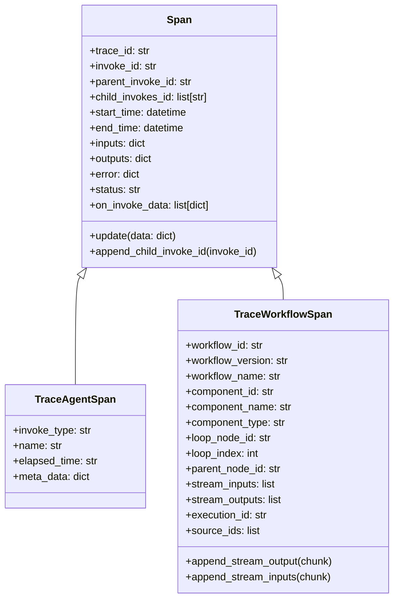
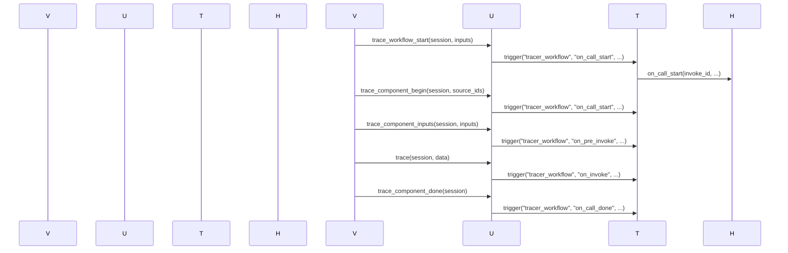
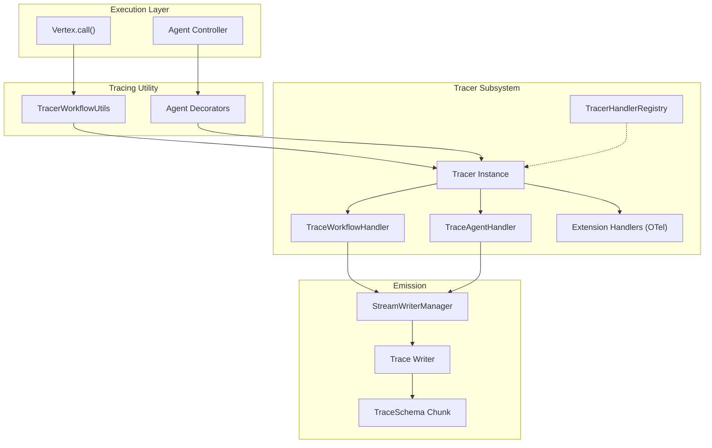

<!-- source: DeepWiki mcp.deepwiki.com · repo openJiuwen-ai/agent-core · page 4.5 Workflow Tracing · fetched 2026-11-02 -->

# Workflow Tracing

Relevant source files

The following files were used as context for generating this wiki page:

- [openjiuwen/core/graph/graph.py](openjiuwen/core/graph/graph.py)
- [openjiuwen/core/graph/pregel/builder.py](openjiuwen/core/graph/pregel/builder.py)
- [openjiuwen/core/graph/pregel/channels.py](openjiuwen/core/graph/pregel/channels.py)
- [openjiuwen/core/graph/pregel/engine.py](openjiuwen/core/graph/pregel/engine.py)
- [openjiuwen/core/graph/pregel/task.py](openjiuwen/core/graph/pregel/task.py)
- [openjiuwen/core/graph/stream_actor/base.py](openjiuwen/core/graph/stream_actor/base.py)
- [openjiuwen/core/graph/stream_actor/manager.py](openjiuwen/core/graph/stream_actor/manager.py)
- [openjiuwen/core/graph/vertex.py](openjiuwen/core/graph/vertex.py)
- [openjiuwen/core/session/internal/agent.py](openjiuwen/core/session/internal/agent.py)
- [openjiuwen/core/session/internal/agent_team.py](openjiuwen/core/session/internal/agent_team.py)
- [openjiuwen/core/session/tracer/handler.py](openjiuwen/core/session/tracer/handler.py)
- [openjiuwen/core/session/tracer/span.py](openjiuwen/core/session/tracer/span.py)
- [openjiuwen/core/session/tracer/tracer.py](openjiuwen/core/session/tracer/tracer.py)
- [openjiuwen/core/session/tracer/workflow_tracer.py](openjiuwen/core/session/tracer/workflow_tracer.py)
- [openjiuwen/core/workflow/__init__.py](openjiuwen/core/workflow/__init__.py)
- [openjiuwen/core/workflow/_workflow.py](openjiuwen/core/workflow/_workflow.py)
- [openjiuwen/core/workflow/components/flow/branch_comp.py](openjiuwen/core/workflow/components/flow/branch_comp.py)
- [openjiuwen/core/workflow/components/flow/branch_router.py](openjiuwen/core/workflow/components/flow/branch_router.py)
- [openjiuwen/core/workflow/components/flow/end_comp.py](openjiuwen/core/workflow/components/flow/end_comp.py)
- [openjiuwen/core/workflow/workflow.py](openjiuwen/core/workflow/workflow.py)
- [openjiuwen/core/workflow/workflow_config.py](openjiuwen/core/workflow/workflow_config.py)
- [openjiuwen/extensions/tracer_otel/handler.py](openjiuwen/extensions/tracer_otel/handler.py)
- [openjiuwen/extensions/tracer_otel/semconv.py](openjiuwen/extensions/tracer_otel/semconv.py)
- [tests/unit_tests/core/graph/test_barrier_cnf.py](tests/unit_tests/core/graph/test_barrier_cnf.py)
- [tests/unit_tests/core/session/tracer/test_handler_registration.py](tests/unit_tests/core/session/tracer/test_handler_registration.py)
- [tests/unit_tests/core/session/tracer/test_workflow_tracer.py](tests/unit_tests/core/session/tracer/test_workflow_tracer.py)
- [tests/unit_tests/core/workflow/test_workflow.py](tests/unit_tests/core/workflow/test_workflow.py)
- [tests/unit_tests/core/workflow/test_workflow_with_comp_stream.py](tests/unit_tests/core/workflow/test_workflow_with_comp_stream.py)
- [tests/unit_tests/extensions/tracer_otel/test_handler.py](tests/unit_tests/extensions/tracer_otel/test_handler.py)

This page covers how workflow execution is traced for debugging and observability: the data models for spans, the handler classes that format and emit trace events, the `TracerWorkflowUtils` utility called from graph internals, and the global registry for extending tracing capabilities.

For information on the graph execution engine that calls these tracing hooks, see [Graph Execution Engine](#4.4). For information on the stream output modes that deliver trace data to callers, see [Defining Workflows](#4.1).

---

## Overview

The tracing system provides detailed visibility into both the workflow graph structure and the agent reasoning steps (LLM calls, tool usage). It is built on a "Handler" architecture where events are triggered during execution and processed by registered handlers.

| Subsystem | Handler | Span Type | Triggered by |
|---|---|---|---|
| **Workflow tracing** | `TraceWorkflowHandler` | `TraceWorkflowSpan` | `TracerWorkflowUtils` static calls from `Vertex` and `PregelGraph` |
| **Agent tracing** | `TraceAgentHandler` | `TraceAgentSpan` | Decorator functions wrapping model/tool/workflow instances |

Both built-in handlers write serialized span data into a trace stream writer (`StreamWriterManager.get_trace_writer()`). Callers streaming a workflow with `BaseStreamMode.TRACE` receive `TraceSchema` chunks containing this data.

Sources: [openjiuwen/core/session/tracer/handler.py:23-31](), [openjiuwen/core/session/tracer/workflow_tracer.py:47-50](), [openjiuwen/core/session/tracer/tracer.py:131-140]()

---

## Span Data Models

All span types live in `openjiuwen/core/session/tracer/span.py`. Spans are the fundamental unit of trace data, capturing inputs, outputs, timestamps, and hierarchical relationships.

**Component diagram: span model hierarchy**

Sources: [openjiuwen/core/session/tracer/span.py:10-76]()

### SpanManager

`SpanManager` maintains an ordered registry of active spans for a single session. It is created with a `trace_id` and an optional `parent_node_id` (used for sub-workflow span isolation).

| Method | Purpose |
|---|---|
| `create_agent_span(parent_span)` | Creates a `TraceAgentSpan` with a new UUID `invoke_id`, links to parent |
| `create_workflow_span(invoke_id, parent_span)` | Creates a `TraceWorkflowSpan` using the component/workflow ID as `invoke_id` |
| `get_span(invoke_id)` | Retrieves a live span by ID |
| `pop_span(invoke_id)` | Removes span from the registry (used for loop iteration cleanup) |
| `update_span(span, data)` | Applies a dict of updates to a span and re-registers it |

Sources: [openjiuwen/core/session/tracer/span.py:78-139]()

---

## Workflow-Level Tracing

### TracerWorkflowUtils

`TracerWorkflowUtils` is a static utility class. Its methods are called by the `Vertex` class ([openjiuwen/core/graph/vertex.py]()) and the graph engine at defined points in the component lifecycle.

**Workflow tracing call sequence**

Sources: [openjiuwen/core/session/tracer/workflow_tracer.py:47-179](), [openjiuwen/core/graph/vertex.py:25]()

#### Static method reference

| Method | Event triggered | Notes |
|---|---|---|
| `trace_workflow_start` | `on_call_start` | Uses `workflow_id` as `invoke_id`; sets `need_send=True` |
| `trace_component_begin` | `on_call_start` | Uses `executable_id` as `invoke_id`; `need_send=False` |
| `trace_component_inputs` | `on_pre_invoke` | Resolves final inputs after schema transforms |
| `trace_component_stream_input`| `on_pre_stream` | Accumulates incoming stream chunks into `stream_inputs` |
| `trace_component_outputs` | `on_post_invoke` | Records outputs after invoke/collect completes |
| `trace_component_done` | `on_call_done` | Emits final span; calls `pop_workflow_span` for loop nodes |

Sources: [openjiuwen/core/session/tracer/workflow_tracer.py:47-156]()

### TraceWorkflowHandler

`TraceWorkflowHandler` ([openjiuwen/core/session/tracer/handler.py:269-386]()) handles events for the `TRACER_WORKFLOW` handler name.

Key behaviors:
- **Loop Handling**: It detects loop contexts via `LOOP_ID` and `INDEX` in the session state, adding `loop_node_id` and `loop_index` to the span metadata ([openjiuwen/core/session/tracer/workflow_tracer.py:35-44]()).
- **End Node Specialization**: In `on_post_invoke`, it specifically handles `End` components and `Message` types to ensure inputs/outputs are correctly captured for template rendering ([openjiuwen/core/session/tracer/handler.py:351-363]()).
- **Streaming Support**: It implements `on_pre_stream` and `on_post_stream` to capture the full sequence of chunks flowing through a vertex ([openjiuwen/core/session/tracer/handler.py:321-340]()).

Sources: [openjiuwen/core/session/tracer/handler.py:269-386]()

---

## Agent-Level Tracing

### TraceAgentHandler

`TraceAgentHandler` processes events for agent reasoning primitives (LLM, Tools, Retrieval). It uses the `InvokeType` enum to categorize spans.

| InvokeType | Description |
|---|---|
| `llm` | Model inference calls |
| `plugin` | Tool/Skill executions |
| `retriever` | Knowledge base searches |
| `workflow` | Sub-workflow calls from within an agent |
| `chain` | Sequential reasoning steps |

Sources: [openjiuwen/core/session/tracer/data.py:17](), [openjiuwen/core/session/tracer/handler.py:75-266]()

### Tracer Registration and Extension

The system supports external trace handlers (e.g., for OpenTelemetry integration) via the `TracerHandlerRegistry`.

- **`TracerHandlerRegistry`**: A global registry where `TraceExtAgentHandler` or `TraceExtWorkflowHandler` instances can be registered ([openjiuwen/core/session/tracer/tracer.py:16-96]()).
- **`Tracer.init()`**: When a tracer is initialized, it picks up all globally registered extension handlers and injects the current `trace_id` and `session_id` ([openjiuwen/core/session/tracer/tracer.py:108-140]()).
- **Reserved Names**: Built-in handlers use reserved names `tracer_agent` and `tracer_workflow`. Extensions must use unique names ([openjiuwen/core/session/tracer/tracer.py:32-50]()).

Sources: [openjiuwen/core/session/tracer/tracer.py:16-140]()

---

## Data Flow and Observability

Trace data is emitted as `TraceSchema` chunks. This allows real-time debugging of complex graphs.

**Trace Data Flow Diagram**

Sources: [openjiuwen/core/session/tracer/tracer.py:131-140](), [openjiuwen/core/session/tracer/handler.py:43-55](), [openjiuwen/core/graph/vertex.py:114-160]()

### Component Session API

Components can manually add data to their execution trace using the `Session` object:

- `session.trace(data: dict)`: Records intermediate execution data into the current span's `on_invoke_data` ([openjiuwen/core/session/node.py:32-35]()).
- `session.trace_error(error: Exception)`: Explicitly records an error in the trace ([openjiuwen/core/session/node.py:37-40]()).

Sources: [openjiuwen/core/session/node.py:32-40](), [openjiuwen/core/session/tracer/workflow_tracer.py:158-171]()

---

