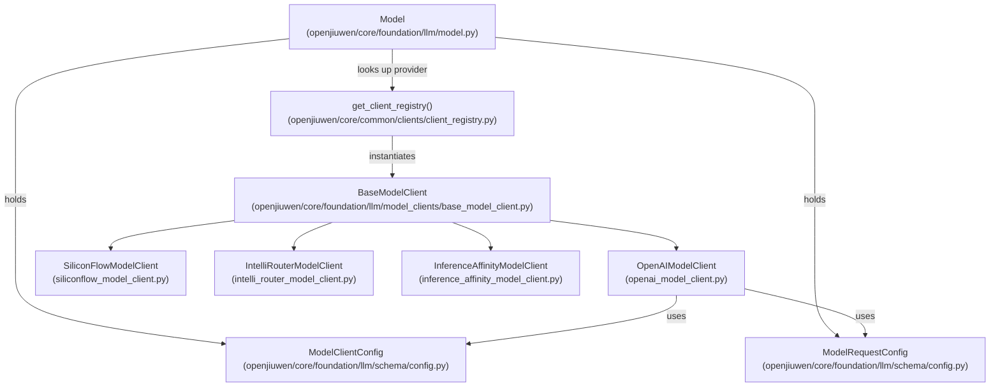
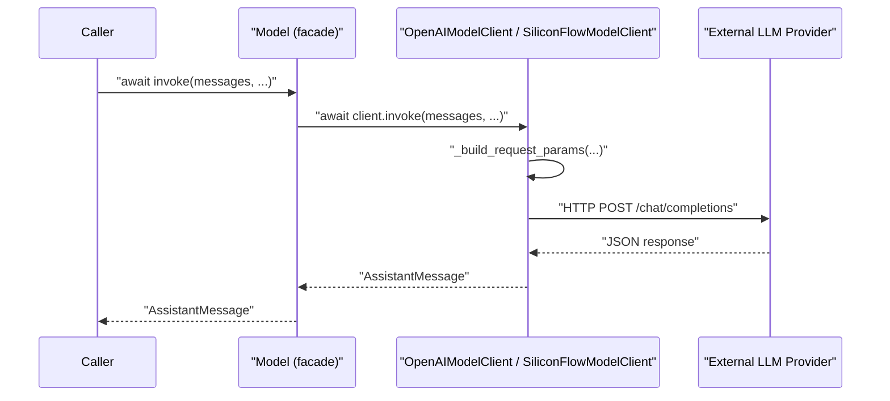
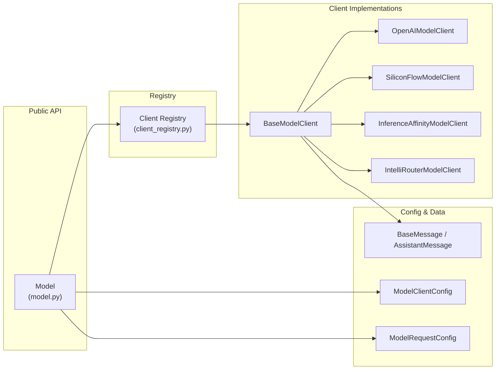

<!-- source: DeepWiki mcp.deepwiki.com · repo openJiuwen-ai/agent-core · page 5 LLM Integration · fetched 2026-11-02 -->

# LLM Integration

<details>
<summary>Relevant source files</summary>

The following files were used as context for generating this wiki page:

- [docs/en/2.Development Guide/Advanced Usage/IntelliRouter.md](docs/en/2.Development Guide/Advanced Usage/IntelliRouter.md)
- [examples/intelli_router/intelliRouter_demo.py](examples/intelli_router/intelliRouter_demo.py)
- [examples/intelli_router/observability_demo.py](examples/intelli_router/observability_demo.py)
- [openjiuwen/core/application/llm_agent/llm_agent.py](openjiuwen/core/application/llm_agent/llm_agent.py)
- [openjiuwen/core/application/llm_agent/llm_controller.py](openjiuwen/core/application/llm_agent/llm_controller.py)
- [openjiuwen/core/application/workflow_agent/workflow_event_handler.py](openjiuwen/core/application/workflow_agent/workflow_event_handler.py)
- [openjiuwen/core/common/clients/llm_client.py](openjiuwen/core/common/clients/llm_client.py)
- [openjiuwen/core/controller/legacy/utils.py](openjiuwen/core/controller/legacy/utils.py)
- [openjiuwen/core/foundation/llm/headers_helper.py](openjiuwen/core/foundation/llm/headers_helper.py)
- [openjiuwen/core/foundation/llm/model.py](openjiuwen/core/foundation/llm/model.py)
- [openjiuwen/core/foundation/llm/model_clients/base_model_client.py](openjiuwen/core/foundation/llm/model_clients/base_model_client.py)
- [openjiuwen/core/foundation/llm/model_clients/inference_affinity_model_client.py](openjiuwen/core/foundation/llm/model_clients/inference_affinity_model_client.py)
- [openjiuwen/core/foundation/llm/model_clients/intelli_router_model_client.py](openjiuwen/core/foundation/llm/model_clients/intelli_router_model_client.py)
- [openjiuwen/core/foundation/llm/model_clients/openai_model_client.py](openjiuwen/core/foundation/llm/model_clients/openai_model_client.py)
- [openjiuwen/core/foundation/llm/model_clients/siliconflow_model_client.py](openjiuwen/core/foundation/llm/model_clients/siliconflow_model_client.py)
- [openjiuwen/core/foundation/llm/schema/config.py](openjiuwen/core/foundation/llm/schema/config.py)
- [openjiuwen/core/foundation/llm/schema/message.py](openjiuwen/core/foundation/llm/schema/message.py)
- [openjiuwen/core/foundation/llm/schema/mode_info.py](openjiuwen/core/foundation/llm/schema/mode_info.py)
- [openjiuwen/core/retrieval/query_rewriter/query_rewriter.py](openjiuwen/core/retrieval/query_rewriter/query_rewriter.py)
- [openjiuwen/core/single_agent/legacy/react_agent.py](openjiuwen/core/single_agent/legacy/react_agent.py)
- [tests/unit_tests/core/common/clients/test_llm_client.py](tests/unit_tests/core/common/clients/test_llm_client.py)
- [tests/unit_tests/core/foundation/llm/test_intelli_router_model_client.py](tests/unit_tests/core/foundation/llm/test_intelli_router_model_client.py)
- [tests/unit_tests/core/foundation/llm/test_model_client_config.py](tests/unit_tests/core/foundation/llm/test_model_client_config.py)
- [tests/unit_tests/core/foundation/llm/test_model_client_tracer.py](tests/unit_tests/core/foundation/llm/test_model_client_tracer.py)
- [tests/unit_tests/core/foundation/llm/test_model_custom_headers.py](tests/unit_tests/core/foundation/llm/test_model_custom_headers.py)
- [tests/unit_tests/core/foundation/llm/test_model_no_custom_headers.py](tests/unit_tests/core/foundation/llm/test_model_no_custom_headers.py)
- [tests/unit_tests/core/memory/test_session_id_in_memory.py](tests/unit_tests/core/memory/test_session_id_in_memory.py)
- [tests/unit_tests/core/retrieval/query_rewriter/test_query_rewriter.py](tests/unit_tests/core/retrieval/query_rewriter/test_query_rewriter.py)
- [tests/unit_tests/dev_tools/agent_builder/executor/test_executor.py](tests/unit_tests/dev_tools/agent_builder/executor/test_executor.py)

</details>


This page documents the LLM integration layer: the `Model` facade class, the provider client registry, configuration schemas, message types, and multimodal generation capabilities. This layer is the single point of contact for all LLM calls made by agents and workflow components in the SDK.

For details on how concrete model clients are implemented and the specific provider registry, see [Model Clients](#5.1). For details on how context windows are managed and messages are compressed before being sent to the LLM, see [Context Engine](#5.2).

---

## Architecture Overview

The LLM integration layer is organized into three tiers: a user-facing facade (`Model`), a provider registry, and provider-specific client implementations that all extend `BaseModelClient`.

**Class hierarchy and call flow:**



Sources: [openjiuwen/core/foundation/llm/model.py:26-57](), [openjiuwen/core/foundation/llm/model_clients/base_model_client.py:44-80](), [openjiuwen/core/foundation/llm/schema/config.py:39-145]()

---

## The `Model` Facade

`Model`, defined in [openjiuwen/core/foundation/llm/model.py:26-212](), is the single entry point for all LLM interactions. It creates the appropriate provider client at initialization time and delegates all calls to it.

**Constructor:**

```python
Model(
    model_client_config: Optional[ModelClientConfig], # required
    model_config: ModelRequestConfig = None           # optional
)
```

On construction, `Model` calls `create_model_client` [openjiuwen/core/foundation/llm/model.py:57](), which looks up the provider in the registry and instantiates the matching `BaseModelClient` subclass. The `Model` class also wraps the client's `invoke` and `stream` methods with the `Runner.callback_framework` to emit `LLMCallEvents` [openjiuwen/core/foundation/llm/model.py:64-87]().

**Public methods on `Model`:**

| Method | Return type | Description |
|---|---|---|
| `invoke(...)` | `AssistantMessage` | Blocking (async) single-response call [openjiuwen/core/foundation/llm/model.py:93-135]() |
| `stream(...)` | `AsyncIterator[AssistantMessageChunk]` | Streaming call, yields chunks with timeout logic [openjiuwen/core/foundation/llm/model.py:137-212]() |

All methods delegate to the underlying `self._client` instance (a `BaseModelClient` subclass).

Sources: [openjiuwen/core/foundation/llm/model.py:26-212]()

---

## Configuration

Two Pydantic config classes control how `Model` and its clients behave.

### `ModelClientConfig`

Controls the HTTP connection and provider selection [openjiuwen/core/foundation/llm/schema/config.py:39-136]().

| Field | Type | Description |
|---|---|---|
| `client_id` | `str` | Unique identifier for registration in the Runner [openjiuwen/core/foundation/llm/schema/config.py:41]() |
| `client_provider` | `ProviderType \| str` | Provider ID (e.g., `"OpenAI"`, `"SiliconFlow"`, `"intelli_router"`) [openjiuwen/core/foundation/llm/schema/config.py:43]() |
| `api_key` | `str` | API authentication key [openjiuwen/core/foundation/llm/schema/config.py:48]() |
| `api_base` | `str` | Base URL of the provider endpoint [openjiuwen/core/foundation/llm/schema/config.py:49]() |
| `timeout` | `float` | HTTP request timeout in seconds (default 360.0s) [openjiuwen/core/foundation/llm/schema/config.py:50]() |
| `use_shared_llm_http_client` | `bool` | Whether to reuse a process-wide connection pool [openjiuwen/core/foundation/llm/schema/config.py:73]() |
| `verify_ssl` | `bool` | Whether to verify SSL certificates [openjiuwen/core/foundation/llm/schema/config.py:79]() |
| `custom_headers` | `dict \| None` | Developer-provided headers merged per LLM call [openjiuwen/core/foundation/llm/schema/config.py:81]() |

### `ModelRequestConfig`

Controls per-request model sampling parameters [openjiuwen/core/foundation/llm/schema/config.py:138-146]().

| Field | Type | Description |
|---|---|---|
| `model_name` | `str` | Model identifier (alias: `model`, e.g. `"gpt-4"`) [openjiuwen/core/foundation/llm/schema/config.py:140]() |
| `temperature` | `float` | Sampling temperature (default 0.95) [openjiuwen/core/foundation/llm/schema/config.py:141]() |
| `top_p` | `float` | Nucleus sampling parameter (default 0.1) [openjiuwen/core/foundation/llm/schema/config.py:142]() |
| `max_tokens` | `int \| None` | Maximum tokens to generate [openjiuwen/core/foundation/llm/schema/config.py:143]() |
| `stop` | `str \| None` | Stop sequence [openjiuwen/core/foundation/llm/schema/config.py:144]() |

Sources: [openjiuwen/core/foundation/llm/schema/config.py:39-146]()

---

## `BaseModelClient`

Defined in [openjiuwen/core/foundation/llm/model_clients/base_model_client.py:44-196](), this is the abstract base class all provider clients must extend. It uses `__init_subclass__` to automatically register any concrete implementation with the global client registry [openjiuwen/core/foundation/llm/model_clients/base_model_client.py:52-69]().

**Abstract methods:**

- `invoke(...)` → `AssistantMessage`
- `stream(...)` → `AsyncIterator[AssistantMessageChunk]`

**Shared concrete helpers:**

| Method | Description |
|---|---|
| `_extract_cache_tokens(obj)` | Extracts prompt cache hit tokens from provider usage metadata [openjiuwen/core/foundation/llm/model_clients/base_model_client.py:83-146]() |
| `_extract_reasoning_tokens(obj)` | Extracts reasoning/thinking token count from metadata [openjiuwen/core/foundation/llm/model_clients/base_model_client.py:149-196]() |

Sources: [openjiuwen/core/foundation/llm/model_clients/base_model_client.py:44-196]()

---

## Concrete Client Implementations

**Call flow for a non-streaming `invoke` call:**



Sources: [openjiuwen/core/foundation/llm/model.py:93-135](), [openjiuwen/core/foundation/llm/model_clients/openai_model_client.py:158-185]()

### `OpenAIModelClient`
File: [openjiuwen/core/foundation/llm/model_clients/openai_model_client.py:56-185]()
Supports GPT models and OpenAI-compatible services. It includes logic to reuse a process-wide `AsyncOpenAI` client via `_client_cache` [openjiuwen/core/foundation/llm/model_clients/openai_model_client.py:68]() and applies model-specific parameter rules (e.g., for MiniMax reasoning) [openjiuwen/core/foundation/llm/model_clients/openai_model_client.py:102-118]().

### `SiliconFlowModelClient`
File: [openjiuwen/core/foundation/llm/model_clients/siliconflow_model_client.py:32-182]()
Directly uses `aiohttp` for requests. It includes a `_sanitize_tool_calls` step to ensure compatibility [openjiuwen/core/foundation/llm/model_clients/siliconflow_model_client.py:68]().

### `InferenceAffinityModelClient`
File: [openjiuwen/core/foundation/llm/model_clients/inference_affinity_model_client.py:31-182]()
Optimized for vLLM backends. It supports **Cache Sharing** by injecting `cache_sharing` and `cache_salt` into the request based on the `session_id` [openjiuwen/core/foundation/llm/model_clients/inference_affinity_model_client.py:71-73]().

### `IntelliRouterModelClient`
File: [openjiuwen/core/foundation/llm/model_clients/intelli_router_model_client.py:96-175]()
Wraps the `ReliableRouter` to provide API pooling, smart routing across multiple deployments, and auto-retry capabilities [openjiuwen/core/foundation/llm/model_clients/intelli_router_model_client.py:100-101]().

---

## Multimodal Generation

The SDK defines specialized response schemas for multimodal generation in [openjiuwen/core/foundation/llm/schema/generation_response.py]().

| Response Type | Fields |
|---|---|
| `ImageGenerationResponse` | `images` (URLs), `images_base64`, `model`, `created` |
| `AudioGenerationResponse` | `audio_url`, `audio_data` (bytes), `duration`, `format` |
| `VideoGenerationResponse` | `video_url`, `video_data`, `duration`, `resolution` |

Sources: [openjiuwen/core/foundation/llm/model_clients/openai_model_client.py:14-15](), [openjiuwen/core/foundation/llm/model_clients/siliconflow_model_client.py:14-15]()

---

## Component Relationships Summary



Sources: [openjiuwen/core/foundation/llm/model.py:26-57](), [openjiuwen/core/foundation/llm/model_clients/base_model_client.py:44-71](), [openjiuwen/core/foundation/llm/schema/config.py:39-146]()

---

