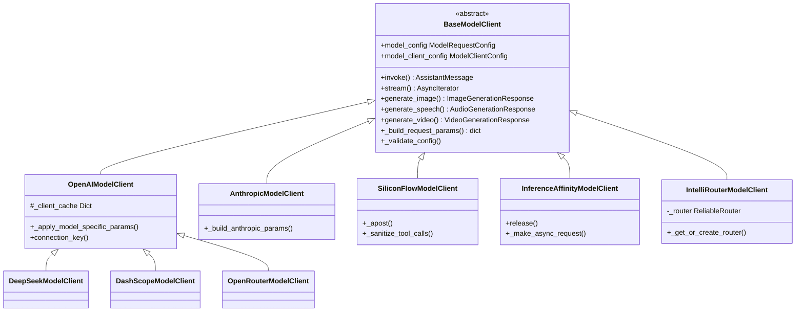
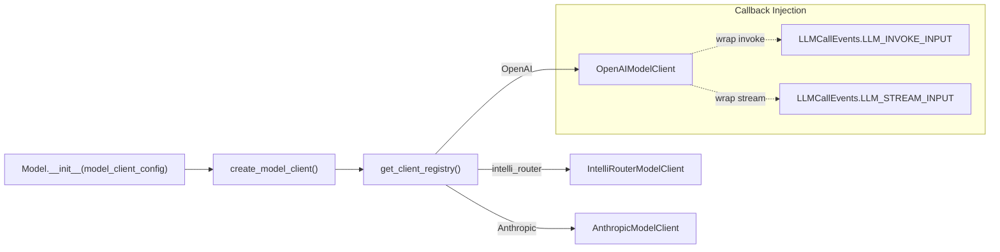

<!-- source: DeepWiki mcp.deepwiki.com · repo openJiuwen-ai/agent-core · page 5.1 Model Clients · fetched 2026-11-02 -->

# Model Clients

Relevant source files

The following files were used as context for generating this wiki page:

- [docs/en/2.Development Guide/Advanced Usage/IntelliRouter.md](docs/en/2.Development Guide/Advanced Usage/IntelliRouter.md)
- [examples/intelli_router/intelliRouter_demo.py](examples/intelli_router/intelliRouter_demo.py)
- [examples/intelli_router/observability_demo.py](examples/intelli_router/observability_demo.py)
- [openjiuwen/core/application/llm_agent/llm_agent.py](openjiuwen/core/application/llm_agent/llm_agent.py)
- [openjiuwen/core/application/llm_agent/llm_controller.py](openjiuwen/core/application/llm_agent/llm_controller.py)
- [openjiuwen/core/application/workflow_agent/workflow_event_handler.py](openjiuwen/core/application/workflow_agent/workflow_event_handler.py)
- [openjiuwen/core/common/clients/llm_client.py](openjiuwen/core/common/clients/llm_client.py)
- [openjiuwen/core/controller/legacy/utils.py](openjiuwen/core/controller/legacy/utils.py)
- [openjiuwen/core/foundation/llm/headers_helper.py](openjiuwen/core/foundation/llm/headers_helper.py)
- [openjiuwen/core/foundation/llm/model.py](openjiuwen/core/foundation/llm/model.py)
- [openjiuwen/core/foundation/llm/model_clients/__init__.py](openjiuwen/core/foundation/llm/model_clients/__init__.py)
- [openjiuwen/core/foundation/llm/model_clients/anthropic_model_client.py](openjiuwen/core/foundation/llm/model_clients/anthropic_model_client.py)
- [openjiuwen/core/foundation/llm/model_clients/base_model_client.py](openjiuwen/core/foundation/llm/model_clients/base_model_client.py)
- [openjiuwen/core/foundation/llm/model_clients/inference_affinity_model_client.py](openjiuwen/core/foundation/llm/model_clients/inference_affinity_model_client.py)
- [openjiuwen/core/foundation/llm/model_clients/intelli_router_model_client.py](openjiuwen/core/foundation/llm/model_clients/intelli_router_model_client.py)
- [openjiuwen/core/foundation/llm/model_clients/openai_model_client.py](openjiuwen/core/foundation/llm/model_clients/openai_model_client.py)
- [openjiuwen/core/foundation/llm/model_clients/openrouter_model_client.py](openjiuwen/core/foundation/llm/model_clients/openrouter_model_client.py)
- [openjiuwen/core/foundation/llm/model_clients/siliconflow_model_client.py](openjiuwen/core/foundation/llm/model_clients/siliconflow_model_client.py)
- [openjiuwen/core/foundation/llm/schema/config.py](openjiuwen/core/foundation/llm/schema/config.py)
- [openjiuwen/core/foundation/llm/schema/message.py](openjiuwen/core/foundation/llm/schema/message.py)
- [openjiuwen/core/foundation/llm/schema/mode_info.py](openjiuwen/core/foundation/llm/schema/mode_info.py)
- [openjiuwen/core/retrieval/query_rewriter/query_rewriter.py](openjiuwen/core/retrieval/query_rewriter/query_rewriter.py)
- [openjiuwen/core/single_agent/legacy/react_agent.py](openjiuwen/core/single_agent/legacy/react_agent.py)
- [openjiuwen/harness/rails/llm_retry_rail.py](openjiuwen/harness/rails/llm_retry_rail.py)
- [tests/unit_tests/core/common/clients/test_llm_client.py](tests/unit_tests/core/common/clients/test_llm_client.py)
- [tests/unit_tests/core/foundation/llm/test_anthropic_client_pooling.py](tests/unit_tests/core/foundation/llm/test_anthropic_client_pooling.py)
- [tests/unit_tests/core/foundation/llm/test_anthropic_model_client.py](tests/unit_tests/core/foundation/llm/test_anthropic_model_client.py)
- [tests/unit_tests/core/foundation/llm/test_intelli_router_model_client.py](tests/unit_tests/core/foundation/llm/test_intelli_router_model_client.py)
- [tests/unit_tests/core/foundation/llm/test_model_client_config.py](tests/unit_tests/core/foundation/llm/test_model_client_config.py)
- [tests/unit_tests/core/foundation/llm/test_model_client_tracer.py](tests/unit_tests/core/foundation/llm/test_model_client_tracer.py)
- [tests/unit_tests/core/foundation/llm/test_model_custom_headers.py](tests/unit_tests/core/foundation/llm/test_model_custom_headers.py)
- [tests/unit_tests/core/foundation/llm/test_model_no_custom_headers.py](tests/unit_tests/core/foundation/llm/test_model_no_custom_headers.py)
- [tests/unit_tests/core/foundation/llm/test_openai_client_pooling.py](tests/unit_tests/core/foundation/llm/test_openai_client_pooling.py)
- [tests/unit_tests/core/foundation/llm/test_openrouter_model_client.py](tests/unit_tests/core/foundation/llm/test_openrouter_model_client.py)
- [tests/unit_tests/core/memory/test_session_id_in_memory.py](tests/unit_tests/core/memory/test_session_id_in_memory.py)
- [tests/unit_tests/core/retrieval/query_rewriter/test_query_rewriter.py](tests/unit_tests/core/retrieval/query_rewriter/test_query_rewriter.py)
- [tests/unit_tests/dev_tools/agent_builder/executor/test_executor.py](tests/unit_tests/dev_tools/agent_builder/executor/test_executor.py)
- [tests/unit_tests/harness/test_llm_retry_rail.py](tests/unit_tests/harness/test_llm_retry_rail.py)

This page covers the LLM provider integration layer: the `BaseModelClient` abstract class, all concrete client implementations, the `Model` facade, and the registration mechanism. These clients handle the transformation of structured messages and tool definitions into provider-specific API calls.

---

## Architecture Overview

The layer follows a provider strategy pattern. `Model` is the public entry point; it resolves a `BaseModelClient` subclass at construction time by looking up `ModelClientConfig.client_provider` in the global registry.

**Client Class Hierarchy**

Sources: [openjiuwen/core/foundation/llm/model_clients/base_model_client.py:44-51](), [openjiuwen/core/foundation/llm/model_clients/openai_model_client.py:56-68](), [openjiuwen/core/foundation/llm/model_clients/anthropic_model_client.py:34-36](), [openjiuwen/core/foundation/llm/model_clients/intelli_router_model_client.py:96-103]()

---

**`Model` Facade and Registry**

The `Model` class wraps a `BaseModelClient` and injects lifecycle hooks from the `Runner.callback_framework`.

Sources: [openjiuwen/core/foundation/llm/model.py:41-88](), [openjiuwen/core/foundation/llm/model_clients/base_model_client.py:52-69]()

---

## `BaseModelClient`

File: [openjiuwen/core/foundation/llm/model_clients/base_model_client.py]()

The abstract base class defines the interface for all LLM interactions. It includes robust utilities for extracting metadata across different provider formats.

### Key Utilities

*   **Token Extraction**: `_extract_cache_tokens` [openjiuwen/core/foundation/llm/model_clients/base_model_client.py:83-146]() and `_extract_reasoning_tokens` [openjiuwen/core/foundation/llm/model_clients/base_model_client.py:149-204]() normalize usage metadata from various providers (OpenAI, Anthropic, DeepSeek, etc.) to track prompt cache hits and "thinking" tokens.
*   **Request Assembly**: `_build_request_params` [openjiuwen/core/foundation/llm/model_clients/base_model_client.py:218-326]() constructs the standard payload, merging `ModelRequestConfig` with call-site overrides.

Sources: [openjiuwen/core/foundation/llm/model_clients/base_model_client.py:44-326]()

---

## Concrete Client Implementations

### `OpenAIModelClient`
Supports OpenAI and compatible services. It implements a process-wide `_client_cache` [openjiuwen/core/foundation/llm/model_clients/openai_model_client.py:68]() to reuse `AsyncOpenAI` instances and their underlying connection pools, bucketed by `api_key` and `api_base`.
*   **Model Rules**: Uses `ModelParamRule` to inject provider-specific fields (e.g., `reasoning_split` for MiniMax models) [openjiuwen/core/foundation/llm/model_clients/openai_model_client.py:47-53]().

### `AnthropicModelClient`
A standalone client using the `anthropic` SDK. It handles the specific Anthropic message structure and supports `max_tokens` constraints required by the Claude API [openjiuwen/core/foundation/llm/model_clients/anthropic_model_client.py:34-150]().

### `IntelliRouterModelClient`
Wraps the `intelli_router.ReliableRouter` to provide smart routing across multiple deployments.
*   **Smart Routing**: Supports strategies like `simple-shuffle` and priority-based routing [openjiuwen/core/foundation/llm/model_clients/intelli_router_model_client.py:39-50]().
*   **Observability**: Can enable a web dashboard and metrics collection for tracking deployment health [openjiuwen/core/foundation/llm/model_clients/intelli_router_model_client.py:169-180]().

### `SiliconFlowModelClient`
Uses `aiohttp` directly. It includes a `_sanitize_tool_calls` method to ensure that message history containing tool results strictly follows the expected schema (e.g., ensuring `tool_calls` are present in assistant messages preceding tool messages) [openjiuwen/core/foundation/llm/model_clients/siliconflow_model_client.py:67-69]().

### `InferenceAffinityModelClient`
Optimized for vLLM/Ascend environments.
*   **KV Cache Control**: Implements `release()` to call the `/release_kv_cache` endpoint [openjiuwen/core/foundation/llm/model_clients/inference_affinity_model_client.py:256-318]().
*   **Cache Sharing**: Supports `enable_cache_sharing` via a `cache_salt` (usually the `session_id`) [openjiuwen/core/foundation/llm/model_clients/inference_affinity_model_client.py:71-73]().

### `DashScopeModelClient`
Extends `OpenAIModelClient` to support multimodal generation:
*   **Image**: Text-to-image and image-to-image via `wanx-v1` [openjiuwen/core/foundation/llm/model_clients/dashscope_model_client.py:51-243]().
*   **Speech**: Text-to-speech with multiple voice profiles [openjiuwen/core/foundation/llm/model_clients/dashscope_model_client.py:245-390]().
*   **Video**: Video generation tasks [openjiuwen/core/foundation/llm/model_clients/dashscope_model_client.py:392-530]().

Sources: [openjiuwen/core/foundation/llm/model_clients/openai_model_client.py:56-120](), [openjiuwen/core/foundation/llm/model_clients/intelli_router_model_client.py:96-140](), [openjiuwen/core/foundation/llm/model_clients/siliconflow_model_client.py:32-69](), [openjiuwen/core/foundation/llm/model_clients/inference_affinity_model_client.py:31-107](), [openjiuwen/core/foundation/llm/model_clients/dashscope_model_client.py:33-530]()

---

## Prompt Construction

The SDK provides specialized builders to assemble prompts before sending them to the `Model` facade.

### `MetaTemplateBuilder`
Generates complex prompts for specific agent roles (e.g., Planning vs. Execution). It uses meta-templates to structure how tools and history are presented to the model [openjiuwen/dev_tools/prompt_builder/builder/meta_template_builder.py]().

### `BadCasePromptBuilder`
Part of the evolution loop. It analyzes failed trajectories (`EvaluatedCase`) and generates feedback-driven prompt updates to correct model behavior [openjiuwen/dev_tools/prompt_builder/builder/badcase_prompt_builder.py]().

Sources: [openjiuwen/dev_tools/prompt_builder/builder/meta_template_builder.py:1-20](), [openjiuwen/dev_tools/prompt_builder/builder/badcase_prompt_builder.py:1-20]()

---

