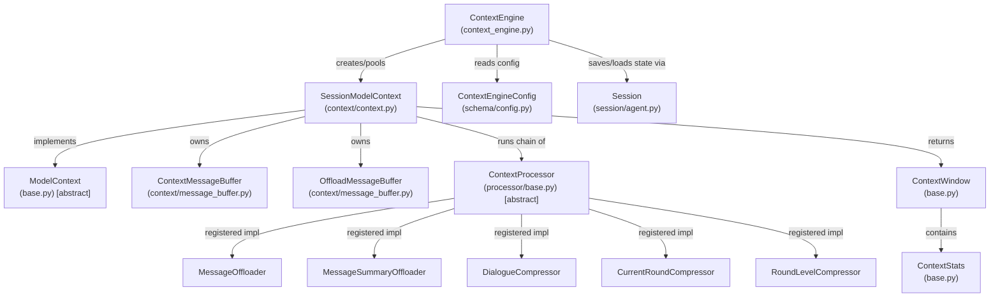
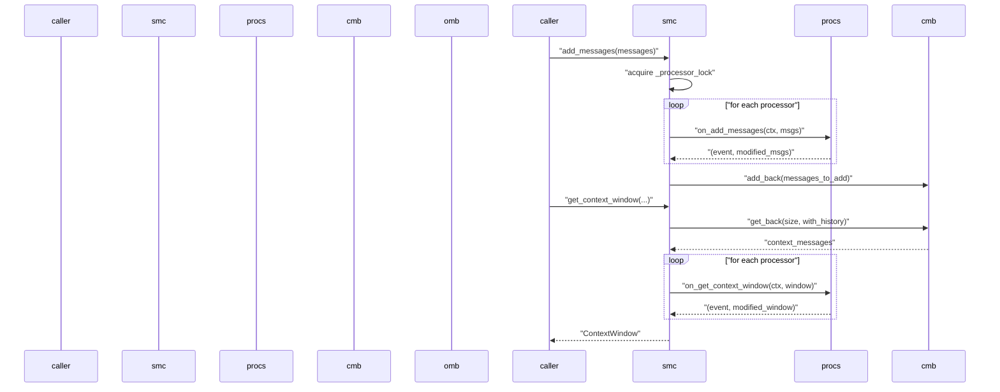

<!-- source: DeepWiki mcp.deepwiki.com · repo openJiuwen-ai/agent-core · page 5.2 Context Engine · fetched 2026-11-02 -->

# Context Engine

Relevant source files

The following files were used as context for generating this wiki page:

- [openjiuwen/core/context_engine/__init__.py](openjiuwen/core/context_engine/__init__.py)
- [openjiuwen/core/context_engine/base.py](openjiuwen/core/context_engine/base.py)
- [openjiuwen/core/context_engine/content_sanitize.py](openjiuwen/core/context_engine/content_sanitize.py)
- [openjiuwen/core/context_engine/context/context.py](openjiuwen/core/context_engine/context/context.py)
- [openjiuwen/core/context_engine/context/context_utils.py](openjiuwen/core/context_engine/context/context_utils.py)
- [openjiuwen/core/context_engine/context/message_buffer.py](openjiuwen/core/context_engine/context/message_buffer.py)
- [openjiuwen/core/context_engine/context/processor_state_recorder.py](openjiuwen/core/context_engine/context/processor_state_recorder.py)
- [openjiuwen/core/context_engine/context/session_memory_manager.py](openjiuwen/core/context_engine/context/session_memory_manager.py)
- [openjiuwen/core/context_engine/context_engine.py](openjiuwen/core/context_engine/context_engine.py)
- [openjiuwen/core/context_engine/processor/base.py](openjiuwen/core/context_engine/processor/base.py)
- [openjiuwen/core/context_engine/processor/budget_guard.py](openjiuwen/core/context_engine/processor/budget_guard.py)
- [openjiuwen/core/context_engine/processor/compressor/__init__.py](openjiuwen/core/context_engine/processor/compressor/__init__.py)
- [openjiuwen/core/context_engine/processor/compressor/current_round_compressor.py](openjiuwen/core/context_engine/processor/compressor/current_round_compressor.py)
- [openjiuwen/core/context_engine/processor/compressor/dialogue_compressor.py](openjiuwen/core/context_engine/processor/compressor/dialogue_compressor.py)
- [openjiuwen/core/context_engine/processor/compressor/full_compact_processor.py](openjiuwen/core/context_engine/processor/compressor/full_compact_processor.py)
- [openjiuwen/core/context_engine/processor/compressor/micro_compact_processor.py](openjiuwen/core/context_engine/processor/compressor/micro_compact_processor.py)
- [openjiuwen/core/context_engine/processor/compressor/reasoning_tool_loop_compact_processor.py](openjiuwen/core/context_engine/processor/compressor/reasoning_tool_loop_compact_processor.py)
- [openjiuwen/core/context_engine/processor/compressor/round_level_compressor.py](openjiuwen/core/context_engine/processor/compressor/round_level_compressor.py)
- [openjiuwen/core/context_engine/processor/compressor/util.py](openjiuwen/core/context_engine/processor/compressor/util.py)
- [openjiuwen/core/context_engine/processor/forked/compressor/base.py](openjiuwen/core/context_engine/processor/forked/compressor/base.py)
- [openjiuwen/core/context_engine/processor/forked/compressor/recall/archive.py](openjiuwen/core/context_engine/processor/forked/compressor/recall/archive.py)
- [openjiuwen/core/context_engine/processor/forked/compressor/reinjection/builders.py](openjiuwen/core/context_engine/processor/forked/compressor/reinjection/builders.py)
- [openjiuwen/core/context_engine/processor/forked/compressor/session_memory_compressor.py](openjiuwen/core/context_engine/processor/forked/compressor/session_memory_compressor.py)
- [openjiuwen/core/context_engine/processor/forked/compressor/support/util.py](openjiuwen/core/context_engine/processor/forked/compressor/support/util.py)
- [openjiuwen/core/context_engine/processor/forked/offloader/message_offloader.py](openjiuwen/core/context_engine/processor/forked/offloader/message_offloader.py)
- [openjiuwen/core/context_engine/processor/forked/offloader/rule_compression/common.py](openjiuwen/core/context_engine/processor/forked/offloader/rule_compression/common.py)
- [openjiuwen/core/context_engine/processor/forked/offloader/rule_compression/pipeline.py](openjiuwen/core/context_engine/processor/forked/offloader/rule_compression/pipeline.py)
- [openjiuwen/core/context_engine/processor/offloader/__init__.py](openjiuwen/core/context_engine/processor/offloader/__init__.py)
- [openjiuwen/core/context_engine/processor/offloader/message_offloader.py](openjiuwen/core/context_engine/processor/offloader/message_offloader.py)
- [openjiuwen/core/context_engine/processor/offloader/message_summary_offloader.py](openjiuwen/core/context_engine/processor/offloader/message_summary_offloader.py)
- [openjiuwen/core/context_engine/processor/offloader/tool_result_budget_processor.py](openjiuwen/core/context_engine/processor/offloader/tool_result_budget_processor.py)
- [openjiuwen/core/context_engine/schema/__init__.py](openjiuwen/core/context_engine/schema/__init__.py)
- [openjiuwen/core/context_engine/schema/config.py](openjiuwen/core/context_engine/schema/config.py)
- [openjiuwen/core/context_engine/schema/context_state.py](openjiuwen/core/context_engine/schema/context_state.py)
- [openjiuwen/core/context_engine/token/tiktoken_counter.py](openjiuwen/core/context_engine/token/tiktoken_counter.py)
- [openjiuwen/core/runner/callback/__init__.py](openjiuwen/core/runner/callback/__init__.py)
- [openjiuwen/core/runner/callback/events.py](openjiuwen/core/runner/callback/events.py)
- [openjiuwen/harness/rails/context_engineer/context_processor_rail.py](openjiuwen/harness/rails/context_engineer/context_processor_rail.py)
- [openjiuwen/harness/subagents/mobile_gui_agent.py](openjiuwen/harness/subagents/mobile_gui_agent.py)
- [openjiuwen/harness/tools/mobile_gui/tiktoken_multimodal_patch.py](openjiuwen/harness/tools/mobile_gui/tiktoken_multimodal_patch.py)
- [tests/unit_tests/core/context_engine/test_compressor_token_budget.py](tests/unit_tests/core/context_engine/test_compressor_token_budget.py)
- [tests/unit_tests/core/context_engine/test_content_sanitize.py](tests/unit_tests/core/context_engine/test_content_sanitize.py)
- [tests/unit_tests/core/context_engine/test_context_compression_state_stream.py](tests/unit_tests/core/context_engine/test_context_compression_state_stream.py)
- [tests/unit_tests/core/context_engine/test_context_engine.py](tests/unit_tests/core/context_engine/test_context_engine.py)
- [tests/unit_tests/core/context_engine/test_context_model.py](tests/unit_tests/core/context_engine/test_context_model.py)
- [tests/unit_tests/core/context_engine/test_current_round_compressor.py](tests/unit_tests/core/context_engine/test_current_round_compressor.py)
- [tests/unit_tests/core/context_engine/test_dialogue_compressor.py](tests/unit_tests/core/context_engine/test_dialogue_compressor.py)
- [tests/unit_tests/core/context_engine/test_forked_message_offloader.py](tests/unit_tests/core/context_engine/test_forked_message_offloader.py)
- [tests/unit_tests/core/context_engine/test_full_compact_processor.py](tests/unit_tests/core/context_engine/test_full_compact_processor.py)
- [tests/unit_tests/core/context_engine/test_message_offloader.py](tests/unit_tests/core/context_engine/test_message_offloader.py)
- [tests/unit_tests/core/context_engine/test_message_summary_offloader.py](tests/unit_tests/core/context_engine/test_message_summary_offloader.py)
- [tests/unit_tests/core/context_engine/test_micro_compact_processor.py](tests/unit_tests/core/context_engine/test_micro_compact_processor.py)
- [tests/unit_tests/core/context_engine/test_new_message_summary_offloader.py](tests/unit_tests/core/context_engine/test_new_message_summary_offloader.py)
- [tests/unit_tests/core/context_engine/test_reasoning_tool_loop_compact_processor.py](tests/unit_tests/core/context_engine/test_reasoning_tool_loop_compact_processor.py)
- [tests/unit_tests/core/context_engine/test_round_level_compressor.py](tests/unit_tests/core/context_engine/test_round_level_compressor.py)
- [tests/unit_tests/core/context_engine/test_rule_compression_pipeline.py](tests/unit_tests/core/context_engine/test_rule_compression_pipeline.py)
- [tests/unit_tests/core/context_engine/test_session_memory_agent.py](tests/unit_tests/core/context_engine/test_session_memory_agent.py)
- [tests/unit_tests/core/context_engine/test_tiktoken_counter.py](tests/unit_tests/core/context_engine/test_tiktoken_counter.py)
- [tests/unit_tests/core/context_engine/test_tool_result_budget_processor.py](tests/unit_tests/core/context_engine/test_tool_result_budget_processor.py)
- [tests/unit_tests/harness/test_context_processor_rail.py](tests/unit_tests/harness/test_context_processor_rail.py)
- [tests/unit_tests/harness/tools/mobile_gui/test_tiktoken_multimodal_patch.py](tests/unit_tests/harness/tools/mobile_gui/test_tiktoken_multimodal_patch.py)

The Context Engine is the subsystem responsible for managing the conversational message history sent to LLMs during agent inference. It maintains isolated context stores per session, enforces window limits, runs processor chains that can compress or offload messages to stay within token budgets, and persists context state across agent invocations.

This page covers the `ContextEngine` facade, `SessionModelContext`, `ContextMessageBuffer`, `OffloadMessageBuffer`, and all registered `ContextProcessor` implementations. For how individual model clients consume a `ContextWindow`, see page [5.1](). For the session object that context state is saved into and restored from, see page [2.6]().

---

## Architecture Overview

**High-level component relationships**

Sources: [openjiuwen/core/context_engine/context_engine.py:25-51](), [openjiuwen/core/context_engine/context/context.py:41-117](), [openjiuwen/core/context_engine/base.py:34-178](), [openjiuwen/core/context_engine/schema/config.py:23-109]()

---

## ContextEngine

`ContextEngine` ([openjiuwen/core/context_engine/context_engine.py:25-51]()) is the top-level entry point. It maintains an internal `_context_pool` dict keyed by `"{session_id}_{context_id}"` strings, and it holds the class-level `_PROCESSOR_MAP` that maps string processor type names to their classes.

### Key Methods

| Method | Signature | Description |
|---|---|---|
| `create_context` | `async (context_id, session, *, processors, history_messages, token_counter) → ModelContext` | Creates or retrieves a `SessionModelContext`. Reuses an existing one if the same `(session_id, context_id)` key is already in the pool [openjiuwen/core/context_engine/context_engine.py:68-139](). |
| `get_context` | `(context_id, session_id) → Optional[ModelContext]` | Looks up a context without creating it. Returns `None` if not found [openjiuwen/core/context_engine/context_engine.py:141-158](). |
| `clear_context` | `(context_id=None, session_id=None)` | Removes contexts from the pool. No args = clear all; only `session_id` = clear all for that session; both = clear one specific context [openjiuwen/core/context_engine/context_engine.py:209-233](). |
| `save_contexts` | `async (session, context_ids=None)` | Serializes context state into the `Session` object for checkpointing [openjiuwen/core/context_engine/context_engine.py:235-243](). |
| `register_processor` | `@classmethod` decorator | Registers a `ContextProcessor` subclass into `_PROCESSOR_MAP` by its `processor_type()` string [openjiuwen/core/context_engine/context_engine.py:245-258](). |

The internal context pool key format is `"{session_id}_{context_id}"`, and dots in `context_id` are replaced by underscores ([openjiuwen/core/context_engine/context_engine.py:341-343]()).

### Context Persistence

When `save_contexts` is called, it calls `context.save_state()` on each `SessionModelContext` and writes the result into `session.update_state({"context": states})` ([openjiuwen/core/context_engine/context_engine.py:235-243]()). When `create_context` is called again on a session that already has state, `_load_state_from_session` restores messages and processor states. If `history_messages` is explicitly passed to `create_context`, it takes precedence over any persisted message state ([openjiuwen/core/context_engine/context_engine.py:302-325]()).

Sources: [openjiuwen/core/context_engine/context_engine.py:25-344]()

---

## ContextEngineConfig

Defined in [openjiuwen/core/context_engine/schema/config.py:23-109]().

| Field | Type | Default | Description |
|---|---|---|---|
| `max_context_message_num` | `Optional[int]` | `None` | Hard cap on total messages in `ContextMessageBuffer`. |
| `default_window_message_num` | `Optional[int]` | `None` | Default sliding window size (message count) for `get_context_window`. |
| `default_window_round_num` | `Optional[int]` | `None` | Default number of dialogue rounds to retain. A round = user message → final assistant response. |
| `enable_reload` | `bool` | `False` | Enables automatic reloading of offloaded messages via reload hints like `[[HANDLE:xxx]]`. |
| `context_window_tokens` | `Optional[int]` | `None` | Total context window supported by the model for telemetry. |
| `enable_context_debug` | `bool` | `False` | Enables stage-by-stage persistence of context processing for debugging. |

Sources: [openjiuwen/core/context_engine/schema/config.py:23-109]()

---

## SessionModelContext

`SessionModelContext` ([openjiuwen/core/context_engine/context/context.py:41-117]()) is the concrete implementation of the abstract `ModelContext` interface ([openjiuwen/core/context_engine/base.py:34-178]()).

**Per-instance state:**

| Attribute | Type | Purpose |
|---|---|---|
| `_message_buffer` | `ContextMessageBuffer` | Stores all messages; distinguishes history vs. current-turn messages. |
| `_offload_message_buffer` | `OffloadMessageBuffer` | Stores full content of messages that were offloaded (compressed/replaced). |
| `_processors` | `List[ContextProcessor]` | Ordered chain of processors run on message addition and window retrieval. |
| `_processor_lock` | `asyncio.Lock` | Synchronizes access to processor state during concurrent operations. |
| `_token_counter` | `TokenCounter` | Strategy for counting tokens (defaults to `TiktokenCounter`). |

### Message Operations

**`add_messages(messages)`** (async)

Runs each processor's `trigger_add_messages` check; if it returns `True`, calls `on_add_messages`. Processors may return a modified message list or trigger side effects like offloading. Finally, messages are appended to `_message_buffer` ([openjiuwen/core/context_engine/context/context.py:166-200]()).

**`get_context_window(system_messages, tools, window_size, dialogue_round)`** (async)

Returns a `ContextWindow`. The order of operations is:
1. Slice the buffer by `window_size` and/or `dialogue_round`.
2. Run each processor's `trigger_get_context_window` and `on_get_context_window`.
3. Apply any registered `window_mutators`.
4. If `enable_reload` is on, inject the reload system prompt and tool definition.
5. Compute `ContextStats` and detect `ContextWindowChange` for KV cache management ([openjiuwen/core/context_engine/context/context.py:266-335]()).

**KV Cache Management**: `detect_context_window_change` ([openjiuwen/core/context_engine/context/context.py:337-352]()) calculates the difference between the current window and the last window sent to the LLM. This allows the system to identify the `msg_start` index where the context diverged, enabling efficient KV cache eviction in supported model clients [openjiuwen/core/context_engine/base.py:14-32]().

Sources: [openjiuwen/core/context_engine/context/context.py:41-352](), [openjiuwen/core/context_engine/base.py:14-178]()

---

## Message Buffers

**`add_messages` and `get_context_window` data flow**

Sources: [openjiuwen/core/context_engine/context/context.py:166-335]()

### ContextMessageBuffer

Maintains a single list of messages where a `_history_messages_size` pointer separates initial "history" from "current turn" messages. When `max_buffer_size` is exceeded, it drops the oldest messages to maintain the hard limit [openjiuwen/core/context_engine/context/message_buffer.py:8-77]().

### OffloadMessageBuffer

Stores original messages that were replaced by markers (e.g., during summary offloading). It supports both in-memory storage and filesystem persistence via `SysOperation` and `Workspace` integration [openjiuwen/core/context_engine/context/message_buffer.py:80-117]().

---

## Registered ContextProcessors

Processors are the primary mechanism for managing context budgets.

### Offloaders

*   **`MessageOffloader`**: Triggers when message/token thresholds are met. Replaces large messages with a handle marker `[[OFFLOAD: handle=...]]` and moves the content to the `OffloadMessageBuffer` [openjiuwen/core/context_engine/processor/offloader/message_offloader.py:19-187]().
*   **`MessageSummaryOffloader`**: Extends the offloader by using an LLM to generate a concise summary of the offloaded content. The summary is kept in the active context, while the original is offloaded [openjiuwen/core/context_engine/processor/offloader/message_summary_offloader.py:26-127]().

### Compressors

*   **`CurrentRoundCompressor`**: Compresses the current dialogue round (assistant response + tool results). It uses a specialized prompt to preserve "Task Data Preservation" facts while reducing token count [openjiuwen/core/context_engine/processor/compressor/current_round_compressor.py:47-291]().
*   **`DialogueCompressor`**: Performs sliding-window style compression on older dialogue rounds to stay within token limits [openjiuwen/core/context_engine/processor/compressor/dialogue_compressor.py:12-35]().
*   **`RoundLevelCompressor`**: Compresses context at the granularity of conversation rounds, often used as a fallback when simpler compaction fails [openjiuwen/core/context_engine/processor/compressor/round_level_compressor.py:188-450]().
*   **`ReasoningToolLoopCompactProcessor`**: Specifically targets loops where the agent repeatedly calls the same tools with similar arguments or generates repetitive reasoning steps [openjiuwen/core/context_engine/processor/compressor/reasoning_tool_loop_compact_processor.py:48-107]().

Sources: [openjiuwen/core/context_engine/__init__.py:73-107](), [openjiuwen/harness/rails/context_engineer/context_processor_rail.py:71-133]()

---

