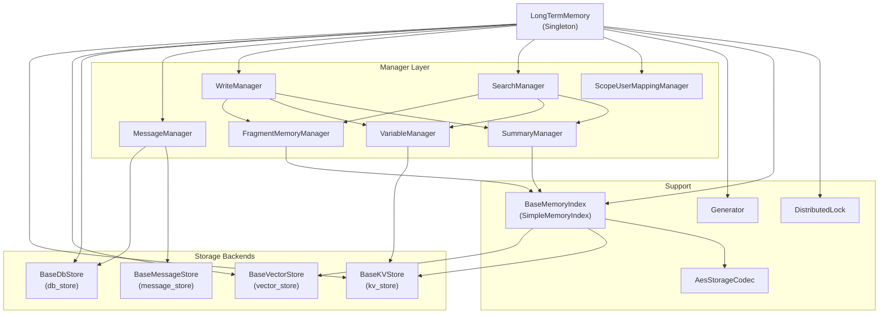
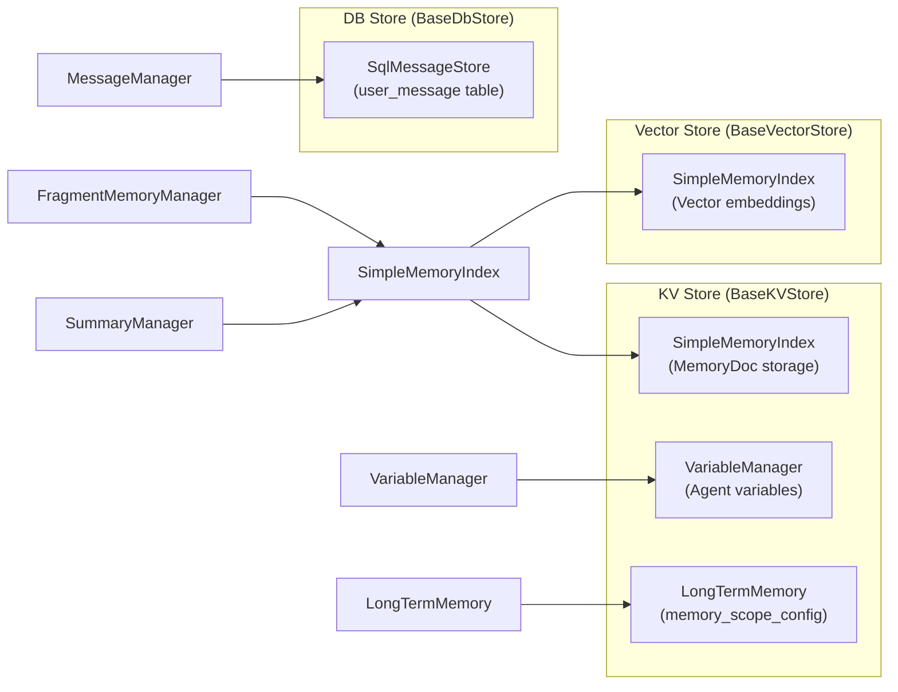

<!-- source: DeepWiki mcp.deepwiki.com · repo openJiuwen-ai/agent-core · page 6 Memory System · fetched 2026-11-02 -->

# Memory System

Relevant source files

The following files were used as context for generating this wiki page:

- [docs/en/2.Development Guide/API Docs/openjiuwen.core/memory/config.md](docs/en/2.Development Guide/API Docs/openjiuwen.core/memory/config.md)
- [docs/en/2.Development Guide/API Docs/openjiuwen.core/memory/long_term_memory.md](docs/en/2.Development Guide/API Docs/openjiuwen.core/memory/long_term_memory.md)
- [docs/en/2.Development Guide/Advanced Usage/Memory Engine.md](docs/en/2.Development Guide/Advanced Usage/Memory Engine.md)
- [openjiuwen/core/foundation/store/base_memory_index.py](openjiuwen/core/foundation/store/base_memory_index.py)
- [openjiuwen/core/foundation/store/index/simple_memory_index.py](openjiuwen/core/foundation/store/index/simple_memory_index.py)
- [openjiuwen/core/memory/config/config.py](openjiuwen/core/memory/config/config.py)
- [openjiuwen/core/memory/long_term_memory.py](openjiuwen/core/memory/long_term_memory.py)
- [openjiuwen/core/memory/manage/index/base_memory_manager.py](openjiuwen/core/memory/manage/index/base_memory_manager.py)
- [openjiuwen/core/memory/manage/index/fragment_memory_manager.py](openjiuwen/core/memory/manage/index/fragment_memory_manager.py)
- [openjiuwen/core/memory/manage/index/summary_manager.py](openjiuwen/core/memory/manage/index/summary_manager.py)
- [openjiuwen/core/memory/manage/index/variable_manager.py](openjiuwen/core/memory/manage/index/variable_manager.py)
- [openjiuwen/core/memory/manage/index/write_manager.py](openjiuwen/core/memory/manage/index/write_manager.py)
- [openjiuwen/core/memory/manage/mem_model/memory_unit.py](openjiuwen/core/memory/manage/mem_model/memory_unit.py)
- [openjiuwen/core/memory/manage/mem_model/message_manager.py](openjiuwen/core/memory/manage/mem_model/message_manager.py)
- [openjiuwen/core/memory/manage/mem_model/semantic_store.py](openjiuwen/core/memory/manage/mem_model/semantic_store.py)
- [openjiuwen/core/memory/manage/mem_model/sql_db_store.py](openjiuwen/core/memory/manage/mem_model/sql_db_store.py)
- [openjiuwen/core/memory/manage/mem_model/user_mem_store.py](openjiuwen/core/memory/manage/mem_model/user_mem_store.py)
- [openjiuwen/core/memory/manage/search/search_manager.py](openjiuwen/core/memory/manage/search/search_manager.py)
- [openjiuwen/core/memory/process/extract/common.py](openjiuwen/core/memory/process/extract/common.py)
- [openjiuwen/core/memory/process/extract/generation.py](openjiuwen/core/memory/process/extract/generation.py)
- [openjiuwen/core/memory/process/extract/long_term_memory_extractor.py](openjiuwen/core/memory/process/extract/long_term_memory_extractor.py)
- [openjiuwen/core/memory/process/extract/memory_analyzer.py](openjiuwen/core/memory/process/extract/memory_analyzer.py)
- [openjiuwen/core/memory/prompts/fragment_memory_prompt.md](openjiuwen/core/memory/prompts/fragment_memory_prompt.md)
- [openjiuwen/core/memory/prompts/memory_analysis_prompt.md](openjiuwen/core/memory/prompts/memory_analysis_prompt.md)
- [tests/system_tests/memory/test_long_term_memory.py](tests/system_tests/memory/test_long_term_memory.py)
- [tests/unit_tests/core/foundation/store/test_simple_memory_index.py](tests/unit_tests/core/foundation/store/test_simple_memory_index.py)
- [tests/unit_tests/core/memory/manage/test_manage.py](tests/unit_tests/core/memory/manage/test_manage.py)
- [tests/unit_tests/core/memory/test_search_manager.py](tests/unit_tests/core/memory/test_search_manager.py)

This page provides an overview of the long-term memory subsystem: its purpose, how it is initialized and configured, the memory types it manages, and how they map to underlying storage backends and manager classes.

## Purpose

The memory system provides persistent, cross-session storage for information associated with users and agents. It is designed to outlast individual conversations and accumulate knowledge over time. The core use cases are:

- Storing raw conversation messages for retrieval and auditing.
- Inferring and persisting durable user profile facts from conversation content.
- Tracking named agent variables (key-value pairs).
- Storing conversation history summaries for long-horizon retrieval.
- Managing graph-based entity relationships and lightweight file-based memories.

The system is primarily accessed through the `LongTermMemory` singleton [openjiuwen/core/memory/long_term_memory.py:69-80](), which orchestrates multiple storage backends.

---

## System Architecture

**Figure: LongTermMemory class and its dependencies**

Sources: [openjiuwen/core/memory/long_term_memory.py:83-114](), [openjiuwen/core/memory/manage/index/write_manager.py:14-17](), [openjiuwen/core/memory/manage/search/search_manager.py:31-37](), [openjiuwen/core/foundation/store/index/simple_memory_index.py:20-35]()

---

## Initialization Sequence

`LongTermMemory` must be initialized in two steps before use:

1.  **`register_store()`** — Binds the backend instances. `kv_store` is required; `vector_store`, `db_store`, and `message_store` are optional [openjiuwen/core/memory/long_term_memory.py:139-161](). If a `db_store` is provided, database tables are created via `create_tables` [openjiuwen/core/memory/long_term_memory.py:163-164]().
2.  **`set_config()`** — Takes a `MemoryEngineConfig` and instantiates all manager objects. This includes setting up the `WriteManager`, `SearchManager`, and `Generator` [openjiuwen/core/memory/long_term_memory.py:201-279](). It also handles the registration of the `SimpleMemoryIndex` as the default plugin if none is set [openjiuwen/core/memory/long_term_memory.py:228-235]().

Sources: [openjiuwen/core/memory/long_term_memory.py:139-279]()

---

## Memory Types

The system manages several distinct memory types, each handled by a specialized manager. Memory is classified into "fragments" (profiles, semantic, episodic) and other structures like variables and summaries:

| `MemoryType` Value | Manager Class | Storage Interface | Description |
| :--- | :--- | :--- | :--- |
| `MESSAGE` | `MessageManager` | `SqlMessageStore` | Raw conversation turns and message history [openjiuwen/core/memory/manage/mem_model/message_manager.py:21-30](). |
| `USER_PROFILE` | `FragmentMemoryManager` | `BaseMemoryIndex` | Inferred durable facts about a user [openjiuwen/core/memory/manage/index/fragment_memory_manager.py:27-30](). |
| `VARIABLE` | `VariableManager` | `BaseKVStore` | Named agent variables per user/scope [openjiuwen/core/memory/manage/index/variable_manager.py:16-25](). |
| `SUMMARY` | `SummaryManager` | `BaseMemoryIndex` | Conversation history summaries [openjiuwen/core/memory/manage/index/summary_manager.py:16-24](). |
| `SEMANTIC_MEMORY` | `FragmentMemoryManager` | `BaseMemoryIndex` | Fact-based knowledge extracted for semantic retrieval [openjiuwen/core/memory/manage/index/fragment_memory_manager.py:28-30](). |
| `EPISODIC_MEMORY` | `FragmentMemoryManager` | `BaseMemoryIndex` | Event-based knowledge with specific time context [openjiuwen/core/memory/manage/index/fragment_memory_manager.py:29-30](). |

Sources: [openjiuwen/core/memory/manage/mem_model/memory_unit.py](), [openjiuwen/core/memory/manage/index/fragment_memory_manager.py:26-30](), [openjiuwen/core/memory/manage/index/summary_manager.py:16-24](), [openjiuwen/core/memory/manage/index/variable_manager.py:16-25]()

---

## Scoping Model

Every memory operation is scoped by identifiers to ensure isolation:

-   **`scope_id`**: Isolates memory between different agents or applications.
-   **`user_id`**: Isolates memory between users within a scope.
-   **`session_id`**: Used for session-level tracking and message filtering.

`LongTermMemory` manages per-scope configurations (LLM and embedding models) using `MemoryScopeConfig` [openjiuwen/core/memory/config/config.py:37-46](). These are persisted and retrieved using `ScopeUserMappingManager` [openjiuwen/core/memory/long_term_memory.py:281-333]().

Sources: [openjiuwen/core/memory/long_term_memory.py:281-333](), [openjiuwen/core/memory/config/config.py:37-46]()

---

## Public API

The `LongTermMemory` singleton provides a high-level API for agents to interact with memory:

-   **`add_messages()`**: Stores new messages and triggers the `Generator` to extract long-term memory units (profiles, variables, summaries) [openjiuwen/core/memory/long_term_memory.py:399-514]().
-   **`search_user_mem()`**: Performs semantic search across user profiles and semantic memories using the `SearchManager` [openjiuwen/core/memory/long_term_memory.py:734-783]().
-   **`get_variables()`**: Retrieves agent variables by name or prefix [openjiuwen/core/memory/long_term_memory.py:683-732]().
-   **`update_mem_by_id()` / `delete_mem_by_id()`**: Direct CRUD operations on specific memory records via `WriteManager` [openjiuwen/core/memory/long_term_memory.py:592-653]().

Sources: [openjiuwen/core/memory/long_term_memory.py:399-950](), [openjiuwen/core/memory/manage/search/search_manager.py:39-89]()

---

## Memory Extraction and Analysis

The `Generator` class [openjiuwen/core/memory/process/extract/generation.py:26-29]() orchestrates the extraction process using `MemoryAnalyzer` and `LongTermMemoryExtractor`.

-   **`MemoryAnalyzer`**: Uses an LLM to determine if "key information" exists, extracts variables, and generates conversation summaries [openjiuwen/core/memory/process/extract/memory_analyzer.py:13-25]().
-   **`LongTermMemoryExtractor`**: Specifically handles the extraction of "fragment" memories (user profiles, semantic, episodic) using the `fragment_memory_prompt` [openjiuwen/core/memory/process/extract/long_term_memory_extractor.py:19-50]().
-   **Conflict Resolution**: `FragmentMemoryManager` utilizes `MemUpdateChecker` to detect and resolve conflicts between new information and existing memories during the addition process [openjiuwen/core/memory/manage/index/fragment_memory_manager.py:163-178]().

Sources: [openjiuwen/core/memory/process/extract/generation.py:31-158](), [openjiuwen/core/memory/process/extract/long_term_memory_extractor.py:19-50](), [openjiuwen/core/memory/manage/index/fragment_memory_manager.py:132-178]()

---

## Storage Backend Roles

**Figure: Mapping Code Entities to Storage Backends**

Sources: [openjiuwen/core/foundation/store/index/simple_memory_index.py:20-40](), [openjiuwen/core/memory/manage/index/variable_manager.py:16-28](), [openjiuwen/core/memory/manage/mem_model/sql_message_store.py:16-25](), [openjiuwen/core/memory/long_term_memory.py:281-290]()

---

## Encryption

If `MemoryEngineConfig.crypto_key` is provided (32 bytes), the system supports encryption of memory content [openjiuwen/core/memory/config/config.py:13-34]().

-   **`AesStorageCodec`**: Injected into the `BaseMemoryIndex` (e.g., `SimpleMemoryIndex`) to handle transparent encryption/decryption of the `text` field in `MemoryDoc` [openjiuwen/core/memory/long_term_memory.py:218-226]().
-   **Manual Encryption**: `BaseMemoryManager` provides static utilities `encrypt_memory_if_needed` and `decrypt_memory_if_needed` for managers that interact with storage directly [openjiuwen/core/memory/manage/index/base_memory_manager.py:116-155]().
-   **Scope**: Primarily protects the textual content of user profiles, semantic memories, and variables.

Sources: [openjiuwen/core/memory/manage/index/base_memory_manager.py:116-155](), [openjiuwen/core/memory/config/config.py:13-34](), [openjiuwen/core/memory/long_term_memory.py:218-226]()

---

## Child Pages

-   [Long-Term Memory](#6.1) — Detailed documentation of the `LongTermMemory` singleton and its managers.
-   [Memory Configuration](#6.2) — Reference for Pydantic models (`MemoryEngineConfig`, `AgentMemoryConfig`) and distributed locking.
-   [Graph Memory](#6.3) — Documentation of entity-triple graph storage and extraction.
-   [Lite and Coding Memory](#6.4) — Lightweight file-based memory for coding agents.
-   [External Memory Providers](#6.5) — Integration with external services like Mem0 and Lakebase.
-   [Context Evolver Extension](#6.6) — Documentation of the `context_evolver` for advanced task memory strategies.

---

