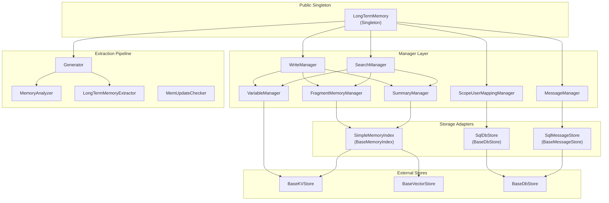
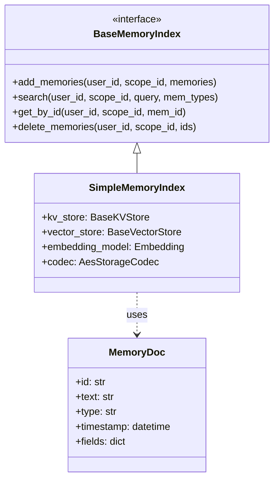

<!-- source: DeepWiki mcp.deepwiki.com · repo openJiuwen-ai/agent-core · page 6.1 Long-Term Memory · fetched 2026-11-02 -->

# Long-Term Memory

Relevant source files

The following files were used as context for generating this wiki page:

- [docs/en/2.Development Guide/API Docs/openjiuwen.core/memory/config.md](docs/en/2.Development Guide/API Docs/openjiuwen.core/memory/config.md)
- [docs/en/2.Development Guide/API Docs/openjiuwen.core/memory/long_term_memory.md](docs/en/2.Development Guide/API Docs/openjiuwen.core/memory/long_term_memory.md)
- [docs/en/2.Development Guide/Advanced Usage/Memory Engine.md](docs/en/2.Development Guide/Advanced Usage/Memory Engine.md)
- [openjiuwen/core/foundation/store/base_memory_index.py](openjiuwen/core/foundation/store/base_memory_index.py)
- [openjiuwen/core/foundation/store/index/simple_memory_index.py](openjiuwen/core/foundation/store/index/simple_memory_index.py)
- [openjiuwen/core/memory/config/config.py](openjiuwen/core/memory/config/config.py)
- [openjiuwen/core/memory/long_term_memory.py](openjiuwen/core/memory/long_term_memory.py)
- [openjiuwen/core/memory/manage/index/base_memory_manager.py](openjiuwen/core/memory/manage/index/base_memory_manager.py)
- [openjiuwen/core/memory/manage/index/fragment_memory_manager.py](openjiuwen/core/memory/manage/index/fragment_memory_manager.py)
- [openjiuwen/core/memory/manage/index/summary_manager.py](openjiuwen/core/memory/manage/index/summary_manager.py)
- [openjiuwen/core/memory/manage/index/variable_manager.py](openjiuwen/core/memory/manage/index/variable_manager.py)
- [openjiuwen/core/memory/manage/index/write_manager.py](openjiuwen/core/memory/manage/index/write_manager.py)
- [openjiuwen/core/memory/manage/mem_model/memory_unit.py](openjiuwen/core/memory/manage/mem_model/memory_unit.py)
- [openjiuwen/core/memory/manage/mem_model/message_manager.py](openjiuwen/core/memory/manage/mem_model/message_manager.py)
- [openjiuwen/core/memory/manage/mem_model/semantic_store.py](openjiuwen/core/memory/manage/mem_model/semantic_store.py)
- [openjiuwen/core/memory/manage/mem_model/sql_db_store.py](openjiuwen/core/memory/manage/mem_model/sql_db_store.py)
- [openjiuwen/core/memory/manage/mem_model/user_mem_store.py](openjiuwen/core/memory/manage/mem_model/user_mem_store.py)
- [openjiuwen/core/memory/manage/search/search_manager.py](openjiuwen/core/memory/manage/search/search_manager.py)
- [openjiuwen/core/memory/manage/update/mem_update_checker.py](openjiuwen/core/memory/manage/update/mem_update_checker.py)
- [openjiuwen/core/memory/process/extract/common.py](openjiuwen/core/memory/process/extract/common.py)
- [openjiuwen/core/memory/process/extract/generation.py](openjiuwen/core/memory/process/extract/generation.py)
- [openjiuwen/core/memory/process/extract/long_term_memory_extractor.py](openjiuwen/core/memory/process/extract/long_term_memory_extractor.py)
- [openjiuwen/core/memory/process/extract/memory_analyzer.py](openjiuwen/core/memory/process/extract/memory_analyzer.py)
- [openjiuwen/core/memory/prompts/__init__.py](openjiuwen/core/memory/prompts/__init__.py)
- [openjiuwen/core/memory/prompts/fragment_memory_prompt.md](openjiuwen/core/memory/prompts/fragment_memory_prompt.md)
- [openjiuwen/core/memory/prompts/memory_analysis_prompt.md](openjiuwen/core/memory/prompts/memory_analysis_prompt.md)
- [openjiuwen/core/memory/prompts/memory_update_check.md](openjiuwen/core/memory/prompts/memory_update_check.md)
- [openjiuwen/core/memory/prompts/prompt_applier.py](openjiuwen/core/memory/prompts/prompt_applier.py)
- [tests/system_tests/memory/__init__.py](tests/system_tests/memory/__init__.py)
- [tests/system_tests/memory/memory_env](tests/system_tests/memory/memory_env)
- [tests/system_tests/memory/test_long_term_memory.py](tests/system_tests/memory/test_long_term_memory.py)
- [tests/system_tests/memory/test_memory_quality.py](tests/system_tests/memory/test_memory_quality.py)
- [tests/unit_tests/core/foundation/store/test_simple_memory_index.py](tests/unit_tests/core/foundation/store/test_simple_memory_index.py)
- [tests/unit_tests/core/memory/manage/test_manage.py](tests/unit_tests/core/memory/manage/test_manage.py)
- [tests/unit_tests/core/memory/manage/test_mem_update_checker.py](tests/unit_tests/core/memory/manage/test_mem_update_checker.py)
- [tests/unit_tests/core/memory/prompt/__init__.py](tests/unit_tests/core/memory/prompt/__init__.py)
- [tests/unit_tests/core/memory/prompt/test_prompt_applier.py](tests/unit_tests/core/memory/prompt/test_prompt_applier.py)
- [tests/unit_tests/core/memory/test_search_manager.py](tests/unit_tests/core/memory/test_search_manager.py)

This page documents the `LongTermMemory` class and all internal subsystems that implement persistent, cross-session memory for agents. It covers storage backend registration, memory types, the extraction pipeline, conflict resolution, encryption, and the public API.

For configuration schema details (`MemoryEngineConfig`, `MemoryScopeConfig`, `AgentMemoryConfig`), see [Memory Configuration](#6.2). For the storage primitives that back this system (`BaseKVStore`, `BaseVectorStore`, `BaseDbStore`), see [Key-Value Stores](#12.1) and [Vector Stores](#7.1).

---

## Overview

`LongTermMemory` is a process-wide **singleton** that stores and retrieves structured memories extracted from agent conversations. It orchestrates an LLM-driven extraction pipeline to transform raw messages into typed, searchable memory records stored across KV, vector, and relational databases. [openjiuwen/core/memory/long_term_memory.py:69-79]()

### Initialization sequence

`LongTermMemory` must be initialized in explicit steps before use:

| Step | Method | Required Preconditions |
|------|--------|----------------------|
| 1 | `register_store(kv_store, vector_store, db_store, embedding_model, message_store)` | None [openjiuwen/core/memory/long_term_memory.py:139-143]() |
| 2 | `set_config(MemoryEngineConfig)` | `register_store` must have been called [openjiuwen/core/memory/long_term_memory.py:190-213]() |
| 3 (optional, per scope) | `set_scope_config(scope_id, MemoryScopeConfig)` | `set_config` must have been called [openjiuwen/core/memory/long_term_memory.py:253-286]() |

Calling `set_config` before `register_store` raises a `StatusCode.MEMORY_SET_CONFIG_EXECUTION_ERROR`. During `register_store`, the system automatically runs database migrations and creates necessary tables via `create_tables`. [openjiuwen/core/memory/long_term_memory.py:161-188](), [openjiuwen/core/memory/manage/mem_model/db_model.py:24]()

---

## Architecture

**Diagram: LongTermMemory subsystem layout**

**Sources:** [openjiuwen/core/memory/long_term_memory.py:83-114](), [openjiuwen/core/memory/manage/search/search_manager.py:28-37](), [openjiuwen/core/memory/manage/index/write_manager.py:18-35]()

---

## Memory Types

`MemoryType` defines the logical categories of stored data. [openjiuwen/core/memory/manage/mem_model/memory_unit.py:14-23]()

| `MemoryType` value | Manager | Description |
|--------------------|---------|-------------|
| `user_profile` | `FragmentMemoryManager` | Explicit user facts (name, job, interests, etc.) |
| `variable` | `VariableManager` | Named key-value pairs defined by the agent author |
| `summary` | `SummaryManager` | Per-turn conversation summaries |
| `semantic_memory` | `FragmentMemoryManager` | Facts without explicit time relation |
| `episodic_memory` | `FragmentMemoryManager` | Facts with clear time relation/events |

### Memory unit dataclasses

All memory units extend `BaseMemoryUnit`:
- `FragmentMemoryUnit`: Used for `user_profile`, `semantic_memory`, and `episodic_memory`. [openjiuwen/core/memory/manage/mem_model/memory_unit.py:53-61]()
- `VariableUnit`: Contains `variable_name` and `variable_mem`. [openjiuwen/core/memory/manage/mem_model/memory_unit.py:44-51]()
- `SummaryUnit`: Contains `summary`, `mem_id`, and `message_mem_id`. [openjiuwen/core/memory/manage/mem_model/memory_unit.py:63-71]()

**Sources:** [openjiuwen/core/memory/manage/mem_model/memory_unit.py:10-90]()

---

## Memory Index and Storage

The system uses `BaseMemoryIndex` (typically `SimpleMemoryIndex`) as the primary abstraction for indexing memory content into KV and Vector stores.

**Diagram: Memory indexing entities**

**Sources:** [openjiuwen/core/foundation/store/base_memory_index.py:16-104](), [openjiuwen/core/foundation/store/index/simple_memory_index.py:25-45]()

### Encryption
All memory content is encrypted at rest when `MemoryEngineConfig.crypto_key` is provided. The system uses `AesStorageCodec` (AES-GCM) to encrypt the `text` field in `MemoryDoc` before it reaches the `BaseKVStore`. [openjiuwen/core/memory/codec/aes_storage_codec.py:15](), [openjiuwen/core/memory/config/config.py:18-34]()

---

## Memory Managers

Each `MemoryType` has a dedicated manager implementing `BaseMemoryManager`. [openjiuwen/core/memory/manage/index/base_memory_manager.py:16-20]()

### `FragmentMemoryManager` and Conflict Resolution
This manager handles `user_profile`, `semantic_memory`, and `episodic_memory`. It uses `MemUpdateChecker` (LLM-based) to resolve conflicts: [openjiuwen/core/memory/manage/index/fragment_memory_manager.py:53-62]()

1. **Recall**: Queries existing memories using `memory_index.search` for context. [openjiuwen/core/memory/manage/index/fragment_memory_manager.py:149]()
2. **Check**: Invokes `MemUpdateChecker.check()` with new vs old memories. [openjiuwen/core/memory/manage/update/mem_update_checker.py:126-147]()
3. **Resolve**: The checker returns `MemoryActionItem` with status `ADD` or `DELETE`. [openjiuwen/core/memory/manage/update/mem_update_checker.py:37-53]()
4. **Commit**: The manager executes the additions and deletions in the index. [openjiuwen/core/memory/manage/index/fragment_memory_manager.py:171-179]()

### `SearchManager`
Routes search queries to specific managers. If `search_type` is not specified, it traverses all registered managers. [openjiuwen/core/memory/manage/search/search_manager.py:28-85]()

---

## Memory Extraction Pipeline

When `add_messages()` is called, it triggers `Generator.gen_all_memory()`. [openjiuwen/core/memory/long_term_memory.py:410-422]()

### Stage 1: `MemoryAnalyzer`
Analyzes messages to determine if key information exists, extracts pre-defined variables, and generates a turn-based summary using `memory_analysis_prompt.md`. [openjiuwen/core/memory/process/extract/memory_analyzer.py:63-90]()

### Stage 2: `LongTermMemoryExtractor`
If key info exists, it extracts structured facts using `fragment_memory_prompt.md`. This prompt handles **Anaphora Resolution** (replacing "he/she" with entities) and **Temporal Reasoning** (converting "next week" to absolute dates). [openjiuwen/core/memory/prompts/fragment_memory_prompt.md:5-32](), [openjiuwen/core/memory/process/extract/long_term_memory_extractor.py:16-25]()

---

## Public API Reference

| Method | Description |
|--------|-------------|
| `add_messages(...)` | Stores messages and runs extraction pipeline. Uses `DistributedLock` to ensure user-level atomicity. [openjiuwen/core/memory/long_term_memory.py:352-463]() |
| `search_user_mem(...)` | Semantic search across long-term memory types. [openjiuwen/core/memory/long_term_memory.py:650-675]() |
| `get_variables(...)` | Retrieves agent-defined variables. [openjiuwen/core/memory/long_term_memory.py:614-628]() |
| `delete_mem_by_id(...)` | Deletes a specific memory record. [openjiuwen/core/memory/long_term_memory.py:554-573]() |

**Sources:** [openjiuwen/core/memory/long_term_memory.py:352-700](), [openjiuwen/core/memory/manage/search/search_manager.py:39-165]()

---

