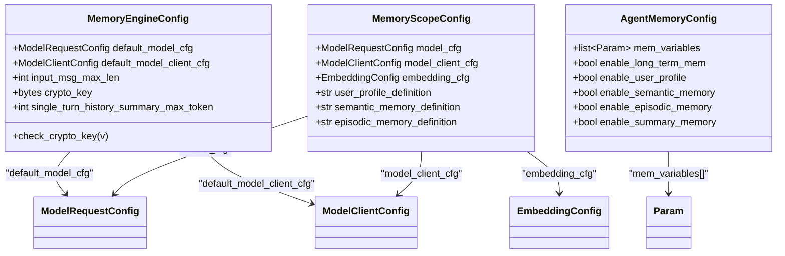
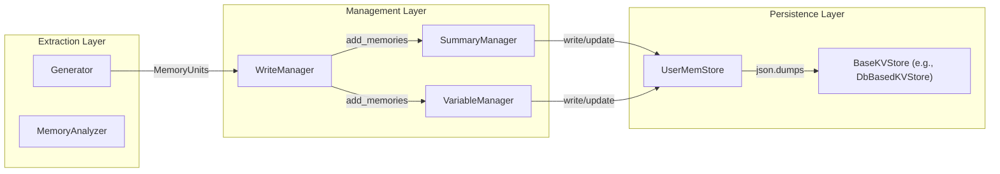
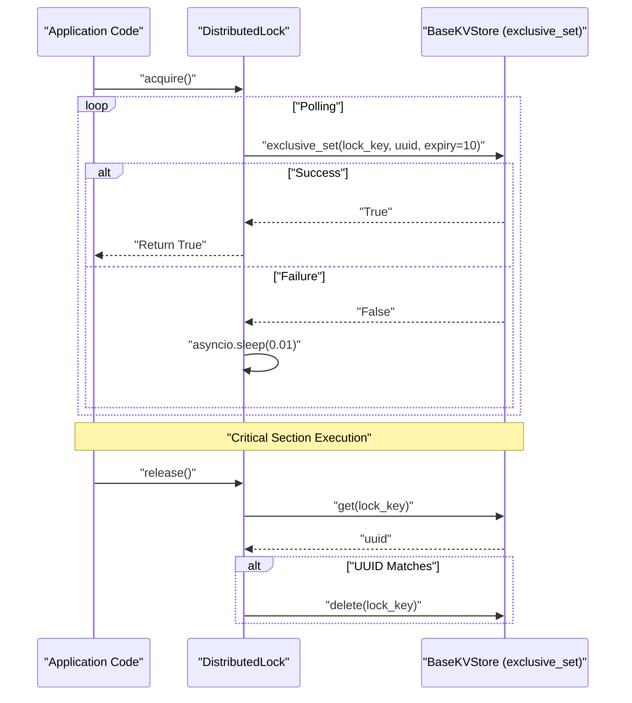
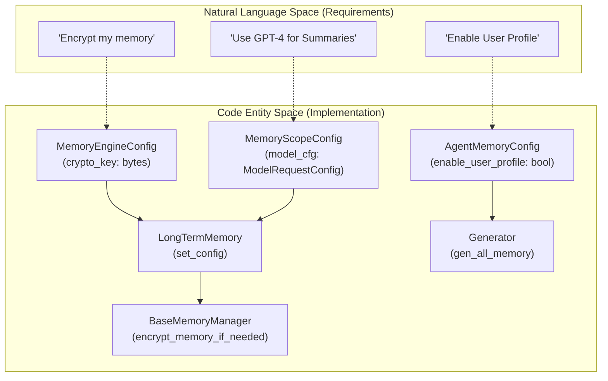

<!-- source: DeepWiki mcp.deepwiki.com · repo openJiuwen-ai/agent-core · page 6.2 Memory Configuration · fetched 2026-11-02 -->

# Memory Configuration

<details>
<summary>Relevant source files</summary>

The following files were used as context for generating this wiki page:

- [docs/en/2.Development Guide/API Docs/openjiuwen.core/memory/config.md](docs/en/2.Development Guide/API Docs/openjiuwen.core/memory/config.md)
- [docs/en/2.Development Guide/API Docs/openjiuwen.core/memory/long_term_memory.md](docs/en/2.Development Guide/API Docs/openjiuwen.core/memory/long_term_memory.md)
- [docs/en/2.Development Guide/Advanced Usage/Memory Engine.md](docs/en/2.Development Guide/Advanced Usage/Memory Engine.md)
- [openjiuwen/core/foundation/store/base_memory_index.py](openjiuwen/core/foundation/store/base_memory_index.py)
- [openjiuwen/core/foundation/store/index/simple_memory_index.py](openjiuwen/core/foundation/store/index/simple_memory_index.py)
- [openjiuwen/core/memory/config/config.py](openjiuwen/core/memory/config/config.py)
- [openjiuwen/core/memory/long_term_memory.py](openjiuwen/core/memory/long_term_memory.py)
- [openjiuwen/core/memory/manage/index/base_memory_manager.py](openjiuwen/core/memory/manage/index/base_memory_manager.py)
- [openjiuwen/core/memory/manage/index/fragment_memory_manager.py](openjiuwen/core/memory/manage/index/fragment_memory_manager.py)
- [openjiuwen/core/memory/manage/index/summary_manager.py](openjiuwen/core/memory/manage/index/summary_manager.py)
- [openjiuwen/core/memory/manage/index/variable_manager.py](openjiuwen/core/memory/manage/index/variable_manager.py)
- [openjiuwen/core/memory/manage/index/write_manager.py](openjiuwen/core/memory/manage/index/write_manager.py)
- [openjiuwen/core/memory/manage/mem_model/memory_unit.py](openjiuwen/core/memory/manage/mem_model/memory_unit.py)
- [openjiuwen/core/memory/manage/mem_model/message_manager.py](openjiuwen/core/memory/manage/mem_model/message_manager.py)
- [openjiuwen/core/memory/manage/mem_model/semantic_store.py](openjiuwen/core/memory/manage/mem_model/semantic_store.py)
- [openjiuwen/core/memory/manage/mem_model/sql_db_store.py](openjiuwen/core/memory/manage/mem_model/sql_db_store.py)
- [openjiuwen/core/memory/manage/mem_model/user_mem_store.py](openjiuwen/core/memory/manage/mem_model/user_mem_store.py)
- [openjiuwen/core/memory/manage/search/search_manager.py](openjiuwen/core/memory/manage/search/search_manager.py)
- [openjiuwen/core/memory/manage/update/mem_update_checker.py](openjiuwen/core/memory/manage/update/mem_update_checker.py)
- [openjiuwen/core/memory/process/extract/common.py](openjiuwen/core/memory/process/extract/common.py)
- [openjiuwen/core/memory/process/extract/generation.py](openjiuwen/core/memory/process/extract/generation.py)
- [openjiuwen/core/memory/process/extract/long_term_memory_extractor.py](openjiuwen/core/memory/process/extract/long_term_memory_extractor.py)
- [openjiuwen/core/memory/process/extract/memory_analyzer.py](openjiuwen/core/memory/process/extract/memory_analyzer.py)
- [openjiuwen/core/memory/prompts/__init__.py](openjiuwen/core/memory/prompts/__init__.py)
- [openjiuwen/core/memory/prompts/fragment_memory_prompt.md](openjiuwen/core/memory/prompts/fragment_memory_prompt.md)
- [openjiuwen/core/memory/prompts/memory_analysis_prompt.md](openjiuwen/core/memory/prompts/memory_analysis_prompt.md)
- [openjiuwen/core/memory/prompts/memory_update_check.md](openjiuwen/core/memory/prompts/memory_update_check.md)
- [openjiuwen/core/memory/prompts/prompt_applier.py](openjiuwen/core/memory/prompts/prompt_applier.py)
- [tests/system_tests/memory/__init__.py](tests/system_tests/memory/__init__.py)
- [tests/system_tests/memory/memory_env](tests/system_tests/memory/memory_env)
- [tests/system_tests/memory/test_long_term_memory.py](tests/system_tests/memory/test_long_term_memory.py)
- [tests/system_tests/memory/test_memory_quality.py](tests/system_tests/memory/test_memory_quality.py)
- [tests/unit_tests/core/foundation/store/test_simple_memory_index.py](tests/unit_tests/core/foundation/store/test_simple_memory_index.py)
- [tests/unit_tests/core/memory/manage/test_manage.py](tests/unit_tests/core/memory/manage/test_manage.py)
- [tests/unit_tests/core/memory/manage/test_mem_update_checker.py](tests/unit_tests/core/memory/manage/test_mem_update_checker.py)
- [tests/unit_tests/core/memory/prompt/__init__.py](tests/unit_tests/core/memory/prompt/__init__.py)
- [tests/unit_tests/core/memory/prompt/test_prompt_applier.py](tests/unit_tests/core/memory/prompt/test_prompt_applier.py)
- [tests/unit_tests/core/memory/test_search_manager.py](tests/unit_tests/core/memory/test_search_manager.py)

</details>


This page is a reference for the Pydantic configuration models, `UserMemStore`, and `DistributedLock` that control how the long-term memory system is set up and isolated. It covers the data shapes you fill in when registering a memory backend or enabling memory on an agent.

For the runtime behavior that consumes these configs — storage backends, `LongTermMemory`, `MessageManager`, etc. — see the **Long-Term Memory (6.1)** page. For the key-value store implementations that `DistributedLock` and `UserMemStore` sit on top of, see **Key-Value Stores (12.1)**.

---

## Configuration Model Hierarchy

Three Pydantic models cover different layers of the memory system. They compose rather than inherit: `MemoryEngineConfig` holds the system-wide defaults, `MemoryScopeConfig` allows per-scope overrides, and `AgentMemoryConfig` is attached to an individual agent to declare which memory features it needs.

**Configuration model relationships**



Sources: [openjiuwen/core/memory/config/config.py:13-56](), [docs/en/2.Development Guide/Advanced Usage/Memory Engine.md:16-41]()

---

## `MemoryEngineConfig`

Holds system-wide settings for the memory engine. Passed when initializing `LongTermMemory` via `set_config` [openjiuwen/core/memory/long_term_memory.py:160-165]().

| Field | Type | Default | Description |
|---|---|---|---|
| `default_model_cfg` | `ModelRequestConfig` | `None` | Default LLM request config used for summarization and memory writing |
| `default_model_client_cfg` | `ModelClientConfig` | `None` | Default model client (provider/endpoint) for memory operations |
| `forbidden_variables` | `str` | `""` | Comma-separated list of variable names forbidden from extraction |
| `input_msg_max_len` | `int` | `8192` | Maximum character length of an input message before truncation |
| `crypto_key` | `bytes` | `b''` | AES-256-GCM key for encrypting stored memory. Must be 32 bytes or empty |
| `single_turn_history_summary_max_token` | `int` | `128` | Token budget for the per-turn history summary written to memory |

### Crypto key validation

The `check_crypto_key` field validator ([openjiuwen/core/memory/config/config.py:21-34]()) enforces exactly two valid states:

- `b''` — encryption disabled, all memory is stored in plaintext.
- A `bytes` value of length `AES_KEY_LENGTH` (32) — encryption enabled.

Any other length raises a `MEMORY_SET_CONFIG_EXECUTION_ERROR` [openjiuwen/core/memory/config/config.py:30-34]().

Sources: [openjiuwen/core/memory/config/config.py:13-36](), [docs/en/2.Development Guide/Advanced Usage/Memory Engine.md:16-22]()

---

## `MemoryScopeConfig`

Provides per-scope overrides for model and embedding choices, as well as customized extraction rules. A "scope" typically maps to a product or application identifier (a `scope_id`) that partitions user memory.

| Field | Type | Default | Description |
|---|---|---|---|
| `model_cfg` | `ModelRequestConfig` | `None` | Override the engine-level `default_model_cfg` for this scope |
| `model_client_cfg` | `ModelClientConfig` | `None` | Override the engine-level `default_model_client_cfg` for this scope |
| `embedding_cfg` | `EmbeddingConfig` | `None` | Embedding model/provider used for semantic search within this scope |
| `user_profile_definition` | `str` | *(Long String)* | Rule for user profile extraction [openjiuwen/core/memory/config/config.py:42]() |
| `semantic_memory_definition` | `str` | *(Long String)* | Rule for semantic memory extraction [openjiuwen/core/memory/config/config.py:44]() |
| `episodic_memory_definition` | `str` | *(Long String)* | Rule for episodic memory extraction [openjiuwen/core/memory/config/config.py:46]() |

Sources: [openjiuwen/core/memory/config/config.py:37-47](), [docs/en/2.Development Guide/Advanced Usage/Memory Engine.md:24-31]()

---

## `AgentMemoryConfig`

Attached to an agent definition to declare that agent's memory requirements and feature toggles.

| Field | Type | Default | Description |
|---|---|---|---|
| `mem_variables` | `list[Param]` | `[]` | Structured memory variables (e.g., name, age) the agent reads/writes |
| `enable_long_term_mem` | `bool` | `True` | Master switch for long-term memory features |
| `enable_user_profile` | `bool` | `True` | Toggle for extracting user profile information |
| `enable_semantic_memory` | `bool` | `True` | Toggle for semantic (fact-based) memory |
| `enable_episodic_memory` | `bool` | `True` | Toggle for episodic (time-based) memory |
| `enable_summary_memory` | `bool` | `True` | Toggle for conversation summary extraction |

Sources: [openjiuwen/core/memory/config/config.py:49-56](), [docs/en/2.Development Guide/Advanced Usage/Memory Engine.md:33-40]()

---

## `UserMemStore`

`UserMemStore` is a thin wrapper around a `BaseKVStore` instance. It provides structured key-naming conventions for all memory state that belongs to a specific user and scope (profile entries, variable values, metadata indices). 

### Key Functions
- `write`: Persists memory data and updates secondary index keys for `user_ids`, `mem_type`, and `user_profile_topic` [openjiuwen/core/memory/manage/mem_model/user_mem_store.py:37-80]().
- `get_all`: Retrieves all memory units for a specific user and memory type by resolving the ID list stored in the KV store [openjiuwen/core/memory/manage/mem_model/user_mem_store.py:126-136]().
- `batch_get`: Efficiently fetches multiple memory records using the `mget` primitive of the underlying store [openjiuwen/core/memory/manage/mem_model/user_mem_store.py:118-124]().

**Data Flow: Memory Extraction to UserMemStore**



Sources: [openjiuwen/core/memory/process/extract/generation.py:31-158](), [openjiuwen/core/memory/manage/index/write_manager.py:19-37](), [openjiuwen/core/memory/manage/mem_model/user_mem_store.py:37-60]()

---

## `DistributedLock`

An async, multi-process-safe distributed lock implemented on top of any `BaseKVStore` that supports `exclusive_set`. This is critical for preventing race conditions when multiple agent instances attempt to update the same user's memory simultaneously.

### Constructor
```python
DistributedLock(store: BaseKVStore, lock_name: str)
```
- `lock_key`: Prefixed with `_lock/` to avoid collision with actual data [openjiuwen/core/memory/common/distributed_lock.py:15]().
- `ttl`: Defaults to 10 seconds to prevent permanent deadlocks if a process crashes [openjiuwen/core/memory/common/distributed_lock.py:16]().
- `lock_value`: A unique `uuid4` string assigned per acquisition to ensure only the owner can release the lock [openjiuwen/core/memory/common/distributed_lock.py:21]().

### Lock Lifecycle



Sources: [openjiuwen/core/memory/common/distributed_lock.py:9-46](), [openjiuwen/core/foundation/store/base_kv_store.py:101-114]()

---

## Configuration Mapping

This diagram maps how high-level configuration requirements associate with specific code entities and their roles in the memory pipeline.



Sources: [openjiuwen/core/memory/config/config.py:13-56](), [openjiuwen/core/memory/long_term_memory.py:160-165](), [openjiuwen/core/memory/manage/index/base_memory_manager.py:116-155]()

---

