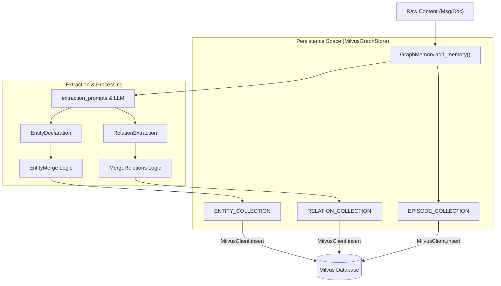
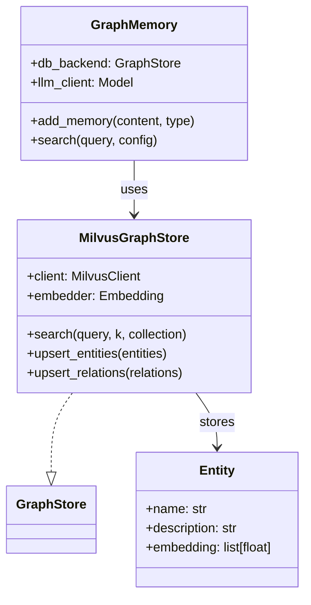

<!-- source: DeepWiki mcp.deepwiki.com · repo openJiuwen-ai/agent-core · page 6.3 Graph Memory · fetched 2026-11-02 -->

# Graph Memory

Relevant source files

The following files were used as context for generating this wiki page:

- [docs/en/2.Development Guide/API Docs/openjiuwen.core/memory/graph/config.md](docs/en/2.Development Guide/API Docs/openjiuwen.core/memory/graph/config.md)
- [openjiuwen/core/foundation/store/graph/base_graph_store.py](openjiuwen/core/foundation/store/graph/base_graph_store.py)
- [openjiuwen/core/foundation/store/graph/milvus/milvus_support.py](openjiuwen/core/foundation/store/graph/milvus/milvus_support.py)
- [openjiuwen/core/foundation/store/graph/result_ranking.py](openjiuwen/core/foundation/store/graph/result_ranking.py)
- [openjiuwen/core/memory/config/graph.py](openjiuwen/core/memory/config/graph.py)
- [openjiuwen/core/memory/graph/extraction/prompts/cn/entity_extraction_document_cn.pr.md](openjiuwen/core/memory/graph/extraction/prompts/cn/entity_extraction_document_cn.pr.md)
- [openjiuwen/core/memory/graph/extraction/prompts/cn/entity_extraction_json_cn.pr.md](openjiuwen/core/memory/graph/extraction/prompts/cn/entity_extraction_json_cn.pr.md)
- [openjiuwen/core/memory/graph/extraction/prompts/en/entity_extraction_document_en.pr.md](openjiuwen/core/memory/graph/extraction/prompts/en/entity_extraction_document_en.pr.md)
- [openjiuwen/core/memory/graph/extraction/prompts/en/entity_extraction_json_en.pr.md](openjiuwen/core/memory/graph/extraction/prompts/en/entity_extraction_json_en.pr.md)
- [openjiuwen/core/memory/graph/graph_memory/base.py](openjiuwen/core/memory/graph/graph_memory/base.py)
- [openjiuwen/core/runner/resources_manager/tag_manager.py](openjiuwen/core/runner/resources_manager/tag_manager.py)
- [openjiuwen/core/runner/resources_manager/thread_safe_dict.py](openjiuwen/core/runner/resources_manager/thread_safe_dict.py)
- [tests/unit_tests/core/foundation/store/graph/milvus/test_milvus_support.py](tests/unit_tests/core/foundation/store/graph/milvus/test_milvus_support.py)
- [tests/unit_tests/core/foundation/store/graph/test_graph_store_utils.py](tests/unit_tests/core/foundation/store/graph/test_graph_store_utils.py)
- [tests/unit_tests/core/foundation/store/graph/test_result_ranking.py](tests/unit_tests/core/foundation/store/graph/test_result_ranking.py)
- [tests/unit_tests/core/memory/graph/graph_memory/test_base.py](tests/unit_tests/core/memory/graph/graph_memory/test_base.py)
- [tests/unit_tests/core/runner/test_tag_manager.py](tests/unit_tests/core/runner/test_tag_manager.py)

Graph Memory is a sophisticated long-term memory subsystem that maintains a knowledge graph of entities, relations, and episodes extracted from user conversations and documents. It leverages Large Language Models (LLMs) for semantic extraction and utilizes high-performance vector databases like Milvus for storage and retrieval.

## Overview

The `GraphMemory` class [openjiuwen/core/memory/graph/graph_memory/base.py:83-89]() manages the lifecycle of graph-based information. Unlike standard vector memory which stores raw text chunks, Graph Memory decomposes information into:
*   **Entities**: Unique nodes representing people, places, or concepts.
*   **Relations**: Triples (Subject-Predicate-Object) defining the connections between entities.
*   **Episodes**: Contextual containers (conversations or documents) that group related entities and relations.

### Data Flow: Extraction to Storage

The process of adding memory involves several stages: extraction via LLM, deduplication, merging, and finally persistence to the backend.

#### Code-to-Entity Data Flow
The following diagram maps the logical flow of data from raw input to the specific code entities responsible for processing and storing it.

**Sources:** [openjiuwen/core/memory/graph/graph_memory/base.py:200-250](), [openjiuwen/core/foundation/store/graph/milvus/milvus_support.py:25-30](), [openjiuwen/core/memory/graph/extraction/extraction_models.py:56-61]()

## GraphMemory Configuration

Graph Memory is highly configurable via the `GraphConfig` and `AddMemStrategy` classes.

### GraphMemoryConfig
The configuration controls the underlying storage backend and embedding parameters:
*   **`db_config`**: A `GraphConfig` object defining the URI, token, and database name [openjiuwen/core/foundation/store/graph/milvus/milvus_support.py:40-50]().
*   **`llm_client`**: The `Model` instance used for semantic extraction [openjiuwen/core/memory/graph/graph_memory/base.py:132]().
*   **`language`**: Supports "cn" (Chinese) and "en" (English) for prompt templates, validated against the storage config [openjiuwen/core/memory/graph/graph_memory/base.py:129-130]().

### AddMemStrategy
Defined in `openjiuwen.core.memory.config.graph`, this strategy governs how new information is integrated:
*   **`merge_entities`**: If True, performs LLM-based entity merging to prevent duplicates [openjiuwen/core/memory/config/graph.py:78]().
*   **`recall_episode`**: Strategy for retrieving similar past episodes during the merge phase [openjiuwen/core/memory/config/graph.py:67]().
*   **`recall_entity`**: Uses a `WeightedRankConfig` by default, balancing name and content density [openjiuwen/core/memory/config/graph.py:68-73]().
*   **`summary_target`**: Target word count for generated entity summaries [openjiuwen/core/memory/config/graph.py:75-77]().

**Sources:** [openjiuwen/core/memory/config/graph.py:49-81](), [openjiuwen/core/memory/graph/graph_memory/base.py:91-123]()

## Implementation Detail: Milvus Backend

The primary implementation for graph storage is `MilvusGraphStore`. It organizes data into three distinct collections.

| Collection Name | Code Constant | Data Object |
| :--- | :--- | :--- |
| Entity | `ENTITY_COLLECTION` | `Entity` |
| Relation | `RELATION_COLLECTION` | `Relation` |
| Episode | `EPISODE_COLLECTION` | `Episode` |

### Storage Architecture
The `MilvusGraphStore` handles the creation of these collections and their indices (Dense and Sparse/BM25) via `_build_indices` and `generate_schema_and_index` [openjiuwen/core/foundation/store/graph/milvus/milvus_support.py:59-65]().

**Sources:** [openjiuwen/core/foundation/store/graph/milvus/milvus_support.py:34-60](), [openjiuwen/core/memory/graph/graph_memory/base.py:130-131](), [openjiuwen/core/foundation/store/graph/constants.py:25-26]()

## Integration with LongTermMemory

`GraphMemory` is integrated into the broader `LongTermMemory` system. When an agent adds messages via `LongTermMemory.add_messages`, the system can trigger graph extraction if `enable_semantic_memory` or `enable_episodic_memory` is enabled in the `AgentMemoryConfig`.

### Retrieval Flow
1.  **Query Processing**: The user query is embedded using the `embedder` attached to the backend [openjiuwen/core/memory/graph/graph_memory/base.py:153-158]().
2.  **Multi-Stage Search**:
    *   Search for relevant **Episodes** using vector similarity [openjiuwen/core/memory/config/graph.py:40-46]().
    *   Search for **Entities** using hybrid search (Dense + BM25) configured via `SearchConfig` [openjiuwen/core/memory/config/graph.py:83-92]().
3.  **Graph Traversal**: Optional BFS (Breadth-First Search) traversal to find neighboring entities and relations based on `bfs_depth` and `bfs_k` [openjiuwen/core/memory/config/graph.py:86-87]().
4.  **Reranking**: If `rerank` is enabled in `SearchConfig`, a cross-encoder `Reranker` is used to sort results for higher precision [openjiuwen/core/memory/graph/graph_memory/base.py:161-169](), [openjiuwen/core/foundation/store/graph/milvus/milvus_support.py:87-102]().

**Sources:** [openjiuwen/core/memory/graph/graph_memory/base.py:151-170](), [openjiuwen/core/memory/config/graph.py:83-92](), [openjiuwen/core/foundation/store/graph/milvus/milvus_support.py:160-170]()

---

