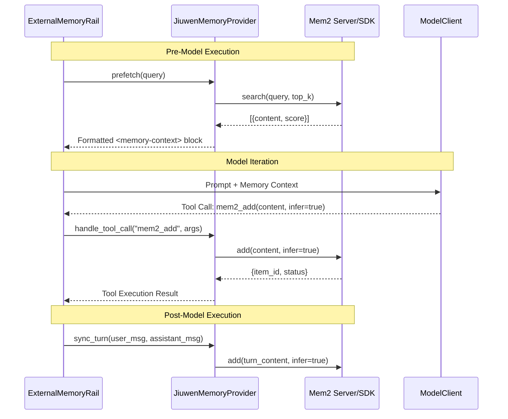

<!-- source: DeepWiki mcp.deepwiki.com · repo openJiuwen-ai/agent-core · page 6.5 External Memory Providers · fetched 2026-11-02 -->

# External Memory Providers

<details>
<summary>Relevant source files</summary>

The following files were used as context for generating this wiki page:

- [openjiuwen/core/memory/external/__init__.py](openjiuwen/core/memory/external/__init__.py)
- [openjiuwen/core/memory/external/agentarts_memory_provider.py](openjiuwen/core/memory/external/agentarts_memory_provider.py)
- [openjiuwen/core/memory/external/jiuwen_memory_provider.py](openjiuwen/core/memory/external/jiuwen_memory_provider.py)
- [openjiuwen/core/memory/external/lakebase_memory_provider.py](openjiuwen/core/memory/external/lakebase_memory_provider.py)
- [openjiuwen/core/memory/external/mem0_provider.py](openjiuwen/core/memory/external/mem0_provider.py)
- [openjiuwen/core/memory/external/openjiuwen_memory_provider.py](openjiuwen/core/memory/external/openjiuwen_memory_provider.py)
- [openjiuwen/core/memory/external/provider.py](openjiuwen/core/memory/external/provider.py)
- [openjiuwen/harness/prompts/sections/external_memory.py](openjiuwen/harness/prompts/sections/external_memory.py)
- [openjiuwen/harness/prompts/sections/goal.py](openjiuwen/harness/prompts/sections/goal.py)
- [openjiuwen/harness/prompts/sections/task_completion.py](openjiuwen/harness/prompts/sections/task_completion.py)
- [openjiuwen/harness/prompts/tools/goal.py](openjiuwen/harness/prompts/tools/goal.py)
- [openjiuwen/harness/rails/evolution/review/subagent.py](openjiuwen/harness/rails/evolution/review/subagent.py)
- [openjiuwen/harness/rails/task_completion_rail.py](openjiuwen/harness/rails/task_completion_rail.py)
- [openjiuwen/harness/schema/interaction.py](openjiuwen/harness/schema/interaction.py)
- [openjiuwen/harness/schema/stop_condition.py](openjiuwen/harness/schema/stop_condition.py)
- [tests/unit_tests/core/memory/external/test_agentarts_memory_provider.py](tests/unit_tests/core/memory/external/test_agentarts_memory_provider.py)
- [tests/unit_tests/core/memory/external/test_jiuwen_memory_provider.py](tests/unit_tests/core/memory/external/test_jiuwen_memory_provider.py)
- [tests/unit_tests/core/memory/external/test_lakebase_memory_provider.py](tests/unit_tests/core/memory/external/test_lakebase_memory_provider.py)
- [tests/unit_tests/core/memory/external/test_mem0_provider.py](tests/unit_tests/core/memory/external/test_mem0_provider.py)
- [tests/unit_tests/core/memory/external/test_openjiuwen_memory_provider.py](tests/unit_tests/core/memory/external/test_openjiuwen_memory_provider.py)
- [tests/unit_tests/harness/prompts/test_external_memory.py](tests/unit_tests/harness/prompts/test_external_memory.py)
- [tests/unit_tests/harness/rails/evolution/test_evolution_review_subagent.py](tests/unit_tests/harness/rails/evolution/test_evolution_review_subagent.py)
- [tests/unit_tests/harness/test_deep_agent_interaction.py](tests/unit_tests/harness/test_deep_agent_interaction.py)
- [tests/unit_tests/harness/test_task_completion_extensions.py](tests/unit_tests/harness/test_task_completion_extensions.py)

</details>


The External Memory subsystem allows the `agent-core` SDK to integrate with diverse long-term memory services. It abstracts the complexities of different memory architectures—ranging from local vector stores and graph databases to third-party SaaS platforms—into a unified interface. This enables agents to maintain persistent user profiles, episodic context, and semantic knowledge across multiple sessions.

## BaseMemoryProvider Interface

All external memory integrations must implement the `MemoryProvider` abstract base class [openjiuwen/core/memory/external/provider.py:10-53](). This interface ensures that the `ExternalMemoryRail` in the harness can interact with any provider regardless of its underlying storage or retrieval logic.

### Key Interface Methods
- **`initialize`**: Sets up connections, initializes clients, and performs health checks. It accepts optional runtime parameters like `user_id` and `session_id` [openjiuwen/core/memory/external/provider.py:22-23]().
- **`prefetch`**: A performance-critical method that retrieves relevant context based on the current user query *before* the LLM is invoked, allowing the context to be injected into the system prompt [openjiuwen/core/memory/external/provider.py:34-35]().
- **`sync_turn`**: Synchronizes the conversation turn (user and assistant messages) to the memory provider for storage or indexing [openjiuwen/core/memory/external/provider.py:38-39]().
- **`get_tool_schemas`**: Returns the JSON schemas for memory-related tools that the agent can call during its execution loop [openjiuwen/core/memory/external/provider.py:26-27]().
- **`handle_tool_call`**: Routes agent tool calls (e.g., `mem2_search`) to the provider's specific implementation [openjiuwen/core/memory/external/provider.py:30-31]().

**Sources:** [openjiuwen/core/memory/external/provider.py:10-53]().

---

## Built-in Providers

### 1. JiuwenMemoryProvider (Mem2)
This is the primary high-performance memory provider, supporting two backend modes: `server` (remote HTTP) and `sdk` (in-process) [openjiuwen/core/memory/external/jiuwen_memory_provider.py:3-35]().

- **Backend Modes**:
    - **`mode="server"`**: Communicates with a remote `JiuwenMemory` service via `POST /v1/<verb>` [openjiuwen/core/memory/external/jiuwen_memory_provider.py:8-11]().
    - **`mode="sdk"`**: Embeds the memory engine directly into the host process for lower latency [openjiuwen/core/memory/external/jiuwen_memory_provider.py:12-16]().
- **Circuit Breaker**: Implements a safety mechanism that opens after 5 consecutive failures, cooling down for 120 seconds to prevent stalling the agent loop [openjiuwen/core/memory/external/jiuwen_memory_provider.py:52-55]().
- **Tools**:
    - `mem2_search`: Hybrid search across keyword (BM25), vector, and graph channels [openjiuwen/core/memory/external/jiuwen_memory_provider.py:65-83]().
    - `mem2_add`: Stores durable facts. Supports `infer=true` for LLM-based extraction and deduplication [openjiuwen/core/memory/external/jiuwen_memory_provider.py:85-108]().

**Sources:** [openjiuwen/core/memory/external/jiuwen_memory_provider.py:3-108]().

### 2. OpenJiuwenMemoryProvider
The native integration for the SDK's internal `LongTermMemory` (LTM) system. It manages memory using local storage backends [openjiuwen/core/memory/external/openjiuwen_memory_provider.py:91-118]().

- **Capabilities**: Directly utilizes `BaseKVStore`, `BaseVectorStore`, and `BaseDbStore` to maintain user profiles and session summaries [openjiuwen/core/memory/external/openjiuwen_memory_provider.py:98-108]().
- **Tools**:
    - `ltm_search`: Searches user profiles and episodic memory [openjiuwen/core/memory/external/openjiuwen_memory_provider.py:63-75]().
    - `ltm_search_summary`: Searches historical session conclusions [openjiuwen/core/memory/external/openjiuwen_memory_provider.py:77-88]().

**Sources:** [openjiuwen/core/memory/external/openjiuwen_memory_provider.py:63-118]().

### 3. AgentArtsMemoryProvider
Integration for Huawei Cloud AgentArts Memory service. It maps agent sessions to AgentArts memory sessions and supports actor/assistant scoping [openjiuwen/core/memory/external/agentarts_memory_provider.py:20-50]().

- **Session Mapping**: Automatically creates and tracks AgentArts session IDs linked to the SDK's `session_id` [tests/unit_tests/core/memory/external/test_agentarts_memory_provider.py:151-182]().
- **Availability**: Requires `api_key` and `space_id` for activation [tests/unit_tests/core/memory/external/test_agentarts_memory_provider.py:136-139]().

**Sources:** [openjiuwen/core/memory/external/agentarts_memory_provider.py:20-50](), [tests/unit_tests/core/memory/external/test_agentarts_memory_provider.py:151-182]().

### 4. Additional Providers
- **Mem0Provider**: Integration for the Mem0 service with circuit breaker support [openjiuwen/core/memory/external/mem0_provider.py:6-26]().
- **OpenVikingMemoryProvider**: A session-based context database integration [openjiuwen/core/memory/external/openviking_memory_provider.py:8-25]().
- **LakeBaseMemoryProvider**: Integration for LakeBase storage backends [openjiuwen/core/memory/external/lakebase_memory_provider.py:9-24]().

---

## Harness Rail Integration

External memory providers are orchestrated via the `ExternalMemoryRail` (and related `MemoryRail`) within the `DeepAgent` harness. The rail intercepts the agent's lifecycle to inject context and synchronize results.

### Natural Language to Code Entity Mapping

| System Concept | Code Entity | Role |
| :--- | :--- | :--- |
| **Memory Interface** | `MemoryProvider` | Base class for all external integrations [openjiuwen/core/memory/external/provider.py:10]() |
| **Memory Tool** | `mem2_search` | Search tool provided by `JiuwenMemoryProvider` [openjiuwen/core/memory/external/jiuwen_memory_provider.py:65]() |
| **Extraction Logic** | `infer=True` | Parameter to trigger LLM fact extraction in Mem2 [openjiuwen/core/memory/external/jiuwen_memory_provider.py:24]() |
| **Circuit Breaker** | `_is_breaker_open` | Method checking if a provider is in cooldown [openjiuwen/core/memory/external/jiuwen_memory_provider.py:169]() |
| **Prompt Section** | `EXTERNAL_MEMORY` | Section identifier in `SystemPromptBuilder` [openjiuwen/harness/prompts/sections/external_memory.py:6]() |

### Memory Provider Data Flow
The following diagram illustrates the lifecycle of a memory operation from the harness to the external service.

**Memory Interaction Flow**

**Sources:** [openjiuwen/core/memory/external/jiuwen_memory_provider.py:116-250](), [openjiuwen/core/memory/external/provider.py:10-53]().

### Prompt Injection
Context retrieved via `prefetch` is wrapped in XML tags to distinguish it from immediate user input:
```text
<memory-context>
[Retrieved memory facts and user preferences]
Note: This is historical context, NOT new user input.
</memory-context>
```
**Sources:** [openjiuwen/core/memory/external/openjiuwen_memory_provider.py:26-61](), [openjiuwen/harness/prompts/sections/external_memory.py:9-16]().

### Provider Comparison Matrix

| Feature | JiuwenMemory (Mem2) | OpenJiuwen (LTM) | AgentArts |
| :--- | :--- | :--- | :--- |
| **Primary Backend** | Remote HTTP / Local SDK | Local KV/Vector/DB | Huawei Cloud SaaS |
| **Search Channels** | BM25 + Vector + Graph | Vector + Summary | Vector Search |
| **Fact Extraction** | Sync LLM Extraction | Manual/Auto Search | Session-based |
| **Safety** | Circuit Breaker | None | Auth/Space ID |
| **Tool Names** | `mem2_search`, `mem2_add` | `ltm_search`, `ltm_search_summary` | Service-specific |

**Sources:** [openjiuwen/core/memory/external/jiuwen_memory_provider.py](), [openjiuwen/core/memory/external/openjiuwen_memory_provider.py](), [openjiuwen/core/memory/external/agentarts_memory_provider.py]().

---

